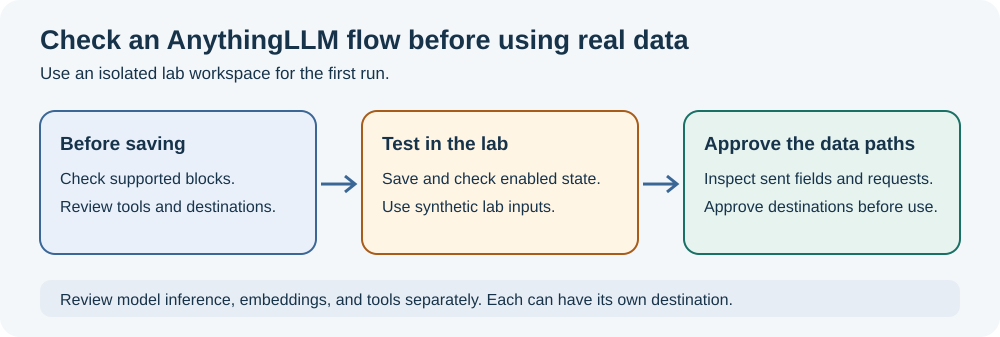

# 🧠 AnythingLLM Agentflow Documentation

<div align="center">

**Custom AgentFlow configurations for cybersecurity assessments, penetration testing, and security automation**

*Part of the [ULTIMATE CYBERSECURITY MASTER GUIDE](../../README.md)*


</div>

---

**Agent acceptance tests:** [Promptfoo security evaluation workflow](../llm-security-evaluation-promptfoo.md) covers synthetic data, tool permissions and instruction boundaries before connecting customer data.

## 🎯 Purpose
Index and configuration notes for nine documented AnythingLLM AgentFlows covering OSINT/recon, scan analysis, and vulnerability triage. [anything_llm_agentflows.md](anything_llm_agentflows.md) presents analyst-run sequences; it does not imply that one flow automatically invokes another.

## ⚙️ Function
A categorized catalog with purpose, provider-access notes, and links to the individual flow configuration guides. Block availability, syntax, provider access, and pricing can change; check your installed AnythingLLM version and current provider documentation before implementation.

## 🏆 Goal
Use the flow notes to build a synthetic-data lab, then decide which analyst-reviewed flow fits an authorized task.

## 📋 When To Use
- Setting up AnythingLLM AgentFlows for the first time (start here, then open the specific `flow-*.md`)
- Deciding which flow fits a given engagement phase (see "By Use Case" table)
- Troubleshooting a flow that isn't producing expected output (see "Common Issues & Solutions")

## Overview

This directory contains example configuration notes for AgentFlows used in authorized security work. They are not proof that a flow was run successfully against a live service; validate available blocks, provider settings, and data handling in your installed release.

---

## Available Flow Documentation

### 🔍 OSINT & Reconnaissance Flows

#### [Companyosint](flow-company_osint.md)
**Purpose:** Gathers public information about target companies  
**Outputs:** Email formats, employees, tech stack, social media presence  
**Use Cases:** Pre-engagement intelligence, company profiling  

#### [Domainrecon](flow-domain_recon.md)
**Purpose:** Performs comprehensive domain reconnaissance  
**Outputs:** Subdomains, DNS records, certificates, security posture  
**Use Cases:** Attack surface mapping, asset discovery  

#### [Emailosint](flow-email_osint.md)
**Purpose:** Investigates email addresses and usernames across platforms  
**Outputs:** Breach history, social media accounts, security awareness assessment  
**Use Cases:** Social engineering prep, breach verification  
**Requirements:** HaveIBeenPwned API key

#### [Githubsecrets](flow-github_secrets.md)
**Purpose:** Searches GitHub for exposed credentials and sensitive data  
**Outputs:** Exposed secrets, API keys, risk assessment  
**Use Cases:** Credential exposure detection, pre-engagement OSINT  

#### [Breachchecker](flow-breacher_check.md)
**Purpose:** Checks domains/emails against known data breaches  
**Outputs:** Breach history, exposed data types, risk analysis  
**Use Cases:** Domain-wide breach assessment, credential exposure  
**Requirements:** HaveIBeenPwned API key

---

### 🎯 Scanning & Analysis Flows

#### [Nmapanalyzer](flow-nmap_analyzer.md)
**Purpose:** Analyzes Nmap scan results and provides recommendations  
**Outputs:** Parsed findings table, prioritized risks, next steps  
**Use Cases:** Port scan analysis, vulnerability prioritization  

#### [Threatintelcheck](flow-threat_intel.md)
**Purpose:** Looks up IP/domain reputation through configured sources  
**Outputs:** A draft analyst aid; reputation data does not establish attribution or justify automatic blocking  
**Use Cases:** Scoped enrichment and incident investigation
**Requirements:** VirusTotal API key (recommended)

---

### 🔐 Vulnerability Management Flows

#### [CVELookup](flow-cve_lookup.md)
**Purpose:** Retrieves a matching NVD CVE API 2.0 record for analyst-led triage  
**Outputs:** Draft evidence-linked context and remediation questions; product applicability and fix status require vendor verification  
**Use Cases:** CVE research and vulnerability triage  

#### [Vulnreportgenerator](flow-vulnreport_gen.md)
**Purpose:** Creates professional vulnerability reports  
**Outputs:** Executive summary, technical findings, remediation steps  
**Use Cases:** Report writing, client deliverables  

---

## Quick Reference

### By Use Case

**Pre-Engagement Phase:**
1. CompanyOSINT
2. DomainRecon
3. EmailOSINT
4. GitHubSecrets
5. BreachChecker

**Active Testing Phase:**
1. NmapAnalyzer
2. ThreatIntelCheck
3. CVELookup

**Reporting Phase:**
1. VulnReportGenerator

### By Complexity

**Simple (3-4 blocks):**
- NmapAnalyzer
- CVELookup
- BreachChecker

**Medium (5-6 blocks):**
- GitHubSecrets
- ThreatIntelCheck
- EmailOSINT
- DomainRecon
- VulnReportGenerator

**Complex (6+ blocks):**
- CompanyOSINT

### Provider Access, Quotas, and Data Handling

Provider requirements depend on the specific endpoint and subscription:

- **Have I Been Pwned:** Authenticated account, paste, and domain-search operations require the documented headers; operation access varies by subscription. Domain search requires a verified domain. Check current [HIBP API documentation](https://haveibeenpwned.com/scalar/) before configuring a flow. Never put API keys in URLs, prompts, or exported flow definitions.
- **VirusTotal:** The Public API is limited to non-commercial use and is not permitted for business workflows that do not contribute new files. Its current public quota is 4 requests/minute and 500/day, but quotas and licensed capabilities can change. Do not use a public key for a business assessment; check [VirusTotal's current API terms and limits](https://docs.virustotal.com/reference/public-vs-premium-api) and obtain approved access for the intended use.
- **Other providers:** Review the provider's current terms, rate limits, retention, and permitted use. Before sending real data, confirm the destination is approved for that data class and minimize inputs.
## File Structure

```
/mnt/user-data/outputs/
├── anythingllm-workflow-examples.md    # Workflow combinations guide
├── flow-CompanyOSINT.md                # Company intelligence
├── flow-DomainRecon.md                 # Domain reconnaissance
├── flow-EmailOSINT.md                  # Email investigation
├── flow-GitHubSecrets.md               # GitHub credential scanning
├── flow-BreachChecker.md               # Breach verification
├── flow-NmapAnalyzer.md                # Nmap scan analysis
├── flow-ThreatIntelCheck.md            # IP/domain reputation
├── flow-CVELookup.md                   # CVE intelligence
├── flow-VulnReportGenerator.md         # Report generation
└── README-AgentFlows.md                # This file
```

---

## Repository Layout

- README.md — this flow catalog and setup notes
- anything_llm_agentflows.md — analyst-run sequence examples and handoff gates
- flow-*.md — individual flow configurations, assumptions, and source checks

The flow guides are stored beside this index in AI/AnythingLLM/; use the relative links above rather than copying files from an export or temporary directory.

---
## How To Use This Documentation



### For Recreation

1. Open the flow's guide and check whether your installed release supports its blocks.
2. Use a separate lab workspace with synthetic inputs. Review the enabled providers, tools, credentials, and destinations before creating the flow.
3. Configure only the blocks needed for the lab, with mock endpoints or approved test endpoints for external calls. Save the flow in the lab.
4. Check the saved flow's enabled state and test with synthetic input. Inspect the actual destinations and the fields that leave the instance before approving a real-data run.

The Flow Builder is available from the workspace's agent skills page. Available blocks can vary by version, and the current upstream guide says new flows are saved as enabled. Checking the flow's scope before saving keeps a draft from becoming available unexpectedly in a shared workspace. [AnythingLLM Flow Builder documentation](https://docs.anythingllm.com/agent-flows/getting-started)

Self-hosting places the application under your control. Model providers, embedding providers, and external tool destinations still need separate review. Check the data sent to each one and use only destinations approved for the input classification. [AnythingLLM embedding models](https://docs.anythingllm.com/features/embedding-models) · [AnythingLLM privacy and data handling](https://docs.anythingllm.com/features/privacy-and-data-handling)

### For Reference

- **Quick lookup** of flow configuration
- **Troubleshooting** common issues
- **API setup** instructions
- **Integration patterns** with other flows

### For Modification

- Each flow can be customized
- Add additional data sources
- Modify prompts for different output formats
- Chain with custom flows

---

## Common Issues & Solutions

### Variable Substitution
**Problem:** A flow block does not resolve an input  
**Solution:** Check the syntax documented for that block and your installed release; do not assume one variable format works in every field. Test using synthetic data and inspect the rendered request before using approved real data.

### API Authentication
**Problem:** 401/403 errors from APIs  
**Solution:** Verify API keys are correct and active

### Rate Limiting
**Problem:** A provider returns a quota or throttling response  
**Solution:** Check the current provider plan, limit, and permitted-use terms. Apply documented backoff; a throttled or empty response is not a negative finding.

### Web Scraping Failures
**Problem:** Scraping returns errors or empty data  
**Solution:** Check if site blocks bots, consider API alternatives

### Large Output Truncation
**Problem:** "Result too long, truncated"  
**Solution:** Enable content summarization, break into smaller queries

---

## Best Practices

### Flow Creation

1. **Start Simple** - Create a minimal flow and test it with synthetic data and approved or mocked destinations before expanding it
2. **Test Each Block** - Verify each block works before adding next
3. **Use Meaningful Names** - Clear variable and block names
4. **Document As You Go** - Note any customizations made
5. **Version Control** - Keep notes on flow versions and changes

### Flow Usage

1. **Verify Authorization** - Always have permission before scanning
2. **Respect Rate Limits** - Don't exceed API quotas
3. **Validate Results** - Cross-check critical findings
4. **Document Findings** - Keep records of all flows run
5. **Secure API Keys** - Never commit keys to repositories

### Integration

1. **Chain Flows Logically** - Follow reconnaissance → analysis → reporting
2. **Save Intermediate Outputs** - Useful for troubleshooting
3. **Batch Processing** - Batch only when scope, provider terms, data minimization, rate limits, and retention have been reviewed
4. **Automate Common Tasks** - Script repetitive flow usage

---

## Maintenance

### Regular Updates

- **Quarterly Review** - Check if APIs still work
- **Update API Keys** - Rotate keys as needed
- **Refresh Prompts** - Improve based on output quality
- **Add New Sources** - Incorporate new threat intel feeds

### Monitoring

- **Track Success Rate** - Note failed flows
- **Monitor API Quotas** - Avoid exhausting limits
- **Review Output Quality** - Ensure prompts still effective
- **User Feedback** - Improve based on actual usage

---

## Support & Resources

### Documentation
- Each flow .md file contains complete technical details
- Workflow examples: `anythingllm-workflow-examples.md`
- Usage patterns and best practices included

### External Resources
- **AnythingLLM Docs:** Check official documentation for updates
- **API Documentation:** Refer to provider docs for API changes
- **Security Communities:** OSINT forums, security subreddits

### Troubleshooting
- Check individual flow documentation "Troubleshooting" section
- Review "Known Issues" sections for common problems
- Test with example inputs provided in each flow doc

---

## Version Information

**Documentation Version:** 1.0  
**Reviewed:** 2026-11-24  
**Created By:** Pacific Northwest Computers  
**Purpose:** Complete AgentFlow recreation guide

---

## Contributing

### Adding New Flows

When creating new flows, document:
1. Flow purpose and use case
2. All variables with descriptions
3. Each block configuration with exact settings
4. Complete prompts and instructions
5. Usage examples
6. Integration patterns
7. Troubleshooting tips

### Updating Existing Flows

When modifying flows:
1. Update corresponding .md file
2. Note version changes
3. Document what changed and why
4. Update usage examples if needed
5. Test thoroughly before documenting

---

## License & Usage

**Purpose:** Internal use for cybersecurity assessments  
**Authorization:** Only use flows on authorized targets  
**Compliance:** Follow all applicable laws and regulations  
**Ethical Use:** Responsible disclosure of all findings

---

## Related Files
- [../README.md](../README.md) - AI section index
- [anything_llm_agentflows.md](anything_llm_agentflows.md) - Chained workflow examples using these flows
- [flow-breacher_check.md](flow-breacher_check.md) - Breach/credential leak checker flow
- [flow-company_osint.md](flow-company_osint.md) - Company OSINT automation flow
- [flow-cve_lookup.md](flow-cve_lookup.md) - CVE research and analysis flow
- [flow-domain_recon.md](flow-domain_recon.md) - Domain reconnaissance flow
- [flow-email_osint.md](flow-email_osint.md) - Email OSINT investigation flow
- [flow-nmap_analyzer.md](flow-nmap_analyzer.md) - Nmap output analysis flow
- [flow-threat_intel.md](flow-threat_intel.md) - Threat intelligence lookup flow
- [flow-vulnreport_gen.md](flow-vulnreport_gen.md) - Vulnerability report generation flow
- [../offline-llm.md](../offline-llm.md) - Offline LLM backend that AnythingLLM can use
