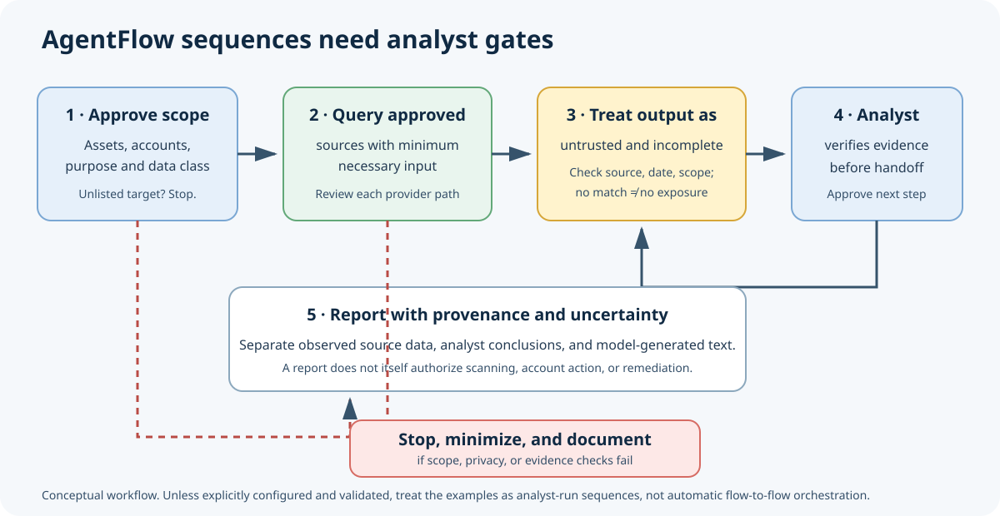

# AnythingLLM AgentFlow Workflow Examples

## 🎯 Purpose
Analyst-run examples for sequencing AnythingLLM AgentFlows during authorized security work. Each external query and active scan needs its own scope, privacy, and provider-use review.

## ⚙️ Function
Shows how an analyst may hand off minimized results between DomainRecon, authorized email or breach checks, threat-intelligence lookups, vulnerability research, and reporting. It does not assume automatic flow-to-flow execution.

## 🏆 Goal
Support repeatable analyst-reviewed workflows with explicit scope, source verification, provider disclosure review, and approval before consequential actions.

## 📋 When to Use
Planning an analyst-run sequence for an authorized assessment; deciding what data can pass between steps; identifying where a human must verify scope, privacy, and evidence.


## Overview

This document provides conceptual sequence examples. Unless you configure and validate a supported orchestration mechanism in your deployment, run each flow as a separate analyst-controlled step. Treat all API, web, scan, and model output as untrusted; verify its source and scope before using it as input to another flow.

### Available AgentFlows

The following custom AgentFlows are referenced in these workflows:

- **CompanyOSINT** - Gathers public information about target companies
- **DomainRecon** - Performs comprehensive domain reconnaissance
- **EmailOSINT** - Investigates email addresses and usernames across platforms
- **GitHubSecrets** - Searches GitHub for exposed credentials and sensitive data
- **BreachChecker** - Checks domains/emails against known data breaches
- **NmapAnalyzer** - Analyzes Nmap scan results and provides recommendations
- **CVELookup** - Retrieves CVE details and exploitability information
- **VulnReportGenerator** - Creates professional vulnerability reports
- **ThreatIntelCheck** - Checks IP/domain reputation against threat intelligence

---

## Common Workflow Patterns

### 1. Pre-Engagement OSINT

**Purpose:** Gather intelligence before active testing begins

**Workflow Steps:**
1. **CompanyOSINT** → Identify company structure, employee information, and email formats
   - Input: `company_name`, `domain`
2. **DomainRecon** → Map attack surface and discover subdomains
   - Input: `domain`
3. **EmailOSINT** → Investigate key personnel emails for breach history
   - Input: Key personnel emails from CompanyOSINT
4. **GitHubSecrets** → Search for exposed credentials and secrets
   - Input: `target_domain`
5. **BreachChecker** → Identify compromised accounts and leaked data
   - Input: `domain`

**Output:** A scoped collection of leads with source, retrieval time, gaps, and uncertainty; do not describe it as comprehensive.

---

### 2. Network Penetration Test

**Purpose:** Complete network security assessment workflow

**Workflow Steps:**
1. **Nmap Scan** - Scan only an explicitly authorized host and approved ports
   ```bash
   nmap -sV -p 22,80,443 AUTHORIZED_LAB_HOST -oN scan.txt
   # Replace the placeholder only with a host listed in the written scope; -sV sends probes.
   ```

2. **NmapAnalyzer** → Parse scan results and prioritize findings
   - Input: `scan_results` (from scan.txt), `target_info`

3. **CVELookup** → Research each identified CVE
   - Input: `cve_id`, `system_context`
   - Repeat for each CVE discovered

4. **VulnReportGenerator** → Document each finding professionally
   - Input: `finding_title`, `finding_details`, `affected_systems`, `client_name`
   - Repeat for each vulnerability

5. **Compile Final Report** - Aggregate all findings into deliverable

**Output:** Draft report for analyst verification, scope review, and approved release

---

### 3. Incident Response

**Purpose:** Rapid investigation of security incidents

**Workflow Steps:**
1. **ThreatIntelCheck** → Assess suspicious IP addresses
   - Input: Suspicious IP from logs/alerts

2. **DomainRecon** → Investigate attacker domains
   - Input: Attacker domain (if identified)

3. **EmailOSINT** → Research associated email addresses
   - Input: Email addresses from investigation

4. **BreachChecker** → Identify compromised accounts
   - Input: Domain or email addresses

**Output:** An incident investigation summary with corroborated indicators, scope, and uncertainty. A reputation match or model summary alone does not establish threat-actor attribution or impact.

---

## Quick Flow Combinations

### Analyst-Guided Vulnerability Triage
**Use Case:** Organize authorized scan evidence and prioritize questions for verification

```
Nmap Scan
    ↓
NmapAnalyzer (prioritize findings)
    ↓
CVELookup (research critical CVEs)
    ↓
VulnReportGenerator (document findings)
```

---

### Deep OSINT Package
**Use Case:** Comprehensive intelligence gathering

```
CompanyOSINT (company intelligence)
    ↓
EmailOSINT (key personnel investigation)
    ↓
GitHubSecrets (credential exposure)
    ↓
BreachChecker (breach history)
```

---

### Network Mapping
**Use Case:** Attack surface enumeration

```
DomainRecon (discover assets)
    ↓
Nmap Scan (active scanning)
    ↓
ThreatIntelCheck (verify IPs)
    ↓
NmapAnalyzer (analyze results)
```

---

### Report Generation Sprint
**Use Case:** Batch document multiple findings

```
All vulnerability findings
    ↓
VulnReportGenerator (repeat for each)
    ↓
VulnReportGenerator (repeat for each)
    ↓
VulnReportGenerator (repeat for each)
    ↓
Compile into final report
```

---

### General OSINT Assessment
**Use Case:** Standard reconnaissance workflow

**Workflow Steps:**
1. **CompanyOSINT** → Determine email format and company structure
2. **EmailOSINT** → Investigate key personnel emails for exposed data
3. **DomainRecon** → Map complete attack surface including subdomains
4. **GitHubSecrets** → Identify exposed credentials in public repositories

**Output:** A bounded report of collected leads, sources, uncertainties, and unsearched areas.

---

## Usage Notes

### Best Practices

- Confirm written scope and data-handling approval before each query or active scan; discovering a host or account does not authorize testing it.
- Use synthetic inputs in development and verify each provider destination, API permission, and quota before real-data use.
- Pass only the minimum necessary data between steps. Treat retrieved text and model output as untrusted and potentially incomplete.
- Preserve source URL, retrieval time, response status, and analyst verification; distinguish raw evidence from model-generated summary.
- Pause for analyst review when scope, consent, provider terms, or evidence is unclear. Require separate approval for blocking, account actions, remediation, or report release.
- Keep credentials in the deployment's supported secret store; do not commit keys or place them in prompts or URLs.

### Workflow Customization

These workflows can be:
- **Modified** to suit specific engagement types
- **Combined** for comprehensive assessments
- **Abbreviated** for time-sensitive tasks
- **Extended** with additional flows as needed

### Tips for Effective Use

1. **Start broad, narrow down** - Begin with OSINT, then focus on discovered assets
2. **Prioritize findings** - Use NmapAnalyzer and CVELookup to identify critical issues first
3. **Document continuously** - Run VulnReportGenerator for each finding immediately
4. **Verify results** - Cross-reference flow outputs with manual testing
5. **Iterate as needed** - Loop back through workflows when new information emerges

---

## Example Complete Engagement

**Scenario:** Illustrative external assessment of a fictional organization; replace placeholders only with assets and accounts listed in written scope.

### Phase 1: Reconnaissance (Week 1)
```
CompanyOSINT → company: Acme Corporation, domain: acme.com
DomainRecon → domain: acme.com
GitHubSecrets → target: acme.com
BreachChecker → domain: acme.com
EmailOSINT → emails discovered from CompanyOSINT
```

### Phase 2: Active Scanning (Week 2)
```
nmap -sV -p 22,80,443 AUTHORIZED_LAB_HOST -oN acme-scan.txt
# Run only against a host explicitly listed in the written scope; discovery does not grant scan permission.
NmapAnalyzer → scan_results: acme-scan.txt
ThreatIntelCheck → IPs discovered from scan
```

### Phase 3: Vulnerability Analysis (Week 2)
```
CVELookup → each CVE from NmapAnalyzer
Manual testing of discovered services
Additional targeted scans
```

### Phase 4: Reporting (Week 3)
```
VulnReportGenerator → each finding documented
Compile all outputs into final report
Executive summary creation
Client presentation preparation
```

---

**Document Version:** 1.1  
**Reviewed:** 2026-11-24  
**Author:** Pacific Northwest Computers  
**Purpose:** AnythingLLM AgentFlow workflow reference guide

## Related Files
- [README.md](README.md) - AnythingLLM AgentFlow documentation index
- [flow-domain_recon.md](flow-domain_recon.md) - First flow in the standard recon chain
- [flow-vulnreport_gen.md](flow-vulnreport_gen.md) - Final output flow for report generation
- [../ai_prompts.md](../ai_prompts.md) - Prompt patterns used within each flow

## Analyst-Gated Workflow Map

A sequence of flow examples is not automatically an orchestrated workflow. Unless a supported flow-to-flow mechanism is configured and tested in your release, invoke each step under analyst control. Recheck scope and provider disclosure at every handoff.



*Conceptual workflow; it does not show a live AnythingLLM deployment or a tested integration.*
