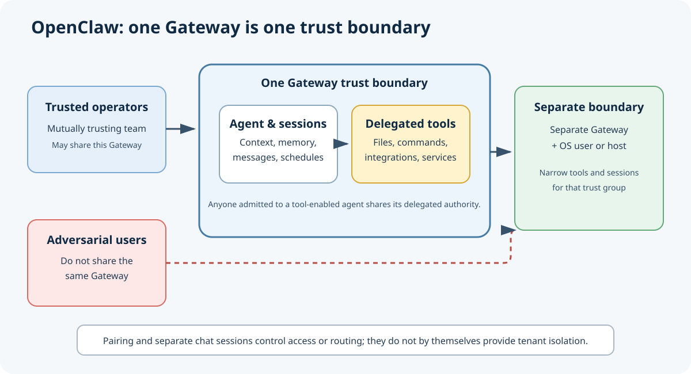
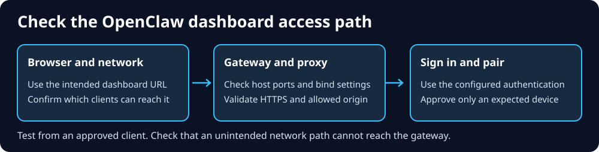

# 🦞 OpenClaw On Truenas Scale - Complete Setup Guide

<div align="center">

**Self-hosted AI agent framework with multi-provider LLM routing, homelab integration, and cybersecurity workflows**

*Part of the [ULTIMATE CYBERSECURITY MASTER GUIDE](../../README.md)*

> **Version context:** This is a tested deployment snapshot using OpenClaw 2026.4.15 and TrueNAS SCALE 25.04, not a current-version recommendation. Provider names, model IDs, app menus, and commands can change. Check [current OpenClaw releases](https://github.com/openclaw/openclaw/releases) and vendor documentation before applying the steps.


</div>

---

## 🎯 Purpose
Complete installation and configuration guide for deploying OpenClaw (a self-hosted, multi-provider AI agent framework) on TrueNAS SCALE, including known TrueNAS-Community-app-specific bugs and their workarounds. First of three companion OpenClaw guides - see [use_cases.md](use_cases.md) for prompt examples and [agent_skill_config.md](agent_skill_config.md) for ready-to-apply agent personas once this install is complete.

## ⚙️ Function
Eight parts covering app-catalog installation, the provider onboarding wizard (Anthropic/Gemini/Groq/Ollama), manual config fixes for wizard bugs (Groq model registration, Ollama API key), security hardening, NPMplus HTTPS reverse-proxy setup with local DNS override, and device pairing - followed by a troubleshooting section documenting specific failure modes and their exact fixes.

## 🏆 Goal
Get OpenClaw running on TrueNAS SCALE with all four LLM providers verified working, HTTPS access configured via NPMplus, and a paired device connected to the dashboard.

## 📋 When To Use
- First-time OpenClaw deployment on TrueNAS SCALE
- Diagnosing a specific OpenClaw/TrueNAS app failure (config service exit 1, WebSocket disconnects, provider not showing in `models list`) - check Troubleshooting first

## What Is OpenClaw?

OpenClaw is an open-source agent framework that you can self-host. Its Gateway can connect local or hosted models to the messaging channels, files, and services you configure; hosting the Gateway locally does not make every connected service local.

**What it can do:**
- Chat via Telegram, Discord, WhatsApp, Slack, Signal, and 50+ other platforms from a single agent
- With corresponding tools and permissions enabled, agents can read or write allowed files, run permitted commands, browse the web, and interact with configured services
- Connect to multiple AI providers simultaneously (Anthropic, Google, Groq, local Ollama models) and route tasks to the best/cheapest model automatically
- Remember context across sessions and schedule automated tasks with cron jobs
- Extend functionality with community-built skills (ClawHub) for homelab management, GitHub, Notion, media servers, and more
- Local Ollama inference is an option, but channels, hosted model routing or fallback, search, tools, plugins, telemetry, logs, and backups can still send data outside your network. Verify every configured data path before treating the deployment as local-only.

**Why self-host it?**
- Self-hosting can keep conversation data on your hardware when the model, channels, tools, logs, and storage paths also remain local; connected hosted services have their own data handling
- Compare current model availability, limits, pricing, retention and data-use terms for every provider; do not send sensitive engagement data to a hosted tier until its terms and approvals are checked
- Integrate with your existing homelab infrastructure
- Choose and constrain models, tools, and data paths; control still depends on the providers and services you connect

---

## Companion Documents
 
This repository includes three guides. Start here, then refer to the others once setup is complete:
 
| File | Description |
|------|-------------|
| **README.md** *(this file)* | Full installation and configuration guide for TrueNAS SCALE |
| **[use_cases.md](use_cases.md)** | Real-world example prompts organized by workflow - personal, IT support, blue team, red team, purple team, OSINT, and more |
| **[agent_skill_config.md](agent_skill_config.md)** | Pre-built agent personas, skill configurations, cron jobs, and automation setups ready to apply to your instance |

---

## Table Of Contents

- [Prerequisites](#prerequisites)
- [Part 1: Install OpenClaw from App Catalog](#part-1-install-openclaw-from-app-catalog)
- [Part 2: Run the Setup Wizard](#part-2-run-the-setup-wizard)
- [Part 3: Configure AI Providers](#part-3-configure-ai-providers)
- [Part 4: Verify All Providers](#part-4-verify-all-providers)
- [Part 5: Set Default Model and Tools Profile](#part-5-set-default-model-and-tools-profile)
- [Part 6: Security Hardening](#part-6-security-hardening)
- [Part 7: NPMplus Reverse Proxy with HTTPS](#part-7-npmplus-reverse-proxy-with-https)
- [Part 8: Device Pairing](#part-8-device-pairing)
- [Local Access Without HTTPS](#local-access-before-https)
- [Troubleshooting](#troubleshooting)
- [Reference: Key Commands](#reference-key-commands)

---

## Gateway Trust Boundary



OpenClaw documents one Gateway as a trust boundary: people who can message a tool-enabled agent share that agent's delegated authority. Do not put mutually untrusted or adversarial users behind the same Gateway and assume pairing or separate chat sessions isolate them. Use separate Gateways, and preferably separate OS users or hosts, for adversarial-user isolation. Restrict tools, session visibility, and agent-to-agent access for the trust model you actually need. See the current [OpenClaw security trust model](https://docs.openclaw.ai/gateway/security/trust-model).

---

## Prerequisites

- [TrueNAS SCALE](https://www.truenas.com/truenas-community-edition/) 25.04+
- [NPMplus](https://github.com/ZoeyVid/NPMplus) installed and running (for HTTPS reverse proxy)
- [OPNsense](https://opnsense.org/) or similar router
- A [DuckDNS](https://www.duckdns.org/) (or other [DDNS](https://github.com/cloudflare/cloudflare-docs/blob/production/src/content/docs/dns/manage-dns-records/how-to/managing-dynamic-ip-addresses.mdx)) domain pointed at your public IP
- [Ollama](https://ollama.com/) running somewhere on your network (optional, for local inference)
- provider credentials for Anthropic, Groq, Google Gemini and Ollama; availability, billing and data-use terms vary by account and change over time

---

## Part 1: Install OpenClaw From App Catalog

### 1.1 Find The App

Go to **Apps → Discover** in the TrueNAS UI and search for **OpenClaw** (Community train).

### 1.2 Generate A Gateway Token

Before installing, generate a strong random token:

```bash
openssl rand -hex 32
```

Save this token - you'll need it throughout setup and to connect to the dashboard.

### 1.3 Configuration Settings

Fill in the app installer form as follows:

**OpenClaw Configuration:**
| Field | Value |
|-------|-------|
| Authentication Mode | Shared bearer token (recommended) |
| Gateway Token | *(your generated token)* |
| Proxy Trusted Proxies | Your TrueNAS/NPMplus IP (e.g. `10.0.1.149`) |

**Network Configuration:**
| Field | Value |
|-------|-------|
| Port Bind Mode | Publish port on the host for access through a trusted LAN or HTTPS reverse proxy only; do not forward this port directly to the public internet |
| Port Number | `30262` |
| Host Network | Unchecked |

**User and Group Configuration:**
| Field | Value |
|-------|-------|
| User ID | `568` |
| Group ID | `568` |

**Storage Configuration:**

> Choose a storage type supported by the current TrueNAS app chart and your backup plan. This guide’s ixVolume setup reflects the tested deployment snapshot below; it is not a universal compatibility guarantee. Check current app documentation and release notes before changing storage. Back up the app configuration and persistent data before any migration, and do not delete/reinstall an app as a troubleshooting shortcut.

**Resources Configuration:**
| Field | Value |
|-------|-------|
| CPUs | `4` |
| Memory (MB) | `6144` |

### 1.4 Add Environment Variables

In the **Additional Environment Variables** section, add all provider API keys before installing:

| Name | Value |
|------|-------|
| `ANTHROPIC_API_KEY` | `sk-ant-...` |
| `GROQ_API_KEY` | `gsk_...` |
| `GEMINI_API_KEY` | `AIza...` |
| `OLLAMA_API_KEY` | `ollama-local` |
| `OLLAMA_BASE_URL` | `http://YOUR_OLLAMA_IP:11434` |

> **Note:** Use `OLLAMA_BASE_URL` - not `OLLAMA_HOST`. The `OLLAMA_HOST` variable is ignored by this version of OpenClaw.

Click **Install** and wait for the app to show as Running (green) in Apps → Installed.

---

## Part 2: Run The Setup Wizard

### 2.1 Anthropic

```bash
sudo docker exec -it ix-openclaw-openclaw-1 node /app/openclaw.mjs onboard --auth-choice anthropic
```

At each prompt:
- Security disclaimer → **Yes**
- Setup mode → **QuickStart**
- Config handling → **Use existing values**
- Channel setup → **Skip for now**

### 2.2 Google Gemini

```bash
sudo docker exec -it ix-openclaw-openclaw-1 node /app/openclaw.mjs onboard --auth-choice google
```

At each prompt:
- Security disclaimer → **Yes**
- Setup mode → **QuickStart**
- Config handling → **Use existing values**
- Use existing `GEMINI_API_KEY` → **Yes**
- Web search provider → **Gemini (Google Search)**
- Channel setup → **Skip for now**

### 2.3 Groq

```bash
sudo docker exec -it ix-openclaw-openclaw-1 node /app/openclaw.mjs onboard --auth-choice groq
```

At each prompt:
- Security disclaimer → **Yes**
- Setup mode → **QuickStart**
- Config handling → **Use existing values**
- Channel setup → **Skip for now**

> **Note:** The Groq wizard often completes without actually registering Groq models. If `models list` doesn't show Groq afterward, the manual fix in Part 3 is required.

### 2.4 Ollama

```bash
sudo docker exec -it ix-openclaw-openclaw-1 node /app/openclaw.mjs onboard --auth-choice ollama
```

At each prompt:
- Security disclaimer → **Yes**
- Setup mode → **QuickStart**
- Config handling → **Use existing values**
- Ollama mode → **Local only**
- Ollama base URL → `http://YOUR_OLLAMA_IP:11434` *(no `/v1` suffix)*
- Select a model from the discovered list
- Channel setup → **Skip for now**

---

## Part 3: Configure AI Providers

Provider setup and configuration schemas change between OpenClaw releases. Follow the [current provider documentation](https://docs.openclaw.ai/providers) for the installed version and use the TrueNAS app's supported environment-variable or secret fields for credentials. Never print keys in terminal output or commit them to configuration files.

### 3.1 Groq

OpenClaw's current [Groq provider guide](https://docs.openclaw.ai/providers/groq) documents an official provider plugin and model references. For this deployment, first check whether the installed app includes the provider and list what it recognizes:

```bash
sudo docker exec -it ix-openclaw-openclaw-1 node /app/openclaw.mjs models list --provider groq
```

If the provider is unavailable, follow the plugin installation steps for the installed OpenClaw release. Review and approve the plugin package/version as third-party executable code before installing it. Do not use the older manual JSON edits or assume that onboarding always adds a working provider. Check [Groq's current model list](https://console.groq.com/docs/models) and [deprecation notices](https://console.groq.com/docs/deprecations) before selecting an ID; the former `llama-3.3-70b-versatile` example in this guide has been retired.

### 3.2 Ollama

Use the current [OpenClaw Ollama provider guide](https://docs.openclaw.ai/providers/ollama) and [Ollama documentation](https://docs.ollama.com/) for the installed versions. Set the service URL through the supported app/provider configuration, and verify reachability from the OpenClaw container's network namespace. Do not expose Ollama's API broadly: allow only the gateway host or required container network.

### 3.3 Model access

Use the provider's current model-discovery command and inspect the installed OpenClaw configuration schema before changing an allowlist or model reference. A model appearing in an upstream provider catalog does not prove that the installed app, account, plugin, or plan can use it.

---
## Part 4: Verify All Providers

Restart the app only if the installed version's instructions require it, then inspect the providers and models available to this specific deployment:

```bash
sudo docker exec -it ix-openclaw-openclaw-1 node /app/openclaw.mjs models list
sudo docker exec -it ix-openclaw-openclaw-1 node /app/openclaw.mjs models list --provider groq
```

Output differs by OpenClaw release, installed plugins, account entitlements and provider catalog. Confirm the exact model reference, context limit and authentication status from the installed CLI and current provider documentation. Send a harmless test prompt, verify which provider handled it, and check usage/billing. Do not copy model IDs or context windows from old screenshots or examples as guaranteed values.

---

<a id="part-5-set-default-model-and-tools-profile"></a>
## Part 5: Set Default Model & Tools Profile

To set a default, first confirm the exact model reference in your installed model list and the current [Groq provider documentation](https://docs.openclaw.ai/providers/groq). The documented example at review time is `groq/openai/gpt-oss-120b`; model availability and pricing can change, so re-check before using it.

```bash
sudo docker exec -it ix-openclaw-openclaw-1 node /app/openclaw.mjs config set agents.defaults.model.primary "groq/openai/gpt-oss-120b"
```

Set the tools profile. Valid values are `minimal`, `coding`, `messaging`, or `full`:

```bash
sudo docker exec -it ix-openclaw-openclaw-1 node /app/openclaw.mjs config set tools.profile minimal
# Keep the minimal profile unless a specific task requires additional tools; enable only the narrow capabilities needed.
```

---

## Part 6: Security Hardening

Run the built-in security audit:

```bash
sudo docker exec -it ix-openclaw-openclaw-1 node /app/openclaw.mjs security audit
```

Fix the flagged issues:

```bash
# Add rate limiting against brute force attacks
sudo docker exec -it ix-openclaw-openclaw-1 node /app/openclaw.mjs config set gateway.auth.rateLimit '{"maxAttempts":10,"windowMs":60000,"lockoutMs":300000}'

# Lock down allowed origins to your HTTPS domain and local IP
sudo docker exec -it ix-openclaw-openclaw-1 node /app/openclaw.mjs config set gateway.controlUi.allowedOrigins '["https://openclaw.yourdomain.duckdns.org"]'
```

Restart the app from the TrueNAS UI to apply changes.

---

## Part 7: Npmplus Reverse Proxy With HTTPS

### 7.1 Create A Proxy Host

In the NPMplus UI go to **Hosts → Proxy Hosts → Add Proxy Host**.

**Details tab:**
| Field | Value |
|-------|-------|
| Domain Name | `openclaw.yourdomain.duckdns.org` |
| Scheme | `http` |
| Forward Hostname/IP | Your TrueNAS IP |
| Forward Port | `30262` |

Keep this backend port blocked from direct public internet access; allow access only from the trusted reverse proxy or an explicitly trusted LAN.

Click the **gear icon ⚙️** next to Forward Port and paste this into the advanced config box:

```nginx
proxy_http_version 1.1;
proxy_set_header Upgrade $http_upgrade;
proxy_set_header Connection "upgrade";
proxy_set_header Host $host;
proxy_set_header X-Real-IP $remote_addr;
proxy_set_header X-Forwarded-For $proxy_add_x_forwarded_for;
proxy_set_header X-Forwarded-Proto $scheme;
more_clear_headers Alt-Svc;
proxy_read_timeout 3600s;
proxy_send_timeout 3600s;
proxy_connect_timeout 60s;
```

> ⚠️ The `proxy_http_version 1.1` line is critical. WebSockets require HTTP/1.1 and will fail silently with HTTP/2 or HTTP/3.

**TLS tab:**
| Field | Value |
|-------|-------|
| TLS Certificate | Request a new Certificate |
| Force HTTPS | ✅ Enabled |
| HTTP/2 Support | ❌ Disabled |
| HTTP/3 Support | ❌ Disabled |
| Use DNS Challenge | ✅ Enabled (required for DuckDNS) |

Enable **Use DNS Challenge** and enter your DuckDNS token from `https://www.duckdns.org`.

### 7.2 Local DNS Override (Opnsense Unbound)

To access the HTTPS domain locally without hairpin NAT issues, add a host override in OPNsense:

Go to **Services → Unbound DNS → Host Overrides → +** and add:

| Field | Value |
|-------|-------|
| Host | `openclaw` |
| Domain | `yourdomain.duckdns.org` |
| Type | `A (IPv4 address)` |
| IP address | Your TrueNAS IP (e.g. `10.0.1.149`) |

Save and apply Unbound. Verify:

```bash
nslookup openclaw.yourdomain.duckdns.org YOUR_OPNSENSE_IP
```

Should return your TrueNAS LAN IP, not your public WAN IP. Add overrides for all your other NPMplus proxy hosts using the same pattern.

### 7.3 Port Forwarding

Forward external ports 80 and 443 from your router WAN to NPMplus on your TrueNAS. Confirm NPMplus port mappings:

```bash
sudo docker ps | grep npmplus
```

---

## Part 8: Device Pairing

### 8.1 Access The Web Ui

Open `https://openclaw.yourdomain.duckdns.org` in your browser.

### 8.2 Connect To The Gateway

On the Gateway Dashboard enter:
- **WebSocket URL:** `wss://openclaw.yourdomain.duckdns.org`
- **Gateway Token:** *(your token from Part 1)*

Click **Connect**. The dashboard will show "pairing required".

### 8.3 Approve The Pairing Request

```bash
# List pending pairing requests
sudo docker exec -it ix-openclaw-openclaw-1 node /app/openclaw.mjs devices list

# Approve using the Request UUID from the output
sudo docker exec -it ix-openclaw-openclaw-1 node /app/openclaw.mjs devices approve YOUR-REQUEST-UUID
```

You are now connected to the OpenClaw dashboard.

---

## Local Access Before HTTPS



Limit initial access to the intended trusted clients. Review both the Gateway's bind address and the TrueNAS application's published host ports. A container listener and its host exposure are separate settings. [OpenClaw network-exposure documentation](https://docs.openclaw.ai/gateway/security/network-exposure) Do not enable Chrome’s insecure-origin override or place the gateway token in an HTTP URL. Use the HTTPS reverse proxy after certificate and origin checks are configured; if HTTPS is unavailable, access only through a trusted local tunnel and keep the token in the app’s supported secure configuration.

---

## Troubleshooting

### App Fails To Start

Inspect the app's lifecycle logs and current TrueNAS chart/OpenClaw release notes first. App startup failures can have several causes; do not infer a storage bug from the error alone. Before changing storage or reinstalling, export/backup the configuration and persistent data, confirm a restorable backup, and follow current vendor guidance.

### App Fails To Start After Editing Config File

The config file has invalid JSON or failed schema validation.

**Fix:** Restore from the automatic backup OpenClaw creates before every edit:

```bash
# Find the config file
sudo find /mnt/.ix-apps -name "openclaw.json" 2>/dev/null

# Restore from backup
sudo cp /mnt/.ix-apps/app_mounts/openclaw/config/.openclaw/openclaw.json.bak \
        /mnt/.ix-apps/app_mounts/openclaw/config/.openclaw/openclaw.json

# Validate
sudo python3 -c "import json; json.load(open('/mnt/.ix-apps/app_mounts/openclaw/config/.openclaw/openclaw.json')); print('Valid')"
```

Then start the app from the TrueNAS UI.

### Provider Configuration Fails

Configuration keys and provider schemas vary by OpenClaw version and packaged app. Use the current provider guide and installed CLI help, back up the configuration, change one setting at a time, then run the built-in security/configuration checks. A valid JSON file alone does not establish schema or runtime validity.

### Ollama Cannot Be Reached

Check the configured Ollama address from the OpenClaw container's network namespace and confirm that the Ollama service allows only the required network path. Container-local `localhost` refers to the container itself. Use currently supported provider settings for the installed version; do not assume an environment variable name from another release.

### Websocket Disconnected (1006) Through Npmplus

HTTP/2 or HTTP/3 is being negotiated, which breaks WebSocket upgrades.

**Fix:** Ensure `proxy_http_version 1.1` is in the NPMplus advanced config, and that HTTP/2 and HTTP/3 are disabled in the TLS tab. Also ensure your Unbound DNS override is resolving the domain to your local TrueNAS IP - if the domain resolves to your WAN IP, traffic hairpins through NAT and the connection fails.

### Certificate Request Fails With Internal Error In Npmplus

Port 80 is not accessible from the internet for the HTTP-01 ACME challenge.

**Fix:** Use the **DNS Challenge** option in NPMplus TLS settings with your DuckDNS token.

### `devices list` Fails With Gateway Closed (1006)

The gateway process isn't running inside the container.

**Fix:**

```bash
sudo docker exec -d ix-openclaw-openclaw-1 node /app/openclaw.mjs gateway run
```

Wait a few seconds then retry `devices list`.

---

## Reference: Key Commands

```bash
# Check running containers
sudo docker ps | grep openclaw

# View all configured models
sudo docker exec -it ix-openclaw-openclaw-1 node /app/openclaw.mjs models list

# Get a config value
sudo docker exec -it ix-openclaw-openclaw-1 node /app/openclaw.mjs config get gateway.port

# Set a simple config value
sudo docker exec -it ix-openclaw-openclaw-1 node /app/openclaw.mjs config set KEY VALUE

# Run security audit
sudo docker exec -it ix-openclaw-openclaw-1 node /app/openclaw.mjs security audit

# List paired devices
sudo docker exec -it ix-openclaw-openclaw-1 node /app/openclaw.mjs devices list

# Approve a device pairing
sudo docker exec -it ix-openclaw-openclaw-1 node /app/openclaw.mjs devices approve UUID

# View raw config file
sudo cat /mnt/.ix-apps/app_mounts/openclaw/config/.openclaw/openclaw.json

# Validate config JSON
sudo python3 -c "import json; json.load(open('/mnt/.ix-apps/app_mounts/openclaw/config/.openclaw/openclaw.json')); print('Valid')"

# Restore config from backup
sudo cp /mnt/.ix-apps/app_mounts/openclaw/config/.openclaw/openclaw.json.bak \
        /mnt/.ix-apps/app_mounts/openclaw/config/.openclaw/openclaw.json

# View app lifecycle logs
sudo grep openclaw /var/log/app_lifecycle.log | tail -n 20

# Check environment variables in container
sudo docker exec -it ix-openclaw-openclaw-1 env | grep -E "GROQ|GEMINI|OLLAMA|ANTHROPIC"

# View container logs
sudo docker logs ix-openclaw-openclaw-1 2>&1 | tail -n 30
```

---

## Provider Selection and Cost Controls

| Option | Evaluate before use |
|---|---|
| Hosted provider | Current per-model prices, rate limits, retention/training terms, region, account eligibility and fallback behavior |
| Local Ollama | Hardware and electricity cost, model license, actual performance, telemetry and whether every integration remains local |
| Automatic routing | Which model receives each request, privacy boundaries, budget caps, fallback behavior and how routing decisions are logged |

Check official current [Groq pricing and limits](https://console.groq.com/docs/rate-limits), [Gemini API pricing and data-use terms](https://ai.google.dev/gemini-api/docs/pricing), and [Anthropic pricing](https://www.anthropic.com/pricing). No-cost tiers can have strict quotas or different data-use terms; do not treat “free” as a privacy control. Verify account usage limits and cost alerts before enabling hosted providers.

## Operational Engineering & Safe Integration Path

After basic installation, treat this Gateway as a **tool-using production application**, not only a chat interface. Use these independent procedures before connecting sensitive accounts or enabling automatic actions:

| Next Capability | Practical Guide | Gate Before Enabling |
|---|---|---|
| Durable notes and session recovery | [Context Engineering](../context-engineering-and-memory.md) · [Notes & Hooks](../notes-hooks-and-automation.md) | Approved project records load correctly; stale context is detected |
| Tool/MCP integrations | [MCP & Permissions](../mcp-tooling-and-permissions.md) | Server identity, scopes, tenant ACLs and denied-call tests |
| Agent workflows | [Orchestration](../multi-agent-orchestration.md) · [Reliability](../agent-reliability-and-recovery.md) | One owner for each write, idempotency, bounded retries and rollback |
| Model/provider routing | [Model Routing & Cost](../model-routing-and-cost-management.md) | Privacy-compliant fallback and measured quality/cost |
| Alert or ticket automation | [Security Operations](../ai-security-operations-workflows.md) | Synthetic events, authenticated ingress and human review |
| Security hardening | [Agent Threat Model](../agent-threat-modeling-and-security.md) | Least privilege, secrets isolation and prompt-injection tests |
| Operations & evaluation | [Observability](../ai-observability-and-auditing.md) · [Evaluations](../ai-evaluation-and-regression-testing.md) | Sanitized traces, real test results, release approval |

The OpenClaw guides contain historical, environment-specific commands. **Inspect your installed version and official CLI/configuration schema before applying them**; a successful JSON parse alone cannot prove a configuration is supported. Neither OpenClaw nor a local Ollama backend automatically ensures that every tool, logger or fallback is offline.

## Next Steps

- **Set up Telegram** for mobile access from anywhere:
  ```bash
  sudo docker exec -it ix-openclaw-openclaw-1 node /app/openclaw.mjs onboard --auth-choice telegram
  ```
- **Install the TrueNAS skill** from ClawHub to manage your homelab via OpenClaw
- **Rotate your API keys** - Groq and Gemini keys were visible in shell history during initial setup
- **Run periodic health checks:**
  ```bash
  sudo docker exec -it ix-openclaw-openclaw-1 node /app/openclaw.mjs security audit
  ```

---

*Deployment snapshot tested at the time: TrueNAS SCALE 25.04 · Dell R630 · OPNsense · NPMplus · Ollama · OpenClaw 2026.4.15. This historical snapshot does not guarantee compatibility with current releases.*

## Related Files
- [../README.md](../README.md) - AI section index
- [use_cases.md](use_cases.md) - 50+ ready-to-use OpenClaw prompts for security workflows
- [agent_skill_config.md](agent_skill_config.md) - Pre-built agent personas and skill configs
- [../offline-llm.md](../offline-llm.md) - Setting up the Ollama backend that OpenClaw routes to
- [../../Homelab/HomeLab_Setup.md](../../Homelab/HomeLab_Setup.md) - TrueNAS SCALE homelab context where OpenClaw runs
