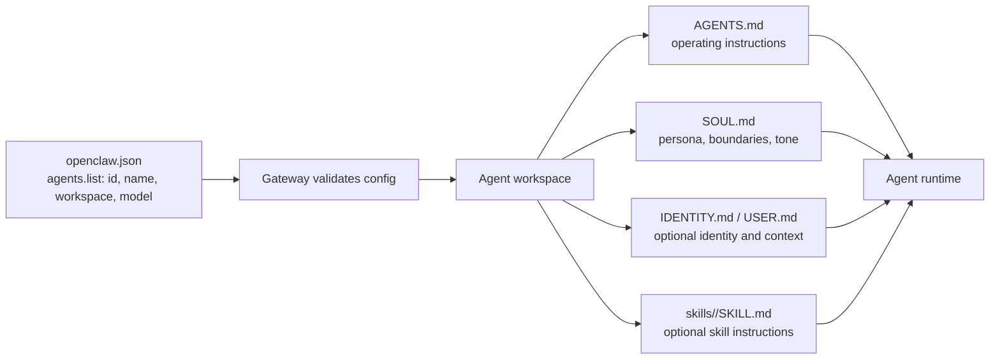

# OpenClaw Agent Configurations & Skill Setups

Examples for organizing role-specific agents and workspace instructions for the OpenClaw **2026.4.15** snapshot described in [README.md](README.md). Check the release notes and live config schema before adapting these examples to another version.

> [!CAUTION]
> The former Python snippets in this guide wrote unsupported per-agent keys such as `persona`, `model.fallback`, `model.thinking`, `tools.profile`, and `memory.contextWindow`. They could produce a config that the gateway rejects. Those snippets have been removed. Use the supported agent list and workspace files below, and validate the final configuration before restarting.

## How agent setup is split

The JSON config registers each agent and its workspace. The workspace files provide operating instructions, persona, identity, and optional memory. They are separate inputs and should not be nested under an invented `persona` key.



## Add an agent

For the documented OpenClaw version, use the agent command to create an isolated agent and its workspace:

```bash
openclaw agents add blue-team
openclaw agents list
```

The setup command manages the supported fields and directories. To register an agent in JSON manually, the versioned schema uses `agents.list`:

```json5
{
  agents: {
    list: [
      {
        id: "blue-team",
        name: "Blue Team Analyst",
        workspace: "~/.openclaw/workspace-blue-team",
        model: "anthropic/claude-opus-4-7",
      },
    ],
  },
}
```

Use a model ID that your gateway has configured. The `model` value here is a model reference string; fallback chains belong to the supported defaults model configuration and use a `fallbacks` array. Do not add a `thinking` model field. Agent workspaces are working directories, not security sandboxes; configure sandboxing separately when the agent handles untrusted content.

After creating the workspace, put role-specific guidance in its files. Example `SOUL.md`:

```markdown
# Blue Team Analyst

You assist with defensive security analysis, threat hunting, incident response,
and security control validation.

## Working rules

- Separate confirmed facts, hypotheses, and unknowns.
- State confidence and identify the evidence behind conclusions.
- For an active incident, prioritize safe containment and evidence preservation.
- Map findings to MITRE ATT&CK when useful, and verify technique identifiers.
- Keep actions within the written authorization and scope.
```

Use `AGENTS.md` for operating instructions that apply to the workspace, and `IDENTITY.md` or `USER.md` for optional agent name and user context. Treat workspace files as instructions, not as a substitute for tool restrictions or sandboxing.

## Role ideas

Create separate workspaces when you need distinct context or session history. These role descriptions are starting points for each workspace's `SOUL.md`:

| Agent ID | Focus | Suggested workspace |
|---|---|---|
| `field-tech` | Concise, practical IT troubleshooting and client-friendly explanations | `~/.openclaw/workspace-field-tech` |
| `blue-team` | Defensive analysis, detection, incident response, evidence handling | `~/.openclaw/workspace-blue-team` |
| `red-team` | Authorized assessment planning, safe validation, evidence and reporting | `~/.openclaw/workspace-red-team` |
| `osint` | Source evaluation, privacy-aware research, attribution limits | `~/.openclaw/workspace-osint` |
| `biz-ops` | Scheduling, client communication, service documentation | `~/.openclaw/workspace-biz-ops` |
| `homelab` | Infrastructure operations, change control, backup and recovery | `~/.openclaw/workspace-homelab` |

Register additional agents through `openclaw agents add <id>`, then adjust each generated workspace and supported model setting. Verify routing and bindings with the version's CLI help and [multi-agent documentation](https://docs.openclaw.ai/concepts/multi-agent).

## Skills

OpenClaw skills are workspace or shared-directory packages, not arbitrary per-agent JSON objects. A skill is described by a `SKILL.md` file in a skill directory. Follow the [official skills guide](https://docs.openclaw.ai/tools/skills) for discovery, eligibility, and security rules. Review third-party skill contents before enabling them; a skill can direct an agent to use powerful tools.

Useful skill ideas for this repo's workflows include:

- Daily security digest that summarizes trusted sources and links to originals.
- Incident intake that collects timestamps, affected systems, and evidence locations.
- Report drafting from analyst-provided findings, with factual claims left attributable.
- Ticket triage that requests missing diagnostic details before recommending changes.
- Homelab health summary that reports state without making unapproved changes.

Do not paste these ideas into `openclaw.json` as a `skills` config object. Implement a skill using the supported directory and frontmatter format for the installed release.

## Scheduled work

Use the OpenClaw cron command and its version-specific help to create, inspect, and remove scheduled jobs:

```bash
openclaw cron --help
openclaw cron list
```

Keep scheduled agents read-only by default. Restrict destinations, avoid sending sensitive logs to external services, and require human review before a job changes systems or sends messages.

## Verify before use

```bash
openclaw agents list
openclaw cron list
openclaw doctor
```

Check the live configuration schema and CLI help for the installed release before applying edits. Back up the config first, validate after changes, and make changes through the supported CLI or Control UI where available. Do not use a plain JSON parse as proof of schema validity.

## Related files

- [README.md](README.md) — TrueNAS SCALE installation snapshot and version context
- [use_cases.md](use_cases.md) — example prompts and workflows
- [../ai_prompts.md](../ai_prompts.md) — prompt patterns
- [../README.md](../README.md) — AI section index

*This guide describes OpenClaw 2026.4.15. Commands, configuration schema, models, and skill loading behavior may differ in later releases.*
