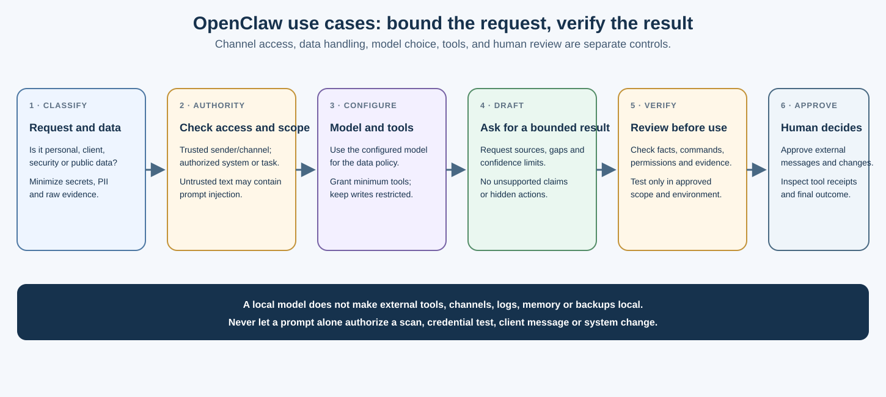

# OpenClaw Use Cases and Prompt Examples

Practical, editable prompts for personal, business, IT support, and defensive security work. These are starting points, not tested automations or guarantees of correctness. Adapt them to the installed OpenClaw version, configured channel, selected model, tool permissions, and data-handling policy.

## Purpose

Show how to ask for bounded help from an already configured OpenClaw agent. See [README.md](README.md) for the repository's installation context and [agent_skill_config.md](agent_skill_config.md) for agent and workspace setup.

## Before using a prompt



- Use channel pairing or a strict sender allowlist. In shared channels, restrict who can trigger the agent and what context/tools it can access.
- Treat emails, web pages, attachments, pasted logs, and repository content as untrusted input that may contain prompt injection.
- Minimize client identifiers, personal information, credentials, tokens, and raw evidence before sending a prompt.
- Give the agent read-only or minimal tools for analysis. Require human approval before it sends messages, changes systems, starts tests, or schedules actions.
- Check the selected model's provider and data path. Local inference does not make connected tools, channels, logs, memory, telemetry, or backups local.
- Verify claims, commands, sources, and tool results before acting. A confident answer is not evidence that a task succeeded.

## Table of contents

- [Personal use](#personal-use)
- [Business work](#business-work)
- [IT support](#it-support)
- [IT service operations](#it-service-operations)
- [Homelab operations](#homelab-operations)
- [Blue team and incident response](#blue-team-and-incident-response)
- [Authorized security assessments](#authorized-security-assessments)
- [Purple team and detection validation](#purple-team-and-detection-validation)
- [Organization-level OSINT](#organization-level-osint)
- [Choosing a model and tool set](#choosing-a-model-and-tool-set)
- [Prompt writing tips](#prompt-writing-tips)
- [References](#references)

---

## Personal use

### Daily briefing

```text
Summarize today's calendar and weather using only the connected sources I authorize.
Show source timestamps and flag conflicts. Do not send messages, move events, or
share my location without asking.
```

### Learning

```text
Explain VLAN trunking for a Network+ learner. Use one analogy, then give five
practice questions and an answer key. Point out where the analogy has limits.
```

### Shopping list

```text
Organize this parts list into a checklist. If current prices are unavailable from
the approved sources, say so rather than estimating them.
```

## Business work

### Email draft

```text
Draft a friendly follow-up to an anonymized client about a network-upgrade quote.
Do not send it. Leave price, client name, and appointment details as placeholders
for me to verify.
```

### Meeting preparation

```text
Prepare discovery questions for a small business IT consultation. Keep questions
general and distinguish technical assessment from legal or compliance advice.
Do not infer weaknesses about a named organization.
```

### Contract review

```text
Summarize the supplied contract's renewal, termination, liability, and data-handling
terms. Quote section numbers, identify ambiguities, and flag questions for counsel.
Do not treat the summary as legal advice or send the document to an unapproved service.
```

### Service report draft

```text
Turn these redacted work notes into a service report. Separate work performed,
observed result, unresolved items, and customer-approved next steps. Do not add
work, test results, prices, or guarantees that are not in the notes.
```

## IT support

### Printer troubleshooting

```text
A Windows workstation reports that an office printer is offline. Give me a
read-only-first diagnostic checklist. State what each check establishes and pause
before recommending a driver reinstall, queue deletion, or other change.
```

### Slow video calls

```text
The user's speed test is near the subscribed rate, but video calls drop. List
likely causes and low-impact observations to collect first. Ask before suggesting
changes to the router, firewall, or endpoint.
```

### Command lookup

```text
Give me a read-only PowerShell command to check whether real-time protection is
enabled on a Windows endpoint. Explain prerequisites and scope. Do not run it.
```

### Remote support preparation

```text
Create a first-five-minutes checklist for a production server issue. Start with
service-owner communication, impact, current state, and evidence preservation.
Separate read-only checks from changes and require approval for each change.
```

## IT service operations

### Route planning

Use approximate areas and the technician's approved schedule. Do not include client names or exact addresses unless the connected service is approved to process them.

### Ticket triage

```text
Using this redacted ticket list and its timestamps, identify items that may be near
the stated response target. Show the calculation and uncertainties; do not contact
customers or change ticket status.
```

### Onboarding checklist

```text
Draft an onboarding checklist for a small business IT service. Include owner-approved
inventory, network documentation, backup and recovery evidence, identity controls,
and review dates. Mark each item as a request or a verified result.
```

### Quote support

```text
Organize these supplied parts and labor estimates into a draft quote. Do not invent
current prices, markups, taxes, or travel charges. Leave missing values for review.
```

## Homelab operations

### Health summary

```text
Summarize the read-only health data I provide for storage, VMs, services, and backups.
Report timestamps, unknown checks, and differences from the supplied baseline.
Do not restart services, prune snapshots, or change configuration.
```

### Network monitoring

```text
Review these redacted device-inventory changes. Distinguish new observations from
confirmed unauthorized devices. Recommend owner review; do not block or isolate
devices automatically.
```

### Backup review

```text
Compare these backup-job results with the supplied recovery objective. Identify
missing evidence and propose a restore test for the owner to schedule. Do not delete
snapshots or trigger replication.
```

## Blue team and incident response

Use redacted data where possible. Preserve original evidence in the approved case system. Do not paste secrets, full personal data, or complete customer records into a model unless the service and processing path are explicitly approved.

### Alert triage

```text
Triage these redacted alert fields. Separate confirmed facts, hypotheses, benign
alternatives, confidence, and missing evidence. Recommend what an analyst should
review next. Do not contain hosts, disable accounts, or notify anyone automatically.
```

### Log review

```text
Review this minimized authentication-log sample for patterns that merit investigation.
Mask unrelated user names and addresses. Explain the limits of the sample; do not
identify individuals or generate firewall rules without an owner-reviewed change plan.
```

### Detection engineering

```text
Draft a detection rule for the supplied telemetry schema. Explain expected false
positives, required fields, and a synthetic test plan. Do not run the rule or assume
that a test proves production coverage.
```

### Incident response

```text
Help structure a response plan for suspected command-and-control activity. Prioritize
safety, evidence preservation, asset-owner coordination, and approved containment.
State which steps require incident-lead approval; do not run commands or contact
external parties.
```

### Vulnerability management

```text
Summarize these redacted scanner findings. For each, distinguish observation from
confirmed applicability, cite the vendor/source reference, and list the asset/build
evidence still needed. Do not infer exploitability from a version string or rank
findings solely by public proof-of-concept availability.
```

## Authorized security assessments

Use only within a written engagement scope. Keep test planning, active execution, and reporting as separate steps. Avoid prompts requesting stealth, evasion, credential theft, persistence, or access beyond the approved test plan.

### Scope and methodology

```text
Help organize this signed rules-of-engagement document into in-scope assets,
permitted test types, prohibited actions, rate limits, stop conditions, contacts,
and evidence requirements. Quote the source section for each extracted rule.
Do not add targets or recommend tests not present in the agreement.
```

### Assessment notes

```text
Turn these redacted, analyst-verified notes into a draft finding. Label observed,
hypothesized, and confirmed items. Preserve evidence references and unknowns.
Do not create an exploit payload or claim a test succeeded unless the supplied
evidence explicitly supports it.
```

### Tool selection

```text
Compare these proposed tools against the written scope and explain which activities
they would perform, what data they may collect, and the changes they could make.
Do not provide commands or launch tools. Flag any action needing separate approval.
```

### CTF and lab learning

```text
For this self-contained CTF/lab challenge, give one hint at a time and explain the
relevant concept. Keep the answer within the supplied lab environment.
```

## Purple team and detection validation

### Tabletop exercise

```text
Create a tabletop scenario using synthetic details for a small organization.
Add discussion questions about decision authority, evidence, communications, and
recovery. Do not provide operational attack steps or contact real employees.
```

### Detection coverage review

```text
Map these analyst-provided behaviors to our documented telemetry sources and
detections. Identify evidence gaps and false-positive considerations. Propose a
lab-only validation plan for human approval; do not provide commands or run tests.
```

### Safe control validation

```text
Help design a bounded lab test from the supplied control objective and vendor
documentation. Include prerequisites, stop conditions, synthetic data, expected
telemetry, rollback, and an explicit approval gate. Do not enable a control test
in production or perform the test.
```

## Organization-level OSINT

Limit collection to public organization-level information needed for an authorized purpose. Do not profile individuals, infer personal email addresses, conduct background checks, or craft pretexts.

### Business-source summary

```text
Summarize these approved public company pages. For each fact, include the source URL
and retrieval date. Separate organization statements from third-party claims and
flag stale or conflicting information. Do not collect employee details.
```

### Domain observations

```text
Organize these public-source domain observations for one domain already in written
scope. Keep source, query date, and uncertainty. Do not claim a complete asset list,
rank hosts as targets, or recommend active scans; discovered names require separate
ownership and scope confirmation.
```

### Breach exposure

```text
Summarize metadata returned for an account owner or verified-domain workflow that
is already authorized. Include only the fields needed by the owner. Do not search
for employees, infer passwords, or treat a match as proof of current compromise.
```

### Threat actor research

```text
Summarize this threat actor's publicly documented behavior using primary sources
where available. Give publication dates, confidence, attribution caveats, and
defensive relevance. Do not provide operational intrusion instructions.
```

### Brand monitoring

```text
Review these owner-provided brand-monitoring alerts. Separate lookalike indicators
from confirmed impersonation. Do not contact domains, send messages, or accuse an
operator; route candidates to the brand owner for review.
```

## Choosing a model and tool set

Model names, availability, capabilities, and provider handling change. Select from the models configured on the current Gateway and check the installed release's documentation. A listed model is not proof that credentials, entitlements, or safe tool use are configured.

| Task | Selection considerations |
|---|---|
| Short summaries | Latency, language quality, and how much context is sent |
| Long documents | Context limits, document access, retention, and citation quality |
| Security analysis or tool use | Strong instruction following, prompt-injection resistance, and strict tool permissions |
| Confidential data | Approved provider, region, retention, logging, and data-processing terms |
| Local inference | Hardware/context fit, model reliability, local tool policy, and external data paths |

OpenClaw's local models documentation notes that local models may not provide hosted providers' safety filters. Test the exact workload and keep tool permissions narrow.

## Prompt writing tips

- State the task, allowed inputs, output shape, and what must not happen.
- Ask the agent to distinguish facts from hypotheses and cite sources or evidence IDs.
- Redact data before sending; do not rely on a prompt to enforce privacy.
- For current facts, request source links and publication or retrieval dates.
- Ask for read-only observations before changes.
- Require explicit human approval before messages, purchases, deployments, scans, or account/system changes.
- Treat output as a draft. Verify important claims against original evidence and current documentation.
- Do not infer an action completed from a generated summary. Inspect the authorized tool result and final system state.

### Model selection

Use the current model picker or `/model <provider/model> -s` for a session-scoped choice when supported. Check the installed release's model documentation. Do not assume aliases such as `@groq`, `@opus`, or `@ollama` exist unless they are configured for your Gateway.

### Local inference and privacy

A local model can keep model inference on a machine you control, but that alone does not make the workflow local. Browser/web tools, integrations, messaging channels, plugins, telemetry, logs, and backups may send data elsewhere. Verify the full data path and disable external tools when the task requires local-only processing.

## References

- [OpenClaw prompt-injection guidance](https://docs.openclaw.ai/gateway/security/prompt-injection) — untrusted web, file, message, and tool content.
- [OpenClaw channel access controls](https://docs.openclaw.ai/gateway/security/exposure-runbook) — pairing, allowlists, group exposure, and tool access.
- [OpenClaw local models](https://docs.openclaw.ai/gateway/local-models) — local model behavior and security considerations.
- [OpenClaw model selection](https://docs.openclaw.ai/models) — current providers, model IDs, and selection behavior.
- [Agent configuration](agent_skill_config.md) — repository's version-specific setup examples.
- [Notes, Memory, Hooks & Automation](../notes-hooks-and-automation.md) — automation boundaries and review practices.

## Related files

- [README.md](README.md) — OpenClaw setup context
- [agent_skill_config.md](agent_skill_config.md) — agent workspace and configuration examples
- [../ai_prompts.md](../ai_prompts.md) — general prompt-writing patterns
- [../README.md](../README.md) — AI section index
