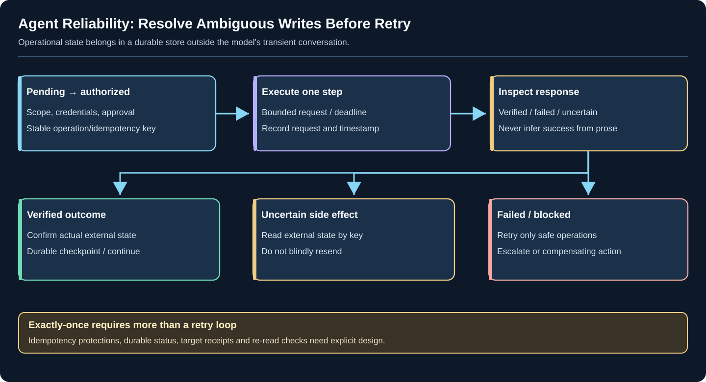

# AI Agent Reliability, Idempotency & Failure Recovery

_Last reviewed: 2026-11-24_

An agent is reliable when it **does the intended work within its boundaries, detects failures, and recovers without duplicating or corrupting side effects**. A successful model answer is not necessarily a successful workflow.

## 1. Define the Runtime State Machine



*Conceptual state and evidence boundaries.* A network timeout after a write attempt is an **unknown outcome**, not proof that no write occurred. Check the target state with a stable operation key before a repeat. Retrying without this readback can duplicate tickets, emails or permission changes.


Use explicit statuses in a persistent store: `PENDING`, `RUNNING`, `WAITING_APPROVAL`, `VERIFYING`, `SUCCEEDED`, `FAILED`, `BLOCKED`, `CANCELLED`. State must be stored outside the model's transient reasoning.

### Distinguish Failure Categories

| Failure | Example | First Response |
|---|---|---|
| Transient read failure | Network timeout while fetching a file | Bounded retry with backoff |
| Ambiguous write | Ticket API times out after receiving request | Check remote state using idempotency key |
| Authorization denial | 403 or missing approved scope | Stop; do not switch credentials |
| Schema or contract drift | Tool rejects old argument shape | Review API version, update tests |
| Model reasoning error | Uses wrong asset ID | Validate identity and reject write |
| Duplicate delivery | Two webhook events for same alert | Deduplicate and record |
| Partial success | 2 of 4 tasks completed | Record per-step state and compensating actions |
| Irreversible action | Email sent / account deleted | No blind replay; escalate |

## 2. Design Each Step as a Transaction-Like Contract

A reliable step records:

```yaml
task_id: LAB-TRIAGE-014
operation: ticket.create_draft
scope: authorized-lab
input_hash: "sha256:EXAMPLE"
idempotency_key: "LAB-TRIAGE-014-draft-v1"
requires_approval: false
preconditions: ["case exists", "caller authorized", "no existing draft"]
expected_postcondition: "exactly one draft linked to case"
verify_with: "ticket.read_by_external_key"
on_timeout: "read_before_retry"
on_failure: "mark blocked; preserve evidence"
```

Keep **intent**, **action request**, **tool acknowledgement**, and **verified postcondition** separate. Most API acknowledgements prove the request was handled, not that downstream asynchronous work is finished.

## 3. Idempotency & Exactly-Once Illusions

In distributed systems, "exactly once" is hard; practical workflows often use **at-least-once delivery plus idempotent handlers**.

```python
# Illustrative application-side pseudocode. Replace with transactional DB ops.
def handle_event(event, db, client):
    key = event["event_id"]
    with db.transaction():
        record = db.get_operation(key)
        if record is not None:
            if record.status == "SUCCEEDED":
                return record.result
            # RUNNING, UNKNOWN or FAILED is not proof of success or safe replay.
            raise NeedsReconciliation(key)
        # Atomic unique insert prevents concurrent local reservations.
        db.reserve_unique(key, status="RUNNING")
    try:
        result = client.create_draft(
            case_id=event["case_id"],
            idempotency_key=key,
        )
        # Read back the target; do not infer success from a timeout.
        confirmed = client.get_draft(result["id"])
        db.mark_completed(key, confirmed["id"])
        return confirmed
    except Exception:
        db.mark_unknown(key)  # reconcile before retry
        raise
```

The pseudocode is **not atomic across a database and remote API**; a unique local record alone cannot prevent duplicates if the remote endpoint lacks idempotency. Use remote idempotency support where available, a transactional outbox if appropriate, and reconciliation by external key. On replay, reconcile an existing `RUNNING` or `UNKNOWN` operation with the remote service before making another request. If the endpoint has no idempotency support and no reliable lookup by operation key, keep the action blocked for manual resolution; a timeout or missing result does not prove that the side effect did not occur.

## 4. Retry, Timeout & Circuit-Breaker Policies

1. Classify errors as retryable or terminal. 400 validation, 401/403 permission and missing authorization usually need review, not retries.
2. Bound retries, set operation-specific timeouts, and use exponential backoff with jitter.
3. Respect documented `Retry-After` and rate limits.
4. Do not retry non-idempotent side effects until remote state is reconciled.
5. Use circuit breakers to avoid storms during widespread outages.
6. Route exhausted failures to a dead-letter queue or `BLOCKED` state with an owner.
7. Capture the original failure context and exact next safe action.

**Backoff example:** initial delay 1 second, double through a configured cap with random jitter; stop after an explicit attempt/time budget. Values should be tuned to API limits and business impact.

## 5. Checkpoints, Interruptions & Resume

Checkpoint after each meaningful outcome with task ID, environment, source commit, tool result, readback evidence and next step. Preserve an append-only event log where feasible.

```text
CHECKPOINT 2026-11-09T14:00:00-08:00
Project: authorized Wazuh lab
Milestone: M3 test false-positive control
Last verified: synthetic alert reached rule 100001
Not verified: benign login burst, duplicate webhook handling
Remote writes: none
Branch/commit: EXAMPLE_SHA
NEXT: run benign fixture under controlled test, record expected vs actual
STOP IF: production alert routing discovered or scope uncertain
```

On resume, inspect **live service and repository state first**, then decide whether a task should run. Do not trust a stale note or prior assistant claim.

## 6. Compensating Actions & Human Review

For a reversible change, plan backup and rollback before a write. A compensating action may undo some effects but is not guaranteed equivalent to a transaction. For a sent email or disclosed secret, rollback is impossible; containment and incident response are required.

| Operation | Precondition | Verification | Recovery |
|---|---|---|---|
| Create draft | User and case known | Read draft ID/content | Delete draft with approval |
| Update Git branch | Expected prior SHA | Fetch new SHA and diff | Revert reviewed commit |
| Deploy lab rule | Backup/config checksum | Rule test + service health | Restore prior config |
| Send message | Exact approver + recipient | Delivery record | Cannot unsend reliably |
| Delete data | Retention/legal hold checks | Readback with audit | Restore if protected backup exists |

## 7. Reliability Test Exercises

- Disconnect a read-only fetch for one request: expect bounded retry and recorded recovery.
- Timeout a draft write after remote persistence: expect readback, no duplicate.
- Submit duplicate alert IDs: expect one triage case.
- Advance Git branch between planning and writing: expect optimistic lock failure, not forced overwrite.
- Remove authorization before an action: expect block, no credential fallback.
- Simulate agent restart between approval and write: expect approval revalidation, not replay.

Measure: **incorrect side effects, duplicated writes, unresolved ambiguous operations, time to detect failure, recovery success, and acceptance-test coverage**. Do not treat a low tool-exception count as proof of correctness.

## Related Guides & Primary Sources

[Milestones](milestones-and-acceptance-criteria.md) · [Multi-Agent Orchestration](multi-agent-orchestration.md) · [Observability](ai-observability-and-auditing.md) · [MCP Permissions](mcp-tooling-and-permissions.md)

References: [OpenAI Running Agents](https://developers.openai.com/api/docs/guides/agents/running-agents) · [OpenAI Agents Testing](https://openai.github.io/openai-agents-js/guides/testing/) · [NIST AI RMF](https://www.nist.gov/itl/ai-risk-management-framework) · [NIST Generative AI Profile](https://www.nist.gov/publications/artificial-intelligence-risk-management-framework-generative-artificial-intelligence).

---

[AI Index](README.md) | [Master Index](../README.md)
