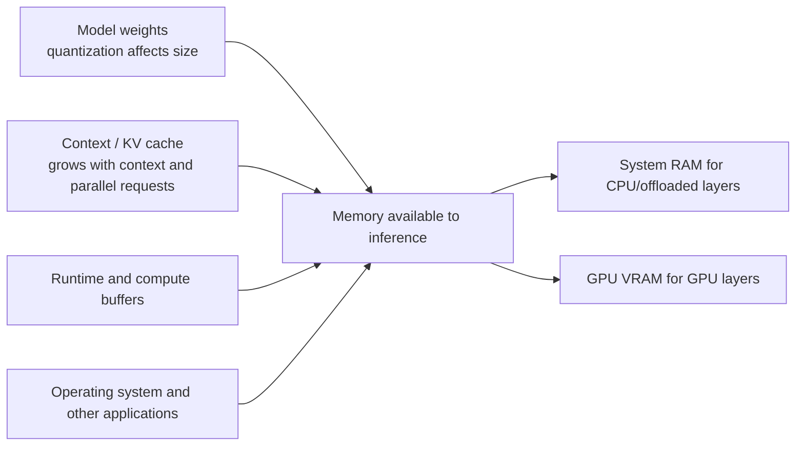
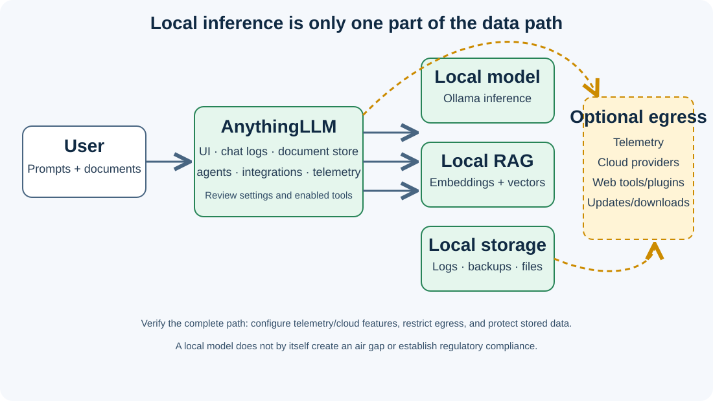
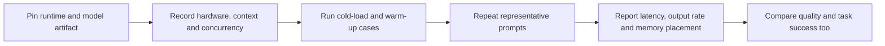

# Build a Local LLM System with Dolphin, Ollama, and AnythingLLM

## 🎯 Purpose
Configuration guide for pursuing a local-only LLM deployment using Ollama, Dolphin models, and AnythingLLM. A local model does not by itself create an air gap: verify application telemetry, integrations, service bindings, storage, and network egress for the specific build.

## ⚙️ Function
Covers hardware requirements by model size, Ollama installation and model management, Dolphin model selection trade-offs (7B/47B MoE/2.7B), AnythingLLM local setup and RAG configuration, system service hardening for localhost-only binding, and OPSEC considerations for sensitive deployments.

## 🏆 Goal
A working local-inference assistant, plus a checklist for verifying whether the surrounding applications, data stores, and network controls meet a deployment's privacy and isolation requirements.

## 📋 When to Use
- Preparing for an engagement where cloud tools are prohibited
- Building a privacy-sensitive AI workflow for sensitive research
- Setting up offline inference for the homelab before internet connectivity is available
- Deploying AnythingLLM in a corporate environment without external API exposure

## Introduction

Running a Large Language Model (LLM) locally can keep inference on your own hardware. Achieving a fully offline or air-gapped deployment takes additional configuration and verification: the UI, telemetry, plugins, embeddings, storage, model downloads, and network paths all matter. This guide uses three tools:

- **Dolphin** - Uncensored, instruction-tuned language models
- **Ollama** - Simple, efficient local LLM runtime
- **AnythingLLM** - User-friendly web interface for interacting with local models

**[Offline AI LLM System - Blog Article](https://pnwcomputers.blogspot.com/2025/11/offline-llm-system.html)**
  
**[Offline AI LLM System TrueNAS Hosted - Blog Article](https://pnwcomputers.blogspot.com/2025/11/offline-llm-system-truenas-hosted.html)**

This guide walks through a local-inference setup and the checks needed before describing a deployment as offline. Initial software and model downloads require network access unless supplied through a separately verified offline process.

## Why Choose This Stack?

**Local inference**: Prompts can be processed on-device when a local provider is selected. Verify telemetry, cloud features, plugins, vector stores, logs, and egress separately.

**Offline option**: Local inference can continue without internet after models and dependencies are installed, if cloud features, telemetry, and optional network integrations are disabled and egress is controlled.

**Behavior and refusal controls**: Some Dolphin model cards describe their behavior as “uncensored” or steerable. Treat that as a safety property to evaluate, not a guarantee of quality or suitability. Test refusal and prompt-injection behavior in isolation, and enforce tool permissions and authorization outside the model before connecting it to sensitive data or actions.

**Easy to Use**: AnythingLLM provides a modern, intuitive interface similar to ChatGPT.

**Cost-Effective**: After initial setup, there are no recurring API costs or subscription fees.

## System Requirements

Plan hardware against the exact model artifact and workload you intend to run. Parameter count or downloaded file size alone does not predict whether a model will fit or how quickly it will respond. Quantization changes weight size; longer contexts and concurrent requests increase KV-cache memory; runtime buffers and other applications also need room.



*Conceptual budget: CPU RAM and GPU VRAM are separate pools on most systems; unified-memory machines share physical memory. The runtime's allocation depends on the model, backend, context and concurrent workload.*

Before selecting hardware:

- Check the specific model's current artifact size, quantization, context limit and license in the [Ollama model library](https://ollama.com/library) and upstream model card.
- Reserve memory for the operating system, AnythingLLM, the vector store, and other running services; leave headroom rather than sizing to the model file alone.
- Treat context size and parallel requests as memory choices, not only quality or throughput settings. Ollama documents that parallel requests increase effective context/memory use in its [local FAQ](https://docs.ollama.com/faq#how-does-ollama-handle-concurrent-requests).
- Use `ollama ps` while the model is loaded to inspect CPU/GPU placement; the [CLI reference](https://docs.ollama.com/cli) documents this command. Check the [GPU compatibility guide](https://docs.ollama.com/gpu) for supported hardware.
- Benchmark cold and warm starts with representative prompts and context lengths on the target system. Record the runtime version, exact model tag/digest, quantization, context, concurrency and latency; do not generalize a single machine's speed result.

Small models may run on modest systems, but the needed RAM/VRAM and practical speed vary substantially by artifact, quantization, backend, context and workload. There is no universal 16 GB / 32 GB model-size rule or guaranteed GPU speedup.

## Part 1: Installing Ollama

Ollama is the backbone of our setup - it manages and runs the AI models locally.

### Installation on Linux

Use Ollama's [official Linux documentation](https://docs.ollama.com/linux) to choose the current package or manual-install method for your architecture. The vendor's quick-install script is served from a mutable URL; do not copy `curl ... | sh` into a reusable script or run a fetched installer without reviewing it.

- Prefer a maintained distribution package where available.
- For manual installation, select a specific official release and architecture, verify published checksums/signatures when available, and inspect the archive contents before installing.
- Run installation with the least privilege the selected method permits. Do not add `sudo` to a remote installer by default.
- Record the chosen release and follow its upgrade notes; re-check provenance and integrity for updates.

### Installation on macOS

```bash
# Download and install from the official website
# Visit: https://ollama.com/download

# Or use Homebrew
brew install ollama

# Verify installation
ollama --version
```

### Installation on Windows

1. Download the Windows installer from https://ollama.com/download
2. Run the installer and follow the prompts
3. Open Command Prompt or PowerShell and verify:

```powershell
ollama --version
```

### Starting the Ollama Service

Ollama typically starts automatically, but you can manage it manually:

**Linux (systemd)**:
```bash
# Start Ollama service
sudo systemctl start ollama

# Enable on boot
sudo systemctl enable ollama

# Check status
sudo systemctl status ollama
```

**macOS/Windows**:
Ollama runs as a background service automatically. If needed, restart it from your system tray.

## Part 2: Installing Dolphin Models

Treat model names, tags, sizes, context limits and licenses as properties of a specific library entry. The table below is a **catalog snapshot checked 2026-11-24**, not a performance ranking; tags and artifacts can change. Confirm the exact model card, license and digest before a repeatable or commercial deployment.

| Ollama library entry | Catalog snapshot | Consideration |
|---|---|---|
| [`dolphin3`](https://ollama.com/library/dolphin3) | 8B; about 4.9 GB; listed 128K context | Newer general-purpose Dolphin example; benchmark on your task and machine |
| [`dolphin-mistral`](https://ollama.com/library/dolphin-mistral) | 7B; about 4.1 GB; listed 32K context | Smaller Mistral-based option; current library version shown as v2.8 |
| [`dolphin-phi`](https://ollama.com/library/dolphin-phi) | 2.7B; about 1.6 GB; listed 2K context | Smaller footprint, but short listed context limits its document use |
| [`dolphin-mixtral`](https://ollama.com/library/dolphin-mixtral) | 8x7B about 26 GB / 32K context; 8x22B about 80 GB / 64K context | Much larger memory and storage needs; check the exact tag before pulling |

Sizes/context values above are taken from Ollama's catalog entries and can differ for other tags or quantizations. Context in a model card is a model limit, not a guarantee that your hardware can run the full window.

### Download a Selected Model

Use the exact tag you reviewed. These are examples, not universal recommendations:

```bash
# Pick one candidate from the current Ollama library
ollama pull dolphin3
# or: ollama pull dolphin-mistral
# or: ollama pull dolphin-phi
# or: ollama pull dolphin-mixtral:8x7b

# Inspect installed artifacts
ollama ls
```

Downloads can take widely varying time depending on artifact size and network speed. For repeatability, record the model name, tag and digest shown by your installed tools; a moving `latest` tag can point to a changed artifact.

### Test the Selected Model

```bash
ollama run dolphin3
```

At the prompt, try a harmless task from your intended workload. Use `/bye` to exit. Check response quality and context handling independently; a successful load is not evidence that the model is suitable for an operational security decision.

### Manage Model Versions

```bash
# Remove an installed model you no longer need
ollama rm dolphin-phi

# Pull a specific published tag after reviewing its model-card notes
ollama pull dolphin-mistral:v2.6

# Refresh a moving tag only after checking what will change
ollama pull dolphin-mistral
```

## Part 3: Installing AnythingLLM

AnythingLLM provides a beautiful web interface for interacting with your local models.

### Installation Methods

#### Method 1: Desktop Application (Recommended)

**Windows/macOS/Linux**:
1. Visit https://anythingllm.com/download
2. Download the installer for your operating system
3. Run the installer and follow the setup wizard
4. Launch AnythingLLM from your applications

#### Method 2: Docker (Advanced Users)

```bash
# Pull the Docker image
docker pull mintplexlabs/anythingllm

# Run AnythingLLM container
docker run -d \
  --name anythingllm \
  -p 127.0.0.1:3001:3001 \
  -v anythingllm_data:/app/server/storage \
  -v anythingllm_models:/app/server/storage/models \
  mintplexlabs/anythingllm

# Local-host access at http://localhost:3001 (loopback-only port publishing)
```

#### Method 3: From Source (Developers)

```bash
# Clone the repository
git clone https://github.com/Mintplex-Labs/anything-llm.git
cd anything-llm

# Install dependencies and build
yarn install
yarn build

# Start the application
yarn start
```

## Part 4: Configuring AnythingLLM with Ollama

Now let's connect AnythingLLM to your local Ollama instance.

### Initial Setup

1. **Launch AnythingLLM** - Open the application

2. **First-Time Setup Wizard**:
   - Click "Get Started"
   - Choose your language preference
   - Skip cloud service options (we're going offline!)

### Connecting to Ollama

1. **Navigate to Settings**:
   - Click the gear icon (⚙️) in the bottom left
   - Select "LLM Preference" from the sidebar

2. **Configure Ollama Connection**:
   - **LLM Provider**: Select "Ollama"
   - **Ollama Base URL**: `http://localhost:11434` when the app and Ollama share a host/network namespace. In Docker, localhost refers to the AnythingLLM container; use the host/service address appropriate for that network and restrict access to the required path.
   - **Model**: Select your installed Dolphin model from the dropdown
   - Click "Save" or "Update"

3. **Verify Connection**:
   - AnythingLLM will test the connection
   - You should see a green checkmark if successful

**Container networking note:** This Docker example publishes the UI only on host loopback. If Ollama runs on the host and AnythingLLM runs in a separate container, container-local `localhost` will not reach it. Configure a host/service address supported by your platform and restrict it to the required Docker network; do not expose port 11434 broadly. See the linked AnythingLLM localhost guidance below.

### Troubleshooting Connection Issues

If AnythingLLM can't connect to Ollama, first confirm that the configured URL is reachable **from the AnythingLLM process**. In Docker, container-local `localhost` is not the host's Ollama service; see AnythingLLM's [Docker localhost guidance](https://docs.anythingllm.com/installation-docker/localhost).

```bash
# Check if Ollama is running
curl http://localhost:11434/api/tags

# Should return JSON with your installed models

# If not running, start Ollama
# Linux:
sudo systemctl start ollama

# macOS/Windows:
# Restart from system tray or run:
ollama serve
```

## Part 5: Creating Your First Workspace

Workspaces in AnythingLLM organize your conversations and documents.

### Setting Up a Workspace

1. **Create New Workspace**:
   - Click "+ New Workspace" button
   - Name it (e.g., "General Chat", "Technical Research", "Writing")
   - Choose your Dolphin model
   - Set temperature (0.7 is balanced, higher = more creative)

2. **Configure Workspace Settings**:
   - **Temperature**: 0.7 (recommended default)
   - **Context Window**: Set based on your model's capacity
   - **Top P**: 0.9 (recommended)
   - **System Prompt**: Customize the AI's behavior (optional)

### Example System Prompts

**General Assistant**:
```
You are a helpful, knowledgeable AI assistant. Provide clear, accurate, and concise responses. When uncertain, acknowledge limitations.
```

**Technical Expert**:
```
You are an expert programmer and system administrator. Provide detailed technical explanations with code examples. Focus on best practices and security.
```

**Creative Writer**:
```
You are a creative writing assistant. Help with storytelling, character development, and prose improvement. Be imaginative and supportive.
```

## Part 6: Advanced Features

### Document Chat (RAG)

AnythingLLM can read and answer questions about your documents:

1. **Upload Documents**:
   - Click the document icon in your workspace
   - Upload PDF, TXT, DOCX, or MD files
   - AnythingLLM will process and embed the content

2. **Ask Questions**:
   - "What are the main points in this document?"
   - "Summarize the technical requirements"
   - "Find information about [specific topic]"

### Supported Document Types
- PDF files
- Text files (.txt)
- Markdown (.md)
- Word documents (.docx)
- Code files (.py, .js, .java, etc.)

### Embedding Models

For document chat, you'll need an embedding model:

```bash
# Install nomic-embed-text (recommended)
ollama pull nomic-embed-text

# Or use a smaller alternative
ollama pull mxbai-embed-large
```

Configure in AnythingLLM:
- Settings → Embedding Preference
- Provider: Ollama
- Model: nomic-embed-text

### Web Scraping (Offline Mode)

While web scraping requires internet, you can download pages offline:

1. Save web pages as HTML or PDF
2. Upload them to your workspace
3. Query the content without needing live internet

## Part 7: Optimizing Performance

### Hardware Optimization

**Enable GPU Acceleration (NVIDIA)**:

```bash
# Ollama automatically detects CUDA-capable GPUs
# Verify GPU is being used:
ollama run dolphin-mistral --verbose

# You should see GPU memory allocation in the output
```

**Adjust Model Parameters**:

```bash
# Run with custom context window
ollama run dolphin-mistral --ctx-size 4096

# Run with specific number of GPU layers
ollama run dolphin-mistral --n-gpu-layers 35
```

### Memory Management

**Linux**: Monitor memory usage
```bash
# Watch memory in real-time
watch -n 1 free -h

# Check Ollama's memory usage
ps aux | grep ollama
```

**Windows**: Use Task Manager
- Press Ctrl+Shift+Esc
- Look for "ollama" process
- Monitor memory and GPU usage

### Model Selection Tips

| Use Case | Recommended Model | RAM Needed | Performance |
|----------|------------------|------------|-------------|
| Quick questions | dolphin-phi | 8GB | Fast |
| General use | dolphin-mistral | 16GB | Balanced |
| Complex tasks | dolphin-mixtral | 32GB | Best quality |
| Technical work | dolphin-mixtral | 32GB | High accuracy |

## Part 8: Best Practices for Offline Use

### Prompt Engineering Tips

**Be Specific**:
```
❌ "Tell me about networking"
✅ "Explain how TCP/IP three-way handshake works with a diagram"
```

**Provide Context**:
```
❌ "Fix this code"
✅ "This Python function should validate email addresses but returns False for valid emails. Please fix it: [code]"
```

**Use System Prompts**:
Set a clear role for consistent behavior across sessions.

### Maintaining Your System

**Regular Updates**:

Use the official [Linux update guidance](https://docs.ollama.com/linux#updating) and review release notes before changing the installed version. Prefer the package manager or a versioned official release artifact; verify its published integrity data where available. Avoid piping a mutable remote installer directly into a shell.

```bash
# Review the installed version before and after an approved update
ollama --version

# Pull a model update only after checking its current name and requirements
ollama pull dolphin-mistral
```

Back up service configuration and note the model storage location before changing the runtime. Use AnythingLLM's built-in updater or its official download page, then verify its version.

**Disk Space Management**:
```bash
# Check model storage
ollama list

# Remove unused models
ollama rm old-model-name

# Clear conversation history (in AnythingLLM)
# Settings → Privacy → Clear Chat History
```

### Backup Your Setup

**Backup Ollama Models**:
```bash
# Models are stored in:
# Linux: /usr/share/ollama/.ollama/models
# macOS: ~/.ollama/models
# Windows: C:\Users\<username>\.ollama\models

# Create backup
tar -czf ollama-models-backup.tar.gz ~/.ollama/models
```

**Backup AnythingLLM Data**:
```bash
# Desktop app data location:
# Linux: ~/.config/anythingllm-desktop
# macOS: ~/Library/Application Support/anythingllm-desktop  
# Windows: C:\Users\<username>\AppData\Roaming\anythingllm-desktop

# Create backup
tar -czf anythingllm-backup.tar.gz ~/.config/anythingllm-desktop
```

## Part 9: Troubleshooting Common Issues

### Ollama Won't Start

**Issue**: Ollama service fails to start

**Solution**:
```bash
# Check if port 11434 is in use
sudo netstat -tulpn | grep 11434

# Identify the listener and its owning service before taking action
sudo ss -ltnp 'sport = :11434'

# If the listener is the Ollama service, restart it; otherwise resolve the
# conflict through the owning service or configure Ollama to use another port.
sudo systemctl restart ollama
```

### Model Download Fails

**Issue**: Model download interrupted or fails

**Solution**:
```bash
# Remove partial download
ollama rm dolphin-mistral

# Try download again with verbose output
ollama pull dolphin-mistral --verbose

# Check disk space
df -h
```

### Slow Performance

**Issue**: Responses are very slow

**Solutions**:
1. **Use a smaller model**: Switch from mixtral to mistral
2. **Close other applications**: Free up RAM
3. **Check GPU usage**: Ensure GPU acceleration is working
4. **Reduce context window**: Lower the context size in settings

```bash
# Monitor system resources
htop  # Linux
# Task Manager on Windows
```

### AnythingLLM Can't Connect

**Issue**: "Failed to connect to Ollama"

**Checklist**:
- [ ] Ollama is running: `curl http://localhost:11434/api/tags`
- [ ] Correct URL in settings: `http://localhost:11434`
- [ ] Firewall not blocking: Temporarily disable and test
- [ ] Model is downloaded: `ollama list`

**Fix**:
```bash
# Restart Ollama service
sudo systemctl restart ollama

# Test connection manually
curl http://localhost:11434/api/tags

# Check Ollama logs
journalctl -u ollama -f
```

### Out of Memory Errors

**Issue**: System crashes or model fails to load

**Solutions**:
1. **Switch to a smaller supported model:** check the official Ollama model library for a maintained model tag and verify its current size and hardware requirements before downloading.

2. **Consider swap space** (Linux): first check `swapon --show`, available disk space, and your distribution’s swap guidance. Do not overwrite or reformat an existing `/swapfile`; use a new, unused path and follow your administrator’s procedure.

3. **Close other applications**: Free up system resources

## Part 10: Use Cases and Examples

### Programming Assistant

**Prompt**:
```
I need a Python function that reads a CSV file and returns a dictionary where keys are values from the first column and values are lists of remaining column values. Include error handling.
```

**Workspace Setup**:
- Model: dolphin-mistral or dolphin-mixtral
- Temperature: 0.3 (more deterministic for code)
- System Prompt: "You are an expert programmer. Provide clean, well-commented code with error handling."

### Research and Analysis

**Prompt**:
```
I'm uploading a research paper about quantum computing. Please:
1. Summarize the main findings
2. Explain the methodology
3. List practical applications mentioned
4. Identify any limitations discussed
```

**Workspace Setup**:
- Upload research papers as PDFs
- Model: dolphin-mixtral (better comprehension)
- Temperature: 0.5
- Enable document chat with nomic-embed-text

### Creative Writing

**Prompt**:
```
Help me develop a character for my sci-fi novel:
- Name: Dr. Sarah Chen
- Role: Xenobiologist on Mars colony
- Conflict: Discovers evidence of ancient Martian life
- Personality: [your input]

Create a character profile with background, motivations, and potential story arcs.
```

**Workspace Setup**:
- Model: dolphin-mixtral (better creativity)
- Temperature: 0.9 (higher creativity)
- System Prompt: "You are a creative writing coach specializing in science fiction."

### Technical Documentation

**Prompt**:
```
Convert this technical specification into user-friendly documentation for non-technical staff. Include:
- Overview in plain language
- Step-by-step instructions
- Common troubleshooting
- FAQ section

[Paste technical spec]
```

**Workspace Setup**:
- Model: dolphin-mistral
- Temperature: 0.6
- Upload existing documentation for context

## Part 11: Privacy and Security

### What Local Inference Does—and Does Not—Guarantee



**Data privacy**
- A local model can process prompts on-device, but other components may communicate externally.
- AnythingLLM documents anonymous telemetry and provides a setting to disable it. Review the current privacy setting and any plugins, agents, cloud providers, or external embedding/vector services.
- Ollama can use cloud models and web search. For local-only Ollama behavior, disable cloud features with `OLLAMA_NO_CLOUD=1` (or `disable_ollama_cloud` in its server configuration), restart it, and verify its logs.
- For an air-gap claim, also control and monitor egress, account for installation/model updates, and inspect the traffic paths for the exact release and deployment.

**Compliance**
- Local storage alone does not establish GDPR, HIPAA, SOC 2, or other compliance. Assess the applicable legal and organizational requirements, access controls, retention, telemetry, subprocessors, audit evidence, and incident response.

**Intellectual property**
- Local inference may reduce exposure to cloud model providers, but it does not guarantee that data stays private. Protect local accounts, application logs, document stores, vector databases, and backups; review any enabled tools and integrations before uploading sensitive material.

### Security Best Practices

1. **Keep Software Updated**:
   - Regular Ollama updates
   - AnythingLLM security patches
   - OS security updates

2. **Access Control**:
   - Use firewalls to block external access to port 11434
   - Consider user authentication in AnythingLLM
   - Don't expose services to the internet

3. **Data Encryption**:
   - Use full disk encryption
   - Encrypt backups
   - Secure physical access to servers

4. **Network Isolation**:

For a host-local setup, Ollama's default loopback binding can be retained. Add a cloud-disable setting to the Ollama service to prevent its cloud features:

```ini
# systemd drop-in for ollama.service
[Service]
Environment="OLLAMA_NO_CLOUD=1"
Environment="OLLAMA_HOST=127.0.0.1:11434"

# Restart service
sudo systemctl daemon-reload
sudo systemctl restart ollama
```

The loopback address is suitable when AnythingLLM shares the host network namespace. A Docker container cannot reach a host service through container-local `localhost`; use a restricted host/service route and firewall it to the required network. Verify the active configuration and egress policy before calling the deployment air-gapped.

## Part 12: Advanced Configuration

### Custom Model Parameters

Create a custom Modelfile for fine-tuned behavior:

```bash
# Create Modelfile
cat > Dolphin-Custom <<EOF
FROM dolphin-mistral

# Set parameters
PARAMETER temperature 0.7
PARAMETER top_p 0.9
PARAMETER top_k 40
PARAMETER num_ctx 4096

# Custom system prompt
SYSTEM You are a security-focused AI assistant specializing in cybersecurity and penetration testing. Provide detailed, accurate technical guidance.
EOF

# Create custom model
ollama create dolphin-security -f Dolphin-Custom

# Use your custom model
ollama run dolphin-security
```

### Environment Variables

Configure Ollama behavior with environment variables:

```bash
# Set model storage location
export OLLAMA_MODELS=/path/to/models

# Set number of parallel requests
export OLLAMA_NUM_PARALLEL=2

# Set max loaded models
export OLLAMA_MAX_LOADED_MODELS=2

# Enable debug logging
export OLLAMA_DEBUG=1

# Restart Ollama to apply
sudo systemctl restart ollama
```

### API Integration

Use Ollama's API for custom integrations:

```python
# Python example
import requests
import json

def query_ollama(prompt, model="dolphin-mistral"):
    url = "http://localhost:11434/api/generate"
    data = {
        "model": model,
        "prompt": prompt,
        "stream": False
    }
    
    response = requests.post(url, json=data)
    return response.json()["response"]

# Use it
result = query_ollama("Explain docker containers")
print(result)
```

```bash
# Curl example
curl http://localhost:11434/api/generate -d '{
  "model": "dolphin-mistral",
  "prompt": "Why is the sky blue?",
  "stream": false
}'
```

### Multi-Model Setup

Run different models for different purposes:

```bash
# Install multiple models
ollama pull dolphin-phi        # Fast responses
ollama pull dolphin-mistral    # Balanced
ollama pull dolphin-mixtral    # Best quality
ollama pull codellama          # Code generation
ollama pull llava              # Vision tasks

# Create workspaces in AnythingLLM for each
```

## Part 13: Performance Benchmarks

Performance depends on the exact model artifact and quantization, context length, CPU/GPU and memory placement, runtime version, prompt length, concurrency, and whether the model is already loaded. The former fixed response-time ranges and “5–10x faster” GPU claim are removed because they were not tied to a reproducible test record.

Use this sequence when comparing local configurations:



Capture at least:

| Field | Record |
|---|---|
| Runtime | Ollama and AnythingLLM versions, OS, driver/backend |
| Model | Exact tag/digest, quantization, source and license |
| Machine | CPU, RAM, GPU model/VRAM, and whether layers use CPU, GPU, or both |
| Workload | Prompt/input length, output length, context limit, concurrency, task type |
| Results | Cold-start time, warm time-to-first-token, generated tokens per second, peak memory, errors |
| Quality | Whether the output passed the task's expected checks; speed alone is not a quality measure |

Repeat each case several times and report the range or median, not a single best run. Distinguish cold model loading from warm inference. Use `ollama ps` to observe current CPU/GPU placement and the [Ollama local FAQ](https://docs.ollama.com/faq) for context and concurrency effects. Benchmark only models and configurations you can actually run on the target system.

## Part 14: Comparison with Cloud Services

### Feature Comparison

This is a decision aid, not a guarantee about any particular subscription or release. Verify current plan features, workspace settings, data terms and provider controls before choosing.

| Feature | Ollama running locally | Hosted assistant plans (for example, ChatGPT Plus or Claude Pro) |
|---|---|---|
| Ongoing cost | Hardware, electricity, storage and administration; no per-token provider charge for local inference | Current subscription terms, included usage limits, and possible API or add-on charges |
| Data path | Can keep inference on-device; verify integrations, telemetry, logs, backups and network egress | Data handling depends on provider, plan, settings and connected tools; review current terms and controls |
| Internet | Not needed for inference after model/dependencies are downloaded, if cloud features and external integrations are disabled | Usually requires network access; exact capabilities vary by service |
| Response time | Depends on hardware, model, quantization, context and workload; measure locally | Depends on model, service load, network and plan limits; measure for the intended task |
| Model versioning | Operator chooses when to pull a model and should record its tag/digest | Provider manages model availability and may change or retire versions; check current release notes and plan access |
| Customization | Choose compatible local model/settings, subject to model license and runtime capabilities | Features vary by product, plan, account and workspace controls |
| API access | Local API can avoid hosted token charges, but must be restricted to trusted clients | API access and billing are separate from many consumer subscriptions; verify current provider pricing |

### Cost Analysis

Compare total ownership costs rather than a single price: hardware, electricity, administration,
model/API usage, and the current subscription or API plan all matter. Provider plan limits,
features, and prices change; consult the current [OpenAI pricing information](https://help.openai.com/en/articles/6950777-what-is-chatgpt-plus)
and [Anthropic pricing page](https://www.anthropic.com/pricing) before making a comparison.

## Conclusion

You now have a local-inference setup. Whether it operates offline or meets privacy and compliance requirements depends on the settings and data paths you verified.

✅ Local model inference after setup
✅ No recurring model API charge for local inference
✅ Customizable models and behavior
✅ Can operate without internet when dependencies are present and all network paths are controlled
✅ Use only after reviewing access, telemetry, logs, integrations, storage, and backups

### Next Steps

1. **Experiment with different models** - Try various Dolphin versions
2. **Create specialized workspaces** - Organize by task type
3. **Upload your documents** - Enable RAG for your personal knowledge base
4. **Customize system prompts** - Tune the AI for your specific needs
5. **Explore the API** - Integrate with your own applications

### Additional Resources

- **Ollama Documentation**: https://github.com/ollama/ollama
- **AnythingLLM Docs**: https://docs.anythingllm.com
- **Dolphin Models**: https://huggingface.co/cognitivecomputations
- **Community Support**: r/LocalLLaMA, r/Ollama

### Need Help?

If you run into issues during setup:

1. Check the troubleshooting section above
2. Consult Ollama GitHub issues
3. Join the AnythingLLM Discord community
4. Post questions on r/LocalLLaMA

---

*This guide was created for Pacific Northwest Computers. For professional IT consulting, cybersecurity services, or help setting up local AI systems for your business, visit our website or contact us.*

**Document Version**: 1.0  
**Last Updated**: November 2025  
**Compatible With**: Ollama 0.1.x+, AnythingLLM 1.0+, Dolphin 2.5+

---

## Frequently Asked Questions

**Q: Can I use a Dolphin model commercially?**  
A: There is no blanket answer for every Dolphin model or quantized artifact. Check the exact model card, its base-model license, and the terms for the specific version you downloaded. For example, the [Dolphin 3.0 Llama 3.1 model card](https://huggingface.co/dphn/Dolphin3.0-Llama3.1-8B) identifies the Llama 3.1 license, while [Dolphin Phi's listing](https://ollama.com/library/dolphin-phi) points to a different base model. Local hosting does not change license obligations.

**Q: Is local inference free after buying hardware?**  
A: It avoids per-token charges for inference that stays local, but hardware, electricity, cooling, storage, maintenance and backups still cost money. Hosted integrations, APIs or cloud features may add usage charges.

**Q: Is a local Dolphin model as capable as a hosted assistant?**  
A: There is no universal equivalence. Compare the exact model and quantization on representative, held-out tasks; score correctness, safety, latency and context handling instead of relying on broad model-to-model claims.

**Q: Can I run a model on a laptop with 16 GB of RAM?**  
A: Some smaller artifacts may fit, but memory needs depend on the exact model, quantization, context, backend and other running applications. Use the sizing guidance above and check actual CPU/GPU placement while it runs.

**Q: Do I need a GPU?**  
A: No. CPU inference is possible, and supported GPUs may improve performance. The speed difference depends on the model, backend, memory placement and workload; benchmark the target system rather than assuming a fixed multiplier.

**Q: Can I access Ollama from other devices?**  
A: Configure only the network path you need. Do not expose Ollama's API port directly to the public internet; restrict it with firewall rules and use a private network or an authenticated, TLS-protected gateway. Review the local service's bind address, origins and any proxy before connecting clients.

**Q: How often should I update Ollama and models?**  
A: Track security and compatibility updates, but test runtime and model changes before using them in a production workflow. Record the version, model tag/digest and evaluation results; moving tags can change behavior.

**Q: Can I use models besides Dolphin?**  
A: Yes. Ollama's [model library](https://ollama.com/library) changes over time. Check the exact model card, capabilities, artifact requirements and license before downloading or connecting a model to a workflow.

**Q: Can I fine-tune a model with this guide?**  
A: This guide covers inference, not training. Fine-tuning requires separate dataset-rights, provenance, hardware, evaluation and security planning; consult the current documentation for the chosen framework and model.

---

## Deployment References

- [AnythingLLM privacy and data handling](https://docs.anythingllm.com/features/privacy-and-data-handling) - telemetry and document deletion behavior
- [AnythingLLM Docker localhost guidance](https://docs.anythingllm.com/installation-docker/localhost) - host services are not reached through container-local `localhost`
- [Ollama local FAQ](https://docs.ollama.com/faq) - disable cloud features and configure server binding

## Related Files
- [README.md](README.md) - AI/ section index
- [AnythingLLM/anything_llm_agentflows.md](AnythingLLM/anything_llm_agentflows.md) - AgentFlow automation built on top of the AnythingLLM instance this guide installs
- [ai_prompts.md](ai_prompts.md) - Prompt engineering techniques that apply directly to locally-hosted Dolphin models
- [../Homelab/HomeLab_Setup.md](../Homelab/HomeLab_Setup.md) - Homelab hardware this offline LLM stack is typically deployed on
- [../OSINT/README.md](../OSINT/README.md) - OSINT workflows that may benefit from verified local inference
- [AnythingLLM/README.md](AnythingLLM/README.md) - AnythingLLM AgentFlows that run on top of this offline stack
- [OpenClaw/README.md](OpenClaw/README.md) - OpenClaw can also route to local Ollama as a provider
- [../SPECIALIZED_TOPICS_GUIDE.md](../SPECIALIZED_TOPICS_GUIDE.md) - Broader context for self-hosted AI in security labs

---

**Happy local AI adventures! 🚀**

