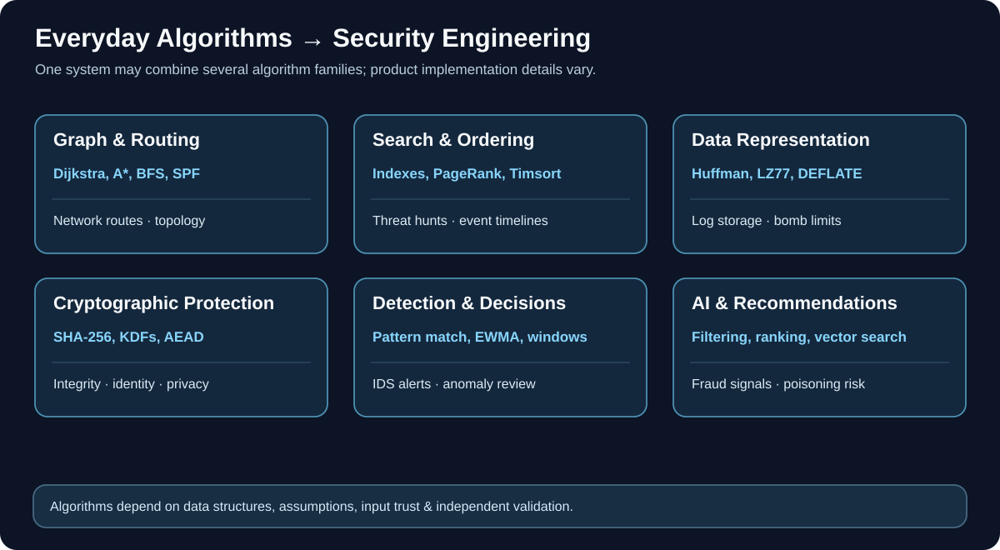

# Algorithms & Computational Foundations

A practical, source-linked guide to the algorithms behind everyday computing, networking, security monitoring, search, storage, and AI.

> [!NOTE]
> **Scope:** This section explains **algorithm families**, not a claim that every named consumer product uses a particular implementation. Implementation choices, hardware acceleration, tuning, and protocol versions vary. Labs use invented data and never require traffic from third parties.

*Original conceptual overview. Each algorithm has specific assumptions; real products may use other or combined implementations.*

## Purpose & Learning Outcomes

An **algorithm** is a finite, defined procedure that transforms inputs into outputs. A **data structure** arranges information so those procedures can perform efficiently. A **protocol** establishes how systems communicate; it may depend on multiple algorithms. A **cryptographic primitive** serves a more specific security role. Treat these as related but distinct concepts.

After this section, readers should be able to trace a small algorithm by hand, explain its complexity and assumptions, distinguish a mathematical guarantee from a product claim, identify realistic cybersecurity uses, and test a safe local implementation.

## Explore The Guides

| Guide | What You Will Learn |
|---|---|
| [Foundations, Complexity & Data Structures](./foundations-and-complexity.md) | Pseudocode, input models, Big-O, correctness, heaps, hash tables, graphs, caching, trade-offs & attacker-controlled inputs |
| [Pathfinding, Routing & Graph Algorithms](./graphs-and-routing.md) | Dijkstra, A*, BFS/DFS, Bellman–Ford, OSPF vs BGP, network topology, weighted paths & routing integrity |
| [Search, Sorting & Information Retrieval](./search-sorting-and-indexing.md) | Binary search, indexes, B-trees, inverted indexes, PageRank, merge sort, Timsort, top-k, Bloom filters & threat-hunting use |
| [Compression, Hashing & Cryptography](./compression-hashing-and-crypto.md) | Huffman, LZ77, LZW, DEFLATE, ZIP/PNG/MP3, SHA-256, AES, TLS, signatures, integrity & compression side channels |
| [Algorithmic Parallels To Cryptography & Trust](./cryptography-parallels.md) | Hash tables vs cryptographic hashes; entropy, PKI trust graphs, TLS algorithm composition, KDFs, constant-time practice & PQC |
| [Detection, Streaming & Recommendation Algorithms](./detection-and-recommendations.md) | Pattern matchers, anomaly detection, sliding windows, rate limiting, sketches, correlation, recommender systems & security evaluation |
| [Hands-On, Offline Algorithm Labs](./labs.md) | Runnable Python standard-library demos; repeatable assertions, synthetic network/log datasets, failure cases & extension exercises |

## Everyday Technology → Algorithm → Cybersecurity Connection

| Everyday Example | Algorithm Or Technique | Security Application & Qualification |
|---|---|---|
| Road navigation | Dijkstra, A*, variants | Network paths & attack-path analysis; real map services may use other preprocessing/heuristics |
| Interior routing | OSPF shortest-path-first | Network topology, route cost, tamper monitoring; BGP is a different protocol family |
| Search results | PageRank & inverted indexes | OSINT graph analysis, link-spam awareness, threat-search pipelines |
| Sorted contacts | Binary search over sorted array | Fast lookups; database indexes may use B-trees or hashes instead |
| ZIP & PNG | DEFLATE: LZ77 + Huffman | Efficient log storage, compression-bomb defense |
| Audio streaming | Lossy perceptual codecs, transforms & entropy coding | Media analysis; not equivalent to LZW or ordinary ZIP compression |
| HTTPS connections | AEAD + authentication + KDFs & hashes | Confidentiality, integrity & authenticated peer identity; hashing alone does not encrypt |
| Live monitoring | Pattern matching, windows, thresholds & statistics | Snort/Suricata rules, SIEM correlation, IDS false-positive control |
| Personalized feeds | Collaborative & content-based filtering, ranking | Abuse-resistant ranking, privacy, bias & adversarial manipulation |
| Ordered inboxes | Stable sorting or indexed retrieval | Log timelines, incident triage & reproducible evidence ordering |

## Choose Your Path

| Goal | Suggested Sequence |
|---|---|
| New reader | [Foundations](./foundations-and-complexity.md) → [Labs](./labs.md) → another focused guide |
| Network professional | [Graphs & Routing](./graphs-and-routing.md) → [Detection](./detection-and-recommendations.md) |
| SOC / DFIR analyst | [Search & Indexing](./search-sorting-and-indexing.md) → [Detection](./detection-and-recommendations.md) → [Labs](./labs.md) |
| Developer or data engineer | [Foundations](./foundations-and-complexity.md) → [Search & Sorting](./search-sorting-and-indexing.md) → [Compression](./compression-hashing-and-crypto.md) |
| Crypto learner | [Compression, Hashing & Cryptography](./compression-hashing-and-crypto.md) → [Cryptographic Algorithmic Parallels](./cryptography-parallels.md) → [existing crypto reference](../Cryptography/algorithms.md) |

## Where This Fits In The Master Guide

See also the new [cross-disciplinary explanation of cryptographic parallels](./cryptography-parallels.md), which distinguishes search-oriented hashes, password KDFs, cryptographic entropy, signature verification, trust graphs, TLS, and post-quantum primitives.

This section **complements rather than duplicates** the detailed [Cryptography](../Cryptography/README.md), [Data Engineering](../Data-Engineering/README.md), [Wireshark & Network Investigation](../Documentation/wireshark-defensive-investigations.md), [Snort & Network IDS](../IncidentResponse/IDS%26IPS/readme.md), [AI](../AI/README.md), and [Network Segmentation](../Documentation/network-segmentation-dmz-acl-vlan.md) sections. For authoritative specifications, use the references in each focused guide.

## Validation & Contribution Notes

Examples labeled *toy* or *educational* are not recommended production implementations. Complexity is expressed in terms of the stated input model and assumptions. A shortest-path algorithm does not automatically establish the trustworthiness of the underlying network graph. An anomaly score does not prove malicious intent. Never use sample cryptography code as a new protocol.

**Editorial verification:** Concepts and selected authoritative source links checked November 22, 2026. Repository lab runtime, CI checks, and links should be checked independently before merge; no production deployment is implied.

---

[Main Index](../README.md) | [Role Navigation](../START_HERE.md) | [Legal Notice](../LEGAL.md)
