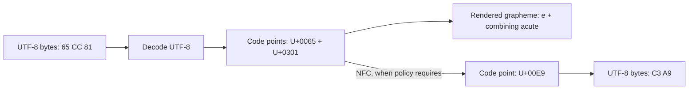

# ASCII, Unicode & Character Encoding

*Part of the [Algorithms & Computational Foundations](./README.md) section.*

> [!CAUTION]
> Use synthetic inputs and authorized datasets. Do not paste untrusted control sequences into an interactive terminal, or sensitive evidence into an online decoder. See [LEGAL.md](../LEGAL.md).

## Purpose & Fundamentals

ASCII (American Standard Code for Information Interchange) maps 128 codes, 0–127, to characters and control functions. It is a 7-bit character set normally stored in 8-bit bytes. It is different from hexadecimal, which represents numeric values. The same byte 0x41 is decimal 65 and represents uppercase A when interpreted as ASCII.

Printable ASCII is 0x20–0x7E (space plus letters, numbers and punctuation); 0x00–0x1F and 0x7F are controls. Bytes 0x80–0xFF are not ASCII. “Extended ASCII” is an ambiguous label for incompatible 8-bit encodings such as Windows-1252 and ISO-8859-1.

## Reading ASCII & Control Characters

| Hex | Decimal | Name | Security Relevance |
|---|---:|---|---|
| 00 | 0 | NUL | C string termination; embedded NUL validation |
| 09 | 9 | HT (tab) | Delimited data, whitespace handling |
| 0A | 10 | LF | Line boundaries |
| 0D | 13 | CR | Often paired with LF in wire protocols |
| 1B | 27 | ESC | Terminal control sequences; render safely |
| 20 | 32 | Space | Token boundaries |
| 30–39 | 48–57 | 0–9 | Numeric text, not numeric binary values |
| 41–5A | 65–90 | A–Z | Uppercase Latin letters |
| 61–7A | 97–122 | a–z | Lowercase Latin letters |
| 7F | 127 | DEL | Historical delete control |

Example: `48 45 4C 4C 4F 0D 0A` becomes HELLO followed by CRLF. A text number "123" is three bytes 31 32 33; binary unsigned integer 123 is 7B in one byte. A control byte is not equivalent to a visible two-character escape such as backslash and n.

## Unicode, UTF-8 & UTF-16

Unicode assigns code points; encodings describe how those values are represented as bytes. UTF-8 is ASCII-compatible and uses one to four bytes per Unicode scalar value. UTF-16 uses 16-bit code units (one or two for a scalar value), with byte-order variants. Code point, byte length and user-perceived character count are not interchangeable.

| Text | Code Point(s) | UTF-8 Bytes | UTF-16LE Bytes (No BOM) |
|---|---|---|---|
| A | U+0041 | 41 | 41 00 |
| é | U+00E9 | C3 A9 | E9 00 |
| e + combining acute | U+0065 U+0301 | 65 CC 81 | 65 00 01 03 |
| 🙂 | U+1F642 | F0 9F 99 82 | 3D D8 42 DE |



*Conceptual example: visually equivalent text can have different code-point and byte sequences. Normalization changes representation; preserve original bytes when evidence or signatures depend on them.*


A byte-order mark (BOM) may occur at the start of text: UTF-8 EF BB BF, UTF-16LE FF FE, UTF-16BE FE FF. Its absence does not prove the encoding. The visually similar é forms in the table differ in raw bytes. Unicode normalization (e.g. NFC) can make them comparable under a defined text policy; never silently normalize raw evidence or signed content.

## Encoding, Escaping, Compression & Encryption

| Representation | Example For A | What It Does |
|---|---|---|
| ASCII/UTF-8 bytes | 41 hex | Encodes the character as a byte |
| Base16 text | 41 | Represents that byte using two printable digits |
| Base64 | QQ== | Binary-to-text encoding with padding in the standard form |
| URI percent encoding | %41 | Represents a byte in URI syntax; context matters |
| JSON Unicode escape | \u0041 | Represents a code point in JSON string syntax |

These are reversible representations, not confidentiality protections. Hashing is a one-way digest operation, encryption requires a cryptographic scheme and key, and compression reduces redundancy. Decode only according to the documented format and processing order; repeated decoding and ambiguous interpretation can introduce application security bugs.

## Software & Tools

| Tool | Practical Use |
|---|---|
| [CyberChef](https://github.com/gchq/CyberChef) | Offline recipes to convert hex, Base64, URL encoding and text encodings |
| [Notepad++](https://notepad-plus-plus.org/) | Windows text inspection, visible whitespace, encoding and EOL selection |
| [VS Code](https://code.visualstudio.com/docs/editing/codebasics) | Text encoding selection, search and whitespace inspection |
| [ImHex](https://github.com/WerWolv/ImHex) / [HxD](https://mh-nexus.de/en/hxd/) | Inspect raw bytes rather than trusting rendered characters |
| [GNU strings](https://sourceware.org/binutils/docs/binutils/strings.html) | Extract candidate printable strings and offsets from binary files |
| [Sysinternals Strings](https://learn.microsoft.com/en-us/sysinternals/downloads/strings) | Windows ASCII/Unicode candidate string extraction |
| [Wireshark](https://www.wireshark.org/docs/wsug_html_chunked/ChUsePacketBytesPaneSection.html) | View text and bytes from authorized packet captures |
| [Burp Decoder](https://portswigger.net/burp/documentation/desktop/tools/decoder) | Inspect and transform text from authorized application testing |
| [Python Unicode HOWTO](https://docs.python.org/3/howto/unicode.html) | Explicit, reproducible encoding and decoding |

Text editor encoding conversion can change actual bytes; re-open with the correct encoding before editing and preserve a copy. Do not trust an extension or an automatic encoding guess.

## CLI & Python Interpretation

Use the invented fixture from the [field lab](./hex-ascii-field-reference.md). GNU strings options shown here may not exist on every BSD/macOS version; consult the installed manual.

```bash
printf 'HELLO\r\n' | xxd -g 1
strings -a -t x -n 4 lab-original.bin
# GNU strings: 16-bit little-endian character scan
strings -a -e l -t x -n 4 lab-original.bin
```

Candidate strings are not proof of a behavior, command execution or secret. Encoded, compressed or fragmented data may not appear in a basic strings scan. Review context and offsets.

```python
import base64
import unicodedata
from urllib.parse import unquote_to_bytes

raw = bytes.fromhex("48 45 4c 4c 4f 0d 0a")
print(repr(raw.decode("ascii")))  # 'HELLO\r\n'
assert b"A".hex() == "41"
assert base64.b64encode(b"A") == b"QQ=="
assert unquote_to_bytes("%41") == b"A"
assert "é".encode("utf-8").hex() == "c3a9"
assert unicodedata.normalize("NFC", "e\u0301") == "é"
try:
    b"\xff".decode("ascii", errors="strict")
except UnicodeDecodeError:
    print("Not valid ASCII")
```

Use strict decoding where format validity matters. Replacement characters and ignored errors are lossy; keep raw bytes and record the transformation. For display of untrusted strings, use escaped representations and avoid passing them directly into shells, terminals or log formats.

## Cybersecurity & Penetration Testing Workflows

| Task | Practical Use |
|---|---|
| Web & API assessment | Examine encoding at each application boundary. Compare declared charset, decoded byte values and validation behavior with local benign inputs, including empty values, accented text, and invalid UTF-8. |
| Protocol review | Interpret ASCII headers and delimiters (e.g. CRLF in HTTP/1.1), while remembering HTTP/2 and HTTP/3 have binary framing. Inspect bytes and parsed fields together. |
| Binary triage | Extract candidate messages, version strings and identifiers; search ASCII and UTF-16LE separately and correlate offsets to disassembly. |
| Digital forensics | Recognize mojibake, log encoding issues and control characters; preserve original byte content and record each decoding step. |
| Hardware & UART | Capture authorized console logs, confirm serial parameters independently of character encoding, inspect escaped raw output when text is corrupted. |
| SOC & detection | Use text and raw byte patterns to detect known indicators, handle Unicode consistently and test false positives. |
| Secure development | Enforce explicit encoding, length limits and canonicalization policy at trust boundaries; use safe parsers and structured logging. |

### Authorized Validation Checklist

1. Define which character set and normalization policy the application or protocol claims to support.
2. Use invented test cases: plain ASCII, empty text, a non-ASCII character, combining marks, malformed UTF-8, and benign embedded control bytes in a local harness.
3. Compare character count, encoded byte count, validation result and stored/retrieved representation. A byte limit is not a character limit.
4. Confirm the same validated representation reaches the intended consumer, without unintended decoding or interpretation.
5. Check that errors are controlled, logs escape untrusted data, and legitimate multilingual input still works. Document expected vs. observed results and remediation without exposing real user data.

## References & Related Guides

| Resource | Description |
|---|---|
| [RFC 20](https://www.rfc-editor.org/rfc/rfc20) | Historical ASCII reference |
| [RFC 3629](https://www.rfc-editor.org/rfc/rfc3629) | UTF-8 |
| [Unicode Normalization](https://www.unicode.org/reports/tr15/) | Normalization forms and constraints |
| [RFC 3986](https://www.rfc-editor.org/rfc/rfc3986) | URI syntax and percent encoding |
| [RFC 8259](https://www.rfc-editor.org/rfc/rfc8259) | JSON string encoding |
| [OWASP Input Validation](https://cheatsheetseries.owasp.org/cheatsheets/Input_Validation_Cheat_Sheet.html) | Input validation design |
| [Hexadecimal & Binary Data Analysis](./hexadecimal-and-binary-analysis.md) | Raw bytes and integer interpretation |
| [Hex & ASCII Field Reference & Labs](./hex-ascii-field-reference.md) | Complete ASCII table and local exercises |
| [Web Application Security](../WebAppSecurity/README.md) | Authorized application testing |
| [Digital Forensics](../IncidentResponse/Digital-Forensics/README.md) | Artifact preservation |
| [Reverse Engineering](../ReverseEngineering/README.md) | Static binary analysis |
| [Wireshark Master Filters](../Documentation/wireshark-master-filters.md) | Packet inspection |
| [Cryptography](../Cryptography/README.md) | Encoding vs encryption and hashing |

---
[⬅️ Algorithms Index](./README.md) | [Master Index](../README.md) | [Role Navigation](../START_HERE.md) | [Legal Notice](../LEGAL.md)
