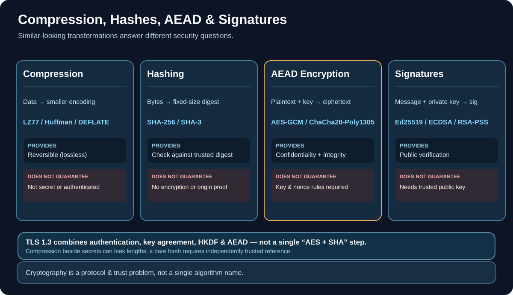
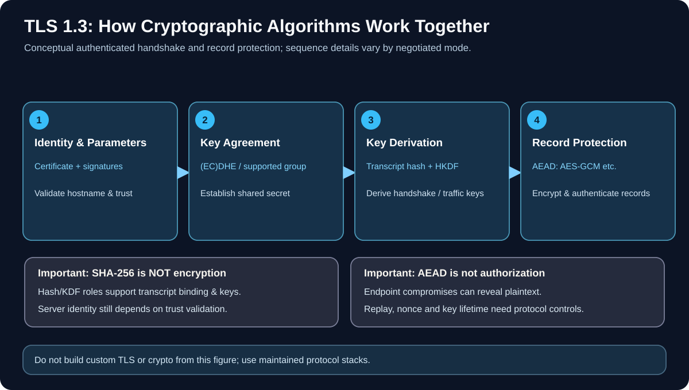

# Compression, Hashing, Integrity & Cryptography

[Algorithm Index](./README.md) | [Cryptography Reference](../Cryptography/algorithms.md) | [Offline Labs](./labs.md)

## Distinguish Four Different Goals

**Compression** represents information using fewer bits. **Encryption** protects confidentiality under a key. **Integrity** detects changes when compared with a trusted reference or verified authentication tag/signature. **Authentication** establishes a verified origin or peer under an appropriate trust model. One technique rarely provides all four.

*Original algorithm-role comparison. Cryptographic security depends on keys, nonces, trust anchors, protocol composition, and correct implementation.*

See [Algorithmic Parallels To Cryptography & Trust](./cryptography-parallels.md) for a detailed connection to hash tables, entropy, PKI graphs, complexity, TLS, password KDFs, and post-quantum cryptography.

| Goal | Typical Technology | What It Does **Not** Guarantee |
|---|---|---|
| Save storage or bandwidth | DEFLATE, LZ77, Huffman, LZW | Confidentiality or authenticity |
| Fingerprint bytes | SHA-256/SHA-3 | Authentic source without trusted reference |
| Confidentiality & authenticated integrity | AES-GCM or ChaCha20-Poly1305 (AEAD) | Peer identity unless keys are properly authenticated |
| Establish secure web connection | TLS 1.3 handshake, certificates, KDF, AEAD | Protection from a compromised endpoint |
| Store user passwords | Argon2id/scrypt/PBKDF2 with suitable parameters/policy | Invulnerability to credential reuse or weak passwords |
| Verify a publisher | Digital signature + trusted public key | Whether signed content is safe or correct |

## Huffman Coding: Assign Shorter Codes To More Common Symbols

Huffman coding creates a variable-length **prefix-free** code using symbol frequencies. Frequent symbols can receive shorter representations and rare ones longer ones. Prefix-free means no complete code word is the prefix of another, so a bitstream can be decoded unambiguously.

Toy example frequencies: A=5, B=2, C=1. An optimal code assignment is A=1, B=01, C=00. Weighted bits = 5×1 + 2×2 + 1×2 = 11 bits for eight symbols, versus 16 bits with fixed two-bit symbols. This simplistic comparison excludes dictionary/tree/header costs; real small files may actually grow.

**Construction:**
1. Count symbol frequencies.
2. Put symbols into a min-priority queue.
3. Remove the two least-frequent nodes and combine them into one parent.
4. Repeat until one tree remains.
5. Assign 0/1 along edges; shorter paths generally correspond to higher frequencies.

Code assignment and tie-breaking may vary while remaining equally optimal. Huffman alone does not describe most file formats or codecs end to end.

## LZ77, LZW & DEFLATE

| Algorithm / Format | How It Works | Familiar Uses |
|---|---|---|
| LZ77 family | Replace repeated substrings with distance/length backreferences inside a sliding window | General-purpose lossless compression |
| Huffman | Variable-length prefix codes based on symbol frequencies | Entropy-coding stage in several formats |
| DEFLATE | LZ77-style matches/literals followed by fixed or dynamic Huffman coding, or stored blocks | **PNG** zlib streams, common **ZIP** method |
| LZW | Build a dictionary of previously seen sequences and encode dictionary references | Historically GIF, TIFF options and older utilities |
| Brotli / Zstandard | Modern lossless compressors with different models/encoding | Web content delivery, backups/log pipelines depending on use |
| JPEG / MP3 | Lossy, media-aware transforms, quantization, entropy coding | Images and audio where acceptable information loss reduces size |

**Important correction:** PNG specifies a lossless filtering + zlib/DEFLATE pipeline for its standard compression method; PNG is not simply “Huffman” or “LZW.” ZIP is a **container format** supporting multiple methods; DEFLATE is common but not universal. GIF historically uses LZW. MP3 includes perceptual audio modeling, filterbank/MDCT transform coding, quantization and Huffman entropy coding; it is **not** explained adequately as assigning short codes to common raw byte patterns.

References: [RFC 1951 — DEFLATE](https://www.rfc-editor.org/rfc/rfc1951.html), [W3C PNG Specification](https://www.w3.org/TR/png-3/), [ZIP APPNOTE](https://pkware.cachefly.net/webdocs/casestudies/APPNOTE.TXT).

### Practical Compression Decisions

- **Already compressed/encrypted data** is often incompressible; do not promise reduction.
- **Text and repetitive structured logs** often compress well; choose a format with bounded decompression and acceptable CPU costs.
- **Lossless vs lossy** is an information-preservation choice. Do not use lossy encodings for forensic evidence, original logs or binaries.
- **Decompression bombs** can have an enormous expanded size relative to compressed size; apply byte, entry count, nesting depth, elapsed time, memory, and recursion limits.
- **Compression side channels:** compressing secrets together with attacker-influenced input and revealing compressed/encrypted lengths can leak information in some protocols. Review [BREACH](https://breachattack.com/) and [CRIME](https://en.wikipedia.org/wiki/CRIME) as historical attack classes; do not assume merely using TLS removes length side channels.
- **Archives may contain unsafe paths** (e.g., traversal through file names) and symlinks. Validate extraction destinations; never trust filenames from untrusted archives.

## SHA-256: A Cryptographic Hash Is Not Encryption

SHA-256 maps arbitrary-length input bytes to a 256-bit digest. The function is deterministic. A tiny change in input usually changes the digest drastically. Hashes are designed to resist preimage and collision attacks under specified assumptions; they are **not reversible encryption**.

~~~python
import hashlib
from hmac import compare_digest

data = b"synthetic-evidence-001"
digest = hashlib.sha256(data).hexdigest()
assert len(digest) == 64

trusted = hashlib.sha256(data).digest()  # illustration only
observed = hashlib.sha256(data).digest()
assert compare_digest(observed, trusted)
~~~

**Critical detail:** In this illustration, both digests were generated from the same local bytes, so the comparison only demonstrates API behavior. In a real validation workflow, the expected digest must come from a **trusted, independent** source. A malicious actor who can replace the file and the digest can defeat a bare hash check.

Use hashes for reproducible evidence identifiers, deduplication candidates, integrity comparisons, and content-addressed storage. They do not prove chain of custody by themselves. An attacker may create different data with the same non-cryptographic checksum; CRC32 is for accidental corruption detection, not adversarial tamper resistance.

## AES, AEAD & The HTTPS Stack

**AES** is a block cipher. It requires an appropriate mode of operation and key handling. **AES-GCM** and **ChaCha20-Poly1305** are authenticated-encryption-with-associated-data (AEAD) constructions that protect ciphertext integrity and confidentiality under their key/nonce rules. Reject invalid tags; avoid releasing unauthenticated plaintext.

In **TLS 1.3**, a handshake negotiates security parameters, authenticates the server under the certificate trust model (and optionally clients), establishes secrets using key agreement / key derivation, and protects records using AEAD. A TLS 1.3 cipher-suite name such as **TLS_AES_128_GCM_SHA256** specifies an AEAD construction and hash used in the protocol key schedule; it does **not** mean SHA-256 is itself the record encryption algorithm.

- HKDF and transcript hashing support key derivation and handshake binding.
- Authentication relies on trusted certificates, signatures and correctly validated names/chains, not only on encrypted bytes.
- AEAD provides confidentiality and integrity; it does not independently authorize a user, guarantee endpoint safety, or stop every replay scenario.
- Nonce reuse under the same key can catastrophically break some AEAD schemes. Do not design a homemade nonce format or security protocol.

Reference: [TLS 1.3 RFC 8446](https://www.rfc-editor.org/rfc/rfc8446.html). For parameter choices, approved algorithms, post-quantum considerations and use/avoid guidance, defer to the repository's dedicated [Cryptography Algorithm Reference](../Cryptography/algorithms.md) and [Applied Cryptography](../Cryptography/applied-crypto.md).

*Conceptual TLS 1.3 algorithm composition; this is not an exact message-by-message handshake trace. See [TLS Algorithm Parallels](./cryptography-parallels.md#4-cryptography-as-a-multi-algorithm-pipeline).*

## Password Verification Is A Separate Problem

A fast digest such as unsalted SHA-256 is **not** appropriate for password storage. Attackers can try enormous numbers of password candidates offline. Use a suitable password-hashing/KDF scheme, unique salts, and tuned work/memory parameters under current policy (for example Argon2id, scrypt, or PBKDF2 where required). For security keys and passkeys, see [Security Keys & Passkeys](../Cryptography/security-keys-passkeys.md). Never implement a custom password hash with toy code.

## Merkle Trees & Evidence Integrity

A **Merkle tree** combines hashes into a tree: leaf hashes represent input blocks and parent hashes represent child digests. If a trusted root is available, a membership proof can show one leaf is included in a particular tree without downloading the entire dataset. A Merkle root by itself does not prove who authored the dataset, when it existed, or that it was truthful. Sign/anchor and retain provenance where appropriate.

Applications include content-addressed backups, distributed data synchronization, transparency logs and some software-supply-chain tools. Investigators should keep original evidence and a defensible audit trail rather than relying only on one summary digest.

## Offline Verification Exercises

1. Hash two slightly different text files; compare the full digests and explain why they differ.
2. Compress repetitive synthetic text and compare it with pre-compressed random-looking bytes. Measure **compressed size**, **elapsed time**, and **CPU/memory** under bounded limits.
3. Model Huffman frequencies by hand; compute average code length including **format overhead**.
4. Draw the TLS trust chain from DNS/name selection to certificate verification, key establishment, record AEAD and application authorization. Label what **each step does not guarantee**.
5. Confirm that an expected digest from the same untrusted download location is a weaker verification method than one from an authenticated publisher or signed manifest.

**Do not experiment with real patient, client, credential or confidential forensic records** in teaching notebooks. Use synthetic inputs.

## Sources & Adjacent Guides

| Resource | What It Covers |
|---|---|
| [RFC 1951](https://www.rfc-editor.org/rfc/rfc1951.html) | DEFLATE's LZ77/Huffman representation |
| [W3C PNG](https://www.w3.org/TR/png-3/) | PNG filtering and compression |
| [RFC 8446](https://www.rfc-editor.org/rfc/rfc8446.html) | TLS 1.3 handshake and record protection |
| [NIST FIPS 180-4](https://csrc.nist.gov/pubs/fips/180-4/upd1/final) | Secure hash standard |
| [NIST SP 800-38D](https://csrc.nist.gov/pubs/sp/800/38/d/final) | GCM requirements |
| [Cryptography Index](../Cryptography/README.md) | Protocol and implementation recommendations |
| [DFIR Index](../IncidentResponse/Digital-Forensics/README.md) | Evidence handling, collection and validation |

---

[Algorithm Index](./README.md) | [Main Index](../README.md) | [Legal](../LEGAL.md)
