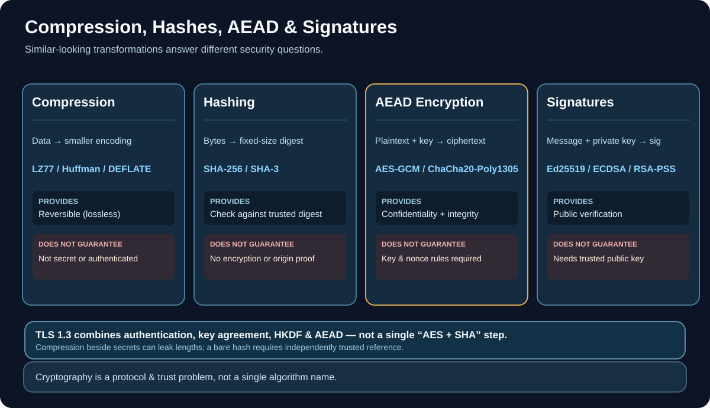
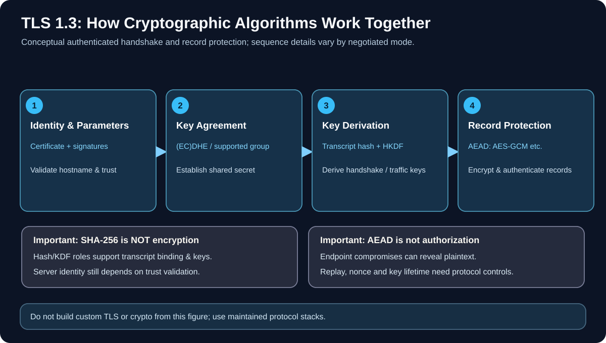

# Algorithmic Parallels To Cryptography, Encryption & Trust

[Algorithm Index](./README.md) | [Compression, Hashing & Cryptography](./compression-hashing-and-crypto.md) | [Cryptography Reference](../Cryptography/algorithms.md)

> [!IMPORTANT]
> **Learning guide, not a crypto design specification.** All diagrams and thought experiments are conceptual. Use established protocols and maintained libraries, do not write your own cipher or key-agreement protocol, and validate any algorithm against its actual threat model and current standards.

## Purpose & Scope

Cryptography uses the same foundations found in search, graph analysis, information theory, and systems design: mathematical operations, algorithms, data structures, cost models, complexity bounds, and assumptions about adversarial inputs. But **a fast or mathematically elegant algorithm is not necessarily secure**. This guide explains the connections without treating algorithms as interchangeable.

**Goal:** explain why hashing and indexing sound related but protect different properties, how entropy and compression differ from secrecy, how TLS composes multiple algorithms, how certificate and software-supply-chain trust can be modeled as graphs, and why implementation timing can undermine sound cryptography.

## Navigation & Visual Reference

| Topic | Explore |
|---|---|
| [Algorithmic Families](./README.md) | Broader conceptual map |
| [Compression & Information Theory](./compression-hashing-and-crypto.md) | Huffman, DEFLATE, entropy and side channels |
| [Graph Algorithms](./graphs-and-routing.md) | Weighted paths; relationship to trust-path reasoning |
| [Search & Indexing](./search-sorting-and-indexing.md) | Hash tables, indexed lookup and ranking |
| [Detection & Anomaly Algorithms](./detection-and-recommendations.md) | Timing, false positives and security monitoring |
| [Cryptographic Parameters](../Cryptography/algorithms.md) | Current algorithm families, legacy rules and post-quantum migration |
| [Applied Cryptography](../Cryptography/applied-crypto.md) | TLS, password storage, randomness, key lifecycle |
| [Password & Passkey Security](../Cryptography/security-keys-passkeys.md) | Phishing-resistant authentication |

*Conceptual decision diagram. Similar input-to-output transformations do not provide the same security property.*

## 1. Hash Tables Versus Cryptographic Hash Functions

Both map input values into derived values, but their performance targets and security properties differ.

| Property | Ordinary Hash Table | Cryptographic Hash (SHA-256, SHA-3) |
|---|---|---|
| Primary goal | Efficient indexing and lookup | Collision, preimage and second-preimage resistance under stated assumptions |
| Output | Usually finite-width bucket/index | Fixed-width digest with a defined cryptographic construction |
| Collisions | Expected and handled by a table | Must be computationally difficult to find deliberately |
| Attacker-chosen inputs | Can trigger uneven buckets and resource exhaustion | Security strength depends on primitive and chosen operation |
| Keying | Some runtimes use randomized/keyed hashing defensively | Plain SHA-256 is unkeyed; HMAC uses a secret key |
| Typical security use | Dictionaries, asset indexing, telemetry aggregation | Digest validation against trusted reference, HMAC, Merkle leaves |

**Key distinction:** a fast lookup hash is not a secure file-integrity fingerprint; a SHA-256 digest is not an authenticator just because it looks random. Use **HMAC** or a digital signature where authenticity is needed under the correct trust model, rather than assuming a shared hash is trustworthy.

**Birthday paradox parallel:** For an ideal n-bit hash, random collisions begin to become likely on the order of 2^(n/2) attempts, while generic preimage search is on the order of 2^n attempts. These are heuristic work-factor scales for idealized functions, not an instruction to use only hash-output length to judge a full system's security.

Reference: [NIST FIPS 180-4](https://csrc.nist.gov/pubs/fips/180-4/upd1/final), [HMAC RFC 2104](https://www.rfc-editor.org/rfc/rfc2104).

## 2. Compression Entropy Versus Cryptographic Entropy

**Shannon entropy** measures uncertainty about symbols under a specified probability distribution; it helps characterize how well data can be compressed. **Cryptographic unpredictability** concerns what an attacker can predict about secrets even with side information. The two concepts overlap mathematically but are **not identical security tests**.

- Huffman coding assigns short prefix-free symbols to common inputs and supports compression; it does not hide them from an attacker.
- A ciphertext produced by a secure encryption scheme should not exhibit plaintext's easily exploitable repetitions, but observing an apparently random-looking ciphertext is **not proof of security**.
- A compressed stream is usually still transparent to anyone with a decompressor.
- A cryptographically secure random-number generator (CSPRNG) requires appropriate entropy sources, seeding and health/operational controls; zip-compressing a predictable sequence does not create secure key material.
- Encrypting a file usually makes lossless recompression ineffective because ciphertext is designed to be computationally indistinguishable from random-looking data under the cipher's security assumptions.

**Compression-length side channel:** If an attacker can influence some bytes compressed alongside a secret and observe output length, some protocols can leak information. Separating secrets from attacker-controlled data and disabling sensitive response compression where appropriate are design mitigations; TLS encryption alone does not hide ciphertext length. See [RFC 7457](https://www.rfc-editor.org/rfc/rfc7457.html) (TLS attack context) and [BREACH](https://breachattack.com/) (historical web compression attack).

## 3. Network Graphs Versus Trust Graphs

Dijkstra and A* operate over graphs with specific edge weights and optimization goals. Trust systems can also be depicted as graphs, but **certificate path validation is not simply shortest-path routing**.

Consider the distinct graphs:

| Graph | Vertices | Edges | Decision |
|---|---|---|---|
| OSPF network | Routers/network vertices | Link-state connectivity/cost | Lowest configured path cost under protocol rules |
| Certificate/PKI trust | Roots, intermediates, end-entity certificates | Issuer/signature relationships and constraints | Is a valid, policy-compliant path rooted in an accepted trust anchor? |
| Software supply chain | Projects, artifacts, builders, signing keys | Dependencies, attestations, signatures | Is provenance and integrity sufficiently verified? |
| Attack-path model | Hosts, identities, privileges, misconfigurations | Permitted transitions/prerequisites | What plausible transitions require mitigation? |

A PKI path has constraints (name validation, permitted usages, dates, policies, basic constraints, revocation policy and algorithm requirements) that **cannot be replaced by assigning a cost to links**. The shortest chain is not necessarily an acceptable chain. A signature proving bytes came from a key is not proof that the software is free from vulnerabilities.

References: [RFC 5280](https://www.rfc-editor.org/rfc/rfc5280.html) on X.509 certification path validation, [NIST SSDF](https://csrc.nist.gov/Projects/ssdf) for secure software development. Related repository material: [Supply Chain Assessment](../ContainerSecurity/software-supply-chain-assessment.md) and [OSINT](../OSINT/README.md).

## 4. Cryptography As A Multi-Algorithm Pipeline

*Conceptual TLS 1.3 sequence, not a packet-accurate handshake trace; certificate and signature methods, group negotiations, and resumption/PSK choices are protocol-specific.*

A common TLS 1.3 certificate-authenticated handshake combines:

1. **Negotiation:** client and server choose protocol security parameters, including a supported key-exchange group and cipher suite.
2. **Key establishment:** ephemeral (EC)DHE exchanges, or appropriately negotiated alternatives under the relevant profile, create shared secret material; this is not bulk encryption.
3. **KDF and transcript binding:** HKDF derives traffic keys using handshake secrets and transcript-related hashes. A hash algorithm such as SHA-256 is part of that process, not the AES record cipher.
4. **Authentication:** the client verifies the server's certificate and handshake signature according to its trust and hostname policy.
5. **AEAD record protection:** record data uses an agreed authenticated encryption construction, typically AES-GCM or ChaCha20-Poly1305. Authentication failure rejects data.
6. **Application authorization:** the authenticated transport does not itself decide whether the logged-in user should access a record.

The exact cryptographic messages and order are governed by the protocol; the numbered stages are an **educational grouping**, not wire-level message order. For example, portions of the TLS 1.3 handshake are encrypted before server certificate verification completes; clients must not trust unauthenticated application data.

**Algorithm roles to remember:** AES = block cipher; AES-GCM = AEAD; SHA-256 = hash; HKDF = KDF; X25519 = key agreement; Ed25519/ECDSA = signatures. The names are not substitutes for complete protocol verification.

References: [TLS 1.3 RFC 8446](https://www.rfc-editor.org/rfc/rfc8446.html), [HKDF RFC 5869](https://www.rfc-editor.org/rfc/rfc5869.html), [Applied Cryptography](../Cryptography/applied-crypto.md).

## 5. Search Hardness, Password Storage & Key Derivation

Binary search is efficient because data is **ordered**. Password guessing is not an ordinary binary search over sorted secrets. Password defenses need to make each *candidate verification* sufficiently costly and preferably memory-intensive under an appropriate threat model.

- Do **not** store passwords as SHA-256(password) or use a bare fast keyed lookup as password protection.
- Use a salted, purpose-built password hashing method such as Argon2id/scrypt/PBKDF2 where appropriate to your compliance and deployment requirements.
- HKDF derives cryptographic keys from suitable input keying material; it is not interchangeable with a password-hardening KDF.
- Search algorithms still matter: breached-password corpus lookup, credential inventory analysis and incident investigations use indexes, set membership, and rate limiting. **Those operations do not turn the password hashing problem into binary search.**
- Online account authentication adds throttling, lockout safety, user experience, MFA/passkeys, and abuse monitoring. Offline stolen-verifier risks require separate protection.

References: [OWASP Password Storage Cheat Sheet](https://cheatsheetseries.owasp.org/cheatsheets/Password_Storage_Cheat_Sheet.html) and [Cryptography's Applied Guide](../Cryptography/applied-crypto.md).

## 6. Correctness, Complexity & Side-Channel Security

Computer science teaches runtime cost (Big-O), worst-case inputs, and optimization. Cryptography adds the question: **Does the amount of time or memory access depend on a secret?**

| Ordinary Optimization | Possible Cryptographic Hazard |
|---|---|
| Early-exit on mismatch | Observable comparison timing may disclose prefix information |
| Lookup tables indexed by secret bytes | Cache access patterns can leak key-dependent information |
| Variable-time arithmetic | Execution time may correlate with private-key bits |
| Faster but unreviewed primitive | Loss of vetted security assumptions and implementation review |
| Error messages that expose processing differences | Padding-oracle-style information leaks in vulnerable protocols |
| Nonce/counter reuse for convenience | Catastrophic failure for some AEAD schemes, including GCM |

**Important:** Big-O is about growth as input size increases; a **constant-time cryptographic implementation** aims to avoid observable secret-dependent differences in timing/behavior for a defined threat model. These are different claims, and a constant-time implementation may still have an ordinary O(n) runtime in public message length. Python scripts in this repository are teaching aids, not audited constant-time crypto code.

Prefer well-maintained cryptography libraries and reviewed protocol implementations. See [Cryptography Reference](../Cryptography/algorithms.md) and [Applied Cryptography](../Cryptography/applied-crypto.md).

## 7. Elliptic Curves, Number Theory & Post-Quantum Algorithms

Modern public-key cryptography draws on **hard mathematical problems**, not merely “scrambling” characters:

| Family | Representative Primitive | Underlying View | Role |
|---|---|---|---|
| RSA | RSA-PSS, RSA-OAEP | Modular arithmetic and integer factorization assumptions | Signature / encryption construction, depending on scheme |
| Elliptic curve | ECDH / X25519 | Elliptic-curve group operations and discrete-log assumptions | Key agreement |
| Elliptic curve | Ed25519 / ECDSA | Discrete-log-based signature constructions | Digital signatures |
| Lattice-based PQC | ML-KEM | Module-lattice problem families | Post-quantum key encapsulation |
| Lattice-based PQC | ML-DSA | Module-lattice problem families | Post-quantum digital signature |
| Hash-based PQC | SLH-DSA | Hash-based signatures | Post-quantum digital signature |

A generic shortest-path, sorting or hashing algorithm is **not** a replacement for these cryptographic security assumptions. Quantum algorithms threaten classical public-key systems in ways that cannot be solved simply by doubling RSA key lengths. Post-quantum cryptography also needs protocol integration, safe implementations, lifecycle management, and side-channel review.

References: [NIST FIPS 203 (ML-KEM)](https://csrc.nist.gov/pubs/fips/203/final), [NIST FIPS 204 (ML-DSA)](https://csrc.nist.gov/pubs/fips/204/final), [NIST FIPS 205 (SLH-DSA)](https://csrc.nist.gov/pubs/fips/205/final). Follow the dedicated [Cryptographic Algorithms Guide](../Cryptography/algorithms.md) for algorithm selection details.

## 8. Integrity, Merkle Trees, Signed Updates & Forensics

A Merkle tree is an algorithmic **tree data structure** whose internal nodes derive hashes from child nodes. It supports compact membership proofs against a trusted root, and can serve transparency logs and content-addressed systems. The root alone does **not** authenticate a publisher, supply a time stamp, or prove an observation was accurate.

A responsible evidence workflow separates:

| Step | Data Structure / Algorithm | Trust Requirement |
|---|---|---|
| Acquire | Deterministic byte stream | Proper authorization and process |
| Fingerprint | SHA-256 hash | Independently record trusted digest |
| Record | Append-only log / indexed event store | Accurate timestamps, access controls |
| Aggregate | Merkle tree / signed manifest | Trusted signatures and auditability |
| Search | B-tree, inverted index, binary search | Preserve provenance and tenant separation |
| Verify | Rehash + compare / signature validation | Correct trust anchors and original bytes |

**Do not confuse a digest with evidence admissibility, authenticity, or chain of custody.** See [Digital Forensics](../IncidentResponse/Digital-Forensics/README.md) and [Data Engineering](../Data-Engineering/README.md).

## 9. Threat Models For The Algorithm Layer

Consider algorithmic DoS (catastrophic regex backtracking, decompression bombs, quadratic parsing), nonce/key misuse, timing/cache side channels, malicious input normalization, poisoned graph edges and recommendation feedback loops. Apply bounds and validation, collect independent evidence, and test under synthetic adversarial inputs.

For detection specifically, see [Pattern Matching & Anomaly Algorithms](./detection-and-recommendations.md) and the existing [Unified Network Visibility Architecture](../IncidentResponse/IDS%26IPS/unified-network-visibility-architecture.md). For network trust, see [Graphs & Routing](./graphs-and-routing.md).

## Learning Exercises (No Custom Cryptography)

1. Compare identical bytes with `hashlib.sha256` and deliberately changed bytes; explain why both digest values require a trusted source before asserting authenticity.
2. Draw a simple mock certificate chain and list **validation constraints** that would reject an otherwise connected path. Do not implement certificate path validation.
3. Compress small synthetic repetitive strings and note how sizes vary; **do not place real secrets next to attacker-controlled input** while exploring compression effects.
4. Explain why password hashing and TLS HKDF use different cost/security goals. Cite a protocol specification for each.
5. Draw an example TLS 1.3 stack and annotate key agreement, certificate verification, HKDF, and AEAD with what each does **not** guarantee.

These exercises are conceptual by design. Repeatable executable examples live in [Offline Algorithm Labs](./labs.md). Implementation guidance remains in [Applied Cryptography](../Cryptography/applied-crypto.md).

## References & Further Reading

| Standard / Guide | Focus |
|---|---|
| [RFC 8446](https://www.rfc-editor.org/rfc/rfc8446.html) | TLS 1.3 roles and composition |
| [RFC 5869](https://www.rfc-editor.org/rfc/rfc5869.html) | HKDF extraction and expansion |
| [RFC 5280](https://www.rfc-editor.org/rfc/rfc5280.html) | Certificate path validation |
| [RFC 2104](https://www.rfc-editor.org/rfc/rfc2104) | Keyed hashes (HMAC) |
| [NIST Post-Quantum Standards](https://www.nist.gov/pqcrypto) | PQC standards and migration |
| [Algorithms: Compression, Hashing & Crypto](./compression-hashing-and-crypto.md) | Related algorithm families |
| [Cryptography Index](../Cryptography/README.md) | Detailed cryptographic standards and practice |

---

[Algorithm Index](./README.md) | [Main Index](../README.md) | [Legal](../LEGAL.md)
