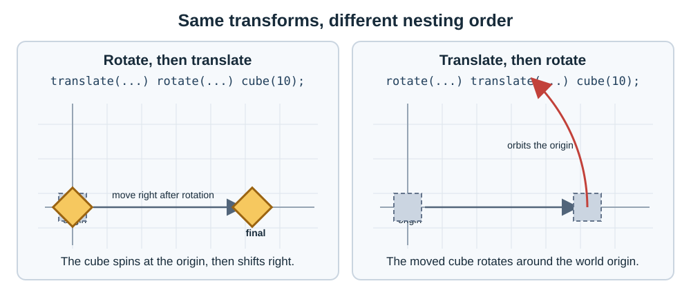

# 🧱 OpenSCAD Fundamentals: Shapes, Transforms & Booleans

_Last reviewed: 2026-11-14_

*Part of the [OpenSCAD Design & Prototyping Guide](./README.md) · [CAD & 3D Printing](../README.md) · [ULTIMATE CYBERSECURITY MASTER GUIDE](../../README.md)*

**Navigate:** [OpenSCAD Hub](./README.md) · **Fundamentals** · [Project Structure](./02-project-structure.md) · [Mockups & Fit Checks](./03-mockups-and-fit-checks.md) · [GPS Cradle Tutorial](./04-tutorial-gps-cradle.md) · [Design for Printing](./05-design-for-printing.md) · [Shortcuts](./06-keyboard-shortcuts.md)

## 🎯 Purpose

Everything you need from the OpenSCAD language to build functional parts: the editor workflow, primitives, 2D-to-3D extrusion, transformations, boolean (CSG) operations, modules, functions, loops and the debugging modifiers. The self-contained snippets were checked in OpenSCAD 2021.01; placeholder names such as `child()` or `plate()` stand for your own modules.

**CSG** (Constructive Solid Geometry) means building complex solids by adding, subtracting and intersecting simple ones. That is the whole OpenSCAD model: you never drag a vertex; you write the recipe.

---

## Contents

1. [The Editor Workflow](#the-editor-workflow)
2. [Units, Axes & Resolution](#units-axes--resolution)
3. [3D Primitives](#3d-primitives)
4. [2D Shapes & Extrusion](#2d-shapes--extrusion)
5. [Transformations](#transformations)
6. [Boolean Operations](#boolean-operations)
7. [Hull, Offset & Minkowski](#hull-offset--minkowski)
8. [Variables, Modules & Functions](#variables-modules--functions)
9. [Loops, Conditionals & Lists](#loops-conditionals--lists)
10. [Debug Modifiers & Color](#debug-modifiers--color)
11. [echo() & assert()](#echo--assert)
12. [Common Gotchas](#common-gotchas)

---

## The Editor Workflow

| Key | Action | When To Use It |
|---|---|---|
| **F5** | Preview (fast, OpenCSG) | Constantly. Shows colors, `%` ghosts and `#` highlights. |
| **F6** | Render (full geometry) | Before exporting; reveals real geometry errors. |
| **F7** | Export STL (snapshots: the *Toolbar Export 3D* format, STL by default) | After F6. |
| **F4** | Reload and Preview | After editing the file in another editor. |
| **Window → Customizer** | Parameter panel | Tune the variables you annotated (see [Project Structure](./02-project-structure.md#customizer-annotations)). |

Full list: [Keyboard & Mouse Cheat Sheet](./06-keyboard-shortcuts.md).

> [!TIP]
> Turn on **Design → Automatic Reload and Preview** and edit in your own editor (VS Code, Neovim). OpenSCAD re-previews every time you save.

> [!NOTE]
> **Which version?** The last formal release is still **2021.01**. The project's download page offers **development snapshots** (nightly builds) and recommends enabling the newer **Manifold** geometry engine in Preferences for a large speed-up; in recent snapshots it is already the default (Preferences → Advanced → 3D Rendering → Backend; `--backend=manifold` on the command line). Everything in this guide works on both. On Linux the nightly package (`openscad-nightly`) installs alongside the release. As of November 2026, the project download site lists **OpenSCAD 2026.11-RC0** as a release candidate. A release candidate is for wider testing, not a stable release; check the [official downloads page](https://openscad.org/downloads.html) for current stable and prerelease builds.

---

## Units, Axes & Resolution

- **Units are unitless numbers.** Every slicer reads STL numbers as **millimeters**, so design in millimeters.
- **Right-handed axes:** X = red, Y = green, Z = blue (up). Decide what each axis *means* for your part before writing code (the tutorial puts the handset's long axis on Y and its screen on +Z).
- **Curves are polygons.** Three special variables control how many sides a circle gets:

| Variable | Meaning | Typical Value |
|---|---|---|
| `$fn` | Fixed number of segments (overrides the other two) | 48–96 for printable parts |
| `$fa` | Minimum angle per segment, degrees | 6 (default 12) |
| `$fs` | Minimum segment length, mm | 0.4 (default 2) |

```openscad
$fn = 64;                          // global default for the whole file
cylinder(d = 6.6, h = 2);          // uses 64 sides
cylinder(d = 6.6, h = 2, $fn = 6); // a hexagon: per-call override
```

> [!TIP]
> A global `$fa = 6; $fs = 0.4;` scales nicely (small holes get few sides, big arcs get many). Use `$fn` when you need an exact polygon, such as a 6-sided nut trap.

---

## 3D Primitives

```openscad
cube([20, 10, 5]);                        // corner at the origin
cube([20, 10, 5], center = true);         // centered on the origin
cylinder(h = 10, d = 8);                  // or r = 4
cylinder(h = 10, d1 = 8, d2 = 4);         // cone / tapered pin
sphere(d = 10);
polyhedron(points = [[0,0,0],[10,0,0],[0,10,0],[0,0,10]],
           faces  = [[0,1,2],[0,3,1],[0,2,3],[1,3,2]]);  // tetrahedron
```

Hexagonal nut trap: a cylinder with six sides. Across-flats `af` converts to circumscribed diameter `af / cos(30)`:

```openscad
module nut_trap(af = 5.5, h = 2.5) cylinder(d = af / cos(30), h = h, $fn = 6);
```

---

## 2D Shapes & Extrusion

Most good OpenSCAD parts are **drawn in 2D, then extruded**. 2D is faster, easier to offset and easier to reason about.

```openscad
square([30, 20]);                 // or center = true
circle(d = 12);
polygon([[0,0], [20,0], [10,15]]);
text("PNWC", size = 6);           // needs fonts installed on the machine
```

| Operation | What It Does |
|---|---|
| `linear_extrude(height = h) ...` | Pushes a 2D shape straight up. Optional `twist`, `scale`, `center`. |
| `rotate_extrude() ...` | Spins a 2D profile (drawn at x > 0) around Z: knobs, bushings, O-ring grooves. |
| `projection(cut = true) ...` | Slices a 3D model back to 2D (useful for DXF/SVG export of a profile). |

```openscad
// A rounded-end slot plate made from 2D, then extruded 3 mm
linear_extrude(height = 3)
    difference() {
        hull() for (x = [0, 40]) translate([x, 0]) circle(d = 14);
        hull() for (x = [0, 40]) translate([x, 0]) circle(d = 6);
    }

// A knob made with rotate_extrude
rotate_extrude($fn = 96) polygon([[0,0], [12,0], [12,8], [9,12], [0,12]]);
```

---

## Transformations

```openscad
translate([x, y, z]) child();   // move
rotate([ax, ay, az]) child();   // degrees, applied X then Y then Z
rotate(a = 30, v = [0,0,1]) child();
scale([sx, sy, sz]) child();
mirror([1, 0, 0]) child();      // mirror across the YZ plane (flips X)
resize([40, 0, 0], auto = true) child();
multmatrix(m) child();          // any affine matrix
```

**Order matters.** Transforms apply from the inside out (the one nearest the shape runs first):

```openscad
translate([20, 0, 0]) rotate([0, 0, 45]) cube(10);  // spin in place, then move
rotate([0, 0, 45]) translate([20, 0, 0]) cube(10);  // move, then orbit the origin
```



The illustration shows the geometry from above. The dashed outline marks the starting cube; the solid shape is the final position.

> [!TIP]
> Use `mirror()` for left/right pairs instead of negating numbers. The tutorial builds one PCB latch and mirrors it: `mirror([s < 0 ? 1 : 0, 0, 0])` gives the left copy when `s = -1`.

---

## Boolean Operations

```openscad
union()        { a(); b(); }  // add (implicit when you just list children)
difference()   { a(); b(); c(); } // a minus b minus c (first child is the base)
intersection() { a(); b(); }  // only the overlap
```

`difference()` is how you make every hole, pocket, window and slot. `intersection()` is how you clip a shape to a region, and (as shown in [Mockups & Fit Checks](./03-mockups-and-fit-checks.md#clash-testing)) how you find collisions.

```openscad
// A 2 mm wall box with an SMA hole in one side
difference() {
    cube([40, 30, 20]);
    translate([2, 2, 2]) cube([36, 26, 20]);                  // hollow, open top
    translate([-1, 15, 10]) rotate([0, 90, 0]) cylinder(d = 6.6, h = 4);
}
```

> [!WARNING]
> Never let a cutting tool end exactly on a face. Overshoot by at least `0.01`–`1` mm (the `-1` and `h = 4` above). Coincident faces make preview flicker ("z-fighting") and can leave paper-thin skins in the STL.

---

## Hull, Offset & Minkowski

| Tool | Works On | Use It For |
|---|---|---|
| `hull()` | 2D and 3D | Rounded boxes, slots, stadiums, smooth transitions, cable paths (hull of two spheres = a capsule) |
| `offset(r = ...)` | 2D | Rounded growth/shrink of an outline: walls, clearances, lips |
| `offset(delta = ...)` | 2D | Sharp-cornered growth/shrink |
| `minkowski()` | 2D and 3D | Rounding every edge of a solid (slow in CGAL; much faster with Manifold) |

```openscad
// The "offset ladder": one outline, many derived shapes
module plan() hull() for (y = [10, 60]) translate([0, y]) circle(r = 10);
offset(r = 0.3) plan();                  // clearance bore (+0.3 mm per side)
offset(r = 0.3 + 4.5) plan();            // outside of a 4.5 mm wall
offset(delta = -2) plan();               // a lip that overlaps the edge by 2 mm
```

The tutorial's whole sleeve, pod and lid come from one outline grown and shrunk with `offset()`. Change the handset width and every wall follows.

---

## Variables, Modules & Functions

```openscad
wall = 1.8;                 // a variable (actually a constant)
inner = 30;
outer = inner + 2 * wall;   // derived values are fine

module box(size, wall = 2) {          // a reusable shape with parameters
    difference() {
        cube(size);
        translate([wall, wall, wall]) cube(size - [2*wall, 2*wall, 0]);
    }
}
box([40, 30, 20], wall = wall);

module place_corners(x, y) {          // children() = whatever you pass in
    for (i = [-1, 1], j = [-1, 1]) translate([i * x, j * y, 0]) children();
}
place_corners(15, 10) cylinder(d = 3, h = 5);

function strain(t, y, L) = 1.5 * t * y / (L * L);   // functions return values
echo(strain(1.2, 0.6, 7));                           // ECHO: 0.022...
```

> [!WARNING]
> **Variables are not variables.** Each name has one value per scope, set at compile time, and the **last assignment wins** for the whole file. `x = 1; x = 2;` makes `x` equal 2 everywhere, even on lines above. The tutorial uses this on purpose: `tutorial_steps.scad` includes the main design and then sets `part = "none"` to silence it.

Use `let()` for local names inside expressions and list comprehensions:

```openscad
function ring(n, r) = [for (i = [0 : n - 1]) let(a = 360 * i / n) [r * cos(a), r * sin(a)]];
polygon(ring(6, 10));
```

---

## Loops, Conditionals & Lists

```openscad
for (x = [0 : 10 : 40]) translate([x, 0, 0]) cube(5);       // range start:step:end
for (p = [[0,0], [12,4], [20,-3]]) translate(p) circle(d = 3); // iterate a list
for (i = [0, 1], j = [0, 1]) translate([i*20, j*20, 0]) cube(4); // nested in one line

if (part == "lid") lid(); else if (part == "body") body();
d = (sma_flat > 0) ? 6.6 : 6.5;                              // ternary

pts = [for (i = [0 : 5]) [i * 10, i * i]];                   // list comprehension
echo(len(pts), pts[2], pts[2][1]);                           // 6, [20, 4], 4
```

> [!NOTE]
> `for` makes an implicit **union** of its iterations. If you need each iteration as a separate child (for example inside `intersection()`), use `intersection_for()` or restructure.

---

## Debug Modifiers & Color

| Prefix | Name | Effect In Preview (F5) | Effect In Render/Export |
|---|---|---|---|
| `%` | Background | Transparent gray, ignored by the CSG tree | Not exported |
| `#` | Debug | Draws the shape in translucent red **and** keeps it in the model | Exported |
| `!` | Root | Shows **only** this subtree | Only this is exported |
| `*` | Disable | Removes the subtree | Not exported |

```openscad
difference() {
    plate();
    #mount_holes();       // see exactly where the cutter is
}
%device_mock();           // stand-in hardware: visible, never printed
```

`color("SteelBlue")`, `color("Ivory", 0.5)` (alpha) and `color([r, g, b, a])` only affect preview. Colors disappear in F6 render and in STL. Use them to tell parts and mockups apart.

> [!WARNING]
> In some development snapshots, `color()` can override the `%` transparency (reported upstream as issue #6310, slated for a fix before the next release). If a ghost turns solid, give it a color with alpha instead, as the tutorial's `tembed_mock()` does with `color("Ivory", 0.55)`.

---

## echo() & assert()

`echo()` prints values to the console. `assert(condition, "message")` **stops the build** with your message when a rule is broken. Assertions are how you encode "this must fit" so a bad parameter fails loudly instead of printing a part that does not fit.

```openscad
pcb_end = pcb_y0 + pcb_len;
assert(pcb_end + 2.54 < sma_y - sma_keepout / 2,
       "SMA hardware overlaps the board: move sma_y");
echo(str("Tab strain = ", round(strain * 1000) / 10, " %"));
```

---

## Common Gotchas

| Symptom | Cause | Fix |
|---|---|---|
| Flickering faces in preview | Coincident faces in `difference()` | Overshoot cutters by `eps` (0.01) or 1 mm |
| "Object may not be a valid 2-manifold" | Two solids sharing only an edge or a face | Overlap by `eps`, or separate by > 0.01 |
| Render takes minutes | `minkowski()`, high `$fn`, CGAL backend | Use a snapshot with Manifold; lower `$fn` while designing |
| Circle-based hole prints small | Polygon flats sit inside the true circle | Use more segments and size holes from a test print ([Design for Printing](./05-design-for-printing.md#tolerances--fits)) |
| Part appears, but export is empty | Everything is `%` or `*` | Remove modifiers from printable geometry |
| A variable "ignores" your change | Assigned twice; the last assignment wins | Search the file (and included files) for the name |
| `include` runs unexpected geometry | `include` executes top-level code | Use `use <file>` for libraries ([Project Structure](./02-project-structure.md#include-vs-use)) |

---

## See Also

- [Project Structure & Parameters](./02-project-structure.md): files, Customizer, libraries and command-line exports
- [Mockups & Fit Checks](./03-mockups-and-fit-checks.md): modeling hardware and proving it fits
- [GPS Cradle Tutorial](./04-tutorial-gps-cradle.md): every technique on this page used in one real part
- [OpenSCAD Cheat Sheet](https://openscad.org/cheatsheet/) and [OpenSCAD documentation downloads](https://files.openscad.org/documentation/)
- [OpenSCAD User Manual](https://en.wikibooks.org/wiki/OpenSCAD_User_Manual) (community-maintained on Wikibooks)

---
[⬅️ Back to Master Index](../../README.md) | [🎯 Role Navigation](../../START_HERE.md) | [Legal Notice](../../LEGAL.md)
