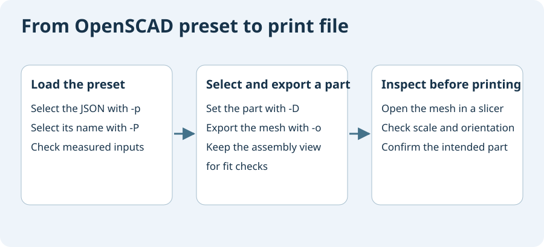

# 🗂️ OpenSCAD Project Structure, Parameters & Libraries

_Last reviewed: 2026-11-19_

*Part of the [OpenSCAD Design & Prototyping Guide](./README.md) · [CAD & 3D Printing](../README.md) · [ULTIMATE CYBERSECURITY MASTER GUIDE](../../README.md)*

**Navigate:** [OpenSCAD Hub](./README.md) · [Fundamentals](./01-fundamentals.md) · **Project Structure** · [Mockups & Fit Checks](./03-mockups-and-fit-checks.md) · [GPS Cradle Tutorial](./04-tutorial-gps-cradle.md) · [Design for Printing](./05-design-for-printing.md) · [Shortcuts](./06-keyboard-shortcuts.md)

**Prerequisites:** [Fundamentals](./01-fundamentals.md) (modules, variables and `include`/`use`).

## 🎯 Purpose

How to lay out an OpenSCAD project so it stays maintainable as it grows from one bracket to a multi-part enclosure: folder layout, parameter conventions, the Customizer, reusable libraries, saved parameter sets and command-line exports you can script.

---

## Contents

1. [Recommended Folder Layout](#recommended-folder-layout)
2. [Anatomy of a Main File](#anatomy-of-a-main-file)
3. [Customizer Annotations](#customizer-annotations)
4. [Naming & Parameter Conventions](#naming--parameter-conventions)
5. [include vs use](#include-vs-use)
6. [Writing Reusable Library Modules](#writing-reusable-library-modules)
7. [The Part Selector Pattern](#the-part-selector-pattern)
8. [Saved Parameter Sets](#saved-parameter-sets)
9. [Command-Line Export & Automation](#command-line-export--automation)
10. [Third-Party Libraries](#third-party-libraries)
11. [Version Control Tips](#version-control-tips)

---

## Recommended Folder Layout

Every project in this section follows the same layout as the worked example in [`examples/gps-cradle/`](./examples/gps-cradle/):

```text
examples/<project-name>/
├── <project>.scad        # MAIN FILE: parameters (Customizer), derived values,
│                         #   design checks, part modules and the part selector
├── <project>.json        # saved Customizer parameter sets (optional)
├── tutorial_steps.scad   # optional step-by-step viewer that includes the main file
├── check.sh              # exports STLs + runs the clash test (exit code for CI)
└── lib/
    ├── utils.scad        # generic helpers: slab(), stadium(), wire_path() ...
    ├── snapfit.scad      # snap tabs, PCB latches, strain calculation
    └── mockups.scad      # proxy models of the real hardware
```

> [!TIP]
> Keep **user-tunable parameters in the main file**. The Customizer only lists variables assigned at the top level of the file you opened, so parameters hidden in a `config.scad` that you `include` do not appear in the panel. Put *generic* code (helpers, snap-fit geometry, hardware mockups) in `lib/` and pass dimensions in as module arguments.

Older advice (and the first version of this page) suggested a separate `config.scad`. That still works for very large projects driven only from the command line, but for parts you tune interactively, one main file with Customizer sections is easier.

---

## Anatomy of a Main File

This layout keeps a design reviewable top to bottom. The following excerpt
illustrates file structure. See the linked GPS cradle project for runnable code.

```openscad
// 1. Header comment: what it is, coordinate system, list of parts
use <lib/utils.scad>              // 2. Libraries (use, not include)
use <lib/mockups.scad>

/* [Render] */                    // 3. Customizer parameters, grouped in tabs
part = "preview"; // [preview, body, lid]

/* [Fit & Walls] */
fit_gap = 0.30;   // clearance per side
wall    = 1.8;

/* [Hidden] */                    // 4. Constants and derived values
$fn = 64;
out_r = dev_width / 2 + fit_gap + wall;

assert(out_r < 30, "Too wide for the printer bed fixture");   // 5. Design checks

module body() { ... }             // 6. 2D plans, then parts, then mockups
module lid()  { ... }

if (part == "body") body();       // 7. The part selector (the only top-level geometry)
if (part == "lid")  lid();
```

---

## Customizer Annotations

The Customizer (**Window → Customizer**) turns specially formatted comments into a parameter panel.

| Comment Form | Widget | Example |
|---|---|---|
| `/* [Tab Name] */` | Starts a group/tab | `/* [Fit & Walls] */` |
| `// [min:max]` | Slider (integer steps) | `lid_explode = 15; // [0:40]` |
| `// [min:step:max]` | Slider with step | `section_x = 0; // [-30:0.5:30]` |
| `// [a, b, c]` | Dropdown (strings or numbers) | `part = "preview"; // [preview, body, lid]` |
| `// [-1:left, 1:right]` | Dropdown with labels | `port_side = -1; // [-1:left, 1:right]` |
| `true` / `false` value | Checkbox | `show_mockups = true;` |
| Comment on the line above | Description shown in the panel | `// clearance per side` |
| `/* [Hidden] */` | Everything after it is hidden | Derived values, `$fn`, `eps` |

> [!NOTE]
> Only **literal** values become widgets. `wall = 1.8;` shows up; `out_r = r + wall;` does not (and should not; it is derived). Put derived values under `/* [Hidden] */` so nobody "tunes" a number that should follow from others.

---

## Naming & Parameter Conventions

| Convention | Why | Example |
|---|---|---|
| Measured hardware gets its own group, labeled "measure yours" | Separates facts about the world from design choices | `dev_width = 38.5;` |
| Clearances are **per side** and named `*_gap` | Stops the "is it diametral?" argument | `fit_gap = 0.30;` |
| Print-process numbers are multiples of line width / layer height | Walls and inlays slice cleanly | `wall = 1.8; // 4 x 0.45` |
| Derived names describe geometry | Readable checks | `cav_far_y`, `pod_z0` |
| `eps = 0.01` for overlap/overshoot only | Never use it as a real clearance | `slab(-eps, h + eps)` |
| Booleans start with `show_` / `use_` | Obvious checkbox intent | `show_cable = true;` |
| Side selectors are `-1` / `+1` | Multiply into X and pass to `mirror()` | `port_side = -1;` |

---

## include vs use

| Statement | Imports Modules & Functions | Imports Variables | Runs Top-Level Geometry |
|---|---|---|---|
| `use <file.scad>` | ✅ | ❌ | ❌ |
| `include <file.scad>` | ✅ | ✅ | ✅ |

- Libraries are loaded with **`use`**, so they cannot accidentally add geometry or overwrite your variables.
- `include` is for when you *want* the other file's variables and output, such as `tutorial_steps.scad`, which includes the whole design and then sets `part = "none"` (last assignment wins) so only the tutorial step draws.
- OpenSCAD looks beside the file containing the statement first, then looks in its
  configured library paths. `lib/mockups.scad` can use `use <utils.scad>` because
  both files live in `lib/`. [OpenSCAD library search order](https://files.openscad.org/documentation/manual/Libraries.html).

---

## Writing Reusable Library Modules

A library module should be **frame-documented** and **dimension-agnostic**:

```openscad
// cantilever_tab(): a lid-to-wall snap.
// Local frame: the arm grows up +Z from z = 0, spans x in [-w/2, w/2] and
// y in [-t, 0]. The tooth sticks out toward +Y (toward the wall it locks into).
module cantilever_tab(w = 5, t = 1.2, len = 7, tooth = 0.85,
                      lead = 1.2, land = 0.6, catch_dz = 0.3) { ... }
```

1. **State the local frame** (where the origin is, which way the feature points). The caller then does all placement with `translate()`/`rotate()`/`mirror()`.
2. **Take every dimension as an argument with a sensible default.** No global variables inside library code.
3. **Pair features with their cutters.** `cantilever_tab()` has a matching `tab_recess()` using the same frame and arguments, so the two always agree.
4. **Pair geometry with its math.** `snap_strain()` lives beside the snap modules.

See [`lib/snapfit.scad`](./examples/gps-cradle/lib/snapfit.scad) and [`lib/mockups.scad`](./examples/gps-cradle/lib/mockups.scad) for complete examples.

---

## The Part Selector Pattern

One file, many outputs. A `part` dropdown chooses what to draw; every printable part has its own branch and its own print orientation.

```openscad
part = "preview"; // [preview, body, lid, inlay, gauge, sma_gauge, mockups, clash, clash_view, section]

module stand() translate([0, 0, sleeve_len]) rotate([-90, 0, 0]) children();  // print pose

if (part == "body")  stand() body();          // printable, already oriented for the bed
if (part == "lid")   lid();                   // printable, flat
if (part == "preview") {                      // assembly view: never exported
    color("SteelBlue") body();
    color("LightSteelBlue") translate([0, 0, lid_pose_z]) lid();
    if (show_mockups) mockups();
}
```

Rules that keep this safe:

- **Model in the assembly frame, rotate only at output.** `body()` is always modeled in handset coordinates; only the `part == "body"` branch applies `stand()`.
- **Mockups never appear in printable branches.**
- **Test parts are parts too.** `gauge` and `sma_gauge` are 10–20 minute prints that check the fit before you commit hours to the full body ([Mockups & Fit Checks](./03-mockups-and-fit-checks.md#test-coupons-gauges)).

---

## Saved Parameter Sets

The Customizer can save named presets to a JSON file next to the `.scad` file (same base name). You can also write them by hand. Values are stored as strings:

```json
{
    "fileFormatVersion": "1",
    "parameterSets": {
        "loose-fit": { "fit_gap": "0.45", "sma_hole_d": "6.7" },
        "cable-right-sma-left": { "port_side": "1", "sma_side": "-1" }
    }
}
```

Use them from the command line with `-p` (file) and `-P` (set name):

```bash
mkdir -p out
openscad -o out/body.stl -p gps_cradle.json -P loose-fit -D 'part="body"' gps_cradle.scad
```

---

## Command-Line Export & Automation



Run the Bash examples from the [GPS cradle example directory](./examples/gps-cradle/).
Select the intended part explicitly and inspect its mesh, scale, and orientation
in the slicer before printing.

Use `-o` to export without opening the GUI. Check `openscad --help` for the
options and formats in your installed build.
[OpenSCAD command-line manual](https://files.openscad.org/documentation/manual/Using_OpenSCAD_in_a_command_line_environment.html).

| Option | Purpose |
|---|---|
| `-o file.ext` | Export; the extension picks the format (`stl`, `3mf`, `off`, `amf`, `dxf`, `svg`, `png`, `echo`, `csg`). Use one invocation per output for portability across releases. |
| `-D 'name=value'` | Override a variable. Quote strings: `-D 'part="lid"'` |
| `-p file.json -P set` | Apply a saved parameter set |
| `--export-format asciistl\|binstl` | Choose STL flavor |
| `--imgsize=W,H` `--camera=tx,ty,tz,rx,ry,rz,dist` `--colorscheme=Tomorrow` | PNG renders for docs |
| `--viewall --autocenter` | Fit the PNG camera to the model |
| `--hardwarnings` | Fail on the first warning (good in CI) |
| `-q` | Quiet (also hides `echo()` output) |
| `--backend=manifold` | Snapshots only: choose the Manifold engine |

```bash
mkdir -p out images

# Export the body, lid, and inlay
for p in body lid inlay; do
  openscad -o "out/gps_cradle_$p.stl" -D "part=\"$p\"" gps_cradle.scad
done

# Capture design-check output (echo/assert) without exporting geometry
openscad -o out/checks.echo gps_cradle.scad

# Documentation image (needs a display; on a headless server prefix xvfb-run -a)
openscad -o images/assembly.png --imgsize=1000,750 --colorscheme=Tomorrow \
         --camera=0,30,-5,60,0,140,250 -D 'part="preview"' gps_cradle.scad
```

The example ships a ready-made [`check.sh`](./examples/gps-cradle/check.sh): it runs the design checks, exports `body`/`lid`/`inlay` STLs to `out/` and fails if the clash test finds any overlap. Any extra arguments pass through, so `./check.sh -p gps_cradle.json -P loose-fit` tests a preset.

---

## Third-Party Libraries

| Library | Good For | Notes |
|---|---|---|
| [BOSL2](https://github.com/BelfrySCAD/BOSL2) | Attachments, rounding, threads, gears, hinges, paths | Large and powerful; clone it into your OpenSCAD library folder and `include <BOSL2/std.scad>` |
| [MCAD](https://github.com/openscad/MCAD) | Classic nuts, bolts, gears, bearings | Bundled with many OpenSCAD installs |

> [!TIP]
> Library folder: **File → Show Library Folder** in the GUI. Anything you put there can be loaded with `use <...>` from any project. For repository examples, prefer self-contained `lib/` files so a fresh clone renders without extra installs.

---

## Version Control Tips

- Commit `.scad`, `.json` presets, `check.sh` and small documentation PNGs. Do not commit `out/` exports; regenerate them.
- Write the *reason* for a dimension in a comment (`// measured with calipers 2026-11-10`, `// +0.25 after test print`). Future you will not remember why `sma_hole_d` is 6.6.
- Tag a version when a part has been printed and verified (`gps-cradle-v4`), and note the printer, nozzle and material in the commit message.

---

## See Also

- [Fundamentals](./01-fundamentals.md)
- [Mockups & Fit Checks](./03-mockups-and-fit-checks.md)
- [GPS Cradle Tutorial](./04-tutorial-gps-cradle.md)
- [Official Customizer documentation](https://en.wikibooks.org/wiki/OpenSCAD_User_Manual/Customizer)

---
[⬅️ Back to Master Index](../../README.md) | [🎯 Role Navigation](../../START_HERE.md) | [Legal Notice](../../LEGAL.md)
