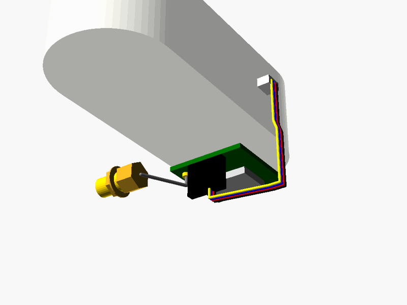
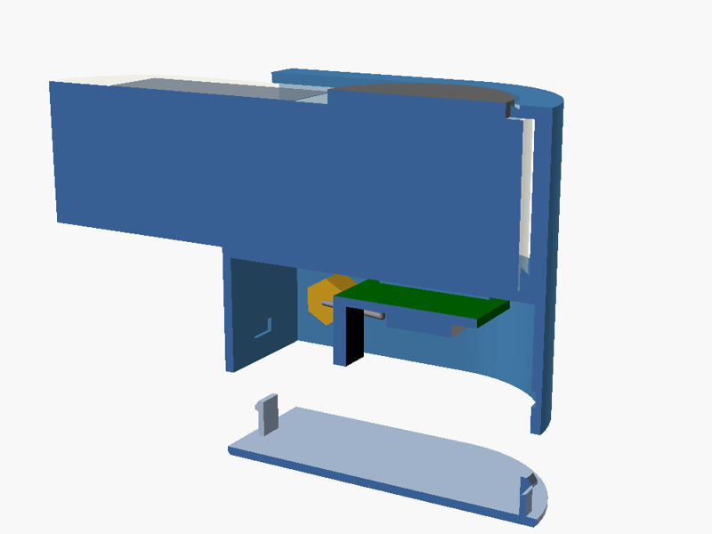
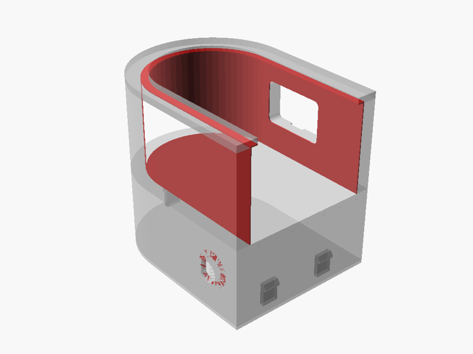
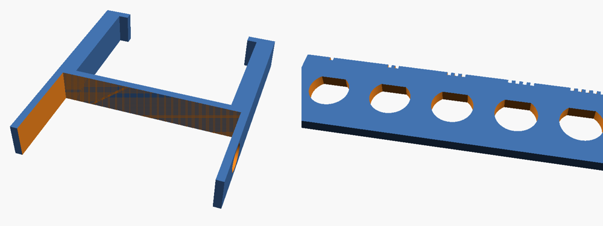

# 📐 Mocking Up Hardware & Proving It Fits

_Last reviewed: 2026-11-14_

*Part of the [OpenSCAD Design & Prototyping Guide](./README.md) · [CAD & 3D Printing](../README.md) · [ULTIMATE CYBERSECURITY MASTER GUIDE](../../README.md)*

**Navigate:** [OpenSCAD Hub](./README.md) · [Fundamentals](./01-fundamentals.md) · [Project Structure](./02-project-structure.md) · **Mockups & Fit Checks** · [GPS Cradle Tutorial](./04-tutorial-gps-cradle.md) · [Design for Printing](./05-design-for-printing.md) · [Shortcuts](./06-keyboard-shortcuts.md)

**Prerequisites:** [Fundamentals](./01-fundamentals.md) (`%`/`#` modifiers, `intersection()`, `assert()`).

## 🎯 Purpose

Cases, cradles, adapters and mounts fail for one reason: something real did not fit. This page shows how to model the hardware you are designing around (a "mockup" or "proxy"), how much detail it needs, and four ways to prove fit **before** printing: visual ghosts, section views, automatic clash tests and numeric design checks, followed by quick test-coupon prints.

<p align="center">
  
</p>

---

## Contents

1. [Measure First](#measure-first)
2. [How Detailed Should a Mockup Be?](#how-detailed-should-a-mockup-be)
3. [Mockup Recipes](#mockup-recipes)
4. [Keep-Out Volumes](#keep-out-volumes)
5. [Looking: Ghosts, Highlights & Sections](#looking-ghosts-highlights--sections)
6. [Clash Testing](#clash-testing)
7. [Numeric Design Checks](#numeric-design-checks)
8. [Test Coupons (Gauges)](#test-coupons-gauges)
9. [Fit-Check Checklist](#fit-check-checklist)

---

## Measure First

| Source | Trust Level | Use It For |
|---|---|---|
| Your own calipers on **your** unit | Highest | Every dimension that touches the print |
| Vendor dimension drawing / datasheet | Good starting point | Planning before the hardware arrives |
| Retail listing ("approx. 28 x 27 mm") | Low | Rough envelope only |
| A photo with a ruler | Lowest | Connector *positions* when nothing else exists; mark them "estimated" |

Practical measuring rules:

- Measure each dimension **three times in different spots** and record the largest. Molded cases taper and boards are not perfectly square.
- **Datasheet envelopes often include protrusions.** LILYGO lists the T-Embed CC1101 as 97.5 × 39 × 31 mm, an overall maximum that likely includes protrusions such as the dial. The tutorial instead uses a measured 27.6 mm body plus a separate 2.5 mm dial proxy, because the body and the dial interact with different features. Measure your own unit.
- Record **positions from a datum**, not center-to-center chains (`port_y = 30 // from the dial tip`). Chained measurements accumulate error.
- Write the source next to each parameter: `// measured`, `// datasheet`, `// estimated from photo`.

> [!TIP]
> If a position is only estimated, design the feature generously (a window rather than a hole, a slot rather than a pin) and make it a parameter you can nudge after the first gauge print.

---

## How Detailed Should a Mockup Be?

Model **what can collide or must align**, nothing else.

| Level | What You Model | Example From the Tutorial |
|---|---|---|
| 1. Envelope | Outer shape the part must hold or clear | T-Embed body as an extruded stadium |
| 2. Interfaces | Connectors, buttons, mounting edges, protrusions | QWIIC socket position, dial, u.FL jack, pin header |
| 3. Mating hardware | Things that plug in or bolt on | QWIIC plug body, SMA nut and washer |
| 4. Keep-outs | Space needed for fingers, tools, cable bends, RF | SMA inner keep-out cylinder, cable bend room |

A mockup made of five cubes that is *right* beats an imported, detailed STEP model that is *wrong* (or slow). If you do have a vendor STL, `import("board.stl")` works; wrap it in `%` and still add your own simple keep-outs on top.

---

## Mockup Recipes

All recipes live in [`examples/gps-cradle/lib/mockups.scad`](./examples/gps-cradle/lib/mockups.scad) and [`lib/utils.scad`](./examples/gps-cradle/lib/utils.scad). Each mockup documents its **local frame** so placement is a single `translate()`. The snippets below are condensed; open the files for the complete modules.

### Device Body (Extruded Plan)

```openscad
// Frame: back face on z = 0, screen toward +Z, dial tip touching y = 0
module tembed_mock(L = 97.5, W = 38.5, D = 27.6, dial_d = 32.5, dial_h = 2.5, ...) {
    color("Ivory", 0.55) slab(0, D) stadium(W, L);                  // body
    color("DimGray") translate([0, W / 2, D]) cylinder(d = dial_d, h = dial_h);
}
```

Build devices from the **same 2D plan** your enclosure uses (`stadium()` here). Then `offset()` of that plan gives you the sleeve bore and outer wall automatically ([Fundamentals: Hull, Offset & Minkowski](./01-fundamentals.md#hull-offset--minkowski)).

### Circuit Board With Components

```openscad
// Frame: PCB centered on x/y, back face on z = 0, components hang toward -Z
module gtu7_mock(pcb = [26.6, 27.6, 1.6], header_pins = 5, header_drop = 11, ...) {
    color("DarkGreen") translate([-pcb[0]/2, -pcb[1]/2, -pcb[2]]) cube(pcb);
    color("Silver")    translate([-8, -9.1, -pcb[2] - 2.4]) cube([16, 12.2, 2.4]); // RF module can
    color("Gold")      translate([10, 9.5, -pcb[2] - 1.25]) cylinder(d = 2.6, h = 1.25); // u.FL
    hw = header_pins * 2.54;                                   // 2.54 mm pitch header
    color("Black") translate([-hw/2, pcb[1]/2 - 2.54, -pcb[2] - header_drop])
        cube([hw, 2.54, header_drop]);                         // header + mated plug
}
```

Model the **mated** connector, not the bare header. `header_drop` is the header plus the Dupont housing plus a little wire, because that is what must fit inside the pod.

### Connectors & Bulkheads

```openscad
// SMA rear-mount bulkhead. Axis +X (out of the box), x = 0 is the panel's outer face.
module sma_bulkhead_mock(panel_t = 1.8, thread_len = 9.5, body_len = 6) {
    color("Gold") translate([-panel_t - 0.5, 0, 0]) rotate([0, 90, 0])
        cylinder(d = 6.35, h = thread_len + 0.5);               // 1/4-36 UNS barrel
    color("Goldenrod") rotate([0, 90, 0]) cylinder(d = 10.2, h = 0.5);        // lock washer
    color("Goldenrod") translate([0.5, 0, 0]) rotate([0, 90, 0])
        cylinder(d = 8 / cos(30), h = 2, $fn = 6);                // 8 mm hex nut
    color("Goldenrod") translate([-panel_t - body_len, 0, 0]) rotate([0, 90, 0])
        cylinder(d = 8 / cos(30), h = body_len, $fn = 6);         // inner body
}
```

SMA connectors use a 1/4"-36 UNS thread (6.35 mm major diameter) and typically an 8 mm hex nut; panel-hole recommendations vary by vendor, and many bulkheads have a **D-flat** on the thread to stop rotation. Check your part's drawing ([connector reference](#see-also)).

### Cables & Ribbons

A wire is a chain of capsules. `hull()` of two spheres makes a capsule, and chaining them follows any path with rounded bends:

```openscad
module wire_path(points, d = 1, fn = 12) {
    for (i = [1 : len(points) - 1])
        hull() {
            translate(points[i - 1]) sphere(d = d, $fn = fn);
            translate(points[i])     sphere(d = d, $fn = fn);
        }
}

// Flat ribbon: the same path, shifted sideways for each conductor
module ribbon(points, n = 4, pitch = 1.0, d = 0.9, across = [0, 1, 0],
              colors = ["black", "red", "blue", "yellow"]) {
    for (k = [0 : n - 1]) {
        shift = (k - (n - 1) / 2) * pitch * across;
        color(colors[k % len(colors)]) wire_path([for (p = points) p + shift], d = d);
    }
}
```

Define the path with **named, derived points** (`[cable_x, port_y, port_z - 2]`) rather than raw numbers, so the cable follows when you move the port or change the wall.

> [!WARNING]
> Real cables need a **bend radius**. A sharp corner in a mockup is a promise you cannot keep with a 1.13 mm coax pigtail. Leave several millimeters around every bend in the path and treat that space as a keep-out.

---

## Keep-Out Volumes

A keep-out is an invisible solid that says "nothing printed may be here". Examples:

- The space around an SMA bulkhead's inner nut and flange, plus wrench room
- The finger/plug volume in front of a USB-C or QWIIC socket
- A cable bend envelope
- An antenna's clearance zone (keep plastic and especially metal-filled filaments away; verify with a [NanoVNA](../../SDR/nanovna/05-antenna-tuning.md) once printed)

In the tutorial the SMA keep-out is an 11 mm cylinder inside the pod wall. It is included in the clash test, so if you move the SMA hole too close to the board or the far wall, the test fails.

---

## Looking: Ghosts, Highlights & Sections

| Technique | Code | What It Shows |
|---|---|---|
| Ghost the hardware | `%tembed_mock();` | Hardware visible, but never exported |
| Highlight a cutter | `#port_window();` | Exactly what a `difference()` removes |
| Isolate a part | `!pod();` | Only this subtree, fast preview |
| Section view | `keep_x_above(0) children();` | Cut the assembly open at a plane |

A section is just an `intersection()` with a big cube:

```openscad
module keep_x_above(x0 = 0, size = 400) {
    intersection() {
        children();
        translate([x0, -size / 2, -size / 2]) cube(size);
    }
}
```

Apply it to each colored item separately so preview colors survive (the tutorial's `cut()` wrapper does this). Set `part = "section"` and drag the `section_x` slider through the model.

<p align="center">
  
</p>

---

## Clash Testing

The intersection of a printed part and a mockup **should be empty**. If it is not, the leftover solid is the clash, at its exact size and position.

```openscad
module hardware_solids() { ... }   // mockups that must not touch the print (no cables)

if (part == "clash") {             // should export an EMPTY model
    intersection() { body(); hardware_solids(); }
}
if (part == "clash_view") {        // same, drawn in red inside a ghosted assembly
    %body();
    color("Red") intersection() { body(); hardware_solids(); }
}
```

<p align="center">
  
</p>

*Above: `clash_view` with `fit_gap = -0.3`, a deliberate mistake. Every red surface is plastic that would hit the handset.*

**Intended contact.** Some parts are *supposed* to touch: the handset rests on the back plate and the board rests on its ledges. Those faces would show up as zero-thickness "clashes". Nudge them apart by a tiny `contact_eps` (0.02 mm) inside `hardware_solids()` only, with a comment saying why. A zero `fit_gap` will still be reported, correctly, because the sides then touch along their whole length.

**Exclude flexible things.** Cables are meant to lie against walls; leave them out of the clash solids and check them visually.

### Automating It

OpenSCAD 2021.01 exports an empty STL (zero facets) for an empty result; newer builds may refuse to export an empty object. Either way, "no facets" means "no clash". The example's [`check.sh`](./examples/gps-cradle/check.sh) turns that into an exit code:

```bash
openscad -o out/clash.stl --export-format asciistl -D 'part="clash"' gps_cradle.scad
facets=$(grep -c "facet normal" out/clash.stl || true)
[ "${facets:-0}" -eq 0 ] && echo PASS || echo "FAIL: $facets clash facets"
```

Run it after **every** parameter change. It takes about six seconds for the example.

---

## Numeric Design Checks

Some rules are easier to state as math than as geometry. Put them in `assert()` so a bad parameter stops the build with a useful message:

```openscad
// Is a point inside the stadium-shaped cavity, with margin m?
function in_cavity(p, m = 0) =
    p[1] >= r ? abs(p[0]) <= cav_r - m
              : norm([p[0], p[1] - r]) <= cav_r - m;

assert(in_cavity([pcb_w / 2 + pcb_gap + latch_t, pcb_y0], 1),
       "Board/latch corner hits the rounded tip: increase pcb_y0");
assert(pcb_bot_z - header_drop > pod_z0 + 1,
       "Header + plug is deeper than the pod: increase pod_depth");
assert(lid_strain < max_strain && latch_strain < max_strain,
       "Snap strain above max_strain: lengthen the arm, thin it, or reduce the hook");
```

Good candidates: board corners inside rounded cavities, connector keep-outs vs. walls, stack heights vs. pod depth, snap-fit strain ([Design for Printing](./05-design-for-printing.md#snap-fits)), minimum wall thickness after a recess is cut.

---

## Test Coupons (Gauges)

The last check is physical. Print small slices that contain the critical fits before the full part:

| Coupon | What It Answers | Tutorial Part |
|---|---|---|
| Body slice | Does the handset slide in? Does the lip hold? Does the SMA thread pass? | `part = "gauge"` (an 8 mm slice through the sleeve, pod and SMA hole) |
| Hole ladder | Which printed hole size fits *this* connector on *this* printer? | `part = "sma_gauge"` (6.4 to 6.8 mm, notches identify each hole) |
| Snap coupon | Does the snap engage and release without cracking? | Print the lid; test against the gauge slice |

<p align="center">
  
</p>

Feed the result back into the parameters (`fit_gap`, `sma_hole_d`), note the printer and material in a comment, and re-run the clash test.

---

## Fit-Check Checklist

- [ ] Every hardware dimension has a source comment (measured / datasheet / estimated)
- [ ] Mockups include mated plugs, not just bare sockets
- [ ] Keep-outs exist for tools, fingers, bends and RF hardware
- [ ] `part = "clash"` exports an empty model (or `check.sh` passes)
- [ ] All `assert()` checks pass with the parameters you will print
- [ ] Section view inspected through every connector and snap
- [ ] Gauge / hole-ladder coupons printed and parameters updated
- [ ] Cable paths have bend room and an exit that does not pinch

---

## See Also

- [GPS Cradle Tutorial](./04-tutorial-gps-cradle.md): all of the above applied step by step
- [Design for Printing](./05-design-for-printing.md): tolerances and snap-fit math
- [LILYGO T-Embed CC1101 wiki](https://wiki.lilygo.cc/products/t-embed-series/t-embed-cc1101/): vendor dimensions and expansion ports
- [SMA connector dimensions & cutouts (TEJTE)](https://tejte.com/?p=38093): thread, hex and panel-cutout background
- [Hardware Hacking](../../HardwareHacking/README.md) and [SDR](../../SDR/README.md): the gear these enclosures usually carry

---
[⬅️ Back to Master Index](../../README.md) | [🎯 Role Navigation](../../START_HERE.md) | [Legal Notice](../../LEGAL.md)
