# 🛰️ Tutorial: T-Embed CC1101 Sleeve With GT-U7 GPS Pod

_Last reviewed: 2026-11-14_

*Part of the [OpenSCAD Design & Prototyping Guide](./README.md) · [CAD & 3D Printing](../README.md) · [ULTIMATE CYBERSECURITY MASTER GUIDE](../../README.md)*

**Navigate:** [OpenSCAD Hub](./README.md) · [Fundamentals](./01-fundamentals.md) · [Project Structure](./02-project-structure.md) · [Mockups & Fit Checks](./03-mockups-and-fit-checks.md) · **GPS Cradle Tutorial** · [Design for Printing](./05-design-for-printing.md) · [Shortcuts](./06-keyboard-shortcuts.md)

**Prerequisites:** [Fundamentals](./01-fundamentals.md) and a skim of [Mockups & Fit Checks](./03-mockups-and-fit-checks.md).

<p align="center">
  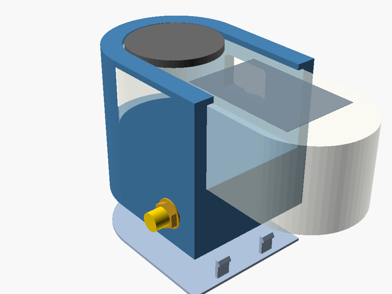
</p>

## 🎯 Purpose

Build a complete, printable accessory from scratch: a sleeve that slides onto a **LILYGO T-Embed CC1101** handset and carries a **GT-U7 GPS receiver** in a pod behind it, with an **SMA** antenna bulkhead, a **QWIIC** cable routed from the handset's side port into the pod, spring latches that clip the GPS board in, and a snap-on lid with an optional two-color circuit-trace inlay.

Along the way you will mock up every piece of hardware and prove it fits with ghosts, section views, an automatic clash test and design-rule assertions before printing anything.

| Term | Meaning |
|---|---|
| **GNSS / GPS** | Satellite positioning; the GT-U7 is a small receiver board that listings describe as u-blox 7th-generation based and NEO-6M software compatible |
| **SMA** | Threaded RF coaxial connector (1/4"-36 UNS) used for external antennas |
| **u.FL / IPEX** | Tiny snap-on RF connector on the GPS board; a pigtail cable adapts it to the SMA bulkhead |
| **QWIIC** | 4-pin JST-SH 1.0 mm expansion connector, normally I²C (the T-Embed CC1101 has two) |
| **PCB** | Printed Circuit Board |

> [!NOTE]
> This example is a cleaned-up, fully parametric rebuild of the "v4" cradle concept. It is **verified in software only**: it renders, exports and passes its clash test and assertions in OpenSCAD 2021.01. Dimensions marked "measure yours" are vendor or estimated values. Print the [test coupons](#step-15-test-coupons-print-orientation--export) before the full body.

---

## Contents

| Step | Topic | Techniques |
|---|---|---|
| [0](#step-0-get-the-files) | Get the files | Project layout, `tutorial_steps.scad` |
| [1](#step-1-measure--record-the-hardware) | Measure & record the hardware | Parameter groups, source comments |
| [2](#step-2-choose-a-coordinate-system) | Choose a coordinate system | Datums, axis meaning |
| [3](#step-3-draw-the-2d-plans) | Draw the 2D plans | `hull()`, `offset()`, the offset ladder |
| [4](#step-4-mock-up-the-hardware) | Mock up the hardware | Proxy modules, local frames |
| [5](#step-5-build-the-sleeve) | Build the sleeve | `slab()`, `difference()`, lips |
| [6](#step-6-cut-the-port-window--cable-groove) | Port window & cable groove | `#` debug cutters, rounded slots |
| [7](#step-7-add-the-gps-pod) | GPS pod shell | Hollow slabs, derived Z levels |
| [8](#step-8-sma-bulkhead-hole-with-a-d-flat) | SMA bulkhead hole | D-flat anti-rotation, print-friendly holes |
| [9](#step-9-cable-entry-notch) | Cable entry notch | Open-ended U slots |
| [10](#step-10-pcb-ledges--snap-latches) | PCB ledges & snap latches | 2D profile extrusion, `mirror()`, strain |
| [11](#step-11-snap-on-lid-tabs--recesses) | Lid, snap tabs & recesses | Paired feature/cutter modules |
| [12](#step-12-two-color-circuit-inlay) | Two-color inlay | Recess + matching inlay part |
| [13](#step-13-route-the-cables) | Route the cables | `wire_path()`, `ribbon()`, derived paths |
| [14](#step-14-prove-it-fits) | Prove it fits | `assert()`, clash test, section view |
| [15](#step-15-test-coupons-print-orientation--export) | Coupons, orientation & export | `stand()`, gauges, `check.sh` |
| [16](#step-16-adapt-it-to-your-hardware) | Adapt it | Parameter map |

---

## Step 0: Get the Files

```text
CAD/OpenSCAD/examples/gps-cradle/
├── gps_cradle.scad       # the design (open this one for real work)
├── tutorial_steps.scad   # step viewer: includes gps_cradle.scad, adds a "step" slider
├── gps_cradle.json       # saved parameter sets (pla-default, loose-fit, cable-right-sma-left)
├── check.sh              # export STLs + clash test
└── lib/
    ├── utils.scad        # slab(), stadium(), wire_path(), ribbon(), keep_x_above(), x_slot()
    ├── snapfit.scad      # cantilever_tab(), tab_recess(), pcb_side_latch(), pcb_ledge(), snap_strain()
    └── mockups.scad      # tembed_mock(), qwiic_plug_mock(), gtu7_mock(), sma_bulkhead_mock()
```

1. Open **`tutorial_steps.scad`** in OpenSCAD.
2. Open **Window → Customizer** and move the **step** slider from 1 to 9 while you read. Each step below says which slider position matches.
3. Keep **`gps_cradle.scad`** open in your editor; code blocks on this page are copied from it or from `lib/`, occasionally reformatted or condensed (marked with `...` or a comment) to fit the page.

---

## Step 1: Measure & Record the Hardware

Before any geometry, collect the numbers and put them in labeled Customizer groups. Facts about the world (measured) are kept apart from design choices (walls, gaps).

```openscad
/* [Handset: LILYGO T-Embed CC1101 - measure yours] */
dev_length = 97.5;  // tip of dial end to far end
dev_width  = 38.5;  // across the straight sides
dev_depth  = 27.6;  // back to front rim (dial not included)
dial_d     = 32.5;
dial_h     = 2.5;
port_y     = 30;    // QWIIC socket center, measured from the dial tip
port_z     = 15;    // QWIIC socket center, measured up from the back
port_side  = -1;    // [-1:left, 1:right]

/* [GPS Pod & Board] */
pcb_w = 26.6;  pcb_l = 27.6;  pcb_t = 1.6;   // GT-U7 carrier board
```

| Hardware | Number | Source |
|---|---|---|
| T-Embed CC1101 envelope | 97.5 × 39 × 31 mm (overall maximum) | LILYGO wiki |
| T-Embed body width / depth | 38.5 / 27.6 mm | Measured; replace with yours |
| QWIIC port position | y = 30, z = 15 | Estimated; **measure** |
| GT-U7 board | ≈ 27.6 × 26.6 mm, 1.6 mm thick | Retail listings; measure |
| SMA bulkhead | 1/4"-36 UNS (6.35 mm), 8 mm hex nut, D-flat on many parts | Connector vendors |

> [!WARNING]
> **Check the electrical side before printing.** The GT-U7 talks UART (NMEA sentences), not I²C, so the QWIIC port's two signal lines must be assigned as UART RX/TX in your firmware's GPS settings; confirm against the T-Embed pinout. Retail listings rate the GT-U7 supply at 3.6–5 V while some list 3.3 V or 5 V logic, and a QWIIC port supplies 3.3 V. Confirm your board runs reliably on 3.3 V or feed it 5 V another way.

> [!TIP]
> Notice `dev_width = 38.5` versus the published 39 mm. Molded cases vary; a sleeve designed from the datasheet can be 0.5 mm too loose or too tight. Measure, then let `fit_gap` add the clearance.

---

## Step 2: Choose a Coordinate System

Decide what each axis means and where zero is, then write it in the header so every module agrees.

```openscad
// Coordinate system (millimeters):
//   +Y  long axis of the handset; the dial tip touches y = 0
//   +Z  out of the screen; the handset's back face sits on z = 0
//   -Z  the GPS pod hangs behind the handset, closed by a snap-on lid
//   X   centered; port_side = -1 puts the QWIIC cable on the left (-X)
```

Why these datums:

- **`y = 0` at the dial tip:** the sleeve grips that end, so every feature (port, board, SMA) is measured from a surface you can put calipers on.
- **`z = 0` at the handset's back:** everything above zero is the sleeve; everything below is the pod. One number (`wall`) separates them.
- **X centered:** left/right features become `±` and mirror cleanly with a `-1`/`+1` side selector.

Derived values turn those decisions into named levels. You will use these names in every later step:

```openscad
r      = dev_width / 2;
in_r   = r + fit_gap;              // sleeve bore half-width
out_r  = in_r + arm_wall;          // outside half-width
pod_z0 = -wall - pod_depth;        // pod rim = top face of the lid
cav_r  = out_r - wall;             // pod cavity half-width
pcb_back_z = -wall - standoff_h;   // board back face
sma_z  = pod_z0 + pod_depth / 2;
```

---

## Step 3: Draw the 2D Plans

*Slider: **step = 1***

Everything in this design is an outline grown or shrunk from **one** shape: the handset seen from the front, a stadium.

```openscad
// lib/utils.scad
module stadium(w, len) {
    hull() for (y = [w / 2, len - w / 2]) translate([0, y]) circle(d = w);
}

// gps_cradle.scad
module dev_plan()  stadium(dev_width, dev_length);
module bore_plan() offset(r = fit_gap) dev_plan();

module outer_plan() {                       // outside of sleeve and pod
    intersection() {
        offset(r = fit_gap + arm_wall) dev_plan();
        translate([-100, -100]) square([200, 100 + sleeve_len]);   // cut at the open end
    }
}
module cavity_plan() offset(delta = -wall) outer_plan();            // inside of the pod
```

<p align="center">
  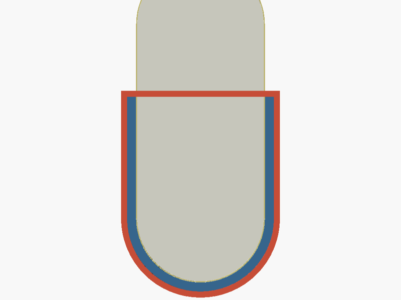
</p>

**What is going on:**

- `hull()` of two circles is the stadium: two semicircular ends joined by straight sides.
- `offset(r = fit_gap)` grows it by the clearance: that is the bore the handset slides into.
- `offset(r = fit_gap + arm_wall)` grows it again: the outside of the sleeve. The `intersection()` with a square stops it at `sleeve_len`, making the sleeve open-ended so the handset can slide in.
- `offset(delta = -wall)` of the outside gives the pod's inner cavity, including a wall across the cut end.

Change `dev_width` and **every** wall, lip and cavity follows. This "offset ladder" is the single most useful habit in enclosure design.

---

## Step 4: Mock Up the Hardware

*Slider: **step = 2***

Before designing features, place proxies of all the hardware in the assembly frame. Each mockup has a documented local frame (see [Mockups & Fit Checks](./03-mockups-and-fit-checks.md#mockup-recipes)), so placement is one transform:

```openscad
module mockups() {
    tembed_mock(L = dev_length, W = dev_width, D = dev_depth,
                dial_d = dial_d, dial_h = dial_h,
                port_y = port_y, port_z = port_z, port_side = port_side);
    translate([dev_side_x, port_y, port_z]) mirror([port_side < 0 ? 1 : 0, 0, 0])
        qwiic_plug_mock(len = plug_len);                       // mated plug, not bare socket
    translate([0, pcb_cy, pcb_back_z])
        gtu7_mock(pcb = [pcb_w, pcb_l, pcb_t], header_drop = header_drop);
    translate([sma_side * out_r, sma_y, sma_z]) mirror([sma_side < 0 ? 1 : 0, 0, 0])
        sma_bulkhead_mock(panel_t = wall);
    if (show_cable) {
        ribbon(cable_pts, n = 4, pitch = 1.0, d = 0.9);
        color("Gray") wire_path(coax_pts, d = 1.13);
    }
}
```

<p align="center">
  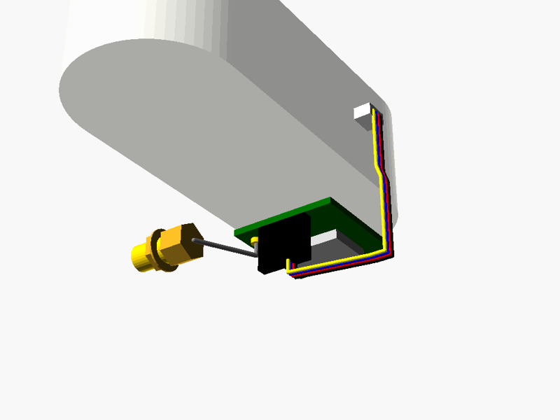
</p>

**What is going on:**

- `mirror([port_side < 0 ? 1 : 0, 0, 0])` flips the plug to the left when `port_side = -1`. The mockup is written once, pointing +X.
- The GPS board is placed by its **back face** (`pcb_back_z`), because that face rests on the ledges you will build in Step 10.
- Notice how much space the **mated** header plug (`header_drop = 11`) needs below the board. That number, not the 1.6 mm board, sets the pod depth.

---

## Step 5: Build the Sleeve

*Slider: **step = 3***

The sleeve is three slabs of 2D plans: a back plate, side arms around the bore, and a front lip that reaches over the screen bezel.

```openscad
// lib/utils.scad
module slab(z, h) { translate([0, 0, z]) linear_extrude(height = h) children(); }

// gps_cradle.scad (inside sleeve(), before the cutters)
slab(-wall, wall) outer_plan();                                          // back plate
slab(-eps, dev_depth + fit_gap + eps) difference() { outer_plan(); bore_plan(); }  // arms
slab(dev_depth + fit_gap - eps, lip_t)                                   // front lip
    difference() { outer_plan(); offset(delta = -front_lip) dev_plan(); }
```

<p align="center">
  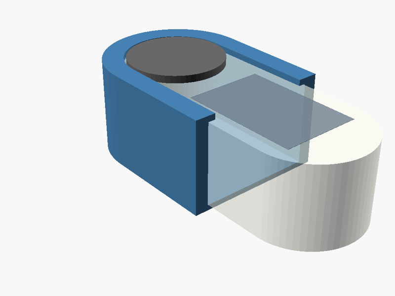
</p>

**What is going on:**

- `slab(z, h)` is a two-line helper that turns any 2D plan into a solid at a given height. Writing parts as "plan + slab" keeps the code readable.
- The **arms** are the ring between the outer plan and the bore.
- The **lip** is the outer plan minus the handset outline shrunk by `front_lip` (2.2 mm), so it overlaps the bezel by that much and holds the handset against the back plate. Because the plan is cut at `sleeve_len`, the lip is open at that end too: the handset slides in from there.
- **`eps` overlaps.** The arms start at `-eps` and end at `+eps` so they fuse with the plate and lip. The back plate itself stops exactly at `z = 0`, where the handset sits, so the clash test does not see a 0.01 mm overlap with the handset.

> [!TIP]
> Try `front_lip = 3.5` and preview with the ghosted handset: you will see the lip start to cover the screen. The clash test (Step 14) catches the subtler case of the lip hitting the dial.

---

## Step 6: Cut the Port Window & Cable Groove

*Slider: **step = 4***

The QWIIC plug needs a window through the arm, and the cable needs a shallow groove to run down the outside.

```openscad
// lib/utils.scad: a rounded rectangular slot along X
module x_slot(ly, lz, depth, corner = 1.5) {
    c = min(corner, ly / 2 - 0.01, lz / 2 - 0.01);
    hull() for (y = [-ly / 2 + c, ly / 2 - c], z = [-lz / 2 + c, lz / 2 - c])
        translate([0, y, z]) rotate([0, 90, 0])
            cylinder(r = c, h = depth, center = true, $fn = 24);
}

// gps_cradle.scad
module port_window() {
    translate([port_side * (in_r + out_r) / 2, (win_y0 + win_y1) / 2, port_z])
        x_slot(win_y1 - win_y0, win_h, arm_wall + 4, corner = 1.5);
}

module groove() {      // shallow channel from the window down to the back plate
    gz1 = port_z - win_h / 2 + 1;
    translate([port_side * out_r, port_y, gz1 / 2 - 1])
        cube([2 * groove_d, groove_w, gz1 + 2], center = true);
}
```

<p align="center">
  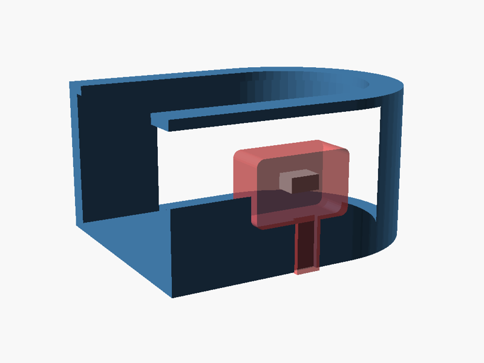
</p>

**What is going on:**

- The window is centered **in the middle of the arm** (`(in_r + out_r) / 2`) and made `arm_wall + 4` deep, so it overshoots both faces by 2 mm. No coincident faces.
- `x_slot()` is the hull of four short cylinders: a rectangle with rounded corners. Rounded corners print better and do not start cracks.
- The window is **bigger than the socket** (20 × 13 mm) on purpose: the port position is only estimated, and the plug and your fingers need room. Make it tighter once you have measured.
- In `tutorial_steps.scad` the cutters are drawn with `#`, so you see exactly what `difference()` removes.

---

## Step 7: Add the GPS Pod

*Slider: **step = 5***

The pod is the same outer plan, extruded below the back plate and hollowed by the cavity plan. It is open toward `-Z`; the lid closes it.

```openscad
// inside pod(), before the cutters
slab(pod_z0, pod_depth + eps) outer_plan();          // solid block
slab(pod_z0 - 1, pod_depth + 1) cavity_plan();        // minus the cavity (open at the rim)
```

<p align="center">
  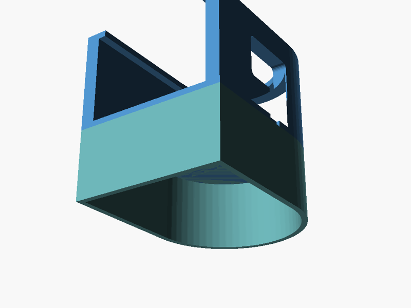
</p>

**What is going on:**

- `pod_z0 = -wall - pod_depth` is the rim. The cavity starts 1 mm *past* the rim (overshoot) and ends exactly at the back plate's underside (`-wall`).
- Because both come from `outer_plan()`, the pod's outside is flush with the sleeve: one continuous body.
- `pod_depth = 22` came from Step 4: 4 mm standoff + 1.6 mm board + 11 mm header and plug + room for the wires to turn. An `assert()` keeps that true if you change it (Step 14).

---

## Step 8: SMA Bulkhead Hole With a D-Flat

*Slider: **step = 6***

```openscad
module sma_hole_2d() {
    if (sma_flat > 0)
        intersection() {
            circle(d = sma_hole_d);
            translate([-sma_hole_d / 2, -sma_hole_d / 2]) square([sma_hole_d, sma_flat]);
        }
    else circle(d = sma_hole_d);
}

module sma_hole() {
    // The flat faces -Y, which is "up" when the body is printed standing.
    translate([sma_side * (out_r - wall / 2), sma_y, sma_z])
        rotate([0, 90, 0]) linear_extrude(height = wall + 2, center = true)
            mirror([0, 1]) sma_hole_2d();
}
```

<p align="center">
  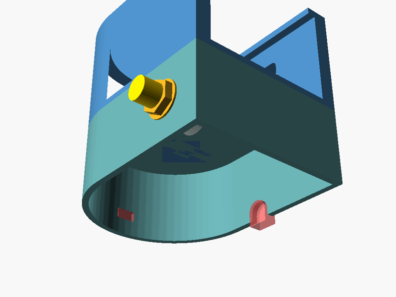
</p>

**What is going on:**

- **D-flat:** `intersection()` of a circle and a square trims one side flat. Many SMA bulkheads have a matching flat on the thread, so the connector cannot spin when you tighten the antenna. Set `sma_flat = 0` for a plain round hole.
- **Print-friendly:** the body prints standing on its open end (Step 15), so `-Y` is "up" on the printer. A flat on top of a horizontal hole is a short bridge instead of a drooping arc: the same idea as a teardrop hole.
- **Clearance:** 6.35 mm thread + about 0.25 mm = `sma_hole_d = 6.6`. Do not trust this number; print `sma_gauge` (Step 15) and pick the hole that fits *your* printer.
- The ghosted cylinder in the image is the **keep-out**: the inner hex body, washer and wrench room (`sma_keepout = 11`). It is part of the clash test.

---

## Step 9: Cable Entry Notch

```openscad
module cable_notch() {
    // U-shaped notch open toward the lid; the lid closes it into a hole.
    translate([port_side * (out_r - wall / 2), port_y, 0]) hull() {
        translate([0, 0, pod_z0 - 1]) cube([wall + 2, notch_w, 2], center = true);
        translate([0, 0, pod_z0 + notch_h - notch_w / 2]) rotate([0, 90, 0])
            cylinder(d = notch_w, h = wall + 2, center = true, $fn = 32);
    }
}
```

**What is going on:**

- A closed hole would force you to cut the connector off the cable to thread it. An **open-ended U-notch** lets you lay a pre-made cable in, then the lid closes the open side and traps it (light strain relief).
- `hull()` of a cube at the rim and a cylinder at the top makes the U in one statement.
- It sits at `y = port_y`, directly under the port window, so the cable runs straight down the groove.

---

## Step 10: PCB Ledges & Snap Latches

*Slider: **step = 7***

The GT-U7 clips in without screws: two ledges set the board's height and two spring arms with hooks catch its edges.

```openscad
// lib/snapfit.scad (local frame: board edge at x = 0, board toward -X,
// plate at z = 0, latch hangs toward -Z)
module pcb_side_latch(length = 8, t = 1.2, standoff = 4, pcb_t = 1.6,
                      gap = 0.3, hook = 0.4, play = 0.2,
                      land = 0.4, ramp = 1.2) {
    e = 0.01;
    catch_v = standoff + pcb_t + play;
    top = catch_v + land + ramp;
    rotate([90, 0, 0])
        linear_extrude(height = length, center = true)
            polygon([for (p = [
                [gap, -e], [gap + t, -e], [gap + t, top], [gap, top],
                [-hook, catch_v + land],        // lead-in ramp
                [-hook, catch_v],               // hook lip
                [gap, catch_v]                  // catch face
            ]) [p[0], -p[1]]]);
}

// gps_cradle.scad
module board_mount() {
    for (s = [-1, 1])
        translate([0, pcb_cy, -wall]) mirror([s < 0 ? 1 : 0, 0, 0])
            translate([pcb_w / 2, 0, 0]) {
                pcb_side_latch(length = latch_len, t = latch_t, standoff = standoff_h,
                               pcb_t = pcb_t, gap = pcb_gap, hook = pcb_hook,
                               play = pcb_play);
                pcb_ledge(length = pcb_l - 6, width = 2, standoff = standoff_h);
            }
}
```

<p align="center">
  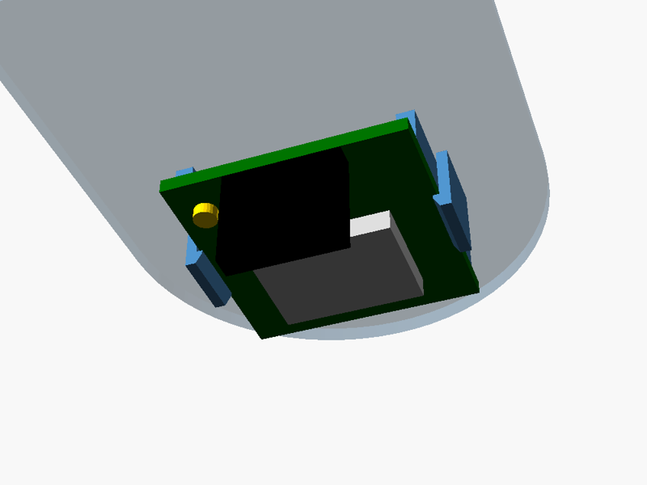
</p>

**What is going on:**

- The latch is a **2D profile** (arm + hook + ramp) extruded 8 mm along Y. The list comprehension `[p[0], -p[1]]` flips "depth below the plate" into negative Z.
- **Assembly:** push the board toward the plate. The ramps spread the arms by `pcb_gap + pcb_hook` (0.7 mm), the board passes, the hooks snap over its edge. `pcb_play` (0.2 mm) keeps the hook from clamping so hard it bends the board.
- **Why side latches, not end latches?** The body prints standing on its end. In that pose these arms are vertical walls with the hook as a horizontal profile: no supports, and the bending stress runs along the printed lines, which is the strong direction ([Design for Printing](./05-design-for-printing.md#orientation--strength)).
- **Strain check:** the arm length is `standoff + pcb_t + play + land + ramp` = 7.4 mm, so
  `strain = 1.5 × 1.2 × 0.7 / 7.4² ≈ 2.3 %`. The file echoes this and asserts it is under `max_strain`. A 2 mm standoff would push it over 4 %, too much for PLA. Raising the standoff is what made the latch safe.

> [!WARNING]
> Check the **back** of your GT-U7 for parts (some boards have a backup battery or LED there) before trusting the ledge positions. Move or shorten `pcb_ledge()` to land on bare board.

---

## Step 11: Snap-On Lid, Tabs & Recesses

*Slider: **step = 8***

The lid is the outer plan as a thin chamfered plate with three cantilever tabs. Each tab's tooth drops into a recess cut in the pod wall.

```openscad
// lib/snapfit.scad: the tab (tooth points +Y, outer face at y = 0)
module cantilever_tab(w = 5, t = 1.2, len = 7, tooth = 0.85,
                      lead = 1.2, land = 0.6, catch_dz = 0.3) {
    e = 0.01;
    z_catch = len - lead - land - catch_dz;
    rotate([90, 0, 90]) linear_extrude(height = w, center = true)
        polygon([[-t, -e], [0, -e], [0, z_catch],
                 [tooth, len - lead - land],   // catch face
                 [tooth, len - lead],          // flat land
                 [0, len],                     // lead-in ramp
                 [-t, len]]);
}
// ...and tab_recess() with the same frame and arguments cuts the matching pocket.

// gps_cradle.scad: ONE placement list drives both tabs and recesses
tab_places = [[0, cav_tip_y, 180], [-far_tab_x, cav_far_y, 0], [far_tab_x, cav_far_y, 0]];

module at_tabs(z) {
    for (p = tab_places)
        translate([p[0], p[1], z]) rotate([0, 0, p[2]]) translate([0, -snap_gap, 0])
            children();
}

// in pod():  at_tabs(pod_z0) tab_recess(w = tab_w, len = tab_len, tooth = tooth, gap = snap_gap);
// in lid():  at_tabs(lid_t - eps) cantilever_tab(w = tab_w, t = tab_t, len = tab_len, tooth = tooth);

module lid_plate() {                       // chamfered outside edge
    hull() {
        slab(0, eps) offset(delta = -lid_chamfer) outer_plan();
        slab(lid_chamfer, lid_t - lid_chamfer) outer_plan();
    }
}
```

<p align="center">
  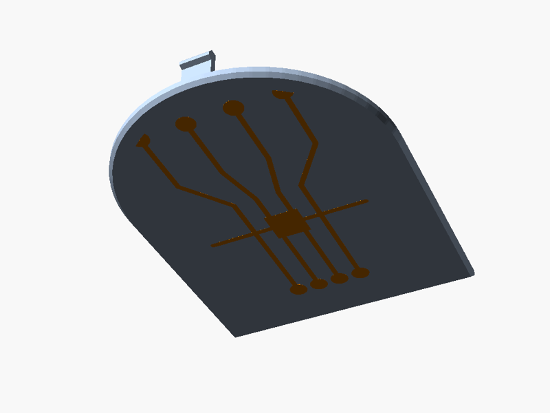
</p>

**What is going on:**

- **Paired modules, one placement list.** `at_tabs()` places children at each wall face, rotated so the tooth points into the wall. Because the tab *and* its recess are placed by the same `at_tabs()` with the same arguments, they can never drift apart.
- **The tab's numbers:** the tab face sits `snap_gap` (0.25 mm) from the wall; the tooth reaches `snap_engage` (0.6 mm) into the recess. While sliding in, the arm deflects by `snap_engage`, so strain is `1.5 × 1.2 × 0.6 / 7² ≈ 2.2 %`.
- **Lead and catch:** the angled lead-in ramp at the tip guides the tab in. The catch face has a small slope (`catch_dz = 0.3`), so the lid can be pried off with a fingernail. Set it to 0 for a permanent snap.
- **Placement choice:** one tab at the rounded tip, two at the flat far wall, none on the long sides where the SMA hole and cable notch are.
- **Chamfer:** `hull()` of a slightly smaller bottom slice and the full-size plate above it makes a 45° edge, which also hides elephant's foot on the first layer.

---

## Step 12: Two-Color Circuit Inlay

The lid's outside face carries a 0.4 mm deep recess shaped like circuit traces, and a separate `inlay` part fills it exactly, so you can print it in a second color.

```openscad
module wire2d(pts) {
    for (i = [1 : len(pts) - 1])
        hull() { translate(pts[i - 1]) circle(d = trace_w, $fn = 16);
                 translate(pts[i])     circle(d = trace_w, $fn = 16); }
}
module circuit_art() {
    intersection() {
        offset(delta = -3) outer_plan();       // stay 3 mm inside the edge
        union() { /* traces from wire2d() and round pads */ }
    }
}
// lid(): difference() { lid_plate(); translate([0,0,-eps]) linear_extrude(trace_d + eps) circuit_art(); }
module inlay() linear_extrude(height = trace_d) circuit_art();
```

**What is going on:**

- `wire2d()` is the 2D twin of `wire_path()`: hulled circles along a polyline.
- `trace_w = 0.9` is two 0.45 mm extrusion lines and `trace_d = 0.4` is two 0.2 mm layers, so the slicer can fill them cleanly.
- The lid prints **outside face down**, so the inlay occupies the first two layers. On a multi-material printer, load `lid` and `inlay` as two parts of one object and assign the inlay a second filament ([Design for Printing](./05-design-for-printing.md#multi-color-inlays)).

---

## Step 13: Route the Cables

*Slider: **step = 9***

Cable paths are lists of **derived** points, so they follow the design when parameters change.

```openscad
cable_x = port_side * (out_r - (cable_groove ? groove_d : 0) + 0.5); // in groove
wall_x  = port_side * (out_r + 0.5);                                   // on the pod

cable_pts = [
    [dev_side_x + port_side * plug_len, port_y, port_z],   // plug tail
    [cable_x, port_y, port_z - 2],                         // out the window
    [cable_x, port_y, 0],                                  // down the groove
    [wall_x,  port_y, -3],                                 // onto the pod wall
    [wall_x,  port_y, pod_z0 + 2.5],                       // down the outside
    [port_side * (cav_r - 1.5), port_y, pod_z0 + 2.5],     // through the notch
    [-2, pcb_y1 - 1.3, pod_z0 + 2.5],                      // to the header
    [-2, pcb_y1 - 1.3, pcb_bot_z - header_drop]            // into the plug
];
ribbon(cable_pts, n = 4, pitch = 1.0, d = 0.9);

coax_pts = [ufl_world, ufl_world + [0, 0, -3], [sma_side * (cav_r - 6.5), sma_y, sma_z]];
color("Gray") wire_path(coax_pts, d = 1.13);               // u.FL to SMA pigtail
```

<p align="center">
  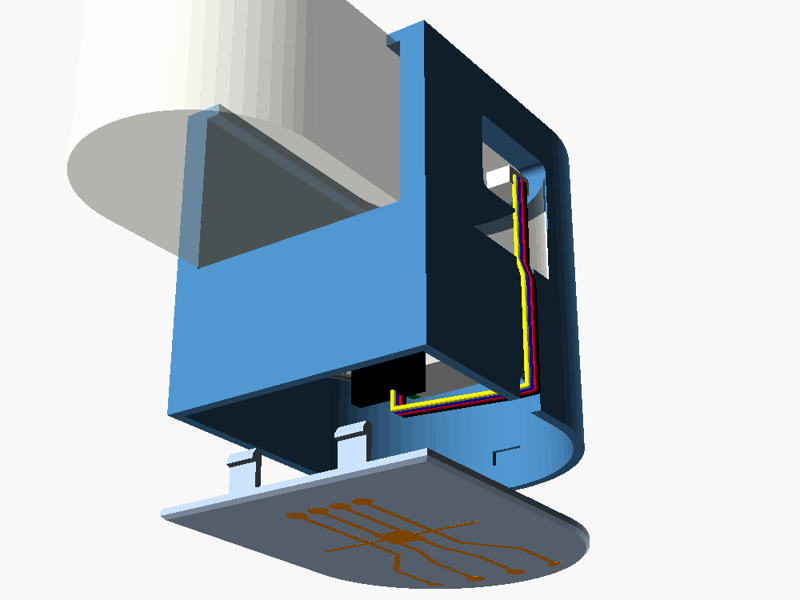
</p>

**What is going on:**

- Flip `port_side` to `1` and the whole path, window, groove and notch move to the right side together.
- The ribbon is four `wire_path()` copies shifted along Y by the conductor pitch.
- Cables are **left out of the clash test** on purpose (they are supposed to touch walls). Check them visually: does each bend have room? Is the coax bend gentle?

---

## Step 14: Prove It Fits

Three layers of checks run every time you preview or export.

### 14a. Assertions (Run Automatically)

```openscad
assert(in_cavity([ pcb_w / 2 + pcb_gap + latch_t, pcb_y0], 1),
       "Board/latch corner hits the rounded tip: increase pcb_y0");
assert(pcb_y1 + 2.54 < sma_y - sma_keepout / 2,
       "SMA hardware overlaps the board/header: move sma_y");
assert(pcb_bot_z - header_drop > pod_z0 + 1,
       "Header + plug is deeper than the pod: increase pod_depth");
assert(lid_strain < max_strain && latch_strain < max_strain,
       "Snap strain above max_strain: lengthen the arm, thin it, or reduce the hook");
```

Try `pcb_y0 = 0` in the Customizer: preview stops with *"Board/latch corner hits the rounded tip: increase pcb_y0"*. Try `tab_len = 4`: the console shows `Lid tab strain = 6.7 %` and the strain assertion fails.

### 14b. Clash Test

```openscad
if (part == "clash") {               // must be EMPTY
    intersection() { body(); hardware_solids(); }
    intersection() { translate([0, 0, pod_z0 - lid_t]) lid(); hardware_solids(); }
}
```

`hardware_solids()` is the mockups minus the cables, plus the SMA keep-out, with intended contact faces (handset on plate, board on ledges, SMA hardware against the wall) nudged apart by `contact_eps = 0.02`. Select `part = "clash_view"` to see any overlap in red inside a ghosted assembly ([example image](./03-mockups-and-fit-checks.md#clash-testing)).

From a terminal:

```bash
cd CAD/OpenSCAD/examples/gps-cradle
./check.sh                                   # PASS: no clashes; STLs are in out/
./check.sh -D fit_gap=-0.3                   # FAIL: ... clash facets
./check.sh -p gps_cradle.json -P loose-fit   # test a saved preset
```

### 14c. Section View

Set `part = "section"` and drag `section_x`. At `x = 0` you can see the board on its ledges, the header plug clearing the lid, and the SMA hardware inside the wall.

<p align="center">
  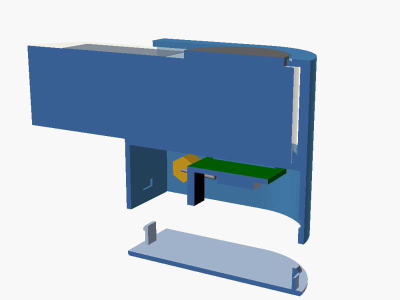
</p>

---

## Step 15: Test Coupons, Print Orientation & Export

### Print the Coupons First

| Part | Print Time | What to Check |
|---|---|---|
| `gauge` | Minutes | An 8 mm slice through the sleeve, pod and SMA hole. Slide the handset in (adjust `fit_gap`), feel the lip grip (adjust `front_lip`), thread the SMA bulkhead |
| `sma_gauge` | Minutes | Five holes, 6.4 to 6.8 mm, with the same D-flat. Count the notches on the best one and set `sma_hole_d` |

<p align="center">
  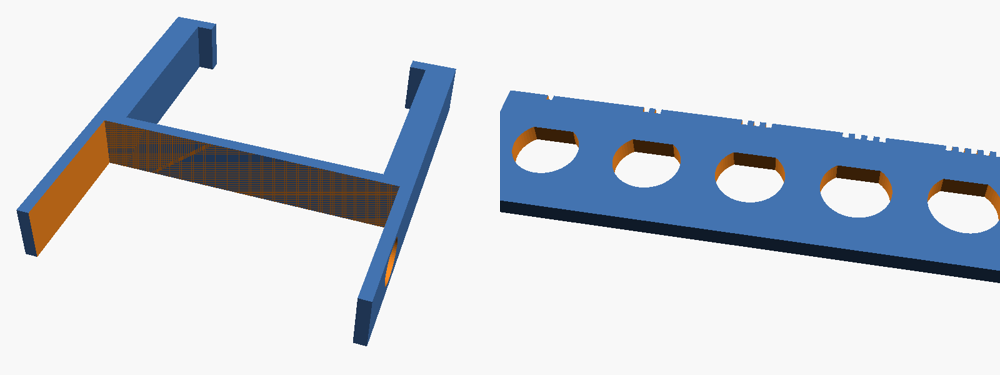
</p>

### Orient for the Bed

```openscad
module stand() translate([0, 0, sleeve_len]) rotate([-90, 0, 0]) children();
if (part == "body") stand() body();    // stands on the open end of the sleeve
if (part == "lid")  lid();             // flat, outside face down
```

<p align="center">
  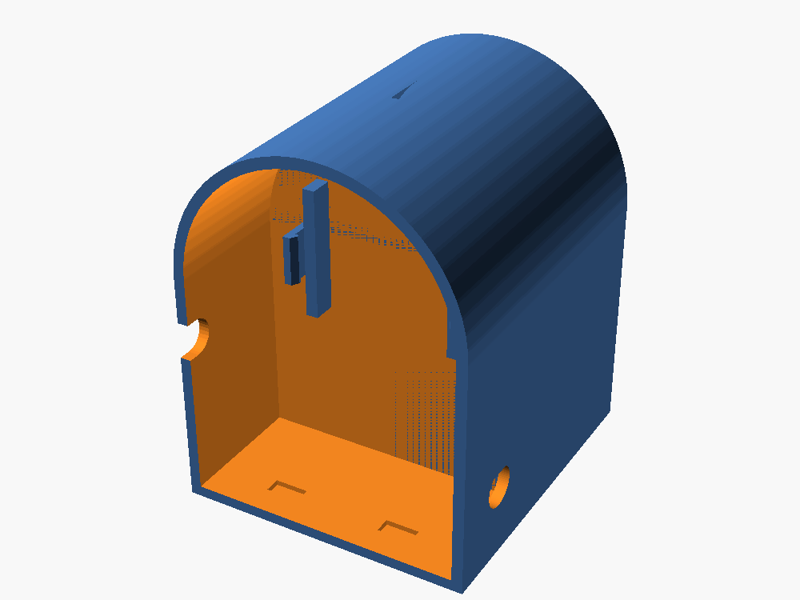
</p>

Why stand the body on its open end?

- The arms, lip, back plate, pod walls and PCB latches all become **vertical walls**: no supports inside the sleeve or pod.
- The SMA hole's flat faces up and prints as a short bridge.
- The rounded tip becomes an arch at the top of the print; arches of this size usually print cleanly, but enable supports for the outer arch if your printer sags.
- The PCB latch arms lie *flat within the layers* in this pose, so their bending stress runs along the printed lines (the strong direction).
- The lid prints flat, which makes its tabs vertical cantilevers whose bending stress crosses layer lines (the weak direction). That is why the tabs use a small 0.6 mm engagement and a 1.2 mm arm. If a tab snaps, raise wall-line count, print hotter, switch to PETG, or lengthen `tab_len`.

### Export

**GUI:** choose `part`, press **F6**, then **F7**. **CLI:** `./check.sh` writes `out/gps_cradle_body.stl`, `out/gps_cradle_lid.stl` and `out/gps_cradle_inlay.stl` after the checks pass.

> [!TIP]
> Material: PETG or ASA is the safer choice for snap fits and for a part that lives in a hot car. PLA works for a desk prototype or a lid you rarely open: its datasheet yield strain is only about 2–3 %, so the snaps here (2.2–2.3 %) are near its limit. The `pla-default` preset caps `max_strain` at 0.025.

---

## Step 16: Adapt It to Your Hardware

| You Want To... | Change | Then Check |
|---|---|---|
| Fit a different handset | `dev_length`, `dev_width`, `dev_depth`, `dial_*` | Clash test, `gauge` print |
| Move the cable to the right side | `port_side = 1` (and usually `sma_side = -1`) | Preset `cable-right-sma-left` |
| Tighten/loosen the slide fit | `fit_gap` (per side) | `gauge` print |
| Use a different GPS board | `pcb_w`, `pcb_l`, `pcb_t`, `header_drop`, `gtu7_mock()` | Assertions, section view |
| Use RP-SMA or a different bulkhead | `sma_hole_d`, `sma_flat`, `sma_keepout`, `sma_bulkhead_mock()` | `sma_gauge` print |
| Deeper electronics stack | `pod_depth` | Assertions |
| Stiffer/softer snaps | `tab_t`, `tab_len`, `snap_engage`, `latch_t`, `standoff_h` | Strain echo / `max_strain` |
| Remove the decoration | Do not print `inlay`; set `trace_d = 0` | — |

The same pattern (2D plan → offset ladder → slabs → cutters → mockups → checks) works for the other projects this section is for: adapter plates, replacement battery doors, antenna brackets, sensor pods and field-kit holders.

---

## See Also

- [Mockups & Fit Checks](./03-mockups-and-fit-checks.md)
- [Design for Printing](./05-design-for-printing.md)
- [Example source: `examples/gps-cradle/`](./examples/gps-cradle/)
- [SDR & RF guides](../../SDR/README.md) · [Wardriving & GNSS-tagged surveys](../../Wardriving/README.md) · [M5StickC Plus2 + CC1101 lab](../../HardwareHacking/m5stickc-plus2-hackstarterpack.md)
- [Bruce firmware](../../Documentation/bruce_firmware.md): the firmware this handset commonly runs
- [NanoVNA antenna tuning](../../SDR/nanovna/05-antenna-tuning.md): check the GPS antenna after the printed pod is fitted
- [LILYGO T-Embed CC1101 wiki](https://wiki.lilygo.cc/products/t-embed-series/t-embed-cc1101/)

---
[⬅️ Back to Master Index](../../README.md) | [🎯 Role Navigation](../../START_HERE.md) | [Legal Notice](../../LEGAL.md)
