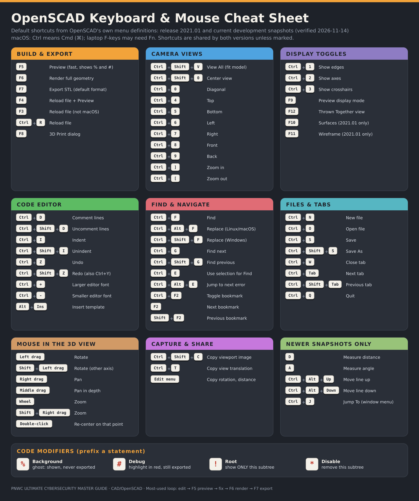

# ⌨️ OpenSCAD Keyboard & Mouse Cheat Sheet

_Last reviewed: 2026-11-14_

*Part of the [OpenSCAD Design & Prototyping Guide](./README.md) · [CAD & 3D Printing](../README.md) · [ULTIMATE CYBERSECURITY MASTER GUIDE](../../README.md)*

**Navigate:** [OpenSCAD Hub](./README.md) · [Fundamentals](./01-fundamentals.md) · [Project Structure](./02-project-structure.md) · [Mockups & Fit Checks](./03-mockups-and-fit-checks.md) · [GPS Cradle Tutorial](./04-tutorial-gps-cradle.md) · [Design for Printing](./05-design-for-printing.md) · **Shortcuts**

## 🎯 Purpose

The shortcuts worth memorizing, on one printable sheet. Every entry was read from OpenSCAD's own menu definitions (`MainWindow.ui` and the code that adds extra shortcuts) for **release 2021.01** and for the **development snapshot source as of 2026-11-14**. Shortcuts are the same in both unless marked.

[Download the PNG version](./images/openscad-shortcuts-cheatsheet.png).

> [!NOTE]
> **macOS:** Qt shows `Ctrl` shortcuts as **⌘ Cmd**. Laptop function keys may need **Fn**. `F3` (extra Reload key) is not added on macOS. **Windows:** Find & Replace is `Ctrl+Shift+F` instead of `Ctrl+Alt+F`.

---

## The Five You Will Use Constantly

| Key | Action | Why It Matters |
|---|---|---|
| `F5` | Preview | Fast view with colors, `%` ghosts and `#` highlights. Press it after every edit. |
| `F6` | Render | Evaluates full geometry. Run it before exporting a mesh from the GUI. The `openscad -o` command renders the geometry as part of mesh export. |
| `F7` | Export STL | Default 3D export. In snapshots this follows Preferences → Advanced → *Toolbar Export 3D* (STL by default). |
| `Ctrl+D` / `Ctrl+Shift+D` | Comment / uncomment | Switch features on and off while debugging. |
| `Ctrl+Shift+V` | View All | Find the model again after you zoom off into space. |

---

## Build & Export

| Shortcut | Action |
|---|---|
| `F5` | Preview |
| `F6` | Render |
| `F7` | Export STL (default 3D export format) |
| `F4` | Reload and Preview |
| `Ctrl+R` or `F3` | Reload file from disk (`F3` not on macOS) |
| `F8` | 3D Print dialog |

> [!TIP]
> With an external editor, turn on **Design → Automatic Reload and Preview**. Saving in your editor then triggers a preview without touching OpenSCAD.

## Camera Views

| Shortcut | View |
|---|---|
| `Ctrl+4` / `Ctrl+5` | Top / bottom |
| `Ctrl+6` / `Ctrl+7` | Left / right |
| `Ctrl+8` / `Ctrl+9` | Front / back |
| `Ctrl+0` | Diagonal |
| `Ctrl+Shift+0` | Center |
| `Ctrl+]` / `Ctrl+[` | Zoom in / out |
| `Ctrl+Shift+V` | View All |

## Display Toggles

| Shortcut | Action | Version |
|---|---|---|
| `Ctrl+1` | Show edges | Both |
| `Ctrl+2` | Show axes | Both |
| `Ctrl+3` | Show crosshairs | Both |
| `F9` | Preview display mode | Both |
| `F12` | Thrown Together display: draws all parts without CSG evaluation, handy for spotting stray or inside-out geometry | Both |
| `F10` | Surfaces display mode | 2021.01 only |
| `F11` | Wireframe display mode | 2021.01 only |

## Code Editor

| Shortcut | Action |
|---|---|
| `Ctrl+D` | Comment selected lines |
| `Ctrl+Shift+D` | Uncomment selected lines |
| `Ctrl+I` | Indent |
| `Ctrl+Shift+I` | Unindent |
| `Ctrl+Z` | Undo |
| `Ctrl+Shift+Z` or `Ctrl+Y` | Redo |
| `Ctrl++` / `Ctrl+-` | Larger / smaller editor font |
| `Alt+Ins` | Insert template |
| `Ctrl+Shift+C` | Copy viewport image to the clipboard |
| `Ctrl+T` | Copy viewport translation (paste into `$vpt` or `--camera`) |

## Find & Navigate

| Shortcut | Action |
|---|---|
| `Ctrl+F` | Find |
| `Ctrl+Alt+F` (Windows: `Ctrl+Shift+F`) | Find and Replace |
| `Ctrl+G` / `Ctrl+Shift+G` | Find next / previous |
| `Ctrl+E` | Use selection for Find |
| `Ctrl+Alt+E` | Jump to next error |
| `Ctrl+F2` | Toggle bookmark |
| `F2` / `Shift+F2` | Next / previous bookmark |

## Files & Tabs

| Shortcut | Action |
|---|---|
| `Ctrl+N` / `Ctrl+O` | New / open file |
| `Ctrl+S` / `Ctrl+Shift+S` | Save / Save As |
| `Ctrl+W` | Close tab |
| `Ctrl+Tab` / `Ctrl+Shift+Tab` | Next / previous tab |
| `Ctrl+Q` | Quit |

## Mouse in the 3D View

Default mapping. It is the same in 2021.01 and in the snapshots' default **OpenSCAD** mouse preset; snapshots also offer *OpenSCAD (Mac OS)*, *Blender*, *Fusion* and *Custom* presets in Preferences.

| Mouse | Action |
|---|---|
| Left drag | Rotate |
| `Shift` + left drag | Rotate around the other axis |
| Right drag | Pan |
| Middle drag | Pan in depth |
| Wheel | Zoom |
| `Shift` + right/middle drag | Zoom |
| Double-click on the model | Re-center the view on that point |

## Newer Snapshots Only

| Shortcut | Action |
|---|---|
| `D` | Measure distance |
| `A` | Measure angle |
| `Ctrl+Alt+Up` / `Ctrl+Alt+Down` | Move line up / down |
| `Ctrl+J` | Jump To |

## Code Modifiers

Not keyboard shortcuts, but you will type them constantly. Prefix any statement:

| Prefix | Name | Effect |
|---|---|---|
| `%` | Background | Transparent ghost; never exported |
| `#` | Debug | Highlighted in red; **still exported** |
| `!` | Root | Show only this subtree |
| `*` | Disable | Remove this subtree |

---

## Sources

- OpenSCAD 2021.01 source: [menu shortcuts](https://github.com/openscad/openscad/blob/openscad-2021.01/src/MainWindow.ui), [GUI export and render handling](https://github.com/openscad/openscad/blob/openscad-2021.01/src/mainwin.cc), `src/QGLView.cc`
- OpenSCAD source, `master` as of 2026-11-14: `src/gui/MainWindow.ui`, `src/gui/MainWindow.cc`, `src/gui/QGLView.cc`, `src/core/MouseConfig.h`
- [OpenSCAD repository](https://github.com/openscad/openscad) · [OpenSCAD Cheat Sheet (language)](https://openscad.org/cheatsheet/)

---
[⬅️ Back to Master Index](../../README.md) | [🎯 Role Navigation](../../START_HERE.md) | [Legal Notice](../../LEGAL.md)
