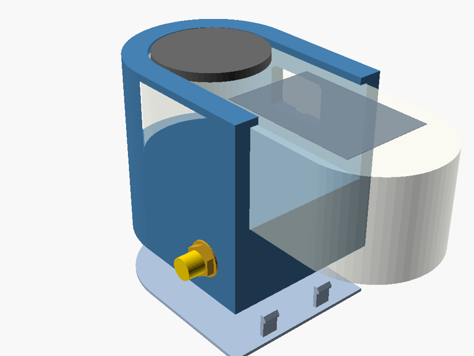

<p align="center">
  
</p>

# 🧩 OpenSCAD Functional Design & Prototyping Guide

_Last reviewed: 2026-11-14_

<div align="center">

**Code-first CAD for printable cases, adapters, mounts, replacement parts and new gear**

*Part of [CAD & 3D Printing](../README.md) in the [ULTIMATE CYBERSECURITY MASTER GUIDE](../../README.md)*


</div>

**Navigate:** [Main Guide](../../README.md) · [Start Here](../../START_HERE.md) · [CAD Index](../README.md) · [All Documentation](../../DOCUMENTATION_INDEX.md)

## 🎯 Purpose

A practical path from "I need a bracket for this radio" to a part that fits the first time. You will learn the OpenSCAD language, how to structure a parametric project, how to **mock up the real hardware** (devices, boards, connectors, cables) and prove clearance before printing, and how to design features that print well, all anchored by a complete worked example: a T-Embed CC1101 sleeve with a GT-U7 GPS pod, SMA bulkhead, routed cable, PCB snap latches and a snap-on lid.

> [!TIP]
> **Why bother?** Design skills turn a 3D printer into a repair shop and prototyping lab: replacement clips and covers, protective cases, mounts, jigs and function-expanding accessories, plus your own inventions. See [Why CAD Skills & a Capable 3D Printer Belong Together](../README.md#-why-cad-skills--a-capable-3d-printer-belong-together).

## 📋 When to Use

- Designing a **case, cradle or holster** for field hardware (handhelds, SDRs, dev boards, battery packs)
- Making an **adapter** (antenna bracket, mount plate, connector panel) or a **replacement part** (battery door, clip, knob)
- Checking whether a new module, connector or cable **will physically fit** before you buy, cut or print
- Building a reusable, **parametric** design others can adjust from the Customizer

---

## Start Here

| Resource | What It Provides |
|---|---|
| **[01 · Fundamentals](./01-fundamentals.md)** | Editor workflow, primitives, 2D extrusion, transforms, booleans, `hull()`/`offset()`, modules, functions, loops, modifiers, `assert()` |
| **[02 · Project Structure & Parameters](./02-project-structure.md)** | Folder layout, Customizer annotations, `include` vs `use`, reusable libraries, part selector, parameter sets, command-line export |
| **[03 · Mockups & Fit Checks](./03-mockups-and-fit-checks.md)** | Measuring, proxy models of devices/PCBs/connectors/cables, keep-outs, section views, automatic clash tests, test coupons |
| **[04 · Tutorial: GPS Cradle](./04-tutorial-gps-cradle.md)** | 17-step (0–16) build of the example: sleeve, port window, pod, SMA hole, cable notch, PCB latches, snap lid, inlay, cable routing, checks, export |
| **[05 · Design for Printing](./05-design-for-printing.md)** | Tolerances, line/layer math, holes, orientation & strength, overhangs, snap-fit strain, multi-color inlays, materials, troubleshooting |
| **[06 · Keyboard & Mouse Cheat Sheet](./06-keyboard-shortcuts.md)** | Printable one-page sheet (SVG/PNG) plus tables of the most-used shortcuts, verified against the OpenSCAD source |

## Example Projects

| Project | Files | Highlights |
|---|---|---|
| [T-Embed CC1101 + GT-U7 GPS Cradle](./examples/gps-cradle/README.md) | `gps_cradle.scad`, `tutorial_steps.scad`, `lib/`, `check.sh` | Offset-ladder enclosure, hardware mockups, D-flat SMA hole, PCB side latches, snap lid, two-color inlay, clash test, gauges |

## Learning Routes

| Goal | Recommended Route |
|---|---|
| **Brand new to OpenSCAD** | [Fundamentals](./01-fundamentals.md) → open `tutorial_steps.scad` and step through the [Tutorial](./04-tutorial-gps-cradle.md) |
| **Design a case for a device you own** | [Mockups & Fit Checks](./03-mockups-and-fit-checks.md) → Tutorial Steps [1–5](./04-tutorial-gps-cradle.md#step-1-measure--record-the-hardware) → [Design for Printing](./05-design-for-printing.md#tolerances--fits) |
| **Add a connector, antenna or cable exit** | Tutorial Steps [6](./04-tutorial-gps-cradle.md#step-6-cut-the-port-window--cable-groove), [8](./04-tutorial-gps-cradle.md#step-8-sma-bulkhead-hole-with-a-d-flat), [9](./04-tutorial-gps-cradle.md#step-9-cable-entry-notch) and [13](./04-tutorial-gps-cradle.md#step-13-route-the-cables) |
| **Hold a PCB or lid without screws** | [Snap Fits](./05-design-for-printing.md#snap-fits) → Tutorial Steps [10–11](./04-tutorial-gps-cradle.md#step-10-pcb-ledges--snap-latches) |
| **Automate exports / checks** | [Command-Line Export](./02-project-structure.md#command-line-export--automation) → [`check.sh`](./examples/gps-cradle/check.sh) |

---

## Quick Start

1. **Install OpenSCAD** from [openscad.org/downloads](https://openscad.org/downloads.html). The stable release is still 2021.01 (a 2026.11 release candidate was tagged in October 2026); development snapshots are much faster with the Manifold engine (Preferences → Advanced → 3D Rendering → Backend). The examples work on both.
2. **Open** [`examples/gps-cradle/tutorial_steps.scad`](./examples/gps-cradle/tutorial_steps.scad), then **Window → Customizer**, and move the `step` slider.
3. **Open** [`examples/gps-cradle/gps_cradle.scad`](./examples/gps-cradle/gps_cradle.scad) for the real design. Change `part` to `body`, `lid` or `gauge`, press **F6** (render) then **F7** (export STL).
4. **Check from a terminal** (Linux/macOS/WSL):

```bash
cd CAD/OpenSCAD/examples/gps-cradle
./check.sh            # design checks + STL export + clash test
```

---

## The Core Workflow

```text
 measure ─► 2D plan ─► offset ladder ─► slabs ─► cutters ─► mockups ─► checks ─► coupons ─► print
   │            │            │             │         │          │          │          │
 calipers   hull()/      offset(r=)    linear_    difference  % ghosts   assert()  gauge,
 + source   stadium()    walls, gaps   extrude    # debug     keep-outs  clash     hole
 comments                lips                                            section   ladder
```

1. **Measure** the hardware and record the source of every number.
2. **Draw a 2D plan** of the device and **grow/shrink** it with `offset()` into bores, walls and cavities.
3. **Extrude** plans into slabs; **cut** windows, holes and recesses with overshooting tools.
4. **Mock up** devices, boards, connectors and cables in the same coordinate frame.
5. **Check** with assertions, an automatic clash test and section views.
6. **Print coupons** (a gauge slice, a hole ladder) before the full part, then update parameters.

---

## Section Conventions

| Convention | Detail |
|---|---|
| Units | Millimeters everywhere |
| Clearances | Per side, named `*_gap` |
| Libraries | Loaded with `use <lib/...>`; every module documents its local frame |
| Parts | One `part` selector per project; printable branches apply their own print orientation |
| Hardware | Mockups only in preview/clash branches; never in printable output |
| Verification | Each example ships a `check.sh`; a doc's "Last reviewed" date means its examples were re-rendered and its links re-checked, **not** that a physical print was tested |

> [!NOTE]
> **Physical testing status:** the GPS cradle example is verified in software (renders, exports, passes its clash test and assertions). Dimensions marked "measure yours" are vendor or estimated values. Print the gauge coupons and record your results before relying on a fit.

---

## ✅ Verification Record (2026-11-14)

| Item | How It Was Checked | Result |
|---|---|---|
| Example `.scad` files, all `part` outputs | Rendered and exported with OpenSCAD 2021.01 (`check.sh`), default + 3 presets + `fit_gap` / `wall` sweeps | Pass; clash test empty except deliberate `fit_gap ≤ 0` cases |
| Assertions and strain echoes | Fed bad inputs (`pcb_y0=0`, `tab_len=4`) | Fail with the documented messages |
| Language snippets in Fundamentals | Self-contained snippets executed in 2021.01 | Pass |
| Keyboard and mouse shortcuts | Read from OpenSCAD source: tag `openscad-2021.01` and `master` (2026-11-14) | Version differences marked |
| CLI options, Manifold default, empty-export behavior | `openscad --help` (2021.01) and `master` source (`openscad.cc`, `RenderSettings.cc`) | Documented as found |
| Customizer rules | [OpenSCAD User Manual: Customizer](https://en.wikibooks.org/wiki/OpenSCAD_User_Manual/Customizer) | Main-file literals only; description from the line above |
| Hardware facts (T-Embed, GT-U7, SMA, Qwiic) | Vendor wiki, retail and data sheets, connector vendors, SparkFun Qwiic pages (linked in each page) | Starting points; measure your parts |
| Snap-fit strain limits | Bayer/BASF cantilever equation; filament data sheets (elongation at yield) | Conservative starting points |
| Physical prints | **Not yet performed** | Record printer, material and result here after test printing |

---

## See Also

- [CAD & 3D Printing index](../README.md)
- [Hardware Hacking](../../HardwareHacking/README.md) · [SDR & RF](../../SDR/README.md) · [Wardriving](../../Wardriving/README.md) · [PNWC Cyberdeck](../../Cyberdeck/README.md) · [uConsole](../../uConsole/README.md): the gear these designs carry
- [OpenSCAD Cheat Sheet](https://openscad.org/cheatsheet/) · [OpenSCAD User Manual](https://en.wikibooks.org/wiki/OpenSCAD_User_Manual)

---
[⬅️ Back to Master Index](../../README.md) | [🎯 Role Navigation](../../START_HERE.md) | [Legal Notice](../../LEGAL.md)
