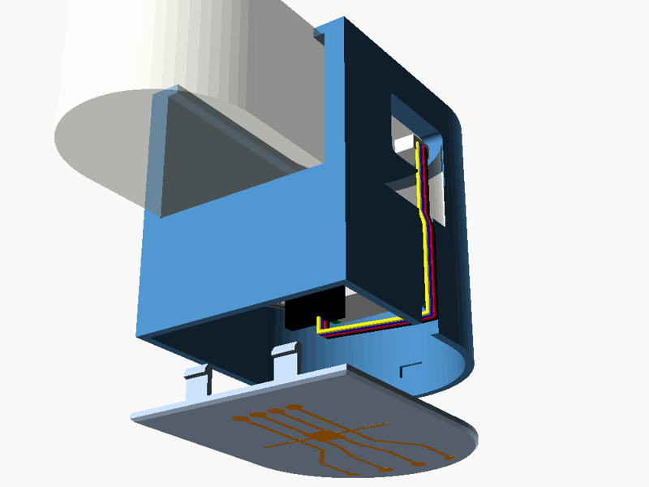

# 🛰️ Example: T-Embed CC1101 Sleeve With GT-U7 GPS Pod

_Last reviewed: 2026-11-14_

*Part of the [OpenSCAD Design & Prototyping Guide](../../README.md) · [CAD & 3D Printing](../../../README.md) · [ULTIMATE CYBERSECURITY MASTER GUIDE](../../../../README.md)*

<p align="center">
  
</p>

Source files for the **[step-by-step tutorial](../../04-tutorial-gps-cradle.md)**. A sleeve that slides onto a LILYGO T-Embed CC1101, with a GPS pod behind it for a GT-U7 board, an SMA bulkhead, a QWIIC cable routed from the handset's side port, screwless PCB latches and a snap-on lid with an optional second-color inlay.

## Files

| File | What It Is |
|---|---|
| [`gps_cradle.scad`](./gps_cradle.scad) | The design. Open this for real work; choose outputs with the `part` dropdown |
| [`tutorial_steps.scad`](./tutorial_steps.scad) | Step viewer for the tutorial (`step` slider 1–9); includes the main file |
| [`gps_cradle.json`](./gps_cradle.json) | Saved parameter sets: `pla-default`, `loose-fit`, `cable-right-sma-left` |
| [`check.sh`](./check.sh) | Runs design checks, exports STLs to `out/`, fails on any clash |
| [`lib/utils.scad`](./lib/utils.scad) | `slab()`, `stadium()`, `wire_path()`, `ribbon()`, `keep_x_above()`, `x_slot()` |
| [`lib/snapfit.scad`](./lib/snapfit.scad) | `cantilever_tab()`, `tab_recess()`, `pcb_side_latch()`, `pcb_ledge()`, `snap_strain()` |
| [`lib/mockups.scad`](./lib/mockups.scad) | `tembed_mock()`, `qwiic_plug_mock()`, `gtu7_mock()`, `sma_bulkhead_mock()` |

## Parts

| `part` | Printable | Description |
|---|---|---|
| `preview` | — | Assembly with hardware mockups and exploded lid |
| `body` | ✅ | Sleeve + pod, oriented standing on the open end |
| `lid` | ✅ | Lid with snap tabs, outside face down |
| `inlay` | ✅ | Optional second-color traces for the lid recess |
| `gauge` | ✅ | 8 mm test slice through sleeve, pod and SMA hole |
| `sma_gauge` | ✅ | SMA hole-size ladder (6.4–6.8 mm) |
| `mockups` | — | Hardware proxies only |
| `clash` | — | Overlap of parts and hardware; must be empty |
| `clash_view` | — | Any overlap in red inside a ghosted assembly |
| `section` | — | Cut-away at `section_x` |

## Run the Checks

```bash
./check.sh                                    # defaults
./check.sh -p gps_cradle.json -P loose-fit    # a saved preset
./check.sh -D fit_gap=0.4 -D port_side=1      # ad-hoc overrides
```

Verified on OpenSCAD 2021.01 (2026-11-14): all parts render and export, all three presets pass the clash test, and the assertions trip as intended for bad inputs (for example `pcb_y0=0` or `tab_len=4`).

> [!WARNING]
> Software-verified only. Port position, GT-U7 outline and SMA hole size are vendor or estimated values: measure your hardware, print `gauge` and `sma_gauge` first, and check the GT-U7's supply voltage and UART pin assignment before wiring it to the QWIIC port.

---
[⬅️ Back to Master Index](../../../../README.md) | [🎯 Role Navigation](../../../../START_HERE.md) | [Legal Notice](../../../../LEGAL.md)
