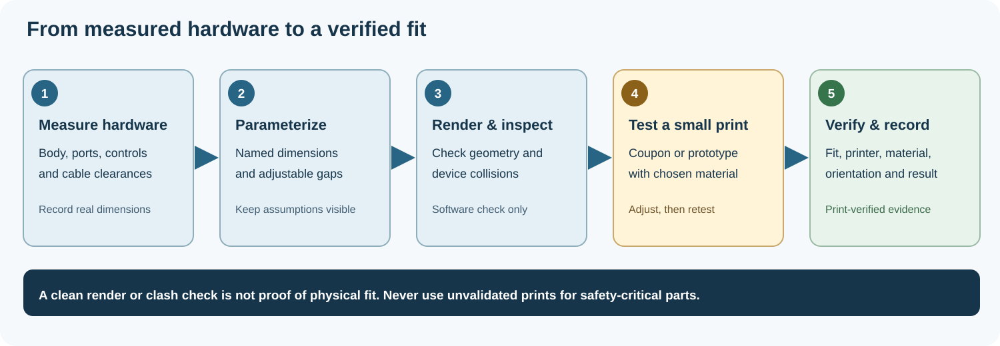

# 🛠️ CAD & 3D Printing for Security Hardware

_Last reviewed: 2026-11-14_

**Designing printable cases, adapters, mounts, replacement parts and new gear for field and lab hardware**

*Part of the [ULTIMATE CYBERSECURITY MASTER GUIDE](../README.md)*

**Navigate:** [Main Guide](../README.md) · [Start Here](../START_HERE.md) · [Specialized Topics](../SPECIALIZED_TOPICS_GUIDE.md) · [All Documentation](../DOCUMENTATION_INDEX.md)

## 🎯 Purpose

Security work runs on small, awkward hardware: handheld RF tools, SDRs, dev boards, GPS modules, antennas and battery packs that never come with the mount, cradle or adapter you need. This section collects the CAD workflows used to design those parts in-house, with an emphasis on **mocking up the real hardware first** so designs fit on the first print.

## 💡 Why CAD Skills & a Capable 3D Printer Belong Together

A 3D printer on its own mostly prints other people's files. Pair it with the ability to **design**, and it becomes a small in-house workshop. You stop asking "does anyone sell a part for this?" and start asking "what are the dimensions?"

| Capability | What It Looks Like In Practice |
|---|---|
| 🔧 **Fix what breaks** | Snapped belt clips, lost battery doors, cracked cases, worn knobs, missing port covers and dust plugs, broken cable strain reliefs. Measure the original (or the pieces), model it, print it. |
| ♻️ **Replace what you can't buy** | Discontinued or proprietary plastic parts, odd one-off brackets, spares for gear you depend on in the field. Keep the design file and you can print another one any time. |
| 🛡️ **Protect your gear** | Fitted cases, bumpers, sleeves, screen guards, connector covers and antenna caps sized to *your* device, not a generic one. |
| 🧷 **Mount & organize** | Brackets, rail and tripod adapters, desk and vehicle mounts, cable guides, pegboard and drawer inserts, labeled bit and SD-card holders. |
| 🧰 **Make the tools you need** | Jigs and alignment fixtures, soldering and probe holders, test-clip guides, drill templates, gauges and spacers for repeatable work. |
| 🚀 **Expand what a device can do** | Add-on pods for GPS, extra radios or batteries, SMA antenna mounts, cooling ducts, button extenders, and the kind of T-Embed + GPS cradle built in the [tutorial](./OpenSCAD/04-tutorial-gps-cradle.md). |
| 💭 **Build your own ideas** | Go from a sketch on a napkin, born of inspiration or necessity, to a physical prototype the same day. Revise it in minutes and reprint. |

**Why parametric (code-based) CAD helps with this:** a model driven by named measurements (`dev_width`, `fit_gap`, `wall`) is easy to adjust when the first print is 0.3 mm tight, to reuse for the next device, and to share so others can adapt it to their hardware. Mockups and clash checks ([how](./OpenSCAD/03-mockups-and-fit-checks.md)) cut down the "print, test, reprint" loop that wastes time and filament.

*Conceptual workflow. A successful render or software clash check does not establish fit on a physical printer.*

**Choose printer capability for the part and environment.** Dimensional fit is not a universal printer guarantee: it varies with the machine, material, geometry, orientation, slicer settings and calibration. For each printer/material combination, use the [test coupons](./OpenSCAD/03-mockups-and-fit-checks.md#test-coupons-gauges) to establish a starting clearance, then verify it with a prototype. A heated bed, enclosure and material choice matter for specific applications; for example, outdoor or hot-car use needs a material and design suited to that environment. Optional multi-material capability can help with labels and two-color inlays. See [Prusa's modeling guidance](https://help.prusa3d.com/article/modeling-with-3d-printing-in-mind_164135) for factors that affect tolerances.

> [!CAUTION]
> **Know where printed plastic does not belong.** Do not print parts whose failure could injure someone (load-bearing, climbing, vehicle-safety or pressure parts), parts that must insulate or enclose mains voltage, or anything near high heat or open flame unless the material and design are rated for it. Treat printed food-contact items with caution. Replacing a part on your own equipment is everyday repair; selling copies of someone else's design or branded part can raise license, trademark or patent issues.

## Start Here

| Resource | What It Provides |
|---|---|
| **[OpenSCAD Design & Prototyping Guide](./OpenSCAD/README.md)** | Hub for the OpenSCAD track: fundamentals, project structure, mockups and fit checks, design for printing |
| [OpenSCAD Fundamentals](./OpenSCAD/01-fundamentals.md) | The language: primitives, extrusion, transforms, booleans, modules, modifiers |
| [Project Structure & Parameters](./OpenSCAD/02-project-structure.md) | Layout, Customizer, libraries, parameter sets, command-line export |
| [Mockups & Fit Checks](./OpenSCAD/03-mockups-and-fit-checks.md) | Modeling devices, PCBs, connectors and cables; clash tests; test coupons |
| [Tutorial: T-Embed + GPS Cradle](./OpenSCAD/04-tutorial-gps-cradle.md) | Step-by-step build with SMA bulkhead, cable routing, PCB latches and snap lid |
| [Design for 3D Printing](./OpenSCAD/05-design-for-printing.md) | Tolerances, orientation, snap-fit strain, inlays, materials, troubleshooting |
| [Keyboard & Mouse Cheat Sheet](./OpenSCAD/06-keyboard-shortcuts.md) | Printable one-page reference of the most-used OpenSCAD shortcuts |
| [Example: GPS Cradle Source](./OpenSCAD/examples/gps-cradle/README.md) | Ready-to-render `.scad` files, parameter presets and `check.sh` |

## Typical Projects

| Need | Starting Point |
|---|---|
| Sleeve or holster for a handheld (T-Embed, Flipper-class tools, M5Stick) | [GPS cradle tutorial](./OpenSCAD/04-tutorial-gps-cradle.md), Steps 3–6 |
| Antenna bracket or SMA/RP-SMA connector panel | [SMA hole with D-flat](./OpenSCAD/04-tutorial-gps-cradle.md#step-8-sma-bulkhead-hole-with-a-d-flat) + [`sma_gauge` coupon](./OpenSCAD/03-mockups-and-fit-checks.md#test-coupons-gauges) |
| Screwless PCB or module carrier | [PCB ledges & snap latches](./OpenSCAD/04-tutorial-gps-cradle.md#step-10-pcb-ledges--snap-latches) |
| Battery door, clip or other replacement part | [Fundamentals](./OpenSCAD/01-fundamentals.md) + [Tolerances & Fits](./OpenSCAD/05-design-for-printing.md#tolerances--fits) |
| Cable exit, strain relief or routing channel | [Cable notch](./OpenSCAD/04-tutorial-gps-cradle.md#step-9-cable-entry-notch) + [cable mockups](./OpenSCAD/03-mockups-and-fit-checks.md#cables--ribbons) |

> [!NOTE]
> Designs in this section are verified **in software** (they render, export and pass their clash tests and assertions). A design is only "print-verified" when a maintainer records the printer, material and result. Vendor dimensions are starting points; measure your own hardware.

## See Also

- [Hardware Hacking](../HardwareHacking/README.md) · [SDR & RF](../SDR/README.md) · [Wardriving](../Wardriving/README.md)
- [PNWC Cyberdeck](../Cyberdeck/README.md) · [uConsole](../uConsole/README.md) · [Mobile](../Mobile/README.md)
- [Bruce firmware (T-Embed CC1101)](../Documentation/bruce_firmware.md) · [Wi-Fi Marauder](../Documentation/WiFiMarauder_Guide.md) · [Bjorn on Raspberry Pi](../Documentation/bjorn_pi.md) · [NanoVNA antenna tuning](../SDR/nanovna/05-antenna-tuning.md)

---
[⬅️ Back to Master Index](../README.md) | [🎯 Role Navigation](../START_HERE.md) | [Legal Notice](../LEGAL.md)
