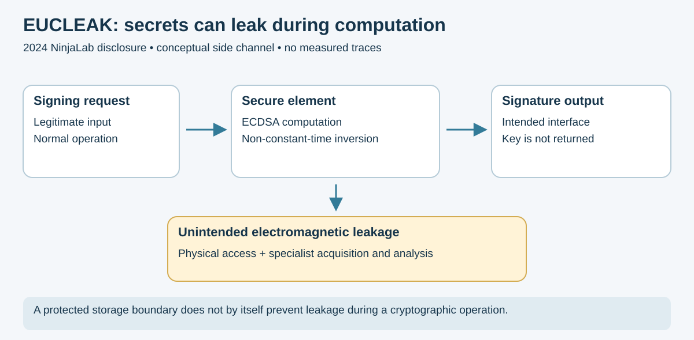

# EUCLEAK: ECDSA Side-Channel Exposure in Infineon Secure Elements (2024)

**Case type:** Published physical side-channel vulnerability with a coordinated vendor advisory. **CVE:** CVE-2024-45678. **Disclosure:** September 3, 2024. **Source review:** November 20, 2026.

## What Was Demonstrated

NinjaLab researchers reported an electromagnetic side-channel weakness in an Infineon cryptographic library's **non-constant-time modular inversion** during ECDSA operations. They demonstrated recovery of a signing secret from a YubiKey 5Ci under controlled conditions. Because a cryptographic library may be reused across hardware products, its implementation can undermine security even when key storage is designed to resist direct extraction.

Yubico's YSA-2024-03 advisory lists these affected ranges: YubiKey 5, 5 FIPS, 5 CSPN and Security Key Series before firmware **5.7.0**; YubiKey Bio before **5.7.2**; and YubiHSM 2 and 2 FIPS before **2.4.0**. Verify the exact model and revision against the [vendor advisory](https://www.yubico.com/support/security-advisories/ysa-2024-03/). Yubico does not provide in-place firmware updates for YubiKeys, so an affected token cannot simply be patched by its owner; if risk decisions require removing the exposure, plan a controlled migration to an unaffected device.

*Original conceptual diagram based on [NinjaLab's EUCLEAK research](https://ninjalab.io/eucleak/). The unintended information channel is separate from the normal signature output. No plotted signal or measured trace is implied; physical access and specialist analysis remain prerequisites.*

## Threat Model & Defensive Response

| Prerequisite or Concern | Interpretation |
|---|---|
| Attacker needs physical possession | This is **not** a remote Internet compromise of every token |
| Specialist EM equipment & knowledge | High skill/resource barrier; the original paper and advisory should define practical bounds |
| ECDSA signing operation leakage | Protect physical custody and verify cryptographic primitive/firmware/model |
| Credential replacement | For affected, high-risk ECDSA credentials, assess controlled migration to an unaffected device; revoke and re-enroll through the normal account recovery process |
| Certification assumptions | A certification result is not a guarantee that new cryptanalytic/side-channel research cannot identify issues |

**Vendor response:** Yubico rates the issue **Moderate (CVSS 4.9)**, reports no active key replacement program, and advises users to maintain physical control and promptly deregister lost or stolen keys. The advisory and researchers continue to recommend FIDO over weaker methods such as OTP or SMS. **Do not disable phishing-resistant MFA solely because of this research;** assess the affected credential type, device status and account risk before planning migration.

No fault-injection or EM sampling reproduction commands are included here; demonstrations belong on owned lab devices with authorized procedures.

## Sources

- [NinjaLab — EUCLEAK Primary Research](https://ninjalab.io/eucleak/).
- [Yubico — Security Advisory YSA-2024-03](https://www.yubico.com/support/security-advisories/ysa-2024-03/).
- [CVE-2024-45678 Record](https://www.cve.org/CVERecord?id=CVE-2024-45678).

[Hardware Side Channels](../../HardwareHacking/Chapter4.md) · [Security Keys & Passkeys](../../Cryptography/security-keys-passkeys.md) · [All Cases](../README.md)
