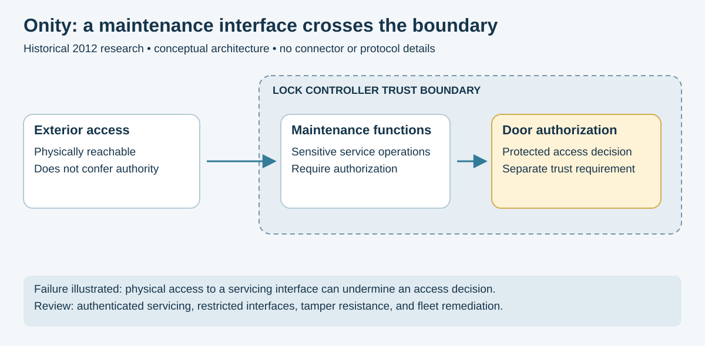

# Onity Hotel-Lock Physical Interface Research (2012)

**Case type:** Hardware security disclosure; later public reporting documented misuse of hotel-lock weaknesses. **Original publication:** 2012.

## What Researchers Found

At Black Hat USA 2012, researcher Cody Brocious presented security problems in widely deployed Onity electronic hotel locks. Public accounts describe abuse of an externally accessible maintenance interface and inadequate separation between technician functions and room-access authorization. The result was a serious **physical trust-boundary failure**. Reliability was not deterministic: PCWorld reported that, in tests conducted for *Forbes*, the device opened one of three locks, and only after a second attempt on the one that opened; timing affected communication. That limitation does not make the exposure harmless, but it matters when describing the demonstration. Historical reports estimated deployment in millions of doors; they do not determine whether an individual modern lock is vulnerable.

Do not confuse the Onity research with the unrelated 2024 **Unsaflok** RFID/key-management disclosures. The attack prerequisites and vendor remediation paths differ.

*Original conceptual diagram: physical proximity is not authorization. It shows the trust boundary, not connector details or a tested lock. Context: [2014 court opinion, factual allegations on PDF pages 2–3](https://www.govinfo.gov/content/pkg/USCOURTS-mnd-0_13-cv-02847/pdf/USCOURTS-mnd-0_13-cv-02847-0.pdf); this record is not an independent laboratory test.*

## Defensive Analysis

| Architectural Area | Failure Mode | Protective Review |
|---|---|---|
| External servicing connector | Powerful maintenance operations reachable outside the trusted enclosure | Authenticated service mode, restricted service interface and tamper resistance |
| Firmware trust | Operational functions treated physical proximity as authorization | Threat-model direct equipment access, not just Internet access |
| Fleet lifecycle | Updates must reach thousands of independently managed devices | Model/firmware inventory, vendor upgrade verification and replacement planning |
| Hotel security operations | Lock telemetry may be incomplete or susceptible to manipulation | Independent incident evidence and guest safety practices |

## Evidence & Limits

This is an account of **published historical research**, not an endorsement of replicating an intrusion. This repository does not provide connector pinouts, attack firmware or instructions for opening third-party doors. Verify exact model and current dormakaba/Onity advisory before describing a particular installation as impacted.

**Sources:** [PCWorld — 2012 Initial Disclosure Reporting](https://www.pcworld.com/article/460140/50_hacking_device_opens_millions_of_hotel_room_locks.html); [WIRED — Unsaflok comparison and reported criminal misuse of Onity weaknesses](https://www.wired.com/story/saflok-hotel-lock-unsaflok-hack-technique/).

[Hardware Interfaces](../../HardwareHacking/Chapter2.md) · [Hardware Threat Model](../../HardwareHacking/Chapter1.md) · [Unsaflok Comparison](unsaflok-3m-hotel-locks.md) · [Index](../README.md)
