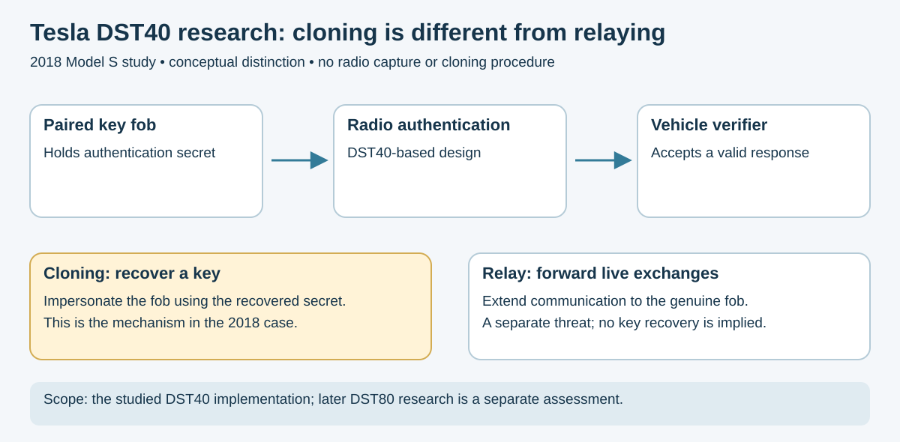

# Tesla Model S Key-Fob Cryptanalysis (2018)

**Case type:** Demonstrated authorized security research, not evidence of a specific fleet-wide criminal campaign.

**Source review:** 2026-11-24. Primary research sources checked; no vehicle, key fob, or current over-the-air update status was tested.

## Research & Root Cause

In September 2018, KU Leuven/imec researchers published a demonstration against an earlier Tesla Model S passive keyless entry/start system. The work exposed weaknesses in the proprietary **DST40-based** key-fob authentication design. Researchers reported demonstrating the attack on two Model S vehicles and coordinating disclosure with Tesla in August 2017. The team also identified Pektron-based systems in McLaren, Karma Automotive, and Triumph motorcycles as possible related exposure, but said it could not confirm the vulnerability in those vehicles. Treat those models as unverified scope, not confirmed affected products.

An important technical distinction: subsequent Tesla key-fob revisions moved to **DST80**. The researchers' follow-up then identified a separate downgrade weakness in the second-version Model S fob. They report that Tesla provided an over-the-air update in August 2019 to let owners self-service that fob. This later issue and remediation are distinct from the 2018 DST40 key-recovery demonstration. The historical reports do not establish the current patch or fob status of any particular vehicle, and the 2018 finding does not prove that current Tesla vehicles or all DST80 deployments share either issue.

*Original conceptual diagram based on [imec/KU Leuven's 2018 announcement](https://www.imec-int.com/en/articles/security-flaws-in-passive-keyless-entry-and-start-systems). Cloning recovers a secret to impersonate the fob; relaying forwards live exchanges. These mechanisms and their mitigations differ. The figure does not describe every later Tesla system.*

## Defensive Implications

| Risk | Architecture & Fleet Review |
|---|---|
| Proprietary RF cryptography | Do not equate secrecy of an algorithm with strong security; independently evaluate protocol and key length |
| Wireless credential exposure | Inventory fob type, firmware and supported passive-entry protections; keep keys physically secured |
| Vehicle-wide remediation | Validate supported updates and features for the **specific** vehicle and model year |
| User safety | Researchers advised disabling passive entry and using **PIN to Drive** where supported in relevant versions; check current Tesla instructions before recommending settings |

The case does not include wireless capture, cloning, replay, or vehicle-access instructions.

## Primary Sources

- [imec/KU Leuven — September 10, 2018 Research Announcement](https://www.imec-int.com/en/articles/security-flaws-in-passive-keyless-entry-and-start-systems).
- [KU Leuven COSIC — DST80 Follow-up & Voltage-Fault Injection](https://www.esat.kuleuven.be/cosic/blog/dismantling-dst80-based-immobiliser-systems), including the separate second-version fob downgrade finding and reported August 2019 update.

[RF/SDR Index](../../SDR/README.md) · [Hardware Threat Modeling](../../HardwareHacking/Chapter1.md) · [All Cases](../README.md)
