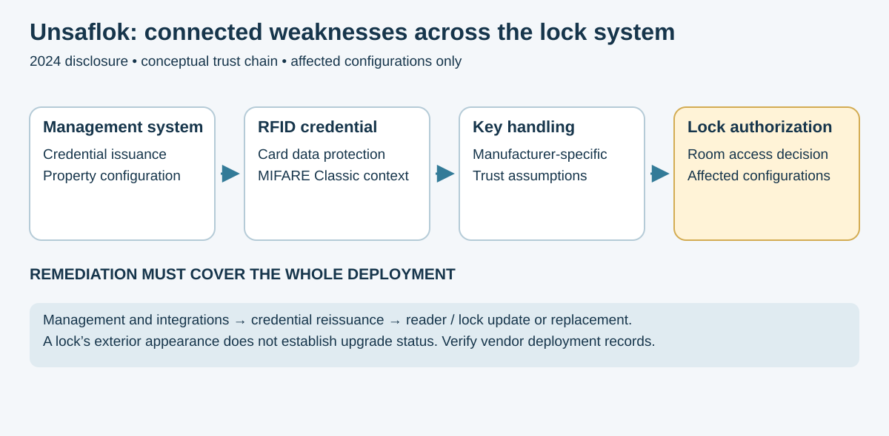
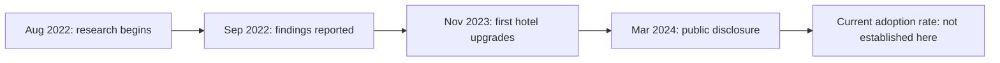

# Unsaflok: Approximately Three Million Hotel Doors (2024)

**Case type:** Coordinated hardware/RFID security disclosure — **not** a confirmed mass intrusion.

**Source review:** November 24, 2026. Original findings published March 21, 2024; current patch adoption rate **not established by this page**.

## Summary & Scope

Security researchers Lennert Wouters, Ian Carroll and collaborators disclosed **Unsaflok**, a chain of weaknesses in dormakaba Saflok RFID room-lock systems. The team estimated exposure at **more than three million doors across over 13,000 properties in 131 countries**. The researchers report the issue across Saflok-system locks, including the MT, Quantum, RT, Saffire and Confidant families. Their FAQ says these are used primarily with System 6000 or Ambiance management software, with some affected multifamily applications using System 6000 or Community. A lock's appearance cannot establish whether it is updated ([researcher FAQ](https://unsaflok.com/)).

## Technical Root Cause (Non-Operational)

The research connected weaknesses in MIFARE Classic-based cards, manufacturer-specific key handling and the lock's authorization logic. The investigators showed that knowledge from a card associated with a property could undermine separation between room credentials in affected installations. This illustrates why **encrypted storage alone** does not solve weak authorization or key-management design.

This case study intentionally omits credential-writing commands, construction of forged cards and lock-opening sequences. No hotel room or access-control system should be tested without written authorization.

*Original conceptual diagram based on the [researchers' disclosure](https://unsaflok.com/). Read the chain as interacting trust assumptions, not an opening procedure. Remediation must cover the affected system; neither the diagram nor a lock's appearance establishes current patch status.*

## Disclosure & Response

The researchers' timeline runs from the start of research through coordinated disclosure and the first hotel upgrades:

As of March 2024, researchers estimated that approximately **36%** of affected locks had been updated or replaced. This is a historical snapshot, **not** a current adoption estimate. Upgrades may involve lock reprogramming or replacement, keycard reissuance, front-desk management changes and dependent integration upgrades.

The researchers stated that they **were not aware of confirmed real-world attacks** using the findings at publication; lack of evidence is not evidence of none.

## Defensive Lessons & Authorized Assessment

| Question | Evidence to Collect | Protection |
|---|---|---|
| Which system/lock/reader versions are deployed? | Model, firmware, reader and card technology, vendor upgrade status | Coordinate vendor-provided remediation across **all** affected doors |
| What is the credential trust model? | Management configuration and credential issuance policy | Per-property/per-room authorization, authenticated credentials and appropriate key management |
| Can patch status be demonstrated? | Vendor deployment record, post-upgrade inventory, and card/firmware records | Researchers note that upgraded systems may issue MIFARE Ultralight C cards instead of MIFARE Classic; treat card type as a clue, not confirmation. Do not infer status from appearance. |
| Are system logs reliable for attribution? | Management audit configuration, clock integrity, access-log limitations | Corroborate with independently collected evidence |
| Are guests adequately protected? | Physical secondary-door protection and operator procedures | Communicate mitigation without promising that an electronic deadbolt alone prevents bypass |

**Current vendor guidance:** dormakaba's [Security Support Center](https://go.dormakaba.com/bg/security-support) says a mitigation solution is available for affected Saflok systems using System 6000, Ambiance, or Community. Property operators should coordinate with dormakaba or their authorized integrator and confirm remediation from deployment records; the public notice does not show which properties have completed upgrades.

## Primary Sources & Boundaries

- [Unsaflok — Researcher Disclosure, FAQ & Timeline](https://unsaflok.com/) — first-party findings, explicit limits and historical patch percentage.
- [CVE-2024-29916](https://www.cve.org/CVERecord?id=CVE-2024-29916) — vulnerability record.
- [KU Leuven COSIC — Researchers' Announcement](https://www.esat.kuleuven.be/cosic/news/hackers-found-a-way-to-open-any-of-3-million-hotel-keycard-locks-in-seconds/) — institutional source.
- [WIRED — March 21, 2024 Reporting](https://www.wired.com/story/saflok-hotel-lock-unsaflok-hack-technique/) — interview and vendor response.

**Follow-up:** [RFID & NFC Access Security](../../SDR/rfid.md) · [Hardware Threat Modeling](../../HardwareHacking/Chapter1.md) · [All Case Studies](../README.md)
