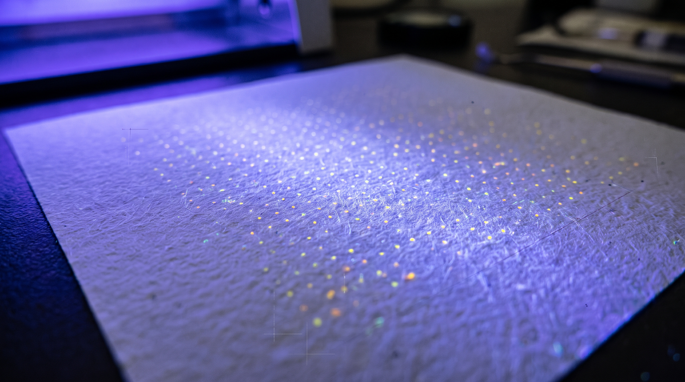
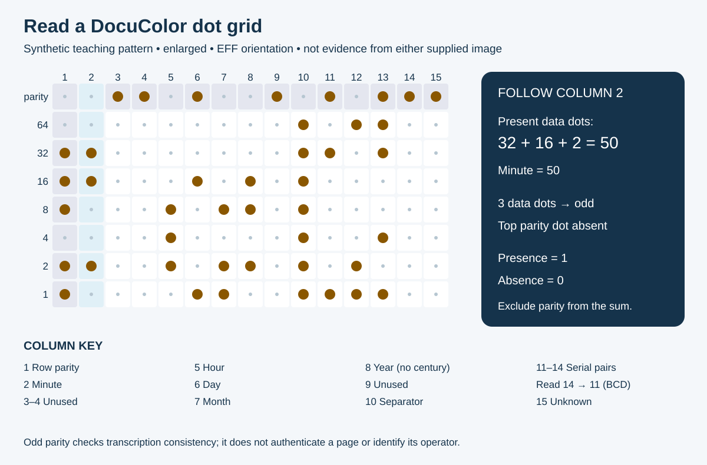
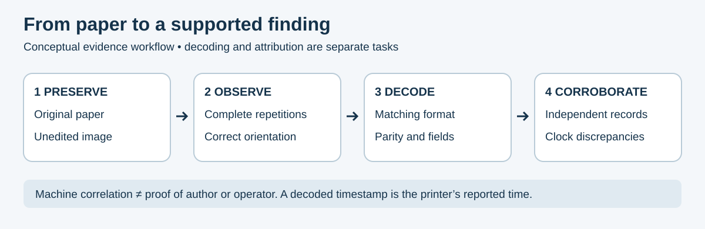

# Xerox DocuColor Machine Identification Code Decoding

## 🎯 Purpose

Explain the Electronic Frontier Foundation's (EFF) 2005 decoding of yellow printer tracking dots, also called a **Machine Identification Code (MIC)**.

## ⚙️ Function

Connect physical-output analysis to reverse engineering, privacy, and document forensics while distinguishing decoding from cryptographic cracking.

## 🏆 Goal

Recognize that a device can disclose identifying metadata through ordinary physical output, even when the visible document contains no identifier.

## 📋 When To Use

Use this case when assessing printer privacy, interpreting document evidence, or teaching how to infer an undocumented data format from controlled samples.

**Evidence review:** November 17, 2026. Historical primary-source review; no physical printer or paper sample tested. The exercise below is proposed, not lab-verified.

## Discovery & Scope

In October 2005, EFF announced that its team had decoded identifying information in Xerox DocuColor output. Researchers compared supporter-supplied print samples to associate changes in dot patterns with underlying data. EFF described the tracking system as an anti-counterfeiting arrangement involving manufacturers and the U.S. Secret Service, while highlighting its broader privacy implications. [1]

This was **reverse engineering of a hidden encoding**, not a demonstrated cryptographic key recovery, printer takeover, or firmware exploit. It belongs in hardware security because the information channel is a physical artifact produced by the device.

| Stage | Result |
|---|---|
| Observe | Identify a recurring, faint pattern in printer output. |
| Compare | Distinguish fields that stay fixed for one machine from fields that change across samples. |
| Decode | Publish a readable interpretation for the studied DocuColor format. |
| Evaluate | Consider what the metadata reveals and what still requires corroboration. |

*Figure 1 — User-supplied visual introduction. Treat this as an illustration, not an authenticated microscope capture or a decoded sample. Dot size, color, and lighting do not establish a printer model or identity.*

The 2005 announcement explicitly limited the decoded format to DocuColor. It was not a universal decoder for every Xerox copier or every manufacturer's printer. [1]

## The Published Dot Format

*Figure 2 — User-supplied overview, retained as a conceptual aid. Its filled grid, field arrows, and magnification label are not a decoding template. Use the column table and Figure 3 for the documented layout. Blue light and ultraviolet (UV) are different; EFF describes blue illumination making yellow dots appear dark. [2]*

EFF documented a repeated **15-column × 8-row** grid, more visible with magnification or blue illumination. In EFF's orientation, the top row supplies column parity; the left column supplies row parity. Columns and non-top rows use odd parity. The seven data rows have weights **64, 32, 16, 8, 4, 2, 1** from top to bottom. [2]

| Columns, Numbered Left To Right | Interpretation |
|---|---|
| 1 | Row parity |
| 2 | Minute |
| 3–4 | Unused |
| 5 | Hour |
| 6–8 | Day, month, year without century |
| 9 | Unused |
| 10 | Separator, typically all ones |
| 11–14 | Serial-number pairs, read in reverse column order using binary-coded decimal |
| 15 | Unknown; often constant for a printer |

The serial may have six or eight digits; the printer clock can be inaccurate or use UTC. Unknown fields should remain unknown. These rules apply to the documented format, not arbitrary yellow-dot patterns. [2]

## Worked Example: Decode & Check Separately

*Figure 3 — Original teaching diagram based on EFF's format. Filled circles represent present dots; small gray marks identify absent positions. The pattern is synthetic and is not extracted from Figures 1 or 2. [2]*

**Synthetic teaching example, not an observed print:** if minute-column data dots occupy weights 32, 16, and 2, their sum is 50. Three data dots already satisfy odd parity, so that column needs no additional parity dot. A transcription with only weights 32 and 16 has two dots; a missing or unread parity dot must be investigated before accepting the value.

Parity checks consistency, not provenance. A valid codeword does not prove that a page is genuine, that its clock was correct, or that a named person operated the printer. Those are separate evidentiary questions. A successful decode should therefore report both the interpreted fields and the assumptions used to obtain them.

## Controlled Observation Exercise

*Figure 4 — Original conceptual workflow. Decoding supports a finding only within the limits of the sample and corroborating evidence.*

This suggested workflow uses your own non-sensitive test pages. It is an evidence-handling exercise, not a claim of compatibility with an untested printer.

1. Record printer model, available firmware information, displayed clock, and an independent reference time. Label the physical page separately so notes cannot be mistaken for encoded data.
2. Inspect blank areas under magnification and blue light as described in EFF's guide. Preserve an unedited photograph alongside any enhanced working image. [2]
3. Determine whether a complete pattern matches the documented geometry. Stop at **unidentified pattern** if its structure differs; do not force it into the DocuColor format.
4. Transcribe at least two repetitions independently. Record uncertainty rather than converting every faint mark into a definite zero or one.
5. Check parity, then interpret fields. Compare results against the known test conditions. If parity fails, revisit orientation, grid boundaries, and image quality before reporting a decode.
6. Retain the original sample, transcription, working images, and discrepancies together. Report **not detected under these conditions** when inspection finds nothing; that result is not a privacy certification.

## Impact, Response & Limitations

EFF's response was to publish its findings and a decoding guide, bringing a previously obscure identification channel into public view. The cited announcement does not establish that Xerox removed the feature or issued a privacy patch. [1]

| Observation | Defensible Interpretation |
|---|---|
| A serial-like value is decoded | Potential machine correlation requiring independent records. |
| A timestamp is decoded | Device-reported time, not automatically trusted event time. |
| The pattern is consistent across repetitions | Supports transcription consistency, not authenticity. |
| No recognizable dots appear | Inconclusive about other markings, formats, or identification methods. |
| A machine is identified | Does not by itself identify the document's author or operator. |

**Assessment lessons:** include printed output in a data-flow review; protect collected pages and serial numbers as potentially identifying evidence; corroborate attribution with independent records. Keep output-format decoding distinct from [network or firmware compromise](../../HardwareHacking/README.md). This assessment does not establish a current inventory of affected products or a guaranteed method of producing anonymous documents.

## Image Provenance & Further Viewing

| Visual | Provenance and limits |
|---|---|
| Figures 1–2 | Supplied by the repository owner for this case study; original creator and capture conditions not independently verified. |
| Figures 3–4 | Original static vector diagrams authored for this guide; teaching aids, not laboratory results. |
| [EFF microscope image under blue light](https://w2.eff.org/Privacy/printers/docucolor/docucolor4.jpg) | External reference for comparison; see EFF's guide for capture conditions and context. |
| [EFF annotated decoding image](https://w2.eff.org/Privacy/printers/docucolor/guide.png) | External reference for the published layout; credit EFF and its named research team. |

## Primary Sources

1. [EFF — Secret Code In Color Printers Lets Government Track You, October 2005](https://www.eff.org/press/archives/2005/10/16): announcement, research approach, privacy concerns, and disclosure scope.
2. [EFF — DocuColor Tracking Dot Decoding Guide](https://w2.eff.org/Privacy/printers/docucolor/): original grid layout, field definitions, parity, optical inspection, and clock caveats. Credits Robert Lee, Seth Schoen, Patrick Murphy, Joel Alwen, and Andrew “bunnie” Huang.

## Related Guides

| Resource | Description |
|---|---|
| [DSS Smart Cards & Black Sunday](./directv-dss-smart-card-black-sunday.md) | Compare access-control compromise with metadata decoding. |
| [Hardware Threat Modeling](../../HardwareHacking/Chapter1.md) | Include physical outputs in the device threat model. |
| [OPSEC](../../OPSEC/README.md) | Identity exposure and information-handling context. |
| [Incident Response](../../IncidentResponse/README.md) | Evidence preservation and corroboration. |
| [Hardware Hacking Index](../../HardwareHacking/README.md) | Hardware chapters and related cases. |
| [All Case Studies](../README.md) | Historical research and incident collection. |

---

[⬅️ Back To Master Index](../../README.md) | [🎯 Role Navigation](../../START_HERE.md) | [Legal Notice](../../LEGAL.md)
