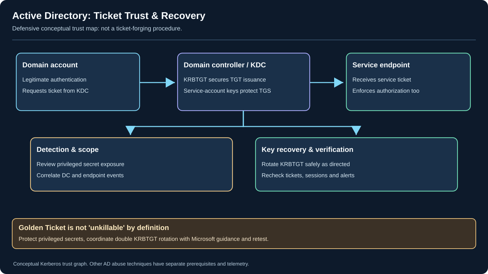

# Active Directory

*Illustrative trust and response map; not a ticket-forging procedure.* [Microsoft Defender for Identity security guidance](https://learn.microsoft.com/en-us/defender-for-identity/security-posture-assessments/accounts) describes the impact of KRBTGT compromise and coordinated double password rotation after compromise. Rotate according to supported operational instructions and domain replication requirements; do not treat one password reset or a passing detector as sufficient remediation.

_Active Directory attack techniques for red team engagements; golden tickets, skeleton keys, DCShadow, and related AD abuse primitives. Source: Pentest Laboratories (pentestlab.blog)._

**Purpose:** This checklist covers post-compromise abuse of Active Directory's trust model itself - not initial access, but what happens once an attacker (or tester) already has a foothold in the domain and wants to escalate, persist, or move covertly using AD's own mechanisms against it. Every item here targets a structural weakness in how Kerberos, LDAP, or domain replication work by design, not a missing patch.
 
**Function:** Each entry maps to a specific abuse of a legitimate AD feature: golden/skeleton-key tickets abuse Kerberos trust in the KRBTGT account, DCShadow can attempt directory replication abuse that may avoid some ordinary edit-auditing paths; it does **not** guarantee absence of domain-controller or network telemetry, SPN discovery and Kerberoasting abuse how service accounts request tickets, and hash dumping abuses how domain credentials are stored and synced. None of these are "exploits" in the CVE sense - they're all abuse of intended functionality, which is exactly why they're hard to patch and easy to miss in a rushed assessment.
 
**Goal:** Establish whether an attacker who compromises a single domain-joined host or low-privileged account can escalate to Domain Admin, and - separately - whether they can then persist that access in a way that survives password resets, account disablement, or even a partial incident response. The golden ticket / skeleton key items specifically test the second question: what secret compromise and recovery controls allow persistence after incident response, and what independent evidence proves the attacker's access was removed.
 
**When & How to use this:** Use this checklist only under a written AD-specific assessment scope. Start with **read-only** inventory and baseline logging; intrusive credential extraction, replication abuse, credential forgery or password changes require separate approval, test windows, rollback and incident contacts. High-privilege abuses generally require specific prerequisites and cannot be inferred from a low-privilege domain account. This checklist assumes you're already past initial access; pair it with [Domain Escalation](./Domain-Escalation.md) for the privilege-escalation path *into* DA, and [Domain Persistence](./Domain-Persistence.md) for the broader persistence toolkit beyond just tickets.

#### 📖 Full deep-dive with detection/defense guidance: [Tradecraft/active-directory.md](../Tradecraft/active-directory.md)
#### 📄 PDF references: [AD_Attacks_.pdf](../PDF/AD_Attacks_.pdf) · [AD_Post_Exploitation.pdf](../PDF/AD_Post_Exploitation.pdf)
#### 🛠️ Related scripts: [Scripts/PowerShell/](../Scripts/PowerShell/) (adlogin.ps1, smblogin.ps1)
---
* [AD-001 - Golden Ticket](https://pentestlab.blog/2018/04/09/golden-ticket/)
* [AD-002 - Skeleton Key](https://pentestlab.blog/2018/04/10/skeleton-key/)
* [AD-003 - DCShadow](https://pentestlab.blog/2018/04/16/dcshadow/)
* [AD-004 - SPN Discovery](https://pentestlab.blog/2018/06/04/spn-discovery/)
* [AD-005 - Kerberoast](https://pentestlab.blog/2018/06/12/kerberoast/)
* [AD-006 - Dumping Domain Password Hashes](https://pentestlab.blog/2018/07/04/dumping-domain-password-hashes/)

---

**📖 Use These Checklists Responsibly: Authorization is MANDATORY**

*Attack techniques are powerful - use them ethically and legally.*

**Repository**: [ULTIMATE CYBERSECURITY MASTER GUIDE](https://github.com/Pnwcomputers/ULTIMATE-CYBERSECURITY-MASTER-GUIDE)

**Maintained by**: [Pacific Northwest Computers](https://github.com/Pnwcomputers)

---

⚠️ **Authorized testing only: confirm authority and scope before active testing.** ⚠️

⚠️ **Legal consequences depend on the conduct and applicable law; see [18 U.S.C. §1030](https://uscode.house.gov/us/usc/119-134/t18/s1030/) and [DOJ CFAA charging policy](https://www.justice.gov/jm/jm-9-48000-computer-fraud).** ⚠️

⚠️ **For systems you do not own or administer, confirm authorization in advance and document scope in writing where policy, law, or contract requires it.** ⚠️

⭐ **Star this repo if you find it useful!** ⭐

## Related Files
- [README.md](README.md) - Checklists section index
