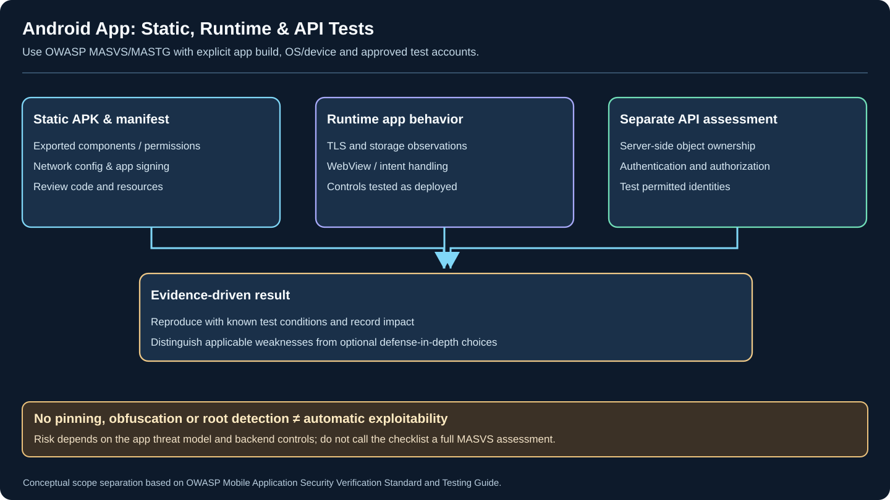

# Android Mobile Application

*Conceptual triage map, not a completed Android assessment.* [OWASP MASVS](https://mas.owasp.org/MASVS/) and [MASTG](https://mas.owasp.org/MASTG/) distinguish client-side risks from backend authorization. Lack of optional pinning, obfuscation or root detection is **not inherently a vulnerability**; assess threat models and actual impact before assigning a finding.

**Purpose:** A first-pass triage checklist for reviewing an Android APK's client-side security posture before (or instead of) a full OWASP MASTG-scale assessment. It is narrower than full OWASP MASVS/MASTG coverage: eight screening prompts that help select relevant tests, not an independently validated list of the most common vulnerabilities.
  
**Function:** The checklist splits into two categories: static configuration review (manifest permissions, certificate/signing setup, code obfuscation presence) and runtime/network behavior (WebView implementation, certificate pinning, rooting detection, plaintext data handling). Manifest and WebView issues can be found from the decompiled APK alone; certificate pinning and device-integrity responses require risk-specific runtime checks. Neither control is mandatory for every application and absence alone does not establish compromise.
  
**Goal:** Evaluate app data exposure, transport validation, WebView and IPC configuration, signing, and applicable runtime defenses. Record reproducible impact rather than claiming exploitation from a missing optional safeguard. This is fundamentally a "can this app be trusted on a compromised device" checklist, not a backend API security review - server-side findings need a separate methodology.
  
**When & How to use this:** Use during mobile app engagements as an initial pass before diving into MASTG's full test suite, or as a lightweight recurring check between major MASTG-scale assessments (e.g., after each app release). Static analysis can reveal potential manifest or WebView issues and signing metadata; confirming behavior may require an authorized device or emulator. Frida and Objection are optional tools, not mandatory for every MASTG test.

*Mobile application security review checklist for Android apps:*
- AMA-001, 002, and 008 link to specific pentestlab.blog write-ups.
- AMA-003 links to the specific OWASP MASTG test case.
- AMA-004 through AMA-007 link to the general OWASP MASTG guide
_★ General reference, OWASP restructures individual test IDs periodically, so these point to the stable top-level guide rather than a specific page that could break)._
---
* [AMA-001 - Manifest File Review](https://pentestlab.blog/2017/01/24/security-guidelines-for-android-manifest-files/)
* [AMA-002 - Insecure WebView Implementation](https://pentestlab.blog/2017/02/12/android-webview-vulnerabilities/)
* [AMA-003 - Certificate Pinning (Threat-Model-Dependent)](https://mas.owasp.org/MASTG/tests/android/MASVS-NETWORK/MASTG-TEST-0244/)
* [AMA-004 - Device Integrity / Root Detection Review ★](https://mas.owasp.org/MASTG/)
* [AMA-005 - Application Certificate ★](https://mas.owasp.org/MASTG/)
* [AMA-006 - Code Obfuscation / Resilience Review ★](https://mas.owasp.org/MASTG/)
* [AMA-007 - Plaintext Data ★](https://mas.owasp.org/MASTG/)
* [AMA-008 - APK Payload Injection](https://pentestlab.blog/2017/06/26/injecting-metasploit-payloads-into-android-applications-manually/)

---

**📖 Use These Checklists Responsibly: Authorization is MANDATORY**

*Attack techniques are powerful - use them ethically and legally.*

**Repository**: [ULTIMATE CYBERSECURITY MASTER GUIDE](https://github.com/Pnwcomputers/ULTIMATE-CYBERSECURITY-MASTER-GUIDE)

**Maintained by**: [Pacific Northwest Computers](https://github.com/Pnwcomputers)

---

⚠️ **Authorized testing only: confirm authority and scope before active testing.** ⚠️

⚠️ **Legal consequences depend on the conduct and applicable law; see [18 U.S.C. §1030](https://uscode.house.gov/us/usc/119-134/t18/s1030/) and [DOJ CFAA charging policy](https://www.justice.gov/jm/jm-9-48000-computer-fraud).** ⚠️

⚠️ **For systems you do not own or administer, confirm authorization in advance and document scope in writing where policy, law, or contract requires it.** ⚠️

⭐ **Star this repo if you find it useful!** ⭐

## Related Files
- [README.md](README.md) - Checklists section index
- [../Mobile/README.md](../Mobile/README.md) - Mobile security section (Android/iOS pentesting, NetHunter platform)
- [../Mobile/mobile_pentest_sop.md](../Mobile/mobile_pentest_sop.md) - Engagement-level SOP for mobile platform pentesting
