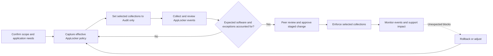

# AppLocker Policy Validation
_A defensive checklist for reviewing application-control policy effectiveness. Historical external references are provided for context; their examples may not apply to current Windows builds or policy configurations._

**Purpose:** Evaluate whether the effective AppLocker policy matches the system owner's intended application-control boundaries. A policy being enabled does not establish that it blocks every unwanted execution path.

**Function:** Record the effective policy, enforcement mode, rule collections, exceptions, and relevant event logs. The legacy references below describe historical bypass classes; they are not a complete, current, or universally applicable list.

**Goal:** Produce a defensible control review with configuration evidence, approved test outcomes, and explicit limits.

**When & How to use this:** Use during an authorized configuration review or a controlled defensive validation. Begin with `Get-AppLockerPolicy -Effective` and the applicable event logs. Prefer vendor-supported simulators or benign test files; do not execute arbitrary code or payloads to prove a policy gap. Validate WDAC separately because its policy and enforcement behavior differ.

### Review and rollout path

Use a staged policy review. Audit-only evaluates policy and records events without blocking, so review actual usage before enforcing any collection.

Treat this as a review sequence, not a guarantee that all executable content is controlled. Policy merge precedence, collection configuration and the target Windows release affect the effective result. A collection shown as `Not configured` can still enforce existing rules in some configurations; inspect the effective policy and set each collection to the intended Audit only or Enforce mode explicitly.

### Current Microsoft references

- [AppLocker overview](https://learn.microsoft.com/en-us/windows/security/application-security/application-control/app-control-for-business/applocker/applocker-overview)
- [Configure an AppLocker policy for audit only](https://learn.microsoft.com/en-us/windows/security/application-security/application-control/app-control-for-business/applocker/configure-an-applocker-policy-for-audit-only)
- [Monitor application usage with AppLocker](https://learn.microsoft.com/en-us/windows/security/application-security/application-control/app-control-for-business/applocker/monitor-application-usage-with-applocker)
- [Deploy AppLocker rules](https://learn.microsoft.com/en-us/windows/security/application-security/application-control/app-control-for-business/applocker/deploy-the-applocker-policy-into-production)

#### Further reading: [Tradecraft LOLBins/LOLBAS overview](../Tradecraft/lolbins-lolbas.md)

---

* [AL-01 - InstallUtil](https://pentestlab.blog/2017/05/08/applocker-bypass-installutil/)
* [AL-02 - Regsvr32](https://pentestlab.blog/2017/05/11/applocker-bypass-regsvr32/)
* [AL-03 - Regasm and Regsvcs](https://pentestlab.blog/2017/05/19/applocker-bypass-regasm-and-regsvcs/)
* [AL-04 - MSBuild](https://pentestlab.blog/2017/05/29/applocker-bypass-msbuild/)
* [AL-05 - Rundll32](https://pentestlab.blog/2017/05/23/applocker-bypass-rundll32/)
* [AL-06 - IEExec](https://pentestlab.blog/2017/06/13/applocker-bypass-ieexec/)
* [AL-07 - Control Panel](https://pentestlab.blog/2017/05/24/applocker-bypass-control-panel/)
* [AL-08 - Weak Path Rules](https://pentestlab.blog/2017/05/22/applocker-bypass-weak-path-rules/)
* [AL-09 - BgInfo](https://pentestlab.blog/2017/06/05/applocker-bypass-bginfo)
* [AL-10 - Assembly Load](https://pentestlab.blog/2017/06/06/applocker-bypass-assembly-load/)
* [AL-11 - File Extensions](https://pentestlab.blog/2017/06/12/applocker-bypass-file-extensions/)
* [AL-12 - MSIEXEC](https://pentestlab.blog/2017/06/16/applocker-bypass-msiexec/)
* [AL-13 - MSXSL](https://pentestlab.blog/2017/07/06/applocker-bypass-msxsl/)
* [AL-14 - CreateRestrictedToken](https://pentestlab.blog/2017/07/07/applocker-bypass-createrestrictedtoken/)
* [AL-15 - Cmstp](https://pentestlab.blog/2018/05/10/applocker-bypass-cmstp/)

---

**Use these references responsibly: validate only systems within documented scope.**

*The links below are historical references, not a runbook or a current compatibility guarantee.*

**Repository**: [ULTIMATE CYBERSECURITY MASTER GUIDE](https://github.com/Pnwcomputers/ULTIMATE-CYBERSECURITY-MASTER-GUIDE)

**Maintained by**: [Pacific Northwest Computers](https://github.com/Pnwcomputers)

---

⚠️ **Use benign, approved validation methods and record scope before any active test.** ⚠️

⚠️ **Legal consequences depend on the conduct and applicable law; see [18 U.S.C. §1030](https://uscode.house.gov/us/usc/119-134/t18/s1030/) and [DOJ CFAA charging policy](https://www.justice.gov/jm/jm-9-48000-computer-fraud).** ⚠️

⚠️ **For systems you do not own or administer, confirm authorization and document scope in advance.** ⚠️

⭐ **Star this repo if you find it useful!** ⭐

## Related Files
- [README.md](README.md) - Checklists section index
