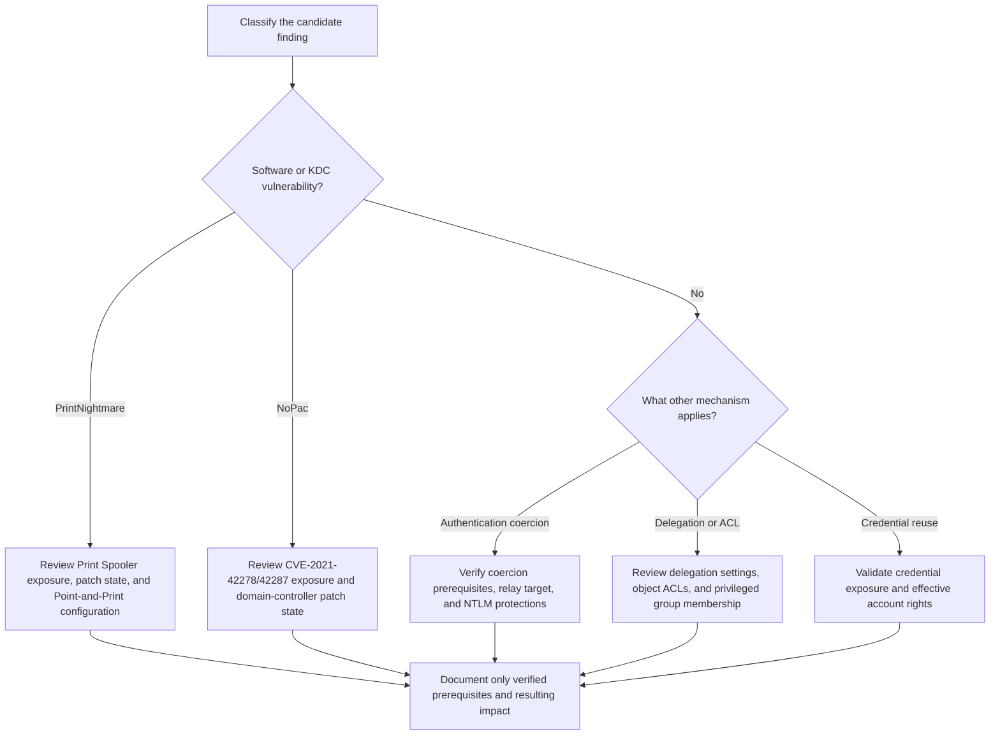

# Domain Escalation
_Active Directory domain escalation techniques (coerced authentication, delegation abuse, ACL abuse) for red team engagements. Source: Pentest Laboratories (note: some newer posts have moved to pentestlaboratories.com under the same team)._

**Purpose:** Covers the path from "domain user with no special rights" to "Domain Admin" - the specific vulnerability classes and misconfigurations that let an attacker climb the privilege ladder within AD rather than techniques for maintaining access once at the top (that's [Domain Persistence](./Domain-Persistence.md)). This checklist groups distinct escalation-related classes. PrintNightmare is a Windows Print Spooler vulnerability (CVE-2021-34527), not an authentication-coercion technique. PetitPotam and related coercion families can induce authentication, but escalation through relay depends on the target services and protections in the environment. NoPac (CVE-2021-42278 and CVE-2021-42287) is a separate Kerberos/KDC account-name vulnerability chain addressed by Microsoft security updates. [Microsoft MSRC](https://www.microsoft.com/en-us/msrc/blog/2021/07/clarified-guidance-for-cve-2021-34527-windows-print-spooler-vulnerability) · [Microsoft Defender for Identity: PetitPotam and relay context](https://learn.microsoft.com/en-us/defender-for-identity/alerts-xdr) · [Microsoft Defender for Identity: NoPac](https://learn.microsoft.com/en-us/defender-for-identity/alerts-mdi-classic)
 
**Function:** The entries cover four broad classes: software vulnerabilities (PrintNightmare and NoPac), authentication coercion/relay (PetitPotam, RemotePotato, ShadowCoerce), delegation or directory-permission exposure (unconstrained delegation and ACLs), and credential reuse or privileged-group exposure (machine-account pass-the-hash and Backup Operators). These paths have different prerequisites and impacts; none automatically implies NTLM relay or Domain Admin.
 
**Goal:** Assess whether the authorized starting identity and environment-specific prerequisites expose an escalation path. Some entries require credentials, unpatched systems, a relayable service, or a specific delegation/ACL configuration. Verify the conditions in the actual environment instead of assuming any candidate path reaches Domain Admin.
 
**When & how to use this:** Use this after basic domain inventory to classify candidate paths by mechanism and prerequisites. Review patch state for software and KDC vulnerabilities, service configuration for coercion/relay paths, and directory rights for delegation/group/ACL exposures. Tools can identify candidates; validate each path against the specific domain and rules of engagement.

*Classification aid: these mechanisms are distinct. The diagram does not imply that any one finding automatically results in domain compromise; impact depends on patch state, privileges, configuration, and other prerequisites.*

#### 📖 Full deep-dive with detection/defense guidance: [Tradecraft/active-directory.md](../Tradecraft/active-directory.md)
#### 📄 PDF references: [AD_Attacks_.pdf](../PDF/AD_Attacks_.pdf) · [AD_Post_Exploitation.pdf](../PDF/AD_Post_Exploitation.pdf)
---
*Linked articles are source references; this table does not assert ATT&CK mappings.*
| Code | Technique |
|---|---|
| DA-01 | [PrintNightmare](https://pentestlab.blog/2021/08/17/domain-escalation-printnightmare/) |
| DA-02 | [PetitPotam](https://pentestlab.blog/2021/09/14/petitpotam-ntlm-relay-to-ad-cs/) |
| DA-03 | [RemotePotato](https://pentestlab.blog/2021/05/04/remote-potato-from-domain-user-to-enterprise-admin/) |
| DA-04 | [Unconstrained Delegation](https://pentestlab.blog/2022/03/21/unconstrained-delegation/) |
| DA-05 | [sAMAccountName Spoofing](https://pentestlab.blog/2022/01/10/domain-escalation-samaccountname-spoofing/) |
| DA-06 | [ShadowCoerce](https://pentestlaboratories.com/2022/01/11/shadowcoerce/) |
| DA-07 | [Pass the hash - Machine Accounts](https://pentestlab.blog/2022/02/01/machine-accounts/) |
| DA-08 | [Backup Operator](https://pentestlab.blog/2024/01/22/domain-escalation-backup-operator/) |

---

**📖 Use These Checklists Responsibly: Authorization is MANDATORY**

*Attack techniques are powerful - use them ethically and legally.*

**Repository**: [ULTIMATE CYBERSECURITY MASTER GUIDE](https://github.com/Pnwcomputers/ULTIMATE-CYBERSECURITY-MASTER-GUIDE)

**Maintained by**: [Pacific Northwest Computers](https://github.com/Pnwcomputers)

---

⚠️ **CRITICAL: These are ATTACK TECHNIQUES - Written authorization is REQUIRED** ⚠️

⚠️ **Unauthorized activity may violate applicable law, contracts, or policy depending on the conduct, authorization, and jurisdiction. Obtain written approval and follow the agreed scope.** ⚠️

⚠️ **ALWAYS obtain explicit written authorization before using any technique** ⚠️

⭐ **Star this repo if you find it useful!** ⭐

## Related Files
- [README.md](README.md) - Checklists section index
