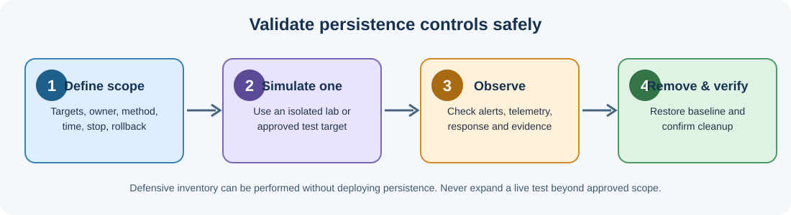

# Domain Persistence

**Purpose:** Once Domain Admin (or equivalent) is achieved, this checklist covers ways to keep that access alive through password rotations, incident response, and partial remediation - response may range from targeted remediation and credential rotation to forest recovery, depending on the compromised material, scope, trusted backups, and specialist incident assessment. A full rebuild is not an automatic requirement. See [Microsoft's forest recovery guidance](https://learn.microsoft.com/en-us/windows-server/identity/ad-ds/manage/forest-recovery-guide/ad-forest-recovery-determine-how-to-recover). Every item here is specifically an AD-native persistence mechanism, not a general Windows backdoor.

**Function:** Entries span a spectrum of stealth and durability: Golden Certificate and Golden Ticket forge Kerberos trust material directly from the krbtgt/CA keys, surviving individual password resets; AdminSDHolder and machine account abuse hijack legitimate AD protection mechanisms to silently maintain privileged group membership; Shadow Credentials and Diamond Ticket are additional paths defenders should inventory; detectability depends on implementation, telemetry, and environment, so validate detection notes against your own lab and data.

**Goal:** Help defenders inventory domain persistence paths and validate recovery coverage. In an explicitly approved exercise, simulate only the minimum needed to test detection and remediation, preferably in an isolated lab or dedicated test domain, with a documented rollback and cleanup check.

**When & how to use this:** Use once you already hold Domain Admin or equivalent rights, as the natural next step after [Domain Escalation](./Domain-Escalation.md). For a red-team exercise, use an isolated lab or a specifically approved simulation with explicit target, technique, duration, rollback, and cleanup criteria. Do not treat deployment of multiple live persistence mechanisms as a default test step. During defensive work, use this as your "did we actually get all of it" checklist after any AD compromise.

#### 📖 Full deep-dive with detection/defense guidance: [Tradecraft/active-directory.md](../Tradecraft/active-directory.md)
#### 📄 PDF references: [AD_Attacks_.pdf](../PDF/AD_Attacks_.pdf) · [AD_Post_Exploitation.pdf](../PDF/AD_Post_Exploitation.pdf)
---
| Code | Technique | MITRE ATT&CK |
|------|-----------|---------------|
| DP-01 | [Golden Certificate](https://pentestlab.blog/2021/11/15/golden-certificate/) | [T1649 — Steal or Forge Authentication Certificates](https://attack.mitre.org/techniques/T1649/) |
| DP-02 | [AdminSDHolder](https://pentestlab.blog/2022/01/04/domain-persistence-adminsdholder/) | Not mapped here |
| DP-03 | [Golden Ticket](https://pentestlab.blog/2018/04/09/golden-ticket/) | [T1558.001 — Golden Ticket](https://attack.mitre.org/techniques/T1558/001/) |
| DP-04 | [DCShadow](https://pentestlab.blog/2018/04/16/dcshadow/) | [T1207 — Rogue Domain Controller](https://attack.mitre.org/techniques/T1207/) |
| DP-05 | [Machine Account](https://pentestlab.blog/2022/01/17/domain-persistence-machine-account/) | Not mapped here |
| DP-06 | [Shadow Credentials](https://pentestlab.blog/2022/02/07/shadow-credentials/) | Not mapped here |
| DP-07 | [Diamond Ticket](https://hacktricks.wiki/en/windows-hardening/active-directory-methodology/diamond-ticket.html) | Not mapped here |

“Not mapped here” means this checklist does not assign a direct ATT&CK technique ID; it does not mean the behavior is harmless or absent from every ATT&CK analysis.

---

**📖 Use These Checklists Responsibly: Authorization is MANDATORY**

*Attack techniques are powerful - use them ethically and legally.*

**Repository**: [ULTIMATE CYBERSECURITY MASTER GUIDE](https://github.com/Pnwcomputers/ULTIMATE-CYBERSECURITY-MASTER-GUIDE)

**Maintained by**: [Pacific Northwest Computers](https://github.com/Pnwcomputers)

---

⚠️ **Authorized testing only: confirm authority and scope before active testing.** ⚠️

⚠️ **Legal consequences depend on the conduct and applicable law; see [18 U.S.C. §1030](https://uscode.house.gov/us/usc/119-134/t18/s1030/) and [DOJ CFAA charging policy](https://www.justice.gov/jm/jm-9-48000-computer-fraud).** ⚠️

⚠️ **For systems you do not own or administer, confirm authorization in advance and document scope in writing where policy, law, or contract requires it.** ⚠️

⭐ **Star this repo if you find it useful!** ⭐

## Related Files
- [README.md](README.md) - Checklists section index
