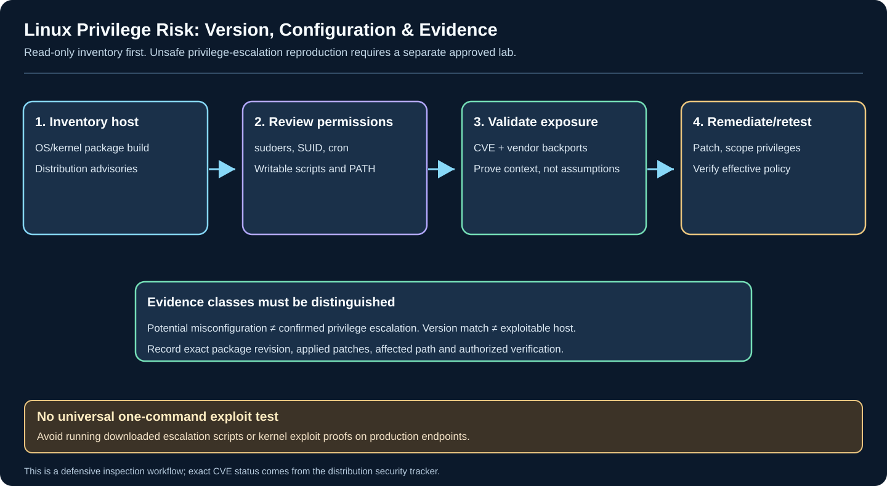

# Linux Privilege Escalation

*Conceptual risk triage, not an instruction to elevate privileges.* Distribution vendors often backport patches without changing upstream version numbers; [Canonical's Ubuntu CVE tracker](https://ubuntu.com/security/cves) and [Red Hat's security data](https://access.redhat.com/security/security-updates/) identify affected package builds and fixes. A `uname -r` release or downloaded exploit list is not sufficient to establish vulnerability or a safe exploit test.

_Common Linux local privilege escalation vectors._

**Purpose:** Covers the path from an unprivileged shell on a Linux host to root - the standard set of misconfigurations and kernel vulnerabilities that show up repeatedly across real-world Linux systems and CTF-style privilege escalation challenges alike. Unlike the AD-focused checklists in this repo, most items here are host-local rather than network/protocol-based.
 
**Function:** The list spans three categories: kernel-level vulnerabilities (Dirty Cow, Baron Samedit - actual CVEs with specific affected version ranges), misconfiguration abuse (SUID binaries, sudo permissions, cron jobs, PATH hijacking - legitimate system features configured too permissively), and technique classes rather than single bugs (wildcard injection is a pattern that applies to any privileged script calling `tar`/`rsync`/`chown` unsafely, not a single fixed vulnerability).
 
**Goal:** Identify, classify and remediate verified Linux local privilege risks and distinguish configuration exposure from a confirmed exploit path. Kernel/package vulnerability handling and sudo/SUID/cron permission hardening have different evidence and remediation requirements; never equate a scan match with proven root compromise.
 
**When & how to use this:** Begin with authorized, read-only host inventory and confirm the exact OS distribution, vendor package build, patch status and actual effective sudo/SUID/cron permissions. Distribution backports mean the upstream kernel version alone cannot prove a CVE is present or fixed. Any intrusive validation, automated enumeration that executes third-party code, service changes or kernel exploit reproduction requires a separate approved lab method and rollback plan.

#### 📄 PDF reference: [Linux_Privilege_Escalation.pdf](../PDF/Linux_Privilege_Escalation.pdf)
---
* [LPE-01 - Dirty Cow](https://dirtycow.ninja/)
* [LPE-02 - SUID Executables](https://pentestlab.blog/2017/09/25/suid-executables/)
* [LPE-03 - Sudo Users](https://gtfobins.org/gtfobins/sudo/)
* [LPE-04 - Wildcard Injection](https://hacktricks.wiki/en/linux-hardening/privilege-escalation/wildcards-spare-tricks.html)
* [LPE-05 - Kernel Exploits](https://github.com/lucyoa/kernel-exploits)
* [LPE-06 - Path Hijacking](https://hacktricks.wiki/en/linux-hardening/privilege-escalation/index.html)
* [LPE-07 - Misconfigured Cron jobs](https://hacktricks.wiki/en/linux-hardening/privilege-escalation/index.html)
* [LPE-08 - Baron Samedit](https://blog.qualys.com/vulnerabilities-threat-research/2021/01/26/cve-2021-3156-heap-based-buffer-overflow-in-sudo-baron-samedit)

---

**📖 Use These Checklists Responsibly: Authorization is MANDATORY**

*Attack techniques are powerful - use them ethically and legally.*

**Repository**: [ULTIMATE CYBERSECURITY MASTER GUIDE](https://github.com/Pnwcomputers/ULTIMATE-CYBERSECURITY-MASTER-GUIDE)

**Maintained by**: [Pacific Northwest Computers](https://github.com/Pnwcomputers)

---

⚠️ **CRITICAL: These are ATTACK TECHNIQUES - Written authorization is REQUIRED** ⚠️

⚠️ **Unauthorized activity may violate law or contract; consequences depend on jurisdiction and conduct.** ⚠️

⚠️ **ALWAYS obtain explicit written authorization before using any technique** ⚠️

⭐ **Star this repo if you find it useful!** ⭐

## Related Files
- [README.md](README.md) - Checklists section index
