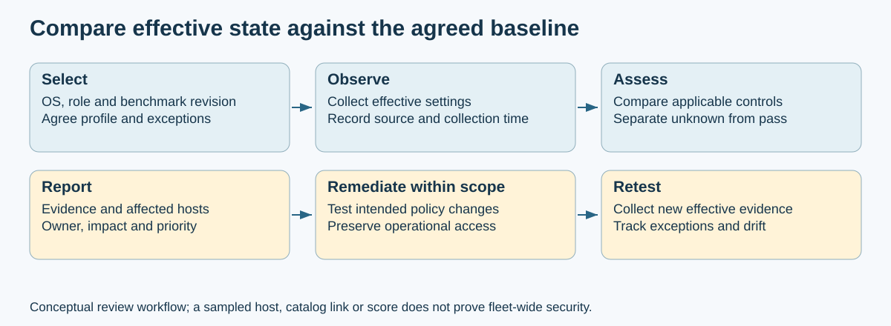

# Windows Build Review
_Host-level configuration review checklist. The 22 links below open a general CIS Windows Desktop catalog, not individual check procedures or an authoritative one-to-one mapping._

_Last reviewed: 2026-11-17 (documentation review; no hosts inspected or settings changed)._

**Purpose:** A configuration-review (not exploitation) checklist for auditing a single Windows host's build against baseline hardening expectations - the kind of assessment done against a "gold image" before mass deployment, or against an existing production host to establish its current security posture. This is fundamentally different in character from the attack-technique checklists elsewhere in this repo: there's no exploit to run here, only configuration to inspect and compare against a known-good baseline.
 
**Function:** The 22 items sweep systematically through a host's attack surface: what's running (active processes, services, network connections), what's exposed (shares, firewall rules, remote management), what may be misconfigured (service paths and permissions that can create local privilege-escalation opportunities under specific conditions), what's missing (patch level, AV, audit logging), and what's policy-controlled (account lockout, local security policy, clear-text password storage). Several items here overlap with [Windows Privilege Escalation](./Windows-Privilege-Escalation.md). A finding is a configuration observation; it does not establish exploitability without validating the relevant permissions, execution context and control requirements.
 
**Goal:** Produce an evidence-backed comparison against an explicitly selected baseline for a Windows host or image, independent of whether any vulnerability is exploited. The checklist supports a scoped configuration review; it is not, by itself, a compliance certification or proof that the host can or cannot be compromised.
 
**When & how to use this:** Run against a representative sample of hosts (or the gold image itself) during a build review engagement, working through items systematically rather than in attack-priority order since there's no exploitation sequencing here - every item is an independent configuration check. Cross-reference findings against [Windows Privilege Escalation](./Windows-Privilege-Escalation.md) and [AppLocker](./AppLocker.md). A service-path issue needs both relevant permissions and an executable search opportunity; a missing AppLocker policy is a baseline deviation only if that control is required for the host. Neither label alone establishes exploitability.

## Select the baseline and capture effective state

Use the [CIS Desktop catalog](https://www.cisecurity.org/benchmark/microsoft_windows_desktop) for the appropriate desktop edition, and the [CIS Server catalog](https://www.cisecurity.org/benchmark/microsoft_windows_server) for server roles. Record the exact OS/build, domain or standalone role, benchmark version/profile, and approved exceptions. A general catalog link does not prove a recommendation applies to a particular system.

[Microsoft security baselines](https://learn.microsoft.com/en-us/windows/security/operating-system-security/device-management/windows-security-configuration-framework/windows-security-baselines) are another versioned reference. Select the agreed assessment baseline; do not combine conflicting settings or apply a downloadable policy simply to conduct a read-only review.

*Original conceptual review flow. Checking configured policy, effective settings and observed behavior answers different questions. A sample image or a passing score does not establish the condition of every deployed host.*

For each WBR item, retain:

| Record | What to capture |
|---|---|
| Scope | Host/image identifier, role, OS/build and UTC collection time |
| Requirement | Exact baseline revision, profile and recommendation ID, where applicable |
| Observation | Effective value and read-only collection method, not only intended policy |
| Result | Pass, fail, not applicable, not checked, or evidence unavailable |
| Exception | Owner, justification, compensating control and review date |
| Follow-up | Scoped remediation, operational impact and retest evidence |

Protect account, process, network and software inventories as sensitive assessment data. Collect only what is needed; do not copy credentials to prove a clear-text-storage concern. A configuration review does not authorize exploitation or automatic hardening changes. If a numeric score is used, publish its denominator, exclusions and weighting separately; unchecked controls must not count as passes.

## Review areas

---

* [WBR-001 - File System Configuration ★](https://www.cisecurity.org/benchmark/microsoft_windows_desktop)
* [WBR-002 - Network Time Protocol ★](https://www.cisecurity.org/benchmark/microsoft_windows_desktop)
* [WBR-003 - Start-up Executables ★](https://www.cisecurity.org/benchmark/microsoft_windows_desktop)
* [WBR-004 - Active Processes ★](https://www.cisecurity.org/benchmark/microsoft_windows_desktop)
* [WBR-005 - Active Network Connections ★](https://www.cisecurity.org/benchmark/microsoft_windows_desktop)
* [WBR-006 - Routing Table ★](https://www.cisecurity.org/benchmark/microsoft_windows_desktop)
* [WBR-007 - Local Services ★](https://www.cisecurity.org/benchmark/microsoft_windows_desktop)
* [WBR-008 - Exploit Mitigation Technologies ★](https://www.cisecurity.org/benchmark/microsoft_windows_desktop)
* [WBR-009 - Weak Service Permissions ★](https://www.cisecurity.org/benchmark/microsoft_windows_desktop)
* [WBR-010 - Unquoted Service Paths ★](https://www.cisecurity.org/benchmark/microsoft_windows_desktop)
* [WBR-011 - Available Shares ★](https://www.cisecurity.org/benchmark/microsoft_windows_desktop)
* [WBR-012 - User Accounts Review ★](https://www.cisecurity.org/benchmark/microsoft_windows_desktop)
* [WBR-013 - Clear-Text Passwords ★](https://www.cisecurity.org/benchmark/microsoft_windows_desktop)
* [WBR-014 - Storage Mechanism of Password Hashes ★](https://www.cisecurity.org/benchmark/microsoft_windows_desktop)
* [WBR-015 - Account Lockout Policy ★](https://www.cisecurity.org/benchmark/microsoft_windows_desktop)
* [WBR-016 - Local Security Policy ★](https://www.cisecurity.org/benchmark/microsoft_windows_desktop)
* [WBR-017 - Events Auditing ★](https://www.cisecurity.org/benchmark/microsoft_windows_desktop)
* [WBR-018 - Host Based Firewall ★](https://www.cisecurity.org/benchmark/microsoft_windows_desktop)
* [WBR-019 - Antivirus Software Review ★](https://www.cisecurity.org/benchmark/microsoft_windows_desktop)
* [WBR-020 - List Available Software ★](https://www.cisecurity.org/benchmark/microsoft_windows_desktop)
* [WBR-021 - Windows Patch Level ★](https://www.cisecurity.org/benchmark/microsoft_windows_desktop)
* [WBR-022 - Remote Management ★](https://www.cisecurity.org/benchmark/microsoft_windows_desktop)

---

**Authorization:** Review only hosts and evidence within the engagement scope. Follow [repository legal terms](../LEGAL.md) and use a separate change process for remediation.

## Related Files

- [README.md](README.md) - Checklists section index

[Section Index](README.md) | [Master Index](../README.md) | [Legal Notice](../LEGAL.md)
