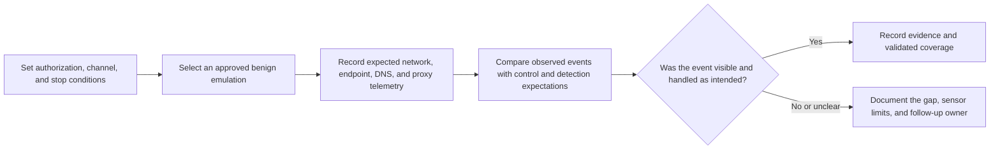

# Command & Control
_C2 channel techniques and covert communication methods for red team infrastructure, organized by protocol/channel. Most items link to a specific pentestlab.blog write-up. C2-005, C2-010, C2-011, and C2-020 have no dedicated article, so they link to the general pentestlab.blog Command & Control category (★ general reference)._

**Purpose:** A survey of covert communication channels an implant can use to phone home once execution is achieved, organized by carrier protocol/service rather than by C2 framework. Where [Tradecraft/c2-frameworks.md](../Tradecraft/c2-frameworks.md) covers *which tool* to run (Cobalt Strike, Sliver, Havoc), this checklist covers *which channel* the traffic rides on - DNS, HTTPS, WebDAV, cloud storage APIs, social media, even images and JavaScript as a transport.
 
**Function:** These channels may be used to carry C2 traffic and can resemble legitimate activity, but visibility and blocking vary by environment. Coverage depends on resolver and egress policy, sensor placement, TLS inspection, SaaS controls, endpoint telemetry, and the specific implementation. Do not assume a protocol is uninspected, a SaaS service is allowed, or encrypted traffic is invisible.
 
**Goal:** Use the list to identify which channels are in scope for a defensive coverage review, then document what telemetry and controls the environment actually has. A missing network-content view does not mean there is no endpoint, DNS, proxy, identity, or provider-side detection. For blue teams, this same list doubles as a coverage map: for each channel, "do we have a detection for this" is a fair question to ask.
 
**When & how to use this:** For authorized red or purple team work, validate one in-scope channel at a time with an approved benign emulation or vendor-supported test. Coordinate expected telemetry and stop conditions in advance. Blue teams can use the same process to compare intended controls with observed events and record coverage gaps. Do not infer detection from assumed firewall or SaaS behavior. - test the most "boring"/high-blend-in channels first (HTTPS, DNS) before escalating to more unusual ones (Instagram, images) that are more likely to be a research curiosity than a production-viable channel. For blue/purple teams, use this as a checklist of channels to validate detection coverage against, ideally paired with the Sigma/detection content in [Tradecraft/c2-frameworks.md](../Tradecraft/c2-frameworks.md).

#### 📖 Full Deep-dives (Cobalt Strike, etc; Architecture, Detection, etc): [Tradecraft/c2-frameworks.md](../Tradecraft/c2-frameworks.md)

*Defensive validation flow: test only the approved channel using a harmless simulation or vendor test, and distinguish a missing network view from a total absence of telemetry.*

---

* [C2-001 - ICMP](https://pentestlab.blog/2017/07/28/command-and-control-icmp/)
* [C2-002 - DNS](https://pentestlab.blog/2017/09/06/command-and-control-dns/)
* [C2-003 - DropBox](https://pentestlab.blog/2017/08/29/command-and-control-dropbox/)
* [C2-004 - Gmail](https://pentestlab.blog/2017/08/03/command-and-control-gmail/)
* [C2-005 - Github ★](https://pentestlab.blog/category/red-team/command-and-control/)
* [C2-006 - Twitter](https://pentestlab.blog/2017/09/26/command-and-control-twitter/)
* [C2-007 - Website Keyword](https://pentestlab.blog/2017/09/14/command-and-control-website-keyword/)
* [C2-008 - PowerShell](https://pentestlab.blog/2017/08/19/command-and-control-powershell/)
* [C2-009 - Windows COM](https://pentestlab.blog/2017/09/01/command-and-control-windows-com/)
* [C2-010 - WebDAV](https://pentestlab.blog/2017/09/12/command-and-control-webdav/)
* [C2-011 - Error Pages ★](https://pentestlab.blog/category/red-team/command-and-control/)
* [C2-012 - Active Directory ★](https://pentestlab.blog/category/red-team/command-and-control/)
* [C2-013 - HTTPS](https://pentestlab.blog/2017/10/04/command-and-control-https/)
* [C2-014 - Kernel](https://pentestlab.blog/2017/10/02/command-and-control-kernel/)
* [C2-015 - Website](https://pentestlab.blog/2017/11/14/command-and-control-website/)
* [C2-016 - WMI](https://pentestlab.blog/2017/11/20/command-and-control-wmi/)
* [C2-017 - WebSocket](https://pentestlab.blog/2017/12/06/command-and-control-websocket/)
* [C2-018 - Images](https://pentestlab.blog/2018/01/02/command-and-control-images/)
* [C2-019 - Web Interface](https://pentestlab.blog/2018/01/03/command-and-control-web-interface/)
* [C2-020 - JavaScript](https://pentestlab.blog/2018/01/08/command-and-control-javascript/)
* [C2-021 - Instagram ★](https://pentestlab.blog/category/red-team/command-and-control/)
* [C2-022 - Browser](https://pentestlab.blog/2018/06/06/command-and-control-browser/)

---

**📖 Use These Checklists Responsibly: Authorization is MANDATORY**

*Attack techniques are powerful - use them ethically and legally.*

**Repository**: [ULTIMATE CYBERSECURITY MASTER GUIDE](https://github.com/Pnwcomputers/ULTIMATE-CYBERSECURITY-MASTER-GUIDE)

**Maintained by**: [Pacific Northwest Computers](https://github.com/Pnwcomputers)

---

⚠️ **Authorized testing only: confirm authority and scope before active testing.** ⚠️

⚠️ **Legal consequences depend on the conduct and applicable law; see [18 U.S.C. §1030](https://uscode.house.gov/us/usc/119-134/t18/s1030/) and [DOJ CFAA charging policy](https://www.justice.gov/jm/jm-9-48000-computer-fraud).** ⚠️

⚠️ **For systems you do not own or administer, confirm authorization in advance and document scope in writing where policy, law, or contract requires it.** ⚠️

⭐ **Star this repo if you find it useful!** ⭐

## Related Files
- [README.md](README.md) - Checklists section index
