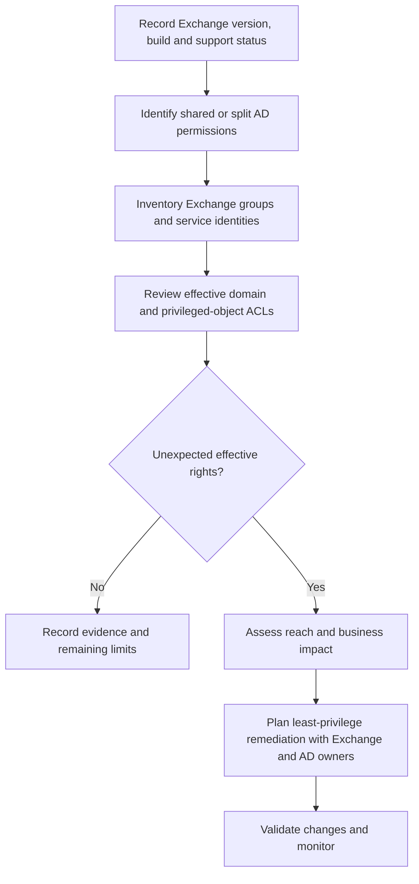

# Microsoft Exchange
_Historical Exchange attack-path references for defensive review. The linked PentestLab posts date from 2019 and do not describe every current deployment or replace vendor security guidance._

**Purpose:** Review on-premises Exchange authentication, server exposure, mailbox access, and the Active Directory permissions that an Exchange compromise might affect. The path depends on Exchange version, installation/permission model, group membership and effective ACLs; product presence alone does not establish domain-level access.
 
**Function:** The legacy list groups authentication, post-compromise, code-execution and Active Directory permission risks. Under the shared-permissions model, Exchange's effective AD permissions can include ACEs on the domain object. With Active Directory split permissions, those ACEs are not added. Determine the actual model and inspect effective groups/ACLs before concluding whether a domain-escalation path exists. DCSync-level impact requires the relevant effective rights and is not an automatic consequence of server compromise.
 
**Goal:** Establish which Exchange risks apply to the assessed build and permission model, distinguish mailbox/server compromise from domain-level impact, and document evidence for any effective privilege path.
 
**Support status:** Exchange Server 2016 and 2019 reached end of support on October 14, 2025; Microsoft identifies Exchange Server Subscription Edition (SE) as the current on-premises release. Check the [current Exchange build and servicing information](https://learn.microsoft.com/en-us/exchange/new-features/build-numbers-and-release-dates) before an assessment. If older versions are present, verify any Extended Security Update coverage and prioritize a supported migration path.

**When & how to use this:** Use for authorized on-premises Exchange assessments. This checklist does not apply to Exchange Online/Microsoft 365. Start with read-only inventory of product/build, exposure, permission mode, privileged groups and effective AD ACLs. Any active authentication, relay, code-execution or credential tests require explicit scope and approval; the historical links below are not current run instructions.

---

## Permission-model review

Microsoft documents that the Exchange Windows Permissions group receives particular ACEs on the domain object under the shared-permissions model, while split permissions excludes those ACEs. Review the deployment's actual mode and effective ACLs rather than inferring risk from Exchange membership alone.

- [Exchange Server permissions](https://learn.microsoft.com/en-us/exchange/permissions/permissions)
- [Split permissions in Exchange Server](https://learn.microsoft.com/en-us/exchange/permissions/split-permissions/split-permissions)
- [Exchange Server 2016 and 2019 end-of-support roadmap](https://learn.microsoft.com/en-us/troubleshoot/exchange/administration/exchange-2019-2016-end-of-support)
* [ME-001 - Password Spraying](https://pentestlab.blog/2019/09/05/microsoft-exchange-password-spraying/)
* [ME-002 - NTLM Relay](https://pentestlab.blog/2019/09/09/microsoft-exchange-ntlm-relay/)
* [ME-003 - Mailbox Post Compromise](https://pentestlab.blog/2019/09/11/microsoft-exchange-mailbox-post-compromise/)
* [ME-004 - Privilege Escalation](https://pentestlab.blog/2019/09/16/microsoft-exchange-privilege-escalation/)
* [ME-005 - Code Execution](https://pentestlab.blog/2019/09/10/microsoft-exchange-code-execution/)
* [ME-006 - Domain Escalation - ACL](https://pentestlab.blog/2019/09/12/microsoft-exchange-acl/)
* [ME-007 - Domain Escalation](https://pentestlab.blog/2019/09/04/microsoft-exchange-domain-escalation/)

---

**📖 Use These Checklists Responsibly: Authorization is MANDATORY**

*Attack techniques are powerful - use them ethically and legally.*

**Repository**: [ULTIMATE CYBERSECURITY MASTER GUIDE](https://github.com/Pnwcomputers/ULTIMATE-CYBERSECURITY-MASTER-GUIDE)

**Maintained by**: [Pacific Northwest Computers](https://github.com/Pnwcomputers)

---

⚠️ **CRITICAL: These are ATTACK TECHNIQUES - Written authorization is REQUIRED** ⚠️

⚠️ **Unauthorized activity may violate applicable law, contracts, or policy depending on the conduct, authorization, and jurisdiction. Obtain written approval and follow the agreed scope.** ⚠️

⚠️ **ALWAYS obtain explicit written authorization before using any technique** ⚠️

⭐ **Star this repo if you find it useful!** ⭐

## Related Files
- [README.md](README.md) - Checklists section index
