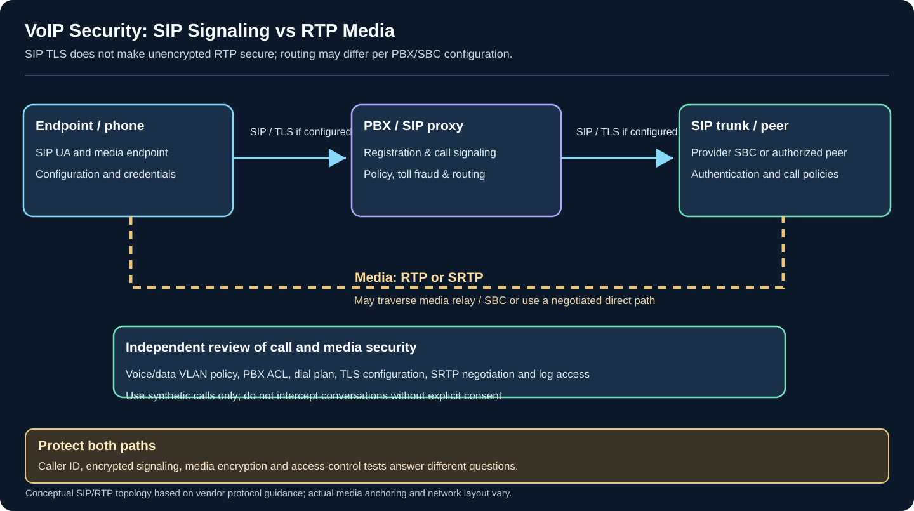

# VoIP Checklist

*Conceptual VoIP topology.* [Asterisk's secure calling reference](https://docs.asterisk.org/Deployment/Secure-Calling/Secure-Calling-Tutorial/) distinguishes SIP signaling protected with TLS from audio media protected with SRTP. The actual RTP route can involve a PBX/SBC/media relay or a negotiated direct connection, and TLS for SIP does **not** automatically encrypt media. Validate voice-VLAN, call-routing, dial-plan and access-control policies separately.

_Checklist for VoIP/SIP infrastructure assessments. This exact checklist is netbiosX's own list - every item traces back to his companion write-up at pentestlab.blog, which explains each check in detail. VoIP-009 links directly to the default credentials list it references; all other items link to that companion post._

**Purpose:** Covers assessment of Voice over IP / SIP telephony infrastructure - a distinct network stack (signaling via SIP, media via RTP) that's frequently deployed on the same physical or logical network as data traffic and is often overlooked in general network pentests despite carrying sensitive voicemail, call data, and - via toll fraud - a direct financial risk.
 
**Function:** The checklist organizes voice-network segmentation, SIP registration/authentication, RTP/SRTP handling, PBX/trunk access policies and handset/voicemail security. Start with read-only configuration and topology checks; call interception, injection, credential attempts, signaling manipulation and firmware operations are intrusive activities requiring separate written approval and suitable test fixtures.
 
**Goal:** Determine whether segment isolation, SIP authentication, PBX routing/dial plans, access restrictions, media encryption and voicemail controls adequately protect authorized calling. Report observed exposure, evidence, uncertainty and remediation; do not infer call-interception or toll-fraud capability from the existence of a voice VLAN.
 
**When & how to use this:** Use only when the written engagement scope explicitly includes voice VLANs, call controls and relevant administrators. Verify permitted methods and operational risk before testing, protect actual calls and subscriber data, and prioritize non-intrusive inspection and synthetic test endpoints. Do not assume default credentials remain in use or that VLAN hopping is possible.

---

* [VoIP-001 - VLAN hopping from data network to voice network](https://pentestlab.blog/2016/09/18/voip-checklist-for-penetration-testers/)
* [VoIP-002 - Extension Enumeration & Number Harvesting](https://pentestlab.blog/2016/09/18/voip-checklist-for-penetration-testers/)
* [VoIP-003 - Capturing SIP Authentication](https://pentestlab.blog/2016/09/18/voip-checklist-for-penetration-testers/)
* [VoIP-004 - Eavesdropping Calls](https://pentestlab.blog/2016/09/18/voip-checklist-for-penetration-testers/)
* [VoIP-005 - CallerID spoofing](https://pentestlab.blog/2016/09/18/voip-checklist-for-penetration-testers/)
* [VoIP-006 - RTP injection](https://pentestlab.blog/2016/09/18/voip-checklist-for-penetration-testers/)
* [VoIP-007 - Signaling Manipulation](https://pentestlab.blog/2016/09/18/voip-checklist-for-penetration-testers/)
* [VoIP-008 - Identification of insecure services](https://pentestlab.blog/2016/09/18/voip-checklist-for-penetration-testers/)
* [VoIP-009 - Testing for Default Credentials](https://github.com/netbiosX/Default-Credentials/blob/master/VoIP-Default-Password-List.mdown)
* [VoIP-010 - Application level vulnerabilities](https://pentestlab.blog/2016/09/18/voip-checklist-for-penetration-testers/)
* [VoIP-011 - Voice Mail Attacks](https://pentestlab.blog/2016/09/18/voip-checklist-for-penetration-testers/)
* [VoIP-012 - Phone Firmware Analysis](https://pentestlab.blog/2016/09/18/voip-checklist-for-penetration-testers/)

---

**📖 Use These Checklists Responsibly: Authorization is MANDATORY**

*Attack techniques are powerful - use them ethically and legally.*

**Repository**: [ULTIMATE CYBERSECURITY MASTER GUIDE](https://github.com/Pnwcomputers/ULTIMATE-CYBERSECURITY-MASTER-GUIDE)

**Maintained by**: [Pacific Northwest Computers](https://github.com/Pnwcomputers)

---

⚠️ **CRITICAL: These are ATTACK TECHNIQUES - Written authorization is REQUIRED** ⚠️

⚠️ **Unauthorized activity can violate laws and contracts; consequences depend on the conduct and jurisdiction.** ⚠️

⚠️ **ALWAYS obtain explicit written authorization before using any technique** ⚠️

⭐ **Star this repo if you find it useful!** ⭐

## Related Files
- [README.md](README.md) - Checklists section index
