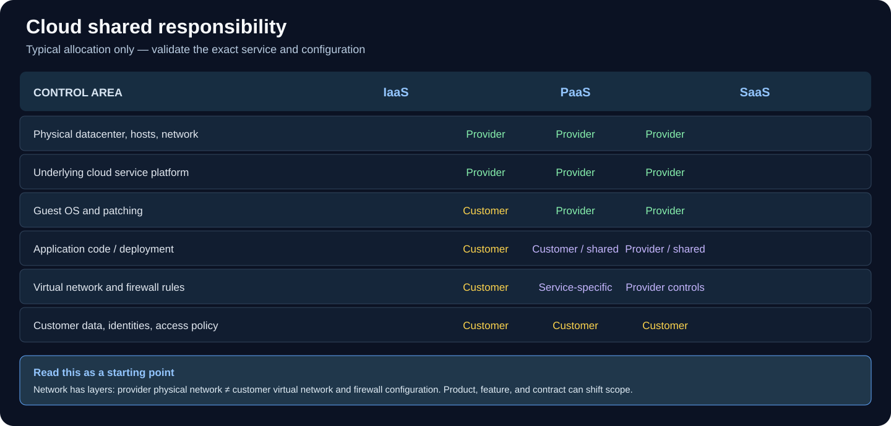

# ☁️ Cloud Security
**Historical cloud reference:** [Cypherpunk Symposium toolkit review](../Documentation/cypherpunk-pentesting-toolkit-review.md) distinguishes archived IAM/Kubernetes tips from current provider controls and maintained tools.

**Attack surface, assessment tooling, and hardening for AWS, Azure, and GCP**

*Part of the [ULTIMATE CYBERSECURITY MASTER GUIDE](../README.md)*

---

**Cloud research references:** [h4cker cloud/container security](https://github.com/The-Art-of-Hacking/h4cker/tree/master/cybersecurity-domains/cloud-container-security) and [PNWC's source map](../Documentation/awesome-hacking-collections-integration.md). Verify current AWS/Azure/GCP APIs before deployment.

**External documentation:** [Curated technical docs](../Documentation/curated-technical-docs.md) includes infrastructure references such as [Linode/Akamai](https://www.linode.com/docs/), and the [Docker operations guide](../ContainerSecurity/docker-cli-operations-reference.md) covers local Engine diagnostics; cloud-native workload hardening still requires provider-specific controls.

**Cloud API and supply-chain references:** [Curated Security API Catalog](../Documentation/security-public-api-catalog.md) covers Cloudflare's managed API, GitHub advisories, NVD and CISA KEV for risk triage. Cloud/API tokens must remain least-privilege and outside committed files.

**Additional assessment paths:** [CISA ScubaGear for Microsoft 365/Entra](m365-scuba-assessment.md) evaluates configuration against SCuBA baselines; [software supply-chain and SBOM checks](../ContainerSecurity/software-supply-chain-assessment.md) apply to cloud artifacts, with credentials and tenant approval handled separately.

## 🎯 Purpose
Dedicated home for cloud security - the shared-responsibility model, the recurring
misconfiguration classes, assessment tooling, and per-provider attack surface and
hardening for AWS, Azure/Entra ID, and GCP.

## ⚙️ Function
Indexes the Cloud Security section: cross-cutting fundamentals (shared
responsibility, IAM, CSPM, common misconfig classes, multi-cloud tooling) plus
three provider deep-dives - each pairing the offensive perspective (enumeration,
privilege escalation, common misconfigurations) with hardening and detection.

## 🏆 Goal
Give practitioners a single canonical cloud-security reference: understand what the
cloud provider secures vs. what you must, how cloud environments are commonly
assessed and attacked, and how to harden and monitor each platform.

## 📋 When To Use
- Scoping or executing an authorized cloud configuration review / penetration test
- Looking up a provider's IAM model, common misconfigurations, or hardening baseline
- Selecting assessment tooling (Prowler, ScoutSuite, Pacu, ROADtools)
- Reviewing a cloud estate defensively against CIS benchmarks and the ATT&CK Cloud matrix

---

## 📋 Table Of Contents

- [Overview](#-overview)
- [Shared Responsibility Model](#-shared-responsibility-model)
- [Recurring Misconfiguration Classes](#-recurring-misconfiguration-classes)
- [Assessment Tooling](#-assessment-tooling)
- [Folder Contents](#-folder-contents)
- [Security & Legal Disclaimer](#-security--legal-disclaimer)
- [Resources](#-resources)

---

## 🎯 Overview

Cloud incidents can involve customer configuration or identity, provider
services or software, compromised credentials, and other factors. Attribute a
cause only when incident-specific evidence supports it. This section consolidates
cloud security - previously scattered across the master guides - into shared
fundamentals plus per-provider depth.

Like [Tradecraft](../Tradecraft/) and [WebAppSecurity](../WebAppSecurity/), the
material is **dual-use**: each provider guide pairs the offensive view (how an
estate is enumerated and abused) with hardening and detection.

---

## 🔀 Shared Responsibility Model

*Responsibilities vary by service model, offering, and contractual terms.*

The provider secures the infrastructure and service components it operates;
the customer secures the workloads, data, identities, and settings assigned to
them. The boundary shifts by service model and by the specific service:

| Area | IaaS (typical) | PaaS (typical) | SaaS (typical) |
|------|----------------|----------------|----------------|
| Datacenter, physical hosts, physical network | Provider | Provider | Provider |
| Underlying service platform and managed runtime | Provider | Provider | Provider |
| Guest operating system and patching | Customer | Provider | Provider |
| Application code and deployment | Customer | Customer / shared | Provider / shared |
| Virtual network, firewall, and service access settings | Customer | Shared / service-specific | Provider service controls; customer sharing settings |
| Customer data, identities, and access policy | Customer | Customer | Customer |

This is a high-level guide, not a contract. “Shared” and service-specific rows
depend on the cloud product, feature, configuration, and agreement. For example,
a provider operates the physical network, while an IaaS customer configures
virtual networks and firewall rules. In all service models, customers still need
to manage their data, identities, and the settings exposed to them. Use the
provider’s matrix for the exact service before assigning a control or incident
cause.

Further reading: [Microsoft's shared responsibility matrix](https://learn.microsoft.com/en-us/azure/security/fundamentals/shared-responsibility) and [AWS's shared responsibility model](https://docs.aws.amazon.com/wellarchitected/latest/framework/shared-responsibility.html). These provider examples illustrate the model; consult the documentation for the service actually in scope.

---

## ⚠️ Recurring Misconfiguration Classes

The same issues appear across all three providers:

- **Public storage** - world-readable buckets/blobs (S3, Azure Blob, GCS).
- **Over-permissive IAM** - wildcard permissions, unused privileged roles, no
  least privilege; **privilege-escalation paths** through role assumption / policy
  editing.
- **Exposed secrets** - keys in code, environment variables, or metadata.
- **Instance metadata abuse** - SSRF against the metadata endpoint to steal
  instance/role credentials (mitigated by IMDSv2 on AWS).
- **Missing logging** - CloudTrail / Azure Activity / GCP Audit Logs disabled or
  not centralized.
- **Weak network exposure** - management ports open to the internet, permissive
  security groups / NSGs / firewall rules.
- **Identity gaps** - no MFA, long-lived access keys, stale accounts.

---

## 🛠️ Assessment Tooling

| Tool | Scope | Role |
|------|-------|------|
| [Prowler](https://github.com/prowler-cloud/prowler) | AWS, Azure, GCP, K8s | CIS/best-practice configuration assessment |
| [ScoutSuite](https://github.com/nccgroup/ScoutSuite) | Multi-cloud | Configuration auditing and reporting |
| [Pacu](https://github.com/RhinoSecurityLabs/pacu) | AWS | Offensive AWS exploitation framework |
| [ROADtools](https://github.com/dirkjanm/ROADtools) | Azure/Entra ID | Entra ID enumeration and analysis |
| [AzureHound](https://github.com/SpecterOps/BloodHound) | Azure/Entra ID | Attack-path mapping (BloodHound collector) |
| [Trivy](https://github.com/aquasecurity/trivy) | Images/IaC | Vulnerability and misconfiguration scanning |

Provider-native: **AWS** IAM Access Analyzer / GuardDuty / Security Hub,
**Azure** Microsoft Defender for Cloud, **GCP** Security Command Center.

---

## 📂 Folder Contents

| File | Description | Status |
|------|-------------|--------|
| **[aws.md](./aws.md)** | AWS security - IAM, S3, IMDS/SSRF credential theft, enumeration & privesc, hardening, logging | ✅ Complete |
| **[azure.md](./azure.md)** | Azure & Entra ID - roles, consent/illicit-grant attacks, ROADtools/AzureHound, hardening | ✅ Complete |
| **[gcp.md](./gcp.md)** | GCP - IAM, service accounts, privilege escalation, assessment, hardening | ✅ Complete |

---

## ⚠️ Security & Legal Disclaimer

> [!CAUTION]
> **Authorized use only.** The techniques here are for authorized cloud assessment,
> education, and defensive research. Testing cloud accounts or tenants you do not
> own or lack **explicit written permission** to assess is illegal - and note that
> cloud providers also have their own **penetration-testing policies** you must
> follow. Always work within a signed scope. See [LEGAL.md](../LEGAL.md).

---

## 📚 Resources

- [MITRE ATT&CK Cloud Matrix](https://attack.mitre.org/matrices/enterprise/cloud/) - cloud adversary TTPs
- [CIS Benchmarks](https://www.cisecurity.org/cis-benchmarks) - per-provider hardening baselines
- [AWS Well-Architected - Security Pillar](https://docs.aws.amazon.com/wellarchitected/latest/security-pillar/welcome.html)
- [Microsoft Cloud Adoption Framework - Security](https://learn.microsoft.com/en-us/azure/cloud-adoption-framework/secure/)
- [Google Cloud Security Best Practices](https://cloud.google.com/security/best-practices)
- [Cloud Security Alliance](https://cloudsecurityalliance.org/) - vendor-neutral guidance

---

**⚠️ USE THIS REPO RESPONSIBLY AND LEGALLY ⚠️**

**Repository**: [ULTIMATE CYBERSECURITY MASTER GUIDE](https://github.com/Pnwcomputers/ULTIMATE-CYBERSECURITY-MASTER-GUIDE)

**Maintained by**: [Pacific Northwest Computers](https://github.com/Pnwcomputers)

---

## Related Files
- [aws.md](aws.md) - Amazon Web Services security
- [azure.md](azure.md) - Microsoft Azure & Entra ID security
- [gcp.md](gcp.md) - Google Cloud Platform security
- [../WebAppSecurity/README.md](../WebAppSecurity/README.md) - Web app security (cloud-hosted apps)
- [../LEGAL.md](../LEGAL.md) - Legal notice and authorized-use terms

---
| [⬅️ Back to Master Index](../README.md) |
