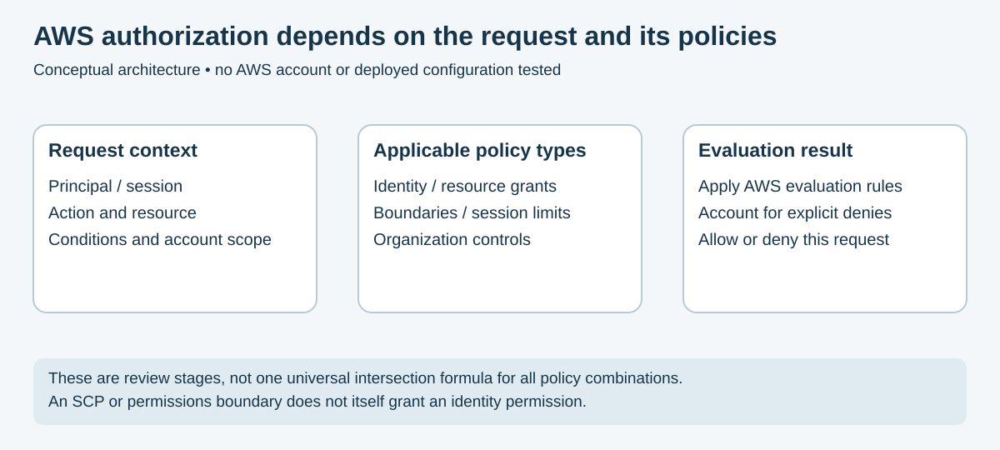
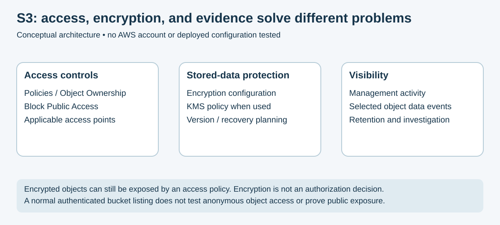
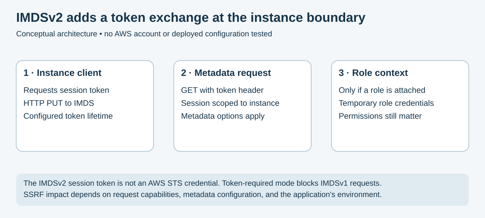
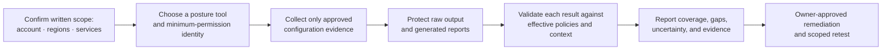
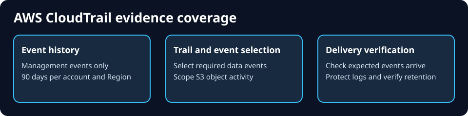

# 🟧 AWS Security

> [!CAUTION]
> **Authorized use only.** The techniques below are for authorized assessment,
> education, and defensive research. Test only AWS accounts you own or have
> **explicit written permission** to assess, and follow
> [AWS's customer support policy for penetration testing](https://aws.amazon.com/security/penetration-testing/).
> See [LEGAL.md](../LEGAL.md).

## 🎯 Purpose
AWS security reference - the IAM model, the recurring misconfigurations, how an
account is enumerated and escalated in an authorized test, and how to harden and
monitor it.

## ⚙️ Function
Covers IAM (users, roles, policies, privilege escalation paths), S3 exposure,
instance metadata (IMDS), SSRF exposure, and role-credential risk; enumeration and assessment tooling
(Prowler, ScoutSuite, Pacu), and the hardening/logging baseline (CloudTrail,
GuardDuty, Security Hub, IAM Access Analyzer).

## 🏆 Goal
Let a reader assess an AWS account methodically and recommend concrete hardening
mapped to AWS-native controls and the CIS AWS Benchmark.

## 📋 When to Use
- Authorized configuration review or penetration test of an AWS account
- Looking up IAM privilege-escalation paths or S3/IMDS issues
- Building an AWS hardening and monitoring baseline

---

## 📋 Table of Contents

- [Identity & Access Management](#identity--access-management)
- [S3 Storage Exposure](#s3-storage-exposure)
- [IMDS, SSRF, and Role Credentials](#imds-ssrf-and-role-credentials)
- [Enumeration & Assessment](#enumeration--assessment)
- [Privilege Escalation Paths](#privilege-escalation-paths)
- [Hardening & Detection](#hardening--detection)
- [Resources](#-resources)

---

## Identity & Access Management



*Figure 1 — Based on [AWS policy evaluation](https://docs.aws.amazon.com/IAM/latest/UserGuide/reference_policies_evaluation-logic.html). Original conceptual review model, not an exhaustive decision tree.*

Review the principal, request context and all applicable policy types. Key concepts:

- **Users / Groups** - users can have credentials; groups organize user permissions and are not principals that can sign in or assume roles.
- **Roles** - assumable identities with temporary credentials (preferred over keys).
- **Policies** - JSON permission documents; `"Action": "*"` / `"Resource": "*"` and
  `iam:*` are red flags.
- **STS** - issues temporary credentials via `AssumeRole`.

Common IAM problems: over-broad policies, long-lived access keys, no MFA,
unused privileged roles, and policies that allow a principal to **escalate** (edit
policies, create keys, or pass a privileged role).

---

## S3 Storage Exposure



*Figure 2 — Original conceptual control map. See [S3 Block Public Access](https://docs.aws.amazon.com/AmazonS3/latest/userguide/access-control-block-public-access.html) and [CloudTrail data events](https://docs.aws.amazon.com/awscloudtrail/latest/userguide/logging-data-events-with-cloudtrail.html).*

- **Public buckets/objects** - the classic breach; check bucket policy, ACLs, and
  the account-level **Block Public Access** setting.
- **Review (authorized):** `aws s3 ls s3://BUCKET` uses the caller's credentials by default; success does not prove public access, and bucket listing differs from object reading. Evaluate bucket/access-point policy, Object Ownership, applicable Block Public Access settings, and intended principals.
- **Defend:** enable Block Public Access account-wide; use bucket policies over
  ACLs (disable ACLs); enable default encryption and versioning; log access.

---

## IMDS, SSRF, and Role Credentials



*Figure 3 — Original conceptual exchange based on [EC2 metadata documentation](https://docs.aws.amazon.com/AWSEC2/latest/UserGuide/configuring-instance-metadata-service.html). No tokens or credentials were collected.*

When an EC2 instance has an IAM role attached, the Instance Metadata Service (IMDS) can provide temporary role credentials to software on that instance. The IPv4 endpoint is `169.254.169.254`; availability and access depend on instance metadata options. Server-side request forgery (SSRF) creates risk when an application can reach IMDS and make requests the service accepts. IMDSv2 requires a `PUT` request to establish a token session followed by token-bearing `GET` requests; SSRF that cannot issue the required method or control the required headers may be blocked, but IMDSv2 is not a substitute for fixing SSRF or limiting role permissions. See [AWS's IMDS documentation](https://docs.aws.amazon.com/AWSEC2/latest/UserGuide/configuring-instance-metadata-service.html).

- **IMDSv1** uses request/response without the IMDSv2 session token; compatible SSRF can expose its metadata.
- **IMDSv2** uses a session token (`PUT` then token-bearing `GET`). Require it where supported, but do not treat it as a universal SSRF fix. Patch the application and scope role permissions too.

```bash
# On an owned test instance: obtain a token and list the role name only.
TOKEN=$(curl -sX PUT "http://169.254.169.254/latest/api/token" \
  -H "X-aws-ec2-metadata-token-ttl-seconds: 60")
curl -s -H "X-aws-ec2-metadata-token: $TOKEN" \
  http://169.254.169.254/latest/meta-data/iam/security-credentials/
```

This example stops after listing the role name. It does **not** request or display the role-credential document, so it demonstrates IMDSv2 reachability rather than credential theft. Do not print, copy, or publish real tokens or credentials.

**Defend:** require IMDSv2 (`HttpTokens: required`), set the metadata response
hop limit for the workload network path (AWS recommends `2` for containers), and
scope instance-role permissions tightly. See [AWS metadata options](https://docs.aws.amazon.com/AWSEC2/latest/UserGuide/configuring-instance-metadata-options.html).

---

## Enumeration & Assessment

Start with the approved account, regions, services, and collection purpose. Use a dedicated assessment identity with the minimum permissions needed for the selected checks. Confirming the caller identity does not show its effective permissions; listing a user's attached policies omits permissions inherited through groups, roles, resource policies, permission boundaries, session policies, and organization controls.



| Tool | Appropriate use | Limits to record |
|---|---|---|
| [Prowler](https://github.com/prowler-cloud/prowler) | Run selected cloud posture checks, including AWS checks mapped to security standards. | Record the provider, check set, benchmark version, identity permissions, and exclusions. A scanner report is evidence to review, not a compliance determination. |
| [ScoutSuite](https://github.com/nccgroup/ScoutSuite) | Gather configuration through cloud APIs for a point-in-time review and offline report analysis. | Results reflect the account and permissions at collection time; the report can contain sensitive configuration and identity data. |
| [Pacu](https://github.com/RhinoSecurityLabs/pacu) | Adversary-simulation framework for specifically approved, controlled testing. | It is not a posture or compliance scanner. Do not run exploitation modules as part of a configuration inventory. |

Validate candidate IAM findings against the complete request context and all applicable policy types; AWS's [policy evaluation model](https://docs.aws.amazon.com/IAM/latest/UserGuide/reference_policies_evaluation-logic.html) describes how these controls interact. Document failed or unavailable checks rather than interpreting missing data as a secure result.

Protect collected account inventory and reports under the engagement's data-handling rules. No account configuration should be changed during discovery unless that change is separately approved and recorded.
---

## Privilege Escalation Paths

Potential privilege-escalation paths depend on resource scope, policy conditions, trust relationships, applicable limits, and additional service permissions. Examples to review:

- `iam:CreatePolicyVersion` / `iam:SetDefaultPolicyVersion` - create or select a permissive version of a managed policy that affects a principal, if the relevant resource/action is allowed.
- `iam:AttachUserPolicy` / `iam:AttachRolePolicy` - potentially attach a more permissive managed policy, subject to allowed targets and constraints.
- `iam:CreateAccessKey` - mint keys for a more privileged user.
- `iam:PassRole` + a compute service (`lambda:CreateFunction`, `ec2:RunInstances`) -
  potentially pass a privileged role to a resource. Service execution permissions and the role's trust policy also matter; `iam:PassRole` alone is not sufficient.

**Assess:** collect identity, resource, trust, session and organization policy evidence for specific candidate actions; a scanner's permission enumeration may be incomplete. **Defend:** restrict privileged actions and `PassRole` to justified targets/conditions. Use boundaries and organization controls where applicable without assuming they grant permissions or cover every principal identically.

---

## Hardening & Detection



CloudTrail Event history provides the past 90 days of management events for one account and Region.
For an ongoing record, configure a trail with the retention your investigation needs. Select required
data events explicitly and verify that expected records reach protected storage. S3 object operations such
as `GetObject` and `PutObject` are data events. [AWS Event history limits](https://docs.aws.amazon.com/awscloudtrail/latest/userguide/view-cloudtrail-events.html) · [AWS data-event selection](https://docs.aws.amazon.com/awscloudtrail/latest/userguide/logging-data-events-with-cloudtrail.html)

- **Logging:** configure multi-Region **CloudTrail** coverage, log-file validation and protected centralized storage; select required data events explicitly. S3 object-level activity is not logged by default merely by creating a trail. Enable appropriate Config recording for resource history.
- **Threat detection:** **GuardDuty** for threat detection; [**Security Hub CSPM**](https://docs.aws.amazon.com/securityhub/latest/userguide/standards-security-score.html)
  aggregates findings and evaluates enabled security standards, including CIS when
  enabled.
- **IAM:** require MFA for human access, prefer temporary credentials, and remove
  long-lived keys where they are not needed. Use [**IAM Access Analyzer**](https://docs.aws.amazon.com/IAM/latest/UserGuide/access-analyzer-findings.html)
  for external-access findings; use [policy validation](https://docs.aws.amazon.com/IAM/latest/UserGuide/access-analyzer-policy-validation.html)
  and a separate unused-access analyzer for those distinct review tasks. Use **SCPs** as organization-level
  permission guardrails; an SCP does not grant permissions.
- **Data:** verify encryption choice and key policy (SSE-S3 and SSE-KMS differ), public-access controls and recovery/versioning requirements; encryption does not replace authorization.
- **Network:** restrict management access to approved administrative paths and
  source ranges; avoid exposing management ports to `0.0.0.0/0` or `::/0`.
- Benchmark against the [CIS AWS Foundations Benchmark](https://www.cisecurity.org/benchmark/amazon_web_services).

---

## 📚 Resources

**Source and visual review:** November 20, 2026. Reviewed this guide and its three existing conceptual diagrams. No AWS API calls, account assessment, scanner execution, or exploit reproduction was performed. Tool versions and deployment-specific policy behavior require separate validation.

- [AWS Penetration Testing Policy](https://aws.amazon.com/security/penetration-testing/) - what is allowed without prior approval
- [AWS Well-Architected - Security Pillar](https://docs.aws.amazon.com/wellarchitected/latest/security-pillar/welcome.html)
- [Pacu (AWS exploitation framework)](https://github.com/RhinoSecurityLabs/pacu)
- [Prowler](https://github.com/prowler-cloud/prowler) / [ScoutSuite](https://github.com/nccgroup/ScoutSuite)
- [MITRE ATT&CK Cloud (IaaS)](https://attack.mitre.org/matrices/enterprise/cloud/iaas/)

---

## Related Files
- [README.md](README.md) - Cloud Security section index
- [azure.md](azure.md) - Azure & Entra ID security
- [gcp.md](gcp.md) - Google Cloud Platform security
