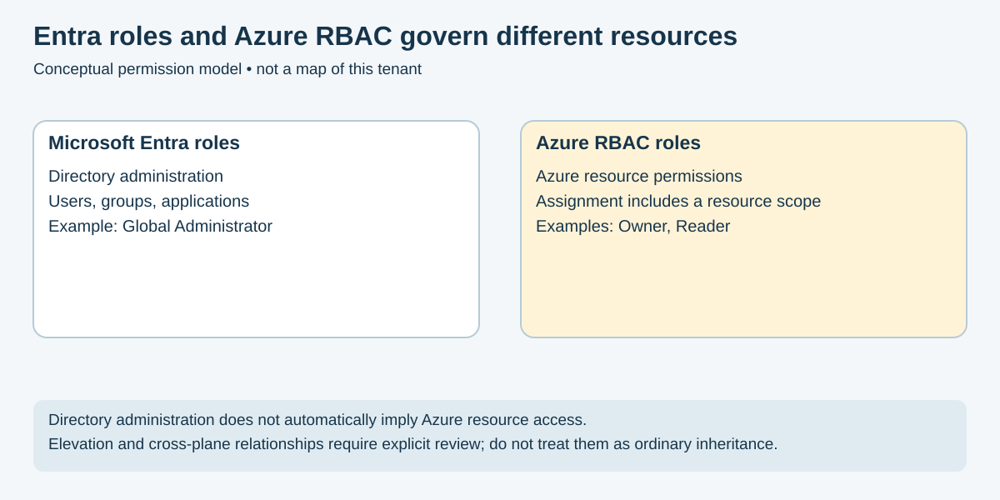
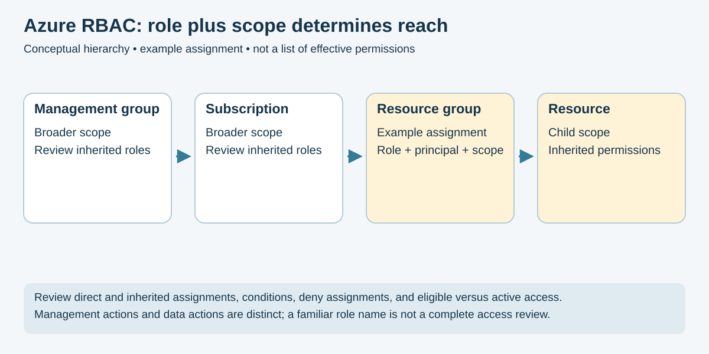
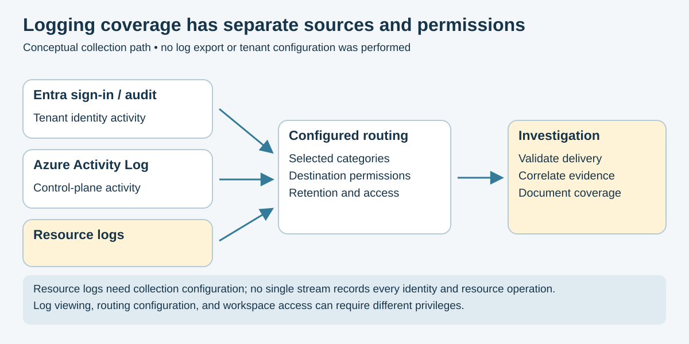

# 🟦 Azure & Entra ID Security

> [!CAUTION]
> **Authorized use only.** The techniques below are for authorized assessment,
> education, and defensive research. Test only tenants/subscriptions you own or
> have **explicit written permission** to assess, and follow the
> [Microsoft penetration testing rules of engagement](https://www.microsoft.com/en-us/msrc/pentest-rules-of-engagement).
> See [LEGAL.md](../LEGAL.md).

**M365 companion:** [CISA ScubaGear + SCuBA assessment](m365-scuba-assessment.md) covers consent, baseline deviations and retesting; Microsoft 365/Entra tenant assessments differ from Azure subscription checks.

**Source and visual review:** November 20, 2026. Reviewed this guide and its three existing conceptual diagrams. No tenant enumeration, policy changes, or log export was performed.

## 🎯 Purpose
Microsoft Azure and **Entra ID** (formerly Azure AD) security reference - the
identity model, the recurring attack paths, assessment tooling, and hardening.

## ⚙️ Function
Covers the Entra ID / Azure RBAC split, common identity attacks (illicit consent
grants, over-privileged app registrations, role abuse), enumeration tooling
(ROADtools, AzureHound), and the hardening/detection baseline (Conditional Access,
PIM, Defender for Cloud).

## 🏆 Goal
Let a reader assess an Azure/Entra environment and recommend concrete hardening
mapped to Microsoft-native controls and the CIS Microsoft Azure Benchmark.

## 📋 When to Use
- Authorized review or penetration test of an Azure subscription / Entra tenant
- Looking up Entra ID attack paths (consent, app registrations, role abuse)
- Building an Azure/Entra hardening and monitoring baseline

---

## 📋 Table of Contents

- [Entra ID vs Azure RBAC](#entra-id-vs-azure-rbac)
- [Common Identity Attacks](#common-identity-attacks)
- [Enumeration & Assessment](#enumeration--assessment)
- [Hardening & Detection](#hardening--detection)
- [Resources](#-resources)

---

## Entra ID vs Azure RBAC

Microsoft Entra roles govern directory administration; Azure RBAC governs Azure
resource access. A principal may be powerful in one system and limited in the
other. [Microsoft's role comparison](https://learn.microsoft.com/en-us/azure/role-based-access-control/rbac-and-directory-admin-roles).

*Figure 1 — Original conceptual model based on Microsoft's role comparison. It does not describe the effective permissions of an assessed tenant.*

A Global Administrator does not automatically become subscription Owner. The
documented elevation mechanism assigns **User Access Administrator at root scope
(`/`)** to the elevating user. Review and remove that elevation when its task is
complete; deactivating a PIM Global Administrator assignment does not itself reset
the elevation setting. [Microsoft elevation guidance](https://learn.microsoft.com/en-us/azure/role-based-access-control/elevate-access-global-admin).

Owner and access-administration roles can assign Azure roles within their
effective scope, subject to applicable restrictions. Do not read “can grant
access” as unlimited authority over unrelated tenants or scopes.

### Review Azure RBAC Scope

*Figure 2 — Original hierarchy schematic based on [Azure RBAC scope](https://learn.microsoft.com/en-us/azure/role-based-access-control/scope-overview). The highlighted assignment is fictional, not a tenant finding.*

Record the principal, role definition and assignment scope. Inspect inherited
assignments, conditions, deny assignments, and eligible versus currently active
access. Separate control-plane `Actions` from data-plane `DataActions`; a
management role does not directly describe every data permission or indirect
access path. [Role definitions](https://learn.microsoft.com/en-us/azure/role-based-access-control/role-definitions).

---

## Common Identity Attacks

- **Illicit consent grants:** A user or administrator may approve inappropriate app permissions. Delegated and application permissions have different consent and access models; a grant does not automatically confer every user's data. Review grants and app credentials as well as user sessions. [Microsoft guidance](https://learn.microsoft.com/en-us/microsoft-365/security/office-365-security/detect-and-remediate-illicit-consent-grants).
- **Over-privileged applications:** Review Microsoft Graph permissions, app-role assignments, ownership and credential lifetime. App registration presence alone does not establish exposure.
- **Directory role abuse:** Reduce unnecessary standing privilege and validate activation controls. PIM is a control to configure and monitor, not automatic protection.
- **Legacy authentication:** These clients do not support modern MFA/device signals; Conditional Access can block them. They do not universally bypass Conditional Access. [Blocking legacy clients](https://learn.microsoft.com/en-us/entra/identity/conditional-access/policy-block-legacy-authentication).
- **Device/session compromise:** Evaluate token protection, device trust and recovery separately. A PRT is device-bound; do not assume simple transferable bearer-token replay in every scenario. [Microsoft PRT model](https://learn.microsoft.com/en-us/entra/identity/devices/concept-primary-refresh-token).

---

## Enumeration & Assessment

Use the installed release's authentication and permission guidance before
collection. The former bare commands omitted identity, tenant/subscription
selection and prerequisites; they were not complete reproducible procedures.

| Tool | Assessment Role | Preparation and Limits |
|---|---|---|
| [ROADtools / ROADrecon](https://github.com/dirkjanm/ROADtools) | Directory data collection and analysis | Verify authentication and API support in the chosen release; protect exported identity data. |
| [AzureHound](https://github.com/SpecterOps/AzureHound) | Collect identity/resource relationships for BloodHound analysis | Match collector and analysis versions; collection permissions affect graph completeness. |
| [Prowler](https://github.com/prowler-cloud/prowler) | Supported Azure configuration checks | Select authorized scopes and documented read permissions; a skipped check is not a passing control. |
| [ScoutSuite](https://github.com/nccgroup/ScoutSuite/wiki/Setup) | Cloud configuration collection and reporting | Validate supported API/SDK versions and granted permissions before interpreting findings. |

Record tenant/subscription IDs, collector version, granted permissions, coverage,
API failures and skipped checks. Keep “not assessed” distinct from “no issue
found.” A configuration report is not a penetration test or proof of effective
runtime enforcement.

---

## Hardening & Detection

- **Identity:** Prefer phishing-resistant authentication where supported. Scope and test Conditional Access before enforcing it; feature/licensing requirements vary. Review exclusions and emergency-access procedures. [Conditional Access overview](https://learn.microsoft.com/en-us/entra/identity/conditional-access/overview).
- **Privilege:** Use least privilege and appropriate PIM activation controls. Review both directory and resource roles; user MFA does not substitute for workload-identity credential controls.
- **Applications:** Review user/admin consent, app permissions, credentials and owners; revoke grants and rotate credentials through an approved response plan.
- **Resources:** Review Azure RBAC at the narrowest practical scope and inspect control/data permissions and inherited authority.
- **Posture and threats:** Defender for Cloud capabilities depend on enabled plans, resource coverage and configuration. A score is a prioritization input, not evidence that all threats are prevented.
- **Benchmarking:** Use the applicable [CIS Azure benchmark](https://www.cisecurity.org/benchmark/azure) version and record exceptions, evidence and retest criteria.

### Validate Logging Coverage

*Figure 3 — Original conceptual collection model. It is not a deployed architecture or proof that events reach a SIEM.*

| Source / Requirement | What To Verify |
|---|---|
| Entra sign-in and audit activity | Verify selected categories and reader access. Default retention is 7 days with Free and 30 days with P1/P2; route logs to Azure Monitor for longer retention. These logs are separate from the Microsoft 365 Unified Audit Log. |
| Azure Activity Log | Subscription control-plane coverage; it is not a record of every data operation. |
| Resource logs | Enable the required diagnostic categories; these logs are not collected by default. |
| Routing and destination | Configuration permissions, destination access, retention, delivery latency and sample-event arrival. |
| Detection | Test expected benign events, correlating identity and resource evidence; document gaps and ingestion failures. |

Use [Entra diagnostic settings](https://learn.microsoft.com/en-us/entra/identity/monitoring-health/howto-configure-diagnostic-settings),
[Entra retention guidance](https://learn.microsoft.com/en-us/entra/identity/monitoring-health/reference-reports-data-retention),
[Azure Activity Log](https://learn.microsoft.com/en-us/azure/azure-monitor/fundamentals/activity-log),
and [Azure Monitor diagnostic settings](https://learn.microsoft.com/en-us/azure/azure-monitor/data-collection/diagnostic-settings).
Log viewing, export configuration and workspace querying can require different
privileges. Never infer working collection merely from a visible dashboard.

---

## 📚 Resources

- [Microsoft Penetration Testing Rules of Engagement](https://www.microsoft.com/en-us/msrc/pentest-rules-of-engagement)
- [ROADtools (Entra ID)](https://github.com/dirkjanm/ROADtools) / [AzureHound](https://github.com/SpecterOps/AzureHound)
- [Microsoft Cloud Adoption Framework - Secure](https://learn.microsoft.com/en-us/azure/cloud-adoption-framework/secure/)
- [Entra ID security operations guide](https://learn.microsoft.com/en-us/entra/architecture/security-operations-introduction)
- [MITRE ATT&CK Cloud (Azure AD / Office 365)](https://attack.mitre.org/matrices/enterprise/cloud/)

---

## Related Files
- [README.md](README.md) - Cloud Security section index
- [aws.md](aws.md) - Amazon Web Services security
- [gcp.md](gcp.md) - Google Cloud Platform security
- [../Tradecraft/active-directory.md](../Tradecraft/active-directory.md) - on-prem AD (hybrid identity context)

