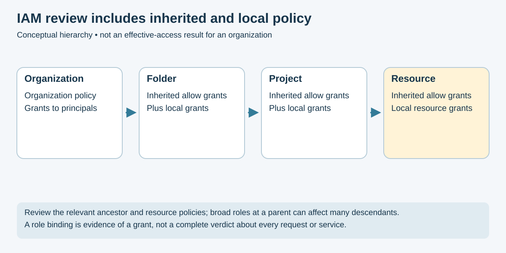
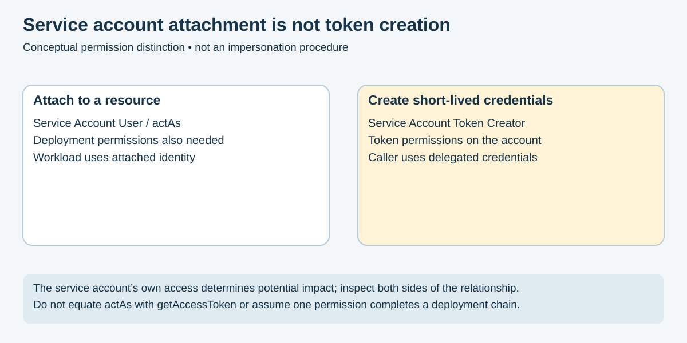
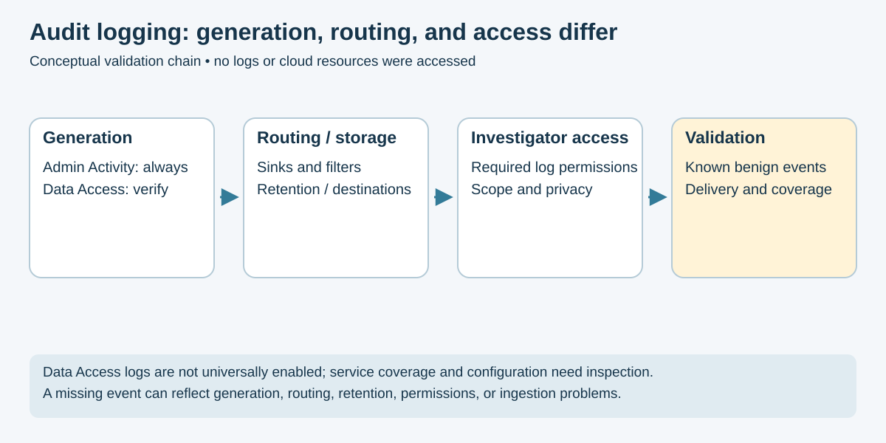

# 🟩 GCP Security

> [!CAUTION]
> **Authorized use only.** The techniques below are for authorized assessment,
> education, and defensive research. Test only GCP projects/organizations you own
> or have **explicit written permission** to assess. Google's [Cloud Security FAQ](https://support.google.com/cloud/answer/6262505) says prior notification is not required for testing your own Cloud Platform infrastructure; this does not authorize testing other customers or override the
> [Acceptable Use Policy](https://cloud.google.com/terms/aup). See [LEGAL.md](../LEGAL.md).

**Source and visual review:** November 17, 2026. Conceptual diagrams and primary documentation review only; no cloud enumeration, impersonation, policy modification, or log export was performed.

## 🎯 Purpose
Google Cloud Platform security reference - the IAM and service-account model, the
recurring privilege-escalation paths, assessment tooling, and hardening.

## ⚙️ Function
Covers GCP IAM (principals, roles, bindings), service accounts and impersonation,
common privilege-escalation primitives, storage exposure, assessment tooling
(Prowler, ScoutSuite), and the hardening/detection baseline (Security Command
Center, Cloud Audit Logs, Organization Policy).

## 🏆 Goal
Let a reader assess a GCP project/org and recommend concrete hardening mapped to
GCP-native controls and the CIS Google Cloud Benchmark.

## 📋 When to Use
- Authorized review or penetration test of a GCP project or organization
- Looking up service-account impersonation / IAM privesc paths
- Building a GCP hardening and monitoring baseline

---

## 📋 Table of Contents

- [IAM & Service Accounts](#iam--service-accounts)
- [Privilege Escalation Paths](#privilege-escalation-paths)
- [Storage & Metadata Exposure](#storage--metadata-exposure)
- [Enumeration & Assessment](#enumeration--assessment)
- [Hardening & Detection](#hardening--detection)
- [Resources](#-resources)

---

## IAM & Service Accounts

IAM allow policies bind **principals** to **roles** on a **resource**. Review
organization/folder ancestors as well as project and resource policies.
Inherited and local allow policies combine; conditions and deny policies also
affect request evaluation. [Google's hierarchy model](https://cloud.google.com/iam/docs/resource-hierarchy-access-control).



*Figure 1 — Original conceptual hierarchy. It illustrates where to gather evidence, not effective access in an assessed organization.*

Service accounts are both identities with permissions and resources whose use
can be delegated. Inspect who controls each account and what that account can
access. Do not assume all privilege escalation originates from service accounts.

The broad **basic roles** Owner, Editor and Viewer are not a substitute for a
task-specific role review. Prefer suitable predefined or custom roles and narrow
scope; custom does not automatically mean least privilege.

---

## Privilege Escalation Paths



*Figure 2 — Original conceptual comparison based on [Google's service-account authentication roles](https://cloud.google.com/iam/docs/service-account-permissions). It is not an exploit recipe or proof of a complete path.*

| Permission / Relationship | What The Reviewer Must Establish |
|---|---|
| `iam.serviceAccounts.actAs` | Allows attachment to supported resources; additional deployment permissions are required. It does not itself allow creating access tokens. |
| `iam.serviceAccounts.getAccessToken` | Permits the relevant short-lived credential operation on a service account; inspect that account's actual privileges. |
| `iam.serviceAccountKeys.create` | Long-lived key creation can extend credential exposure; verify effective constraints and key lifecycle. |
| Custom-role modification | Determine whether the caller can edit a relevant role and whether a binding makes the changed permissions usable. |
| Resource deployment plus identity attachment | Check every deployment permission, identity-use permission, policy condition and runtime restriction; one create permission is not a full chain. |
| Service-specific `setIamPolicy` | Inspect which resource's policy can be changed and the authority that change could grant. |

Assess paths as combinations of effective permissions and configuration, not as
a checklist where one matching permission proves compromise. Review necessity
before changing delegation; policy updates need approved impact and recovery
plans.

---

## Storage & Metadata Exposure

- **Cloud Storage:** Review IAM and, where still enabled, ACLs. `allUsers` and `allAuthenticatedUsers` are broad principals. [Public access prevention](https://cloud.google.com/storage/docs/public-access-prevention) blocks their public grants, but does not block access through signed URLs.
- **Uniform bucket-level access:** [This feature disables ACLs in favor of IAM](https://cloud.google.com/storage/docs/uniform-bucket-level-access); it does not by itself make a bucket private. Review ACL-dependent workloads before migration.
- **Metadata and workload identity:** A compromised application or SSRF path may expose credentials if it can make the required metadata requests. Impact depends on the attached service account and applicable access controls, not hostname reachability alone. Minimize workload privilege and untrusted request paths. See [Compute Engine service-account authorization](https://cloud.google.com/compute/docs/access/service-accounts#authorization).
- **Encryption keys:** CMEK can meet key-control requirements; it does not replace authorization, exposure review or recovery planning.

---

## Enumeration & Assessment

Source-reviewed read examples, not a complete effective-permission assessment:

```bash
# Local CLI credential inventory; this does not enumerate every grant.
gcloud auth list

# Policy attached to one explicitly authorized project.
gcloud projects get-iam-policy PROJECT_ID
```

[The project policy command](https://cloud.google.com/sdk/gcloud/reference/projects/get-iam-policy)
returns that project's policy, not a merged inventory of ancestor policies,
every child resource's grants, or all effective permissions. Verify the active
account/configuration, actual target and required read permissions first.

| Tool | Coverage To Verify Before Interpreting Results |
|---|---|
| [Prowler](https://github.com/prowler-cloud/prowler) | Installed version, supported GCP checks, authentication, required read roles and selected scopes. |
| [ScoutSuite](https://github.com/nccgroup/ScoutSuite) | SDK/API compatibility, credential scope, service coverage and skipped requests. |
| Google Cloud CLI / inventory tools | Organization/folder/project/resource coverage, service-account policies and collection failures. |

Record failed, denied and skipped checks separately from passing controls.
Protect identity/policy exports as assessment evidence. No scanner output alone
establishes exploitability or a secure deployment.

---

## Hardening & Detection

- **IAM:** Prefer narrow roles and scopes. Reduce unnecessary service-account attachment, token creation and key administration; user MFA is not a substitute for workload credential protection.
- **Service-account keys:** Prefer supported keyless workload identity approaches. Verify effective organization-policy constraints and exceptions; blocking new keys does not remediate existing keys. Inventory and retire existing credentials through a planned migration. [Key-management guidance](https://cloud.google.com/iam/docs/best-practices-for-managing-service-account-keys).
- **Data:** Review public access prevention, IAM/ACL configuration and signed-URL use together; validate application impact before changing access.
- **Posture:** Security Command Center capabilities depend on enabled services, tier and asset coverage. Findings and scores are assessment inputs, not guarantees of complete detection.
- **Guardrails:** Review effective Organization Policy at the relevant scope and validate exceptions and supported constraint behavior.
- **Benchmarking:** Record the applicable [CIS Google Cloud benchmark](https://www.cisecurity.org/benchmark/google_cloud_computing_platform) version, exceptions, evidence and retest criteria.

### Validate Audit Coverage



*Figure 3 — Original conceptual collection model informed by [Cloud Audit Logs](https://cloud.google.com/logging/docs/audit). It does not represent a deployed logging configuration.*

Admin Activity logs are always written. Data Access logs are generally disabled
by default except for BigQuery; verify the service, configuration and exemptions
needed for the assessment. Log generation is separate from routing, retention,
query access and detection.

| Review Area | Evidence |
|---|---|
| Generation | Enabled Data Access categories, service coverage and exempted principals. |
| Routing / retention | Sinks, filters, destination permissions and retained time span. |
| Access | Required log-reader permissions; ordinary Logs Viewer does not grant every private-log view. |
| Detection | Known benign events arriving in the destination, expected fields and documented ingestion gaps. |

Verify [routing](https://cloud.google.com/logging/docs/routing/overview) and
[log access controls](https://cloud.google.com/logging/docs/access-control)
independently. Centralize necessary logs to the [SIEM](../IncidentResponse/SIEM/README.md)
with appropriate access controls and retention. Missing search results do not
alone prove no activity occurred.

---

## 📚 Resources

- [Google Cloud Security Best Practices](https://cloud.google.com/security/best-practices)
- [GCP IAM documentation](https://cloud.google.com/iam/docs)
- [Prowler](https://github.com/prowler-cloud/prowler) / [ScoutSuite](https://github.com/nccgroup/ScoutSuite)
- [MITRE ATT&CK Cloud (IaaS)](https://attack.mitre.org/matrices/enterprise/cloud/iaas/)

---

## Related Files
- [README.md](README.md) - Cloud Security section index
- [aws.md](aws.md) - Amazon Web Services security
- [azure.md](azure.md) - Microsoft Azure & Entra ID security
