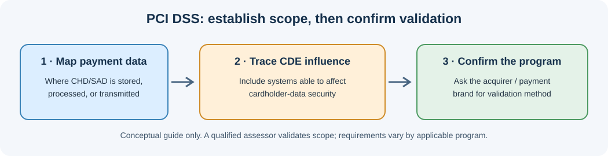
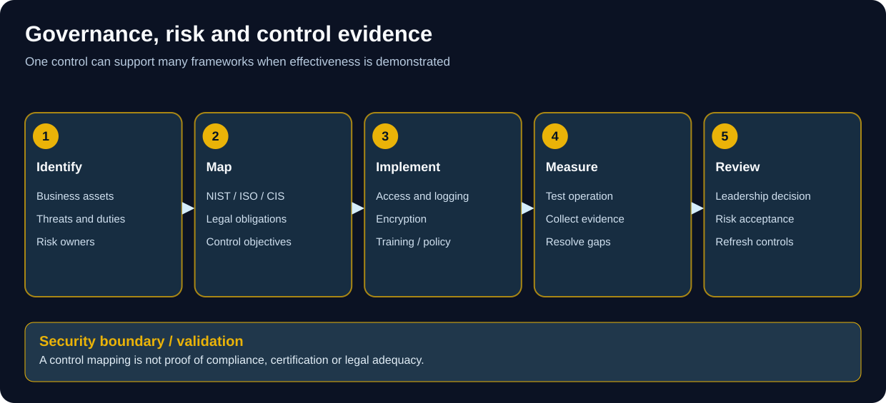

# 📋 Compliance & GRC

**Governance, Risk, and Compliance - frameworks, regulations, and control mapping**

*Part of the [ULTIMATE CYBERSECURITY MASTER GUIDE](../README.md)*

---

**Hardening and security governance source lists:** [Awesome Security](https://github.com/sbilly/awesome-security), [annual reports](https://github.com/jacobdjwilson/awesome-annual-security-reports), and [PNWC's curated source map](../Documentation/awesome-hacking-collections-integration.md).

**PCI DSS 4.0.1 scoping:** [Scoping & Segmentation Field Guide](pci-dss-scoping.md) maps payment-data flows, connected-to/security-impacting systems, third-party access, cloud boundaries and scope evidence. Use the [blank scope review worksheet](pci-scope-review-template.md) for a specific assessment. This is educational guidance, not a compliance certification.

**Versioned assurance:** [ASVS/WSTG requirements and tests](../WebAppSecurity/owasp-assessment-and-nuclei.md) and [CISA SCuBA baselines](../Cloud/m365-scuba-assessment.md) produce evidence IDs, exceptions and remedial work tracked via [client findings](../PlayBooks/assessment-findings-lifecycle.md).

## 🎯 Purpose
Dedicated home for Governance, Risk, and Compliance - the major security control
frameworks, the data-protection regulations, and a practical approach to mapping
one set of controls to many requirements.

## ⚙️ Function
Indexes the Compliance & GRC section: GRC fundamentals and a control-mapping
approach (this file), the major control frameworks (NIST CSF 2.0, ISO/IEC
27001:2022, SOC 2, PCI DSS 4.0.1, CIS Controls v8.1, NIST 800-53/800-171), and the
key data-protection regulations (GDPR, HIPAA, CCPA/CPRA).

## 🏆 Goal
Give practitioners a single reference for which framework applies when, how the
frameworks relate, and how to implement controls once and satisfy multiple
requirements - tying governance back to the technical controls elsewhere in this
repo.

## 📋 When To Use
- Choosing a framework for an organization or a customer requirement
- Preparing for a SOC 2 examination, ISO/IEC 27001 certification, or PCI DSS assessment and validation
- Mapping existing technical controls to compliance requirements
- Understanding a data-protection obligation (GDPR/HIPAA/CCPA)

SOC 2 is an examination and report; PCI DSS assessment follows the validation
method set by the applicable payment program and uses PCI SSC forms rather than a
generic compliance certificate. See [AICPA's SOC 2 resources](https://www.aicpa-cima.com/topic/audit-assurance/audit-and-assurance-greater-than-soc-2)
and [PCI SSC FAQ 1220](https://www.pcisecuritystandards.org/faqs/1220/).

---

## 📋 Table Of Contents

- [Overview](#-overview)
- [What GRC Is](#-what-grc-is)
- [Choosing a Framework](#-choosing-a-framework)
- [Control Mapping (Do It Once, Satisfy Many)](#-control-mapping-do-it-once-satisfy-many)
- [Folder Contents](#-folder-contents)
- [Important Notice](#-important-notice)
- [Resources](#-resources)

---

## 🎯 Overview

Compliance is heavily referenced across this repository but previously had no home.
This section consolidates it. The theme throughout: **compliance evidence shows how applicable requirements are addressed; it does not by itself establish that security is strong or every risk is controlled**. The technical work lives in the
[IncidentResponse](../IncidentResponse/), [Cloud](../Cloud/),
[WebAppSecurity](../WebAppSecurity/), and [Checklists](../Checklists/) sections;
GRC organizes, requires, and demonstrates it.

---

## 🏛️ What GRC Is

- **Governance** - the policies, roles, and accountability that direct a security
  program (leadership ownership, risk appetite, standards).
- **Risk** - identifying, assessing, and treating risk (accept / mitigate /
  transfer / avoid), usually via a risk register and periodic assessment.
- **Compliance** - demonstrating adherence to chosen frameworks and applicable
  laws/regulations, with evidence.

A framework provides the **control set**; risk management decides **which controls
matter most**; governance ensures they are **owned and maintained**.

---

## 🧭 Choosing A Framework

| If you need to… | Consider |
|-----------------|----------|
| A flexible, risk-based program (US-centric, widely recognized) | **NIST CSF 2.0** |
| An internationally recognized certification | **ISO/IEC 27001:2022** |
| Assure customers/partners of your controls (SaaS/service orgs) | **SOC 2** |
| Handle payment-account data or systems affecting CDE security | **PCI DSS 4.0.1** (scope and validation depend on the applicable payment program) |
| A prioritized, prescriptive starting set of controls | **CIS Controls v8.1** |
| A US federal / government-adjacent baseline | **NIST SP 800-53 / 800-171** |

Details in [frameworks.md](./frameworks.md). For PCI DSS, scope includes entities that store, process, or transmit cardholder data (CHD) or sensitive authentication data (SAD), and systems that can affect CDE security. The relevant payment brand, acquirer, or other compliance-accepting entity determines validation and reporting expectations; confirm the applicable scope and method with them and a qualified assessor. See the [PCI DSS overview](https://www.pcisecuritystandards.org/standards/pci-dss/) and [PCI SSC FAQ 1473](https://www.pcisecuritystandards.org/faqs/1473/).

Regulatory obligations (GDPR, HIPAA, CCPA) are **not optional** and apply based on data and jurisdiction - see [regulations.md](./regulations.md).

---

## 🔗 Control Mapping (Do IT Once, Satisfy Many)

*A framework mapping supports audits but does not establish compliance or certification.*

The frameworks overlap heavily. Rather than implement each in isolation:

1. **Pick a primary framework** (often NIST CSF 2.0 or ISO 27001) as the backbone.
2. **Implement the underlying technical controls** (MFA, logging, encryption,
   access control, patching) - the substance lives in this repo's technical sections.
3. **Map** those controls to each framework/regulation you must satisfy, so one
   control (e.g. centralized logging) provides evidence for CSF *Detect*, ISO
   *A.8.15/A.8.16*, SOC 2 *CC7*, and PCI *Req. 10* at once.
4. **Collect evidence** continuously (config, logs, tickets) rather than scrambling
   at audit time.

The [Secure Controls Framework (SCF)](https://securecontrolsframework.com/) and
NIST's [OLIR mappings](https://csrc.nist.gov/projects/olir) publish
cross-framework crosswalks to accelerate this.

---

## 📂 Folder Contents

| File | Description | Status |
|------|-------------|--------|
| **[frameworks.md](./frameworks.md)** | Control frameworks - NIST CSF 2.0, ISO 27001:2022, SOC 2, PCI DSS 4.0.1, CIS Controls v8.1, NIST 800-53/800-171 | ✅ Complete |
| **[pci-dss-scoping.md](./pci-dss-scoping.md)** | PCI DSS 4.0.1 scoping workflow, connected-to systems, segmentation evidence and third-party responsibilities | ✅ Reference guide |
| **[pci-scope-review-template.md](./pci-scope-review-template.md)** | Blank, privacy-conscious scoping review, exclusion and shared-responsibility worksheet | ✅ Reusable template |
| **[regulations.md](./regulations.md)** | Data-protection regulations - GDPR, HIPAA, CCPA/CPRA, and breach-notification duties | ✅ Complete |

---

## ⚠️ Important Notice

> [!IMPORTANT]
> **This is educational reference material, not legal or compliance advice.**
> Framework versions, regulatory thresholds, and applicability change and depend on
> your jurisdiction, industry, and data. Verify against the authoritative source
> and consult qualified legal/compliance counsel and, where required, a qualified
> assessor (e.g. a PCI QSA or ISO certification body) before relying on it.

---

## 📚 Resources

- [NIST Cybersecurity Framework](https://www.nist.gov/cyberframework)
- [ISO/IEC 27001](https://www.iso.org/standard/27001)
- [AICPA SOC 2](https://www.aicpa-cima.com/topic/audit-assurance/audit-and-assurance-greater-than-soc-2)
- [PCI Security Standards Council](https://www.pcisecuritystandards.org/)
- [CIS Controls](https://www.cisecurity.org/controls)
- [Secure Controls Framework (crosswalks)](https://securecontrolsframework.com/)

---

**Repository**: [ULTIMATE CYBERSECURITY MASTER GUIDE](https://github.com/Pnwcomputers/ULTIMATE-CYBERSECURITY-MASTER-GUIDE)

**Maintained by**: [Pacific Northwest Computers](https://github.com/Pnwcomputers)

---

## Related Files
- [frameworks.md](frameworks.md) - Security control frameworks
- [regulations.md](regulations.md) - Data-protection regulations
- [pci-dss-scoping.md](pci-dss-scoping.md) - PCI DSS scope decisions and validation
- [pci-scope-review-template.md](pci-scope-review-template.md) - blank scoping and evidence worksheet
- [../IncidentResponse/README.md](../IncidentResponse/README.md) - the detection/response controls compliance requires
- [../Checklists/README.md](../Checklists/README.md) - operational checklists that implement controls

---
| [⬅️ Back to Master Index](../README.md) |
