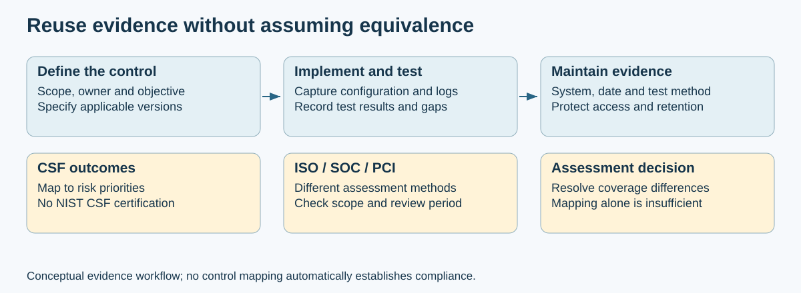

# 🏛️ Security Control Frameworks

_Last reviewed: 2026-11-20 (targeted version and scope review against primary sources; no assessment or certification performed)._

> [!IMPORTANT]
> Educational reference, **not** compliance advice. Framework versions change -
> verify against the authoritative source and engage a qualified assessor before
> relying on this for an audit or certification. See the
> [section notice](README.md#-important-notice).

## 🎯 Purpose
A working reference to the major security control frameworks - what each is, when
it applies, how it is structured, and how they relate.

## ⚙️ Function
Covers NIST CSF 2.0, ISO/IEC 27001:2022, SOC 2, PCI DSS 4.0.1, CIS Controls v8.1 (retaining versioned references to v8 where applicable), and
NIST SP 800-53 / SP 800-171, with versions checked against authoritative sources.

## 🏆 Goal
Let a reader pick the right framework, understand its structure, and see how a
single set of technical controls maps across several of them.

## 📋 When to Use
- Selecting or comparing frameworks
- Preparing for a SOC 2 examination, an ISO/IEC 27001 certification audit, or PCI DSS validation
- Mapping technical controls to a framework's requirements

---

## 📋 Table of Contents

- [NIST Cybersecurity Framework (CSF) 2.0](#nist-cybersecurity-framework-csf-20)
- [ISO/IEC 27001:2022](#isoiec-270012022)
- [SOC 2](#soc-2)
- [PCI DSS 4.0.1](#pci-dss-401)
- [CIS Controls v8.1](#cis-controls-v81)
- [NIST SP 800-53 & 800-171](#nist-sp-800-53--800-171)
- [How They Relate](#how-they-relate)
- [Resources](#-resources)

---

## NIST Cybersecurity Framework (CSF) 2.0

Released **2024**; the widely used, voluntary, risk-based framework. CSF 2.0's
headline change is a new **Govern** function, making **six** core functions:

1. **Govern (GV)** *(new in 2.0)* - organizational context, risk strategy, roles, policy, oversight
2. **Identify (ID)** - assets, risks, and the environment
3. **Protect (PR)** - safeguards (access control, awareness, data security)
4. **Detect (DE)** - find events (monitoring, detection processes)
5. **Respond (RS)** - act on incidents
6. **Recover (RC)** - restore capabilities

- **Use it for:** a flexible program backbone; maps well to other frameworks.
- **Not a certification** - it is a framework you self-adopt/assess against.

---

## ISO/IEC 27001:2022

The leading **international, certifiable** standard for an Information Security
Management System (ISMS). The **2022** revision supersedes 2013.

- **ISMS-centric:** requires risk assessment, a Statement of Applicability, and
  continual improvement - not just controls.
- **Annex A (2022):** **93 controls** organized into **4 themes** - Organizational,
  People, Physical, Technological (down from 114 controls / 14 domains in 2013).
- **Use it for:** an internationally recognized ISMS certification via an accredited certification body.
- **Amendment 1:2024:** ISO/IEC 27001:2022 has a published climate-action
  amendment. Consider whether climate change is a relevant ISMS context issue under
  clause 4.1 and whether interested parties have related requirements under clause
  4.2; verify current certification-body guidance in the [ISO amendment](https://www.iso.org/standard/88435.html).

---

## SOC 2

An **attestation report** (not a certification) under the AICPA's **Trust Services
Criteria** - common for SaaS/service organizations to assure customers.

- **Five Trust Services categories:** **Security** (the required "common criteria"),
  plus optional **Availability, Processing Integrity, Confidentiality, Privacy**.
- **Type I** - design assessed as of a specified date; **Type II** - design and operating effectiveness over a specified period. Read the report's actual scope, period, exceptions, and complementary user-entity controls; do not infer them from the label.
- **Use it for:** demonstrating control effectiveness to customers/partners.

---

## PCI DSS 4.0.1

**Practical implementation:** [PCI DSS Scoping & Segmentation Field Guide](pci-dss-scoping.md) and [Scope Review Worksheet](pci-scope-review-template.md) describe how to inventory account-data flows, connected-to/security-impacting systems, vendor responsibilities, segmentation evidence and recurring scope confirmation. Use the current PCI SSC standard and confirm acceptance/reporting with the acquirer; the guides do not determine compliance.

PCI DSS addresses entities that store, process, or transmit cardholder/sensitive authentication data, and systems that can affect the cardholder-data environment. Payment brands and acquirers administer compliance programs; it is not a universal statute. Outsourcing processing can reduce scope but does **not** remove a merchant's applicable responsibilities ([PCI SSC outsourcing FAQ](https://www.pcisecuritystandards.org/faqs/does-pci-dss-apply-to-merchants-who-outsource-all-payment-processing-operations-and-never-store-process-or-transmit-cardholder-data/)).

**v4.0.1** (2024) is the active version in the linked PCI SSC material; verify the current library for the engagement. **v3.2.1 retired on 31 March 2024** and **v4.0 retired on 31 December 2024**.

- **12 requirements** across 6 goals (network security, data protection, vulnerability
  management, access control, monitoring, and policy).
- v4.x adds a **customized approach** option, more MFA, and stronger authentication
  requirements. The requirements originally future-dated to **31 March 2025** are now effective where applicable; the [v4.0.1 release notice](https://blog.pcisecuritystandards.org/just-published-pci-dss-v4-0-1) did not postpone that date.
- **Use it for:** entities with applicable payment-card responsibilities. The payment
  program determines the required validation route; this can be an eligible SAQ or,
  where required, a Report on Compliance (ROC) assessment by a QSA.

---

## CIS Controls v8.1

The current [CIS material](https://www.cisecurity.org/controls) is **v8.1**; retain exact version IDs when using older v8 mappings. The 18 prioritized, prescriptive controls are broken into safeguards and grouped into **Implementation Groups (IG1-IG3)**
by organizational risk profile and resources. IG2 includes IG1; IG3 includes all safeguards. They are implementation priorities, not certification or maturity scores ([CIS IG guidance](https://www.cisecurity.org/controls/implementation-groups)).

- **IG1** is the "essential cyber hygiene" baseline every org should meet.
- **Use it for:** a concrete, actionable starting point; maps to CSF, ISO, and others.
- Pairs with the **CIS Benchmarks** (per-technology hardening) referenced in the
  [Cloud](../Cloud/README.md) and endpoint guides.

---

## NIST SP 800-53 & 800-171

- **SP 800-53 (Rev 5)** - a comprehensive security/privacy **control catalog**, organized into families and used by federal and other organizations. **SP 800-53B** supplies control baselines; selection, tailoring, and assessment are separate tasks ([NIST RMF Select](https://csrc.nist.gov/projects/risk-management/about-rmf/select-step)).
- **SP 800-171 (Rev 3)** - published requirements for protecting CUI confidentiality in nonfederal systems. A publication superseding an older NIST revision does **not** automatically change the revision incorporated into a contract or CMMC assessment. Check the governing rule, contract clauses, transition dates, and [official CMMC guidance](https://dodcio.defense.gov/CMMC/FAQs/); record the version actually applicable to the assessment.
- **Use them for:** US government systems, federal contracting, and the defense
  industrial base.

---

## How They Relate

These resources overlap in security objectives, but differ in scope, prescriptiveness, assessment method, and evidence. CSF describes outcomes; it does not prescribe a universal technical checklist. Certification, attestation, contractual validation, and a control catalog are different things. Practical guidance:

- Choose **one backbone** (commonly NIST CSF 2.0 or ISO 27001).
- Reuse a control implementation and evidence **where the scopes and requirements actually match**. Additional configuration, testing, retention, and assessment may still be necessary.
- **Map** them to every framework you must satisfy (see
  [Control Mapping](README.md#-control-mapping-do-it-once-satisfy-many)).

*Evidence reuse: a common implementation can support several objectives, but each assessment still checks applicability, coverage, period, and exceptions. This original conceptual figure is not an authoritative crosswalk.*

| Control area | CSF 2.0 | ISO 27001:2022 | SOC 2 | PCI DSS 4.0.1 |
|--------------|---------|-----------------|-------|----------------|
| Access control / MFA | PR.AA | A.5.15-.18, A.8.2-.5 | CC6 | Req. 7, 8 |
| Logging & monitoring | DE.CM | A.8.15, A.8.16 | CC7 | Req. 10 |
| Encryption | PR.DS | A.8.24 | CC6 | Req. 3, 4 |
| Vulnerability mgmt | ID.RA / PR.PS | A.8.8 | CC7 | Req. 6, 11 |
| Incident response | RS / RC | A.5.24-.28 | CC7 | Req. 12.10 |

*Mappings are indicative; use an authoritative crosswalk (NIST OLIR, SCF) for audit work.*

---

## 📚 Resources

- [NIST CSF 2.0 (final)](https://csrc.nist.gov/pubs/cswp/29/the-nist-cybersecurity-framework-csf-20/final)
- [ISO/IEC 27001](https://www.iso.org/standard/27001)
- [AICPA SOC 2 / Trust Services Criteria](https://www.aicpa-cima.com/topic/audit-assurance/audit-and-assurance-greater-than-soc-2)
- [PCI DSS Document Library](https://www.pcisecuritystandards.org/document_library/)
- [CIS Controls](https://www.cisecurity.org/controls)
- [NIST SP 800-53 Rev 5](https://csrc.nist.gov/pubs/sp/800/53/r5/upd1/final) / [SP 800-171](https://csrc.nist.gov/pubs/sp/800/171/r3/final)
- [NIST OLIR crosswalks](https://csrc.nist.gov/projects/olir)

---

## Related Files
- [README.md](README.md) - Compliance & GRC section index
- [regulations.md](regulations.md) - data-protection regulations
- [../IncidentResponse/SIEM/README.md](../IncidentResponse/SIEM/README.md) - logging/monitoring controls (CSF Detect, PCI Req. 10)
