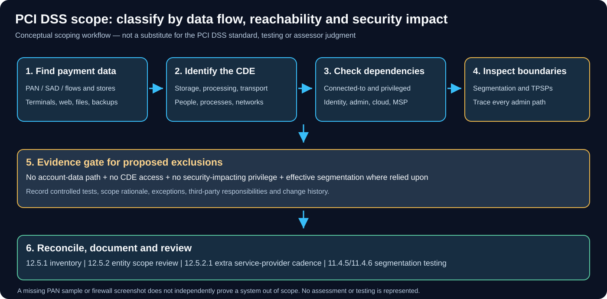

# PCI DSS 4.0.1 — Scoping & Segmentation Field Guide

_Reviewed: 18 November 2026 against PCI Security Standards Council (PCI SSC) FAQs and current guidance. This guide is a **planning and evidence collection reference**, not an assessment, compliance determination, or substitute for the current standard._

> [!IMPORTANT]
> **Scope is an evidence-based determination, not a diagram color or firewall label.** Record how payment account data is handled and which systems can affect it. Confirm reporting obligations and the applicable SAQ/ROC with the **acquirer, payment brand, or other compliance-accepting entity**, and engage a qualified security assessor (QSA) where appropriate. Do not upload real card data, customer network diagrams, internal IPs, live credentials, or unredacted provider agreements to this public repository.

## Purpose & Use

Use this workflow to document PCI DSS scope for merchants or service providers, to review a proposed scope reduction, to evaluate outsourced checkout or IT support, and to prepare a defensible scoping record. Start with the [editable review template](pci-scope-review-template.md), the [PCI DSS framework overview](frameworks.md#pci-dss-401), and the [PCI SSC document library](https://www.pcisecuritystandards.org/document_library/).

**Status:** Guidance and examples only. No PNWC/client assessment, segmentation test, provider Attestation of Compliance (AOC) validation, or PCI certification was performed in preparing this document.

*Conceptual scoping map, not a validated network topology. The same system may perform more than one role, and business processes, personnel, and physical media also matter.*

## Terminology & The First Decision

| Term | How to use it during discovery |
|---|---|
| **Account data** | PCI DSS umbrella term for **cardholder data (CHD)** and **sensitive authentication data (SAD)**. |
| **CHD** | Primary account number (**PAN**) alone, or PAN together with cardholder name, expiration date, or service code. PAN is the key element for determining CHD. |
| **SAD** | Full track data/equivalent chip data, card verification code/value (such as CVV2/CVC2/CID), and PIN/PIN block. **Do not store SAD after authorization, even encrypted** (subject to the exact standard and payment-brand rules). |
| **CDE** | People, processes, and technology that store, process, or transmit account data, and the network segments containing such components. |
| **Connected-to systems** | Components that have connectivity to the CDE, even if they never directly hold PAN. Assess the actual reachability and privilege. |
| **Security-impacting systems** | Components or services that can affect CDE security, such as administrative access, identity, deployment/configuration, logging, backups, and some cloud or web control planes. |
| **TPSP** | A third-party service provider whose services store/process/transmit payment account data **or can impact its security**, or which meets a PCI DSS requirement for a customer. The full PCI SSC definition and facts of the service govern. |
| **Out of scope** | A supported conclusion **after** testing and documenting why the component neither handles account data, connects to, nor can affect security of the CDE. |
| **SAQ / ROC / AOC** | Reporting instruments: Self-Assessment Questionnaire / Report on Compliance / Attestation of Compliance. The reporting route is **not** selected solely by a web diagram or by a vendor's marketing claim. |

The presence of a token, encrypted data, truncated PAN, or a hosted payment processor does **not automatically** settle scope; document the implementation and verify the applicable PCI SSC guidance with the assessor. Likewise, bank routing data is not automatically payment-card account data.

**Discovery rule:** Never collect live PAN or SAD merely to demonstrate that it exists. Use interviews, redacted configurations, approved data-discovery procedures and non-sensitive samples; store any necessary evidence in an access-controlled customer repository.

## Classify The System & Service Boundary

Use this sequence for **each component and each trust relationship**, including cloud services, offsite personnel, and system-to-system credentials:

1. **Find account-data entry points and flows.** Identify card-present terminals, virtual terminals, e-commerce checkout, recurring billing, telephone orders, refunds, chargebacks, support workflows and authorized third-party flows. Record every stage from initial capture to disposal.
2. **Locate storage, processing and transmission.** Include databases, web apps, files, local caches, email, paper, screenshots, call/VoIP recordings, backups, logs, ticketing, crash dumps and cloud replicas. Confirm whether data is present rather than assuming none.
3. **Mark the CDE.** Identify all in-scope data-bearing systems, relevant network segments, physical locations, people and processes.
4. **Review connected-to systems.** Enumerate routes, firewall rules, jump hosts, remote access, management VLANs, APIs, DNS/name resolution, and inter-system trust paths that can reach the CDE.
5. **Review security-impacting components.** Check identity/directory services, MFA, hypervisors, cloud IAM, KMS, patching/configuration systems, backup/restore administrators, CI/CD, logging, EDR consoles, security gateways, privileged remote-support tooling and payment-page delivery controls where they can influence CDE security.
6. **Document third-party and shared responsibility.** Identify processor, hosting, gateway, MSP/IT support, remote maintenance, SaaS and any nested provider whose service can impact account-data security. Do not omit an administrative provider because it never sees PAN.
7. **Test each proposed exclusion.** Record exactly which isolation, permissions and independent evidence establish that a system **cannot access or affect** the CDE. A firewall rule, VLAN name or lack of observed PAN alone is not sufficient proof.
8. **Reconcile and sign off.** Update inventory, data-flow and network diagrams, third-party access list, evidence references, scope decisions and unresolved assumptions. Obtain the responsible entity/assessor review before treating an exclusion as final.

### Scope Classification Examples — Illustrative, Not Determinations

| Component or service | Initial classification to investigate | Evidence needed to decide |
|---|---|---|
| Payment terminal and payment-handling point-of-sale workstation | CDE candidate | Terminal architecture, network paths, interaction with PAN, P2PE deployment |
| Dedicated POS VLAN / hosted payment gateway connection | CDE or connected-to candidate | Routing, device role, account-data flows, gateway responsibility |
| Corporate AD/Entra identity, remote-admin jump host or EDR management plane | Security-impacting / connected-to candidate | Who can change CDE permissions, software, policies or configurations? |
| Backup storage, offsite replicas, logs, ticketing or call recordings | CDE / security-impacting candidate | PAN/SAD discovery, data access, encryption/key custody, restore privilege |
| Guest Wi-Fi, ordinary office VLAN, unrelated laptop | **Potentially** out of scope | Tested effective isolation **and** absence of any security-impacting administration or dependencies |
| Checkout webpage that sends the customer to a processor | Payment-page/security-impacting scope to evaluate | Redirect vs embedded fields, page change control, scripts, provider service, current SAQ criteria |
| Managed IT support with remote access to POS, payment systems or their identity plane | Potential TPSP and/or security-impacting scope | Service contract, permissions, accessible systems, responsibility allocation, evidence of least privilege |
| Fully external accounting software with no payment account data or ability to affect the CDE | Potentially out of scope | Confirmed data fields, integrations and privileges; validate against all other relationships |

**Important:** An ordinary IT support technician can affect security through privileged access even without seeing cardholder data. PCI SSC [FAQ 1579](https://www.pcisecuritystandards.org/faqs/1579/) and [FAQ 1580](https://www.pcisecuritystandards.org/faqs/1580/) address services that impact payment account data without directly handling it. The classification must still be based on the **specific service**; being an equipment reseller does not automatically establish TPSP status.

## Segmentation & Modern Architecture

Segmentation can reduce the number of systems subject to assessment **only when the separation works and is verifiable**. It is not, by itself, a universal PCI DSS requirement and it does not excuse a security-impacting identity, remote support, hypervisor, logging or cloud control plane.

| Architecture | What to verify before calling a boundary effective |
|---|---|
| VLANs and firewalls | Real Layer 3 routes, stateful policy, exceptions, management access, dual-homed hosts, switch trunks, DHCP/DNS paths |
| Proxmox/VMs and hypervisors | Physical bridge/port mappings, virtual NICs, shared management, host administration, snapshot and backup permissions; an unmanaged switch provides no automatic SPAN traffic |
| Cloud/hybrid | Account/subscription/project and VPC/VNet boundaries, peering, transit gateways, private endpoints, IAM, service identities, orchestration, logs and backup access |
| Kubernetes/containers | Shared hosts and clusters, namespace isolation, network policy **enforcement**, node/control-plane privilege, secret and image pipelines |
| Zero-trust / microsegmentation | Identity and policy decision points, policy bypass, rule enforcement, management-plane dependencies and tested failure modes |
| Remote MSP / vendor access | Approved entry point, MFA, support credentials, time-bound access, vendor service components, access revocation and audit logs |
| Outsourced hosted checkout | Merchant website and script integrity, domain/redirect settings, iframe integration, payment processor obligations and customer-facing flow |

**Segmentation validation is a different activity from general vulnerability scanning.** Where segmentation is used to isolate the CDE, **Requirement 11.4.5** addresses segmentation penetration testing at least every 12 months and after changes to segmentation methods; **11.4.6** adds service-provider-specific testing at least every six months and after changes. Apply the full current requirement text and the assessment method before assigning a test frequency. All exercises require explicit written authorization, known exclusions and a rollback plan.

Keep both a **network diagram** (including connection points and security controls) and **account-data flow diagrams**. PCI DSS **1.2.3** and **1.2.4**, respectively, address these diagrams; **12.5.2** uses scoping confirmation to reconcile them against reality. The PCI SSC's [2024 modern-network information supplement](https://blog.pcisecuritystandards.org/new-information-supplement-pci-dss-scoping-and-segmentation-guidance-for-modern-network-architectures) specifically discusses cloud, zero trust, microsegmentation and ephemeral infrastructure. Supplementary guidance does **not** replace the standard.

### Practical Boundary Verification (Authorized Systems Only)

For each proposed out-of-scope zone, document the **source vantage**, destination, protocol and expected denial; verify the firewall/router policy and relevant control-plane privileges. Under a separately approved assessment plan, use safe, rate-limited connectivity tests from representative owned endpoints to confirm the exclusion. Include tests after rule, route, identity, cloud-policy and backup-path changes. A failed ping, absent IDS alert, or 'deny' screenshot **alone** does not establish isolation.

Evidence record: change ticket; approved source/destination matrix; sanitized route/policy exports; tester identity and independence; method/date; observed failures/successes; exception list; immutable evidence references; remediation and retest.

## Merchant Checkout & SAQ Eligibility — Avoid Common Shortcuts

PCI DSS applicability, environment scope, and **which SAQ or ROC to submit** are related but different decisions. Contact the acquirer/payment brand or program manager; confirm the current SAQ's full eligibility criteria **before** selecting a form.

| Payment model | What still needs checking |
|---|---|
| **Hosted redirect** to a compliant processor | Merchant site/redirect integrity, involved systems, third-party oversight and any applicable externally exposed e-commerce ASV scan requirement |
| **Embedded processor iframe / hosted fields** | Merchant payment page and scripts, iframe implementation and current SAQ A script-attack eligibility criteria; responsibilities can differ from direct redirects |
| **Merchant-managed payment form / direct post or JavaScript collection** | Cardholder data paths and merchant-controlled page elements; do **not** assume SAQ A eligibility |
| **Card-present terminal / validated P2PE solution** | Actual terminal and P2PE solution listing, key/terminal management, supporting processes and still-applicable merchant requirements |
| **Telephone / virtual-terminal / mail-order** | Personnel, devices, headsets, call recordings, paper and any connected remote administration or network paths |

**Two easy-to-miss distinctions from PCI SSC:**

- [FAQ 1588 (February 2025)](https://www.pcisecuritystandards.org/faqs/1588/) explains special **SAQ A eligibility** considerations for *embedded* payment pages/forms and protecting the merchant page from script attacks. That particular added eligibility criterion is **not** applied the same way to redirect-only merchant webpages. This does **not** mean redirect sites are automatically out of scope.
- [FAQ 1604 (June 2026)](https://www.pcisecuritystandards.org/faqs/1604/) confirms that **SAQ A e-commerce merchants** with redirect pages or embedded iframes are subject to applicable **external Approved Scanning Vendor (ASV)** scanning requirements (11.3.2/11.3.2.1), even if payment processing is outsourced. Do not equate this with self-run scans or assume that all domains of a business require identical ASV treatment.

For webpages and payment-page protection, separately evaluate **6.4.3** (payment-page script management) and **11.6.1** (change/tamper detection) *where applicable*. These were among the v4.x future-dated requirements effective from **31 March 2025**. Review specific eligibility and applicability instead of imposing a blanket statement on all hosted-redirect implementations.

## Service Providers, Remote IT & Shared Responsibility

The PCI SSC's **10 November 2026** [Understanding PCI DSS Service Providers guidance](https://blog.pcisecuritystandards.org/pci-ssc-publishes-new-guidance-on-understanding-pci-dss-third-party-service-providers) explains the difference between payment processors, administrative/security-impacting TPSPs, multi-tenant providers, nested providers and services that generally do not impact payment security. It also clarifies customer/TPSP evidence-sharing expectations.

For each provider, record:

1. **Specific services and access** (who can administer, reach or change what; who can indirectly affect payment security).
2. **Written agreements and responsibility** (which PCI DSS requirements the TPSP fulfills, the customer fulfills, or both share; **12.8** for customers, **12.9** for providers where applicable).
3. **Validation evidence** (AOC covering the **actual service**, assessment period, relevant requirements, service-level exceptions, or other specific control evidence when no relevant AOC exists).
4. **Due diligence and monitoring** (including the **at-least-every-12-months TPSP PCI DSS compliance-status monitoring** under 12.8, as applicable).
5. **Nested dependencies** (hosting, backup, remote support, cloud service provider or subcontractor performing an in-scope function).
6. **Exit and change controls** (revoking vendor access and verifying scope when provider, permissions or supported services change).

A provider can fall within PCI DSS **service provider** expectations if it can affect security, even if it never processes a PAN; see [FAQ 1580](https://www.pcisecuritystandards.org/faqs/1580/). A service provider's own scope is based on the people, processes and systems delivering its relevant service, and **not** determined using a merchant SAQ eligibility shortcut.

### What A Typical Remote IT Engagement Should Document

Use this service-boundary worksheet for an MSP, one-person IT consultant, break/fix technician or subcontractor **only where their actual access/services warrant it**:

| Question | Evidence / action |
|---|---|
| Can remote support enter a CDE host, POS network, security appliance or account with access? | Support architecture, access control list, remote-session approvals, audit trail |
| Can a support tool change CDE patching, endpoint policy, firewall rules, backups or identity? | Admin role/export, policy assignments, segregated credentials and change logs |
| Does the technician ever receive account data in support tickets, emails, photos or logs? | Privacy-safe discovery, handling guidance and restricted/redacted evidence |
| Are the provider's laptops, support platform or subcontractors security-impacting? | Device controls, MFA, patch state, platform responsibility matrix, permitted access |
| Who owns incident reporting, scan coordination, segmentation tests, and PCI evidence? | Signed role matrix, notification commitments and named owner on each side |
| Can a change to support tools or vendor access expand the customer's CDE scope? | Change impact review, architecture updates, revocation and independent verification |

Do not advertise a customer as **"PCI compliant"** merely because a processor or IT vendor has an AOC. The [PCI SSC evidence FAQ 1576](https://www.pcisecuritystandards.org/faqs/1576/) explains that the provider's assessment must actually cover the relevant contracted service.

## Required Scope Review Cadence & Evidence

| Relevant control | Scope-review action |
|---|---|
| **12.5.1** | Maintain a current inventory of all in-scope system components and their purpose/function. |
| **12.5.2** | Entity documents and reconfirms scope **at least every 12 months** and **after significant changes**; review data flows and locations, CDE/connected-to/security-impacting assets, segmentation/exclusions, and third-party connections. |
| **12.5.2.1 (service providers only)** | Additional scope confirmation **at least every six months** and upon significant changes, including the elements in 12.5.2. |
| **12.5.3 (service providers only)** | Document impact reviews for significant organizational-structure changes affecting PCI scope/control applicability and communicate outcomes appropriately. |
| **1.2.3 / 1.2.4** | Keep accurate network and account-data flow diagrams, as applicable to the environment. |
| **11.4.5 / 11.4.6** | Where relying on segmentation, assess its effectiveness by applicable annual / additional service-provider six-month penetration-test requirements and after relevant segmentation changes. |

PCI SSC [FAQ 1317](https://www.pcisecuritystandards.org/faqs/1317/) notes that significant changes can include changes to CDE hardware/software, account-data flows, CDE boundaries, supporting infrastructure (including identity/logging) and third-party services. Track such changes and evaluate their significance; do not simply postpone scoping until the next annual review.

### Minimum Scope Review Evidence Pack

- [ ] Named entity, location, assessment type, responsible owner, date, standard version and acceptance program.
- [ ] Payment acceptance channels and flow inventory (authorization, settlement, refunds, chargebacks, recurring/MOTO, where applicable).
- [ ] Network and payment-data flow diagrams with revisions, owners and approved data classification.
- [ ] In-scope asset/service inventory with role, data interaction, CDE/connected-to/security-impacting classification and justification.
- [ ] Evidence for each claimed excluded network, host, cloud tenant, provider service or process, including segmentation validation as applicable.
- [ ] Access paths, privileged identities, system dependencies, administrative control plane and all third-party access.
- [ ] TPSP inventory, written agreements, service-specific AOC/control evidence, shared responsibility matrix and monitoring records.
- [ ] Summary of changes since prior review, unresolved questions, testing gaps, risks and remediation owners.
- [ ] Entity scope-review sign-off and independent assessor/acquirer resolution for disputed classifications.
- [ ] Confidential evidence storage, retention and data minimization; **no actual CHD/SAD in public documentation**.

Start a fresh [fillable scoping template](pci-scope-review-template.md) for each client/assessment rather than copying any real details into the GitHub repository.

## Common Errors & Corrective Questions

| Shortcut that fails | Better question |
|---|---|
| "We use a payment processor, so nothing is in scope." | Which website, terminal, employee, remote admin and third-party responsibilities remain? |
| "Guest Wi-Fi is a separate VLAN, so it is excluded." | Which routes and management paths were actually tested, and who can change policy? |
| "No PAN on this server, so it is out of scope." | Could the system **reach or impact** the CDE, including through identity, deployment or backups? |
| "We checked the firewall rules." | Were segmentation controls independently tested from relevant source networks after change? |
| "The provider is compliant, so our work is done." | Does the **current service-specific** AOC cover the work and responsibility matrix? |
| "Our annual audit replaces our scoping exercise." | Where is the entity's own documented 12.5.2 confirmation (plus extra service-provider cadence)? |
| "A script scanner or a small number of packets proves payment security." | Which evidence, negatives, source controls, requirements and independent review support the claim? |
| "The hosted payment iframe is automatically SAQ A." | Do the current SAQ's payment-page, script and third-party eligibility conditions hold? |

## Primary Sources & Version Notes

**Source verification date:** 18 November 2026. PCI SSC publishes the requirements, forms and supplementary guidance. The **current standard and SAQ eligibility criteria must be rechecked when used**; guidance may be updated without a change to this repository.

1. [PCI SSC PCI DSS document library — latest standard and SAQs](https://www.pcisecuritystandards.org/document_library/?class=pcidss&doc=pci_dss)
2. [PCI SSC: Scoping and segmentation for modern network architectures (September 2024)](https://blog.pcisecuritystandards.org/new-information-supplement-pci-dss-scoping-and-segmentation-guidance-for-modern-network-architectures)
3. [PCI SSC: Understanding PCI DSS third-party service providers (10 November 2026)](https://blog.pcisecuritystandards.org/pci-ssc-publishes-new-guidance-on-understanding-pci-dss-third-party-service-providers)
4. [PCI SSC FAQ 1580 — scope of security-impacting providers](https://www.pcisecuritystandards.org/faqs/1580/)
5. [PCI SSC FAQ 1576 — provider AOC and evidence](https://www.pcisecuritystandards.org/faqs/1576/)
6. [PCI SSC FAQ 1473 — compliance-accepting entities and assessors](https://www.pcisecuritystandards.org/faqs/1473/)
7. [PCI SSC FAQ 1317 — significant changes](https://www.pcisecuritystandards.org/faqs/1317/)
8. [PCI SSC FAQ 1588 — embedded e-commerce page script criteria](https://www.pcisecuritystandards.org/faqs/1588/)
9. [PCI SSC FAQ 1604 — SAQ A e-commerce ASV scans (June 2026)](https://www.pcisecuritystandards.org/faqs/1604/)
10. [PCI SSC FAQ 1154 — sensitive authentication data before and after authorization](https://www.pcisecuritystandards.org/faqs/1154/)

The **2024 and 2026 supplements are explanatory guidance**, not additional PCI DSS requirements. Exact mandatory wording, reportable applicability, approved test methods and assessor decisions remain governed by the current PCI DSS and program rules.

## Related Repository Guides

[Compliance index](README.md) · [Frameworks](frameworks.md) · [Scoping template](pci-scope-review-template.md) · [Cloud security](../Cloud/README.md) · [Web app assessment](../WebAppSecurity/README.md) · [Segmentation/Proxmox visibility](../Homelab/proxmox-security-monitoring-visibility.md) · [SIEM detection validation](../IncidentResponse/SIEM/detection-content-validation.md) · [Client assessment findings](../PlayBooks/assessment-findings-lifecycle.md) · [Legal terms](../LEGAL.md)
