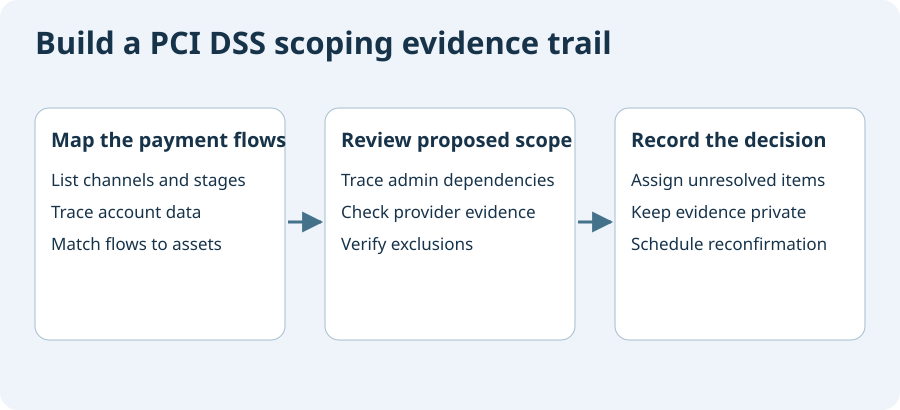

# PCI DSS Scope Review — Reusable Evidence Worksheet

_Companion to the [PCI DSS 4.0.1 Scoping & Segmentation Field Guide](pci-dss-scoping.md). **Blank template only.** Do not commit completed client copies, real payment account data, production configurations, credential material, or private third-party agreements to a public repository._

> [!CAUTION]
> This worksheet is **not** a PCI SSC SAQ, ROC, AOC or certification. The entity, assessor and compliance-accepting organization determine applicability and validation. Treat every blank as **unassessed**, not "out of scope" or "not applicable."

## How to use the worksheet

Assign stable IDs to each flow, asset and provider. Use those IDs to link
proposed exclusions to their evidence and record unresolved items with an
owner. Keep completed worksheets and evidence in the private review record.
[PCI SSC scoping and segmentation guidance](https://blog.pcisecuritystandards.org/new-information-supplement-pci-dss-scoping-and-segmentation-guidance-for-modern-network-architectures).

## 1. Assessment Record

| Field | Authorized review entry |
|---|---|
| Entity / merchant or service-provider role | _Private record_ |
| Payment channels and brands / acceptance program | _Private record_ |
| PCI DSS / SAQ / ROC version used | _Verify current form_ |
| Review owner / assessor / acquirer contact | _Private record_ |
| Review date / next review deadline | _Date and cadence_ |
| Significant change since last review | _Change IDs or none, verified_ |
| Written authorization and boundaries | _Private evidence ID_ |
| Evidence repository and retention controls | _Private evidence ID_ |
| Overall status | _Draft / pending evidence / reviewed / approved_ |

## 2. Payment Data Flow Inventory

Include **authorization, capture, settlement, refunds, chargebacks and recurring billing** where relevant. Record card-present, e-commerce, MOTO and virtual-terminal channels separately.

| Flow ID | Channel & stage | Entry / processing / exit | Data types present? | System & provider IDs | Evidence ID | Owner |
|---|---|---|---|---|---|---|
| _FLOW-01_ | _To assess_ | _Redacted architecture_ | _PAN, SAD, token, or unknown_ | _ASSET/TPSP IDs_ | _Private_ | _Role_ |

Reconcile **all** identified paths against the updated network diagram and account-data flow diagram. Include temporary logs, troubleshooting artifacts, backups and physical media when applicable.

## 3. In-Scope & Exclusion Inventory

| Asset or service ID | Role & location | Data interaction | Proposed class | Access & security dependencies | Evidence / justification | Reviewed? |
|---|---|---|---|---|---|---|
| _ASSET-01_ | _Functional description_ | _Store / process / transmit / none / unknown_ | _CDE / connected-to / security-impacting / exclusion candidate_ | _Identity, network, backup, remote support_ | _Private evidence ID_ | _Pending_ |

Document the evidence that supports each proposed exclusion. Check the
component's account-data role, connectivity to the CDE, and ability to affect
CDE security. Use the evidence appropriate to each question, such as current
data flows, administrative access paths, and segmentation test results where
segmentation is used to reduce scope. Mark unresolved exclusions as pending.
[PCI SSC FAQ on segmentation and assessment scope](https://www.pcisecuritystandards.org/faqs/1115/).

## 4. Segmentation Evidence

| Boundary ID | Source segment or identity | CDE destination / control plane | Control & rule ID | Approved test method / date | Expected / actual result | Reviewer / retest |
|---|---|---|---|---|---|---|
| _SEG-01_ | _Representative source_ | _Sanitized target_ | _Private evidence ID_ | _Written authorization required_ | _Unverified_ | _Pending_ |

Record segmentation design plus **independent test results** as applicable, including changes and remediation. Do not substitute a firewall screenshot or ping result for a comprehensive assessment. See PCI DSS 11.4.5 and service-provider-only 11.4.6.

## 5. Third-Party Services & Responsibility

| TPSP ID | Actual service | Direct/indirect CDE impact | Customer / provider / shared PCI responsibility | AOC or control evidence & expiry | Agreement & monitoring | Owner |
|---|---|---|---|---|---|---|
| _TPSP-01_ | _Service definition_ | _Access path_ | _Requirement IDs / matrix ID_ | _Private evidence_ | _Review date_ | _Role_ |

Validate that the provider evidence **covers the specific service**. Document nested providers, provider access and exit/revocation. Refer to 12.8/12.9 and the [November 2026 PCI SSC service-provider guidance](https://blog.pcisecuritystandards.org/pci-ssc-publishes-new-guidance-on-understanding-pci-dss-third-party-service-providers).

## 6. E-Commerce / Payment Page (Where Applicable)

| Question | Review evidence |
|---|---|
| Is checkout redirected, embedded iframe/hosted fields, direct post or merchant collection? | _Provider technical integration and diagram_ |
| Who controls the merchant page, scripts, redirects, DNS, hosting and deployment? | _Change logs, inventory, responsible entity_ |
| Do current SAQ eligibility criteria hold (including embedded script criteria where relevant)? | _SAQ version, acquirer/assessor decision_ |
| Have applicable payment-page script and tamper controls been evaluated? | _Requirements 6.4.3 / 11.6.1 applicability record_ |
| Has any required SAQ A e-commerce ASV scanning been performed by a listed ASV? | _Requirements 11.3.2/11.3.2.1, as applicable; private report ID_ |

A vendor's "PCI compliant" label **does not** determine the merchant's SAQ eligibility.

## 7. Scope Confirmation Checklist

- [ ] All payment acceptance channels, transaction stages and account-data flows reconciled.
- [ ] Locations, storage, paper, recordings, logs, backups, cloud replicas and access paths investigated.
- [ ] Network/data-flow diagrams and in-scope inventory dated and reconciled.
- [ ] Connected-to and security-impacting identity/remote-admin/management infrastructure included.
- [ ] Proposed exclusions have documented rationale and appropriate independent boundary testing.
- [ ] All applicable third-party service access, agreements, responsibilities and supporting evidence reviewed.
- [ ] E-commerce SAQ eligibility and ASV scanning applicability checked with current PCI SSC criteria.
- [ ] Scope confirmation scheduled at least every 12 months under 12.5.2, or at least every six months for service providers under 12.5.2.1.
- [ ] Significant changes to the in-scope environment trigger a scope confirmation outside the scheduled cycle. [PCI SSC significant-change FAQ](https://www.pcisecuritystandards.org/faqs/1317/).
- [ ] Findings and unknowns assigned owners; final sign-off retained privately.

## 8. Decisions, Unknowns & Sign-Off

| Item ID | Scope decision or unresolved question | Supporting evidence | Reviewer & date | Next action |
|---|---|---|---|---|
| _DEC-01_ | _In scope / proposed exclusion / unresolved_ | _Private reference_ | _Pending_ | _Retest / provider response / assessor review_ |

**Final scope determination:** _Pending evidence and authorized review._

**Do not publish completed copies.** Keep this public version as a blank example; use the [scope guide](pci-dss-scoping.md) and [PCI SSC document library](https://www.pcisecuritystandards.org/document_library/) for current criteria.
