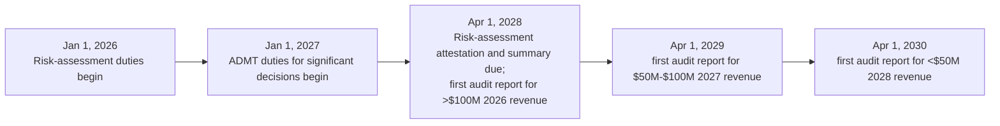

# ⚖️ Data-Protection Regulations

_Reviewed: 2026-11-20 against primary legal and agency sources; not legal advice._

> [!IMPORTANT]
> Educational reference, **not** legal advice. Regulatory thresholds, definitions,
> and penalties change and depend on jurisdiction, industry, and the data involved.
> Consult qualified legal counsel for your specific situation. See the
> [section notice](README.md#-important-notice).

## 🎯 Purpose
A practitioner's orientation to the major data-protection regulations - who they
apply to, what they require, and their breach-notification duties.

## ⚙️ Function
Covers GDPR (EU/EEA), HIPAA (US healthcare), and CCPA/CPRA (California), plus the
common thread of breach notification, at the level a security practitioner needs
to know when they apply and what controls they drive.

## 🏆 Goal
Let a reader recognize which regulation applies to a given system or dataset and
what security obligations follow - then route to counsel for specifics.

## 📋 When to Use
- Determining whether a regulation applies to a system or dataset
- Understanding the security controls a regulation implies
- Preparing breach-notification readiness

---

## 📋 Table of Contents

- [GDPR (EU/EEA)](#gdpr-eueea)
- [HIPAA (US Healthcare)](#hipaa-us-healthcare)
- [CCPA / CPRA (California)](#ccpa--cpra-california)
- [Breach Notification (Common Thread)](#breach-notification-common-thread)
- [What This Means for Security](#what-this-means-for-security)
- [Resources](#-resources)

---

## GDPR (EU/EEA)

The EU **General Data Protection Regulation** (GDPR) governs processing of personal data within its territorial scope.

- **Applies to:** processing in the context of a controller's or processor's
  establishment in the Union, regardless of where the processing occurs. For an
  entity without a Union establishment, Article 3 can also apply when processing
  relates to offering goods or services to people in the Union or monitoring
  their behavior there. A person's EU residence or data location alone does not
  decide territorial scope; assess the Article 3 criteria.
- **Key principles:** lawfulness, purpose limitation, data minimization, accuracy,
  storage limitation, integrity/confidentiality, and accountability.
- **Data-subject rights include:** access, rectification, erasure ("right to be
  forgotten"), restriction of processing, data portability, and objection. Rights to
  withdraw consent and not to be subject to certain solely automated decisions also
  apply in specified circumstances.
- **Security duty:** "appropriate technical and organizational measures" (Art. 32) -
  encryption, resilience, testing.
- **Penalties:** Article 83 sets two maximum tiers, depending on the infringement:
  up to **€10 million or 2% of global annual turnover**, and for higher-tier
  infringements up to **€20 million or 4%**, whichever amount is higher. These are
  statutory maxima, not automatic fines; the supervisory authority considers the
  factors in Article 83(2).

---

## HIPAA (US Healthcare)

The US **Health Insurance Portability and Accountability Act** - protects health
information.

- **Applies to:** **covered entities** - health plans, health care clearinghouses,
  and health care providers that conduct specified transactions electronically under
  HIPAA - plus **business associates** performing covered functions or services that
  involve PHI on behalf of a covered entity or another business associate. See
  [HHS scope guidance](https://www.hhs.gov/hipaa/for-professionals/covered-entities/index.html).
- **Security Rule:** requires administrative, physical, and technical safeguards for
  electronic PHI (access control, audit controls, integrity, transmission security).
- **Privacy Rule:** governs use and disclosure of PHI.
- **Breach Notification Rule:** applies to breaches of **unsecured PHI**, subject
  to defined exceptions and a risk assessment. Notification duties and timing
  vary by affected population and recipient.
- **Penalties:** tiered civil penalties per violation, up to substantial annual caps.

---

## CCPA / CPRA (California)

The **California Consumer Privacy Act**, amended and strengthened by the **California
Privacy Rights Act (CPRA)**.

- **Applies to:** for-profit businesses handling California residents' personal
  information that meet thresholds (revenue, volume of data, or data-selling share).
- **Consumer rights:** know, delete, correct, opt out of sale/sharing, and limit
  use of sensitive personal information.
- **CPRA additions:** a dedicated enforcement agency (CPPA), a "sensitive personal
  information" category, and data-minimization/retention duties.
- **2025 regulatory package:** The regulations took effect January 1, 2026; some
  duties have later first deadlines. Businesses subject to the risk-assessment rules
  must begin compliance in 2026; first attestations and summaries are due by April
  1, 2028. ADMT requirements for significant decisions begin January 1, 2027.
  Cybersecurity-audit report dates are phased by revenue cohort:

  *Dates summarize first deadlines in the final rule package; the duties apply only
  when their scope criteria are met. Confirm coverage, thresholds, exceptions, and
  current regulations with the [CPPA](https://cppa.ca.gov/regulations/ccpa_updates)
  and counsel.*
- **Note:** many other US states have since enacted comparable laws - check the
  specific state(s) where your users reside.

---

## Breach Notification (Common Thread)

Many privacy and breach-notification laws require timely notice after a covered breach; triggers, thresholds, recipients, and exceptions differ by law:

*Conceptual triage aid only; it is not a legal decision tool. Confirm the current law, jurisdiction, roles, facts, and deadlines with qualified counsel.*

- **GDPR:** the controller notifies the supervisory authority without undue delay
  and, where feasible, within 72 hours after becoming aware, unless the breach is
  unlikely to result in a risk to people's rights and freedoms. A processor
  notifies the controller without undue delay. Notify individuals without undue
  delay when high risk is likely, subject to Article 34 exceptions.
- **HIPAA:** for a breach of unsecured PHI, apply the rule's exceptions or document
  the required risk assessment. Notify affected individuals without unreasonable
  delay and no later than 60 days after discovery. Notify HHS within 60 days for
  breaches affecting 500 or more individuals; breaches affecting fewer than 500
  may be reported annually, within 60 days after year-end. Media notice applies
  when more than 500 residents of a state or jurisdiction are affected.
  Business associates notify the covered entity without unreasonable delay and
  no later than 60 days after discovery. A business associate agreement can require
  a shorter deadline so the covered entity has time to meet its own obligations.
- **US state laws:** triggers, deadlines, thresholds, and recipients vary by
  jurisdiction; CCPA/CPRA duties and other state breach laws should be assessed
  separately.

There is no universal breach-notification clock: GDPR uses awareness, HIPAA uses
discovery, and state laws set their own triggers. Preserve a timeline of discovery
or awareness, data types, affected people, risk findings, notices, and the
rationale for each decision. See [IncidentResponse](../IncidentResponse/README.md).

---

## What This Means for Security

Regulations rarely prescribe specific technology, but consistently drive the same
controls:

- **Data inventory & classification** - you must know what personal data you hold.
- **Access control & MFA** - limit who can reach regulated data.
- **Encryption** - in transit and at rest. Encryption changes a notification
  outcome only when the applicable law's conditions are met; GDPR Article 34 has
  defined exceptions to individual communication, and HIPAA's breach rule applies
  to PHI not rendered unusable, unreadable, or indecipherable under HHS guidance.
- **Logging & monitoring** - to detect and evidence incidents within notification windows.
- **Incident response** - a tested plan that meets the notification clocks.
- **Data minimization & retention** - collect and keep less.

Implement these once (see the technical sections of this repo) and map them to each
applicable regulation and framework - see
[Control Mapping](README.md#-control-mapping-do-it-once-satisfy-many).

---

## 📚 Resources

- [GDPR - official text (EUR-Lex)](https://eur-lex.europa.eu/eli/reg/2016/679/oj)
- [HHS Breach Notification Rule](https://www.hhs.gov/hipaa/for-professionals/breach-notification/index.html)
- [California CCPA (OAG)](https://oag.ca.gov/privacy/ccpa)
- [California Privacy Protection Agency regulations](https://cppa.ca.gov/regulations/)
- [CPPA 2025 CCPA updates](https://cppa.ca.gov/regulations/ccpa_updates)

---

## Related Files
- [README.md](README.md) - Compliance & GRC section index
- [frameworks.md](frameworks.md) - security control frameworks
- [../IncidentResponse/README.md](../IncidentResponse/README.md) - detection & response that breach-notification duties require
