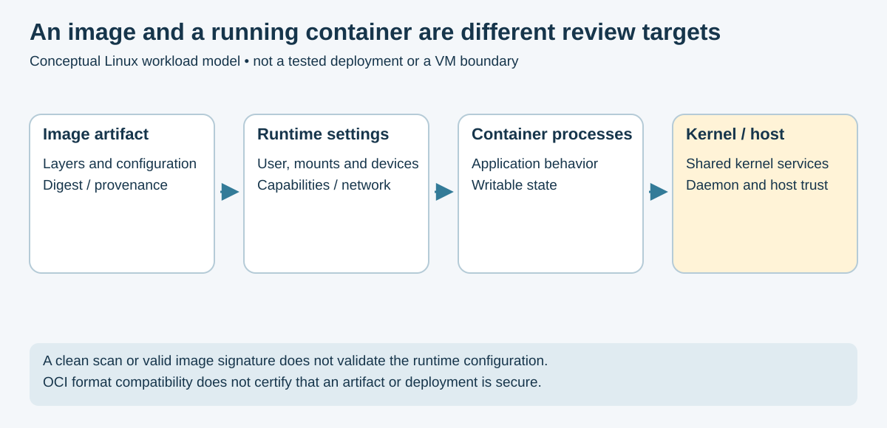
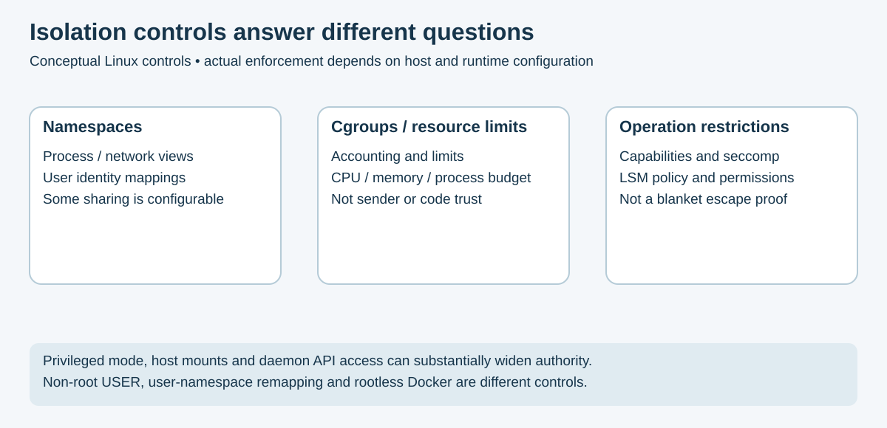
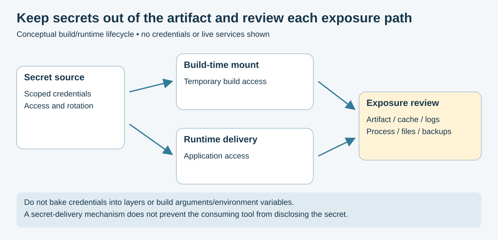

# 🐳 Container Image & Runtime Security

> [!CAUTION]
> **Authorized use only.** Assess only images and hosts you own or have explicit
> permission to review. See [LEGAL.md](../LEGAL.md).

**Operational CLI companion:** [Docker operations and diagnostics](./docker-cli-operations-reference.md)
provides inspection examples. **Supply-chain extension:**
[SBOMs, secret scanning and signatures](software-supply-chain-assessment.md).

## 🎯 Purpose

Explain image, runtime and host trust boundaries for Docker/OCI workload reviews.

## ⚙️ Function

Connect artifact provenance, secret handling, effective runtime privileges and
host security to a practical hardening review. Benchmark references inform the
review; this page does not claim a complete CIS control mapping.

## 🏆 Goal

Produce concrete findings supported by an exact image digest, configuration,
platform and version, while distinguishing possible impact from demonstrated compromise.

## 📋 When to Use

- Reviewing a container artifact or its deployment configuration.
- Investigating exposed host resources or excessive runtime authority.
- Designing workload hardening and a repeatable assessment record.

**Source and visual review:** November 17, 2026. No container, daemon, scan,
escape attempt or host change was executed for this review.

---

## 📋 Table of Contents

- [Image Security](#image-security)
- [Runtime Misconfigurations](#runtime-misconfigurations)
- [Container Escape Vectors](#container-escape-vectors)
- [Hardening](#hardening)
- [Resources](#-resources)

## Image Security

*Original conceptual Linux workload model, not a tested environment. [OCI](https://opencontainers.org/about/overview/) separates image and runtime specifications. Docker Desktop and other VM-backed deployments add another host layer; inspect the actual platform.*

| Review Area | Evidence And Limit |
|---|---|
| Vulnerabilities | Scan supported OS/application packages; record digest, platform and tool/database version. Clean output does not establish that unknown or unsupported components are safe. |
| Base image | Choose a maintained source appropriate to the application. Minimal, official and distroless are not blanket security guarantees. |
| Digest pinning | Identifies a specific artifact; pair it with a controlled update/rebuild process. A digest is not an endorsement. |
| Provenance | Verify the expected signer identity/key, issuer and artifact digest under policy. A valid signature alone does not prove harmless contents. Admission enforcement depends on the orchestrator and configured policy. |
| Secrets | Review layers, configuration, caches and logs. A source-repository scanner is not a complete image-layer audit. |

~~~bash
# Source-reviewed vulnerability filter; placeholder image, not executed.
trivy image --scanners vuln --severity HIGH,CRITICAL myorg/app:1.2.3
~~~

Use the reviewed digest for an actual assessment. This command is a vulnerability
severity filter, not a full misconfiguration audit or a CI failure policy.
Check the installed [Trivy image-scanning documentation](https://trivy.dev/latest/docs/target/container_image/).

## Runtime Misconfigurations

*Original conceptual control map. [Docker runtime privileges](https://docs.docker.com/engine/containers/run/) and [resource constraints](https://docs.docker.com/engine/containers/resource_constraints/) describe different controls. Names or configured limits alone do not establish effective enforcement.*

| Configuration | Risk To Review |
|---|---|
| `--privileged` | Broad capabilities and device access significantly reduce default restrictions. Exact authority depends on daemon, user namespace, host and platform; every mode is not identical to host-root access. |
| Docker socket/API | Access grants authority over that daemon. Rootful daemon control can usually create host-impacting workloads. A read-only filesystem mount of a socket does not itself impose read-only API permissions. |
| Excessive capabilities | Evaluate capabilities in their actual namespace and policy context. `CAP_SYS_ADMIN` is broad but is not an unconditional escape guarantee. |
| Host mounts / namespaces | Docker bind mounts and Kubernetes `hostPath` are distinct surfaces. Host PID/network sharing removes particular boundaries; sensitive writable host paths expose host state directly. |
| Root user / writable state | Non-root execution and a read-only root filesystem reduce some exposure. They do not replace patching, application permissions or controlled writable mounts. |

For ordinary Linux containers, namespace and cgroup controls operate through a
shared kernel. Review the [Docker security model](https://docs.docker.com/engine/security/)
for daemon authority, kernel features and configured restrictions.

## Container Escape Vectors

Treat escape investigation as an evidence review, not a request to execute an escape.

| Evidence | Interpretation And Limit |
|---|---|
| Image and runtime configuration | Record digest, user, capabilities, devices, mounts, namespace modes and security profiles. Inspection output can include secrets and requires controlled handling. |
| In-container markers | `/.dockerenv` and `/proc/1/cgroup` are heuristics. Their absence does not prove a bare-metal host; runtime and cgroup versions differ. |
| Daemon/API reachability | Identify daemon identity, transport permissions and policy without creating privileged workloads. |
| Kernel/runtime advisories | Verify applicability and patch status. A version or configuration alone does not prove an escape was exercised. |

Possible paths include host-resource exposure, privileged device access, daemon
authority and kernel/runtime defects. Some are direct configuration exposure,
rather than exploitation of a software flaw. Report prerequisites and distinguish
**possible impact**, **verified configuration** and **demonstrated compromise**.
The former incomplete privileged-container command was not a validated test.

## Hardening

| Control | What To Verify |
|---|---|
| Least privilege | Avoid privileged mode; reduce capabilities and devices to demonstrated application requirements. Validate seccomp/LSM policy where supported. |
| Application identity | Run under the intended non-root identity and test file access. A Dockerfile `USER` is different from user-namespace remapping or a rootless daemon. |
| Rootless / user namespaces | [Rootless Docker](https://docs.docker.com/engine/security/rootless/) runs the daemon and containers without host-root privileges; `userns-remap` keeps a rootful daemon. Check prerequisites and limits for the chosen mode. |
| Filesystem | Use a read-only root filesystem where compatible, with explicit writable locations. Mounted data is not automatically read-only. |
| Host exposure | Avoid daemon sockets, sensitive host paths and unnecessary namespace sharing. Scope any required exceptions narrowly. |
| Resource budget | Configure and verify CPU, memory and process limits. They reduce some exhaustion risk; they do not address every denial-of-service path. |
| Artifact lifecycle | Rebuild and re-evaluate pinned images, dependencies and provenance after relevant changes. |
| Runtime visibility | Evaluate [Falco](https://github.com/falcosecurity/falco) and [SIEM](../IncidentResponse/SIEM/README.md) integration against expected and unexpected behavior; no detector has universal coverage. |

### Secret Handling Across Build And Runtime

*Original conceptual lifecycle based on [Docker build secrets](https://docs.docker.com/build/building/secrets/). Temporary secret mounts avoid automatically baking credentials into image layers; the consuming build step can still copy or print a secret. Runtime delivery is a separate configuration.*

Use scoped build secret mounts or SSH mounts instead of build arguments and
environment variables for credentials. Review outputs and logs, and configure
runtime delivery, access and rotation independently.

Use [Docker Bench for Security](https://github.com/docker/docker-bench-security)
with the exact [CIS benchmark](https://www.cisecurity.org/benchmark/docker) version
and platform scope. A passing result is benchmark evidence, not proof against
every container escape.

## 📚 Resources

- [Docker Engine security](https://docs.docker.com/engine/security/).
- [Docker runtime configuration](https://docs.docker.com/engine/containers/run/).
- [Rootless mode](https://docs.docker.com/engine/security/rootless/).
- [Resource constraints](https://docs.docker.com/engine/containers/resource_constraints/).
- [Build secrets](https://docs.docker.com/build/building/secrets/).
- [OCI overview and specifications](https://opencontainers.org/about/overview/).
- [Trivy image scanning](https://trivy.dev/latest/docs/target/container_image/).
- [Sigstore / Cosign](https://www.sigstore.dev/).
- [MITRE ATT&CK Containers](https://attack.mitre.org/matrices/enterprise/containers/).

## Related Files

- [README.md](README.md) — Container & Kubernetes Security index.
- [kubernetes.md](kubernetes.md) — Kubernetes security.
- [../Cloud/README.md](../Cloud/README.md) — Cloud security.

