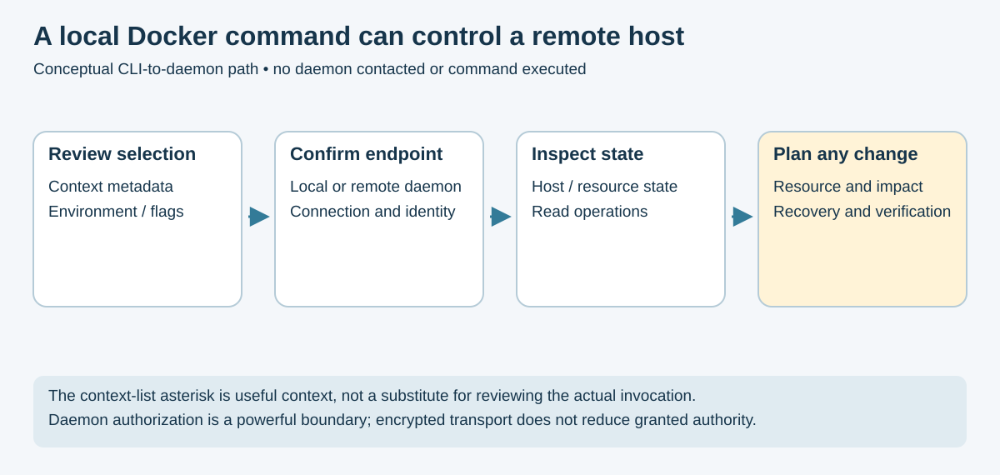
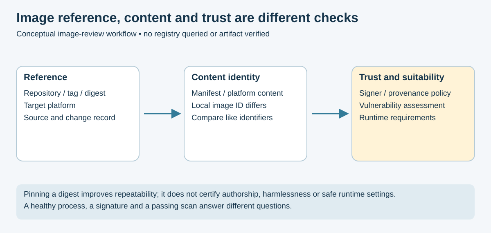
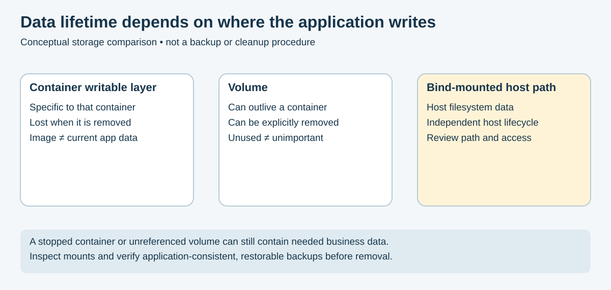

# Docker Operations, Diagnostics and Hardening Cheat Sheet

_Last reviewed: 2026-11-17 (primary documentation and visual review; no Docker commands or daemon actions executed)_

> [!CAUTION]
> **Authorized environments only.** Docker daemon access can grant
> host-level control, especially for a rootful engine and its Unix socket.
> Inspect the current Docker context **before issuing any command**.
> Do not paste production cleanup, image or volume removal commands from
> old cheat sheets without an approved backup and change plan.

**References:** [Docker Cheat Sheet by wsargent](https://github.com/wsargent/docker-cheat-sheet)
is an extensive third-party command collection, published under
[CC BY 4.0](https://github.com/wsargent/docker-cheat-sheet/blob/master/LICENSE).
This page offers **original, inspection-first examples** checked against
[current Docker CLI documentation](https://docs.docker.com/reference/cli/docker/)
and the [Compose reference](https://docs.docker.com/compose/reference/).
The source contains historical installation methods, Compose V1 examples and
destructive commands; prefer the official current manuals where they differ.

[Container security](containers.md) · [Container index](README.md) ·
[Kubernetes security](kubernetes.md) · [Homelab](../Homelab/README.md) ·
[Main guide](../README.md)

## Before you touch a Docker host



*Figure 1 — Original conceptual control path based on [Docker contexts](https://docs.docker.com/engine/manage-resources/contexts/) and [CLI selection variables](https://docs.docker.com/reference/cli/docker/). No endpoint or authority was inspected.*

```bash
docker --version                     # Local CLI version only
docker context ls                    # Review configured contexts/endpoints
docker context show                  # Report selected context
docker context inspect               # Inspect context metadata
# Review DOCKER_CONTEXT / DOCKER_HOST and any --context / --host override.
# Confirm the intended endpoint before the following daemon queries.
docker version                       # Client and server/API version details
docker info                          # Engine runtime, security and storage facts
docker system df                     # Images/volumes/container disk summary
docker compose version               # Record installed Compose implementation/version
```

Docker contexts can point to **remote** hosts: a command run from your laptop
could affect production. Context selection can be overridden by environment and command flags: `DOCKER_CONTEXT` overrides `DOCKER_HOST` and the stored default; explicit flags also matter. Review the actual invocation, not just an asterisk in the context list. See [Docker contexts](https://docs.docker.com/engine/manage-resources/contexts/) and the [CLI environment reference](https://docs.docker.com/reference/cli/docker/).

`docker info` and `docker inspect` may disclose
internal topology; handle outputs as restricted operational artifacts.

## Container and process triage

```bash
docker ps                             # Running containers
docker ps --all                       # Include stopped containers
docker ps --format 'table {{.Names}}\t{{.Status}}\t{{.Ports}}'
docker logs --tail 100 my-container   # Logs can contain tokens / PII
docker inspect --format '{{.State.Status}}' my-container
docker inspect --format '{{.HostConfig.RestartPolicy.Name}}' my-container
docker port my-container              # Published host/container ports
docker stats --no-stream              # Snapshot resource consumption
docker top my-container               # Processes within container
docker events --since 10m --until 0s  # Bounded recent daemon-event query
```

**Note:** process lists, image histories, inspect output, environment variables
and logs can reveal credentials. Do not paste them into public issues. A
reported healthy status is not proof that the application is secure.

`docker events` is not a complete audit archive: Docker documents a limited recent-event buffer (last 256 events), and event scope depends on the object and node. Logging-driver behavior and application logging also affect `docker logs` visibility. Preserve appropriate external audit/log sources for investigations. See [daemon events](https://docs.docker.com/reference/cli/docker/system/events/).

## Images and provenance



*Figure 2 — Original conceptual review model. Compare [Docker image-reference documentation](https://docs.docker.com/engine/containers/run/#image-references) and the signing/provenance references below; no artifact was scanned or verified.*

```bash
docker image ls
docker image inspect myorg/app:approved-tag
docker image history myorg/app:approved-tag  # May expose build instructions
docker manifest inspect myorg/app:approved-tag
docker image ls --digests
```

- Pin important production images by **digest** after validation; floating
  `latest` tags can change without review.
- Keep Docker Engine, plugins, Compose and container images updated via an
  approved change window; update dependencies and capture rollback state.
- Inventory base-image packages and vulnerabilities with
  [Trivy](https://aquasecurity.github.io/trivy/), CI scans and vendor advisories.
- Distinguish tag, repository/manifest digest, platform-specific content and local image ID; do not compare unlike identifiers as if they were the same. Locally built images may not have a repository digest. A digest identifies content, not who authored it. Evaluate signing and
  attestation with [Sigstore/Cosign](https://docs.sigstore.dev/).
- Do **not** use the source cheat sheet's `curl | sh` Docker installer
  as a default runbook. Prefer the
  [official installation instructions](https://docs.docker.com/engine/install/).

## Network and storage inspection



*Figure 3 — Original conceptual comparison based on [Docker storage documentation](https://docs.docker.com/engine/storage/). These lifecycle distinctions do not replace application-consistent backups or a validated restore procedure.*

```bash
docker network ls
docker network inspect bridge
docker volume ls
docker volume inspect my-volume
docker inspect --format '{{json .Mounts}}' my-container
docker system df --verbose
```

The host firewall, published binding addresses and routing behavior require separate verification. A listed port is configuration evidence, not proof of actual permitted or denied reachability. A volume can contain **persistent business data** even
when a container is stopped; the presence of a container snapshot is not a
substitute for tested application-consistent backups.

## Docker Compose V2

```bash
docker compose version
docker compose config --quiet          # Validate the Compose model
docker compose config --services       # List service names
docker compose ps
docker compose logs --tail 100
docker compose images
docker compose ls
```

**Use `docker compose`**, not the legacy `docker-compose` V1 command,
for new Compose instructions. Read the
[Compose documentation](https://docs.docker.com/compose/).
Record the installed Compose version; the section heading names the V2-style command, not a guarantee of one current major version. Verify the intended project name, project directory, selected `-f` files, environment and profiles. `docker compose config --quiet` validates/resolves the model; it does not certify security, service readiness or correct target selection. Rendered configuration can expose interpolated values. See [Compose config](https://docs.docker.com/reference/cli/docker/compose/config/).

State-changing operations such as `docker compose up -d`,
`docker compose pull`, `docker compose down` and
`docker compose down --volumes` require a planned update, impact review,
backups and a maintenance window. **`down --volumes` removes declared named volumes and attached anonymous volumes; external volumes are not removed by Compose.** Bind-mounted host data has a separate lifecycle. Do not use volume removal as a routine refresh operation. See [Compose down](https://docs.docker.com/reference/cli/docker/compose/down/).

## Runtime security and resource boundaries

| Control | Why it matters | Official documentation |
| --- | --- | --- |
| Rootless Engine (where supported) | Reduces privilege of daemon and containers; feature trade-offs apply | [Rootless mode](https://docs.docker.com/engine/security/rootless/) |
| User namespace remapping | Maps container UIDs to less-privileged host ranges (daemon is still privileged) | [userns-remap](https://docs.docker.com/engine/security/userns-remap/) |
| Non-root processes | Limit app-level capabilities inside the container | [Dockerfile USER](https://docs.docker.com/reference/dockerfile/#user) |
| Capability minimization | Drop all and add strictly required capabilities | [Docker run options](https://docs.docker.com/reference/cli/docker/container/run/) |
| Seccomp/AppArmor/SELinux | Enforce additional kernel/runtime controls | [Engine security](https://docs.docker.com/engine/security/) |
| No-new-privileges | Reduce privilege escalation through setuid/file capabilities | [docker run security options](https://docs.docker.com/reference/cli/docker/container/run/) |
| Read-only root filesystem | Shrink writable attack surface, with explicit writable tmpfs/volumes when needed | [docker run read-only](https://docs.docker.com/reference/cli/docker/container/run/) |
| CPU/memory/PID limits | Reduce the blast radius of resource exhaustion | [Resource constraints](https://docs.docker.com/engine/containers/resource_constraints/) |
| SSH/TLS daemon connection | Avoid exposing an unprotected Docker control socket remotely | [Protect daemon socket](https://docs.docker.com/engine/security/protect-access/) |

**Do not mount `/var/run/docker.sock` inside general application containers.**
Do not add arbitrary users to the Docker group expecting an ordinary
unprivileged permission: [Docker documents that the group is root-equivalent
for rootful installations](https://docs.docker.com/engine/install/linux-postinstall/).

When teaching a locked-down runtime, apply settings explicitly to a disposable
approved container and test functionality; these flags are not automatically
compatible with every application:

```bash
# Illustrative only: substitute an approved image and validate its runtime needs.
docker run --rm --network none --read-only --cap-drop ALL \
  --security-opt no-new-privileges --pids-limit 128 \
  --memory 256m --cpus 0.5 \
  approved-image:pin-reviewed-version
```

This invocation **creates and executes** a container and is not a
read-only inspection command. It may pull a missing image, and it does not itself set a non-root user; verify the image's configured user or a compatible explicit user setting. Do not use it on an unreviewed image; for
production, define an approved image digest, expected command, resource
budget, required files and explicit writable paths.

## Cleanup, recovery and destructive operations

**Inspect before any removal.** The following are safe inventory
commands; they do not delete resources. Here, `dangling=true` on volumes means unreferenced by containers, not disposable or empty:

```bash
docker ps -a --filter status=exited
docker image ls --filter dangling=true
docker volume ls --filter dangling=true
docker system df --verbose
```

Do not blindly automate any of:

- `docker system prune -a` — removes eligible stopped containers, unused networks/images and build cache; it can impair rollback or scheduled work. Volumes require separate options; do not infer identical scope from every prune command.
- `docker volume prune`, `docker volume rm` or `docker compose down -v` — can delete persistent application data. Current `volume prune` documentation defaults to unused anonymous local volumes; `--all` includes unused named volumes where supported. Check installed API/version and filters. Compose volume-removal scope is different.
- `docker rm -f` — forcibly stops/removes containers; may interrupt service.
- `docker rmi -f` — removes images still needed for rollback or repeatability.

Before an approved cleanup, collect a service/volume inventory, verify
**application-consistent backups and restorability**, check the active
context, record required tags/digests and schedule the downtime. See
[Docker prune documentation](https://docs.docker.com/engine/manage-resources/pruning/)
and [Storage volumes](https://docs.docker.com/engine/storage/volumes/) and [volume prune](https://docs.docker.com/reference/cli/docker/volume/prune/).

## Field troubleshooting sequence

1. Review context metadata, environment/flag overrides and the intended endpoint, then use `docker info` only after confirming that target.
2. Read `docker ps -a` and recent, sanitized `docker logs`.
3. Inspect the service's health, published ports, mounts, user and restart
   policy without changing them.
4. Compare the actual image/reference and platform with approved deployment records, then compare the effective Compose model. Keep manifest/repository digests and local image IDs distinct.
5. Check host disk and volume capacity, kernel logs and network boundaries.
6. Evaluate the image's vulnerabilities and hardening separately from an
   application's availability.
7. Document changes, verify backups and secure rollback, then perform
   modifications only during an approved maintenance process.

For Docker-host threat modeling and escape vectors, use the authoritative
[container image/runtime guide](containers.md); for Kubernetes, use
[Kubernetes security](kubernetes.md). This page intentionally does not
duplicate their full threat-model material.

**Review boundary:** Inspection and run examples were checked against current primary documentation, not executed. CLI/daemon/API, OS and Compose differences still require validation in the intended environment; the diagrams below are conceptual rather than deployment evidence.

## Sources and related documents

- Original external collection:
  [wsargent/docker-cheat-sheet](https://github.com/wsargent/docker-cheat-sheet)
  ([CC BY 4.0 license](https://github.com/wsargent/docker-cheat-sheet/blob/master/LICENSE)).
- Primary current technical references:
  [Docker CLI](https://docs.docker.com/reference/cli/docker/),
  [Compose](https://docs.docker.com/compose/),
  [Engine security](https://docs.docker.com/engine/security/),
  [Rootless Docker](https://docs.docker.com/engine/security/rootless/),
  [Protect the daemon](https://docs.docker.com/engine/security/protect-access/).
- Internal:
  [Containers and runtime security](containers.md) ·
  [Homelab](../Homelab/README.md) ·
  [Docker/pen-test PDF](../PDF/docker-pen-test.pdf) (static reference; not
  re-audited for correctness or current security posture).

This guide was authored independently as a curated, safer companion to the
external sheet. It does **not** certify that historical upstream instructions
remain appropriate for the reader's environment.

---

[Container security index](README.md) · [Main guide](../README.md) ·
[Legal terms](../LEGAL.md)
