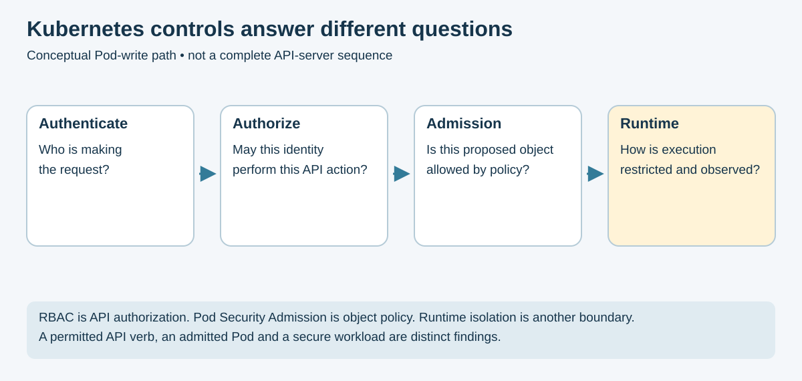
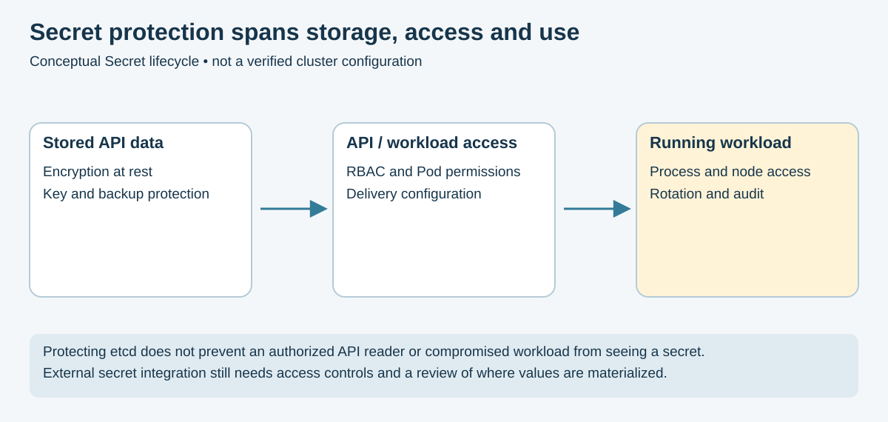
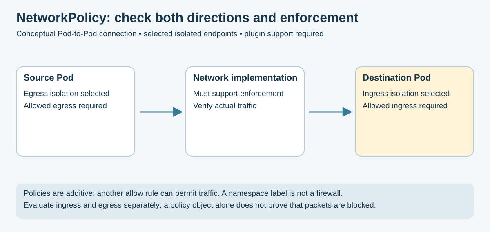

# ☸️ Kubernetes Security

> [!CAUTION]
> **Authorized use only.** The techniques below are for authorized assessment,
> education, and defensive research. Test only clusters you own or have **explicit
> written permission** to assess (and follow the cloud provider's pentest policy
> for managed clusters). See [LEGAL.md](../LEGAL.md).

**Runtime distinction:** The [Docker operations cheat sheet](docker-cli-operations-reference.md) documents Docker Engine/Compose, **not** Kubernetes administration. For Kubernetes-native workloads use the cluster/RBAC controls below, and review your actual container runtime (often containerd) before applying Docker-specific commands.

**Source and visual review:** November 17, 2026. No cluster inspected, commands executed, policies applied or security tests performed. Match documentation and policy versions to the deployed cluster.

## 🎯 Purpose
Kubernetes security reference - the cluster attack surface, RBAC and Pod Security,
common attack paths, and hardening.

## ⚙️ Function
Covers the K8s components and trust boundaries, RBAC, **Pod Security Standards**
and Pod Security Admission after PodSecurityPolicy removal, secrets, network policy,
common attack paths, and a hardening baseline mapped to the CIS Kubernetes
Benchmark and NSA/CISA guidance.

## 🏆 Goal
Let a reader assess a Kubernetes cluster methodically and recommend concrete
hardening.

## 📋 When to Use
- Authorized assessment or hardening of a Kubernetes cluster
- Looking up K8s attack paths (RBAC abuse, privileged pods, exposed API/kubelet)
- Building a cluster hardening baseline

---

## 📋 Table of Contents

- [Cluster Attack Surface](#cluster-attack-surface)
- [RBAC](#rbac)
- [Pod Security Standards (PSP is Removed)](#pod-security-standards-psp-is-removed)
- [Secrets & Network Policy](#secrets--network-policy)
- [Common Attack Paths](#common-attack-paths)
- [Hardening & Detection](#hardening--detection)
- [Resources](#-resources)

---

## Cluster Attack Surface

- **API server** - the front door; exposed or weakly authenticated API servers are
  a critical risk.
- **etcd** - stores API-backed cluster state, including Secrets. Restrict access, protect backups and configure API data encryption at rest; base64 serialization is not encryption.
- **kubelet** - the node agent. Protect sensitive API operations with authentication and authorization. Reachability or anonymous access to a health endpoint alone does not establish pod-execution access.
- **Workloads** - over-privileged pods and service accounts.
- **Supply chain** - images and admission (see [containers.md](containers.md)).

---

## RBAC



*Figure 1 — Original conceptual Pod-write model, not a complete API-server sequence. Sources: [API access controls](https://kubernetes.io/docs/concepts/security/controlling-access/), [RBAC](https://kubernetes.io/docs/reference/access-authn-authz/rbac/) and [Pod Security Admission](https://kubernetes.io/docs/concepts/security/pod-security-admission/).*

RBAC grants allowed Kubernetes API actions to identities. It does not inspect every field of a proposed Pod or enforce runtime isolation. Common problems:

- **Over-permissive roles** - `cluster-admin` bindings, wildcard verbs/resources.
- **Dangerous permissions** - `create pods` (+ a privileged pod), `create` on
  `pods/exec`, `secrets get/list`, `escalate`/`bind` on roles, `impersonate`.
- **Unneeded service-account credentials** mounted into Pods. Modern clusters generally use bound projected tokens; inspect actual mounts, audience, expiration and permissions.

```bash
# Enumerate what the current identity can do (authorized)
kubectl auth can-i --list
kubectl auth can-i create pods
```

These examples query the selected API server and identity; they were not executed in this review. A permission result does not establish admission acceptance.

**Defend:** least-privilege roles; remove unnecessary `cluster-admin` bindings and wildcard permissions; disable
auto-mounting of service-account tokens where unused (`automountServiceAccountToken:
false`); review bindings and effective permissions. A scanner or one `can-i` result answers a limited question; it does not certify the cluster.

---

## Pod Security Standards (PSP is Removed)

> [!IMPORTANT]
> **PodSecurityPolicy (PSP) was deprecated in Kubernetes 1.21 and removed in 1.25.**
> Guides that still tell you to configure PSPs are out of date. A built-in migration option is **Pod Security Admission (PSA)**, which evaluates the **Pod Security Standards (PSS)**. It is not feature-for-feature equivalent to every PSP use case.

The three Pod Security Standards levels:

- **Privileged** - unrestricted (avoid for workloads).
- **Baseline** - disallows a set of known privilege-escalation configurations; not a guarantee against escalation.
- **Restricted** - hardened best practice (non-root, no privilege escalation,
  dropped capabilities, seccomp).

PSA namespace labels choose a level and mode: `enforce` rejects violating Pod admissions, while `audit` and `warn` record or surface violations. Pin an appropriate policy version, review exemptions and assess compatibility before enforcement. Label changes do not retrofit settings into running Pods.

For requirements beyond PSA, evaluate version-supported validating admission policy or controllers such as **OPA/Gatekeeper** or **Kyverno**. Admission is distinct from runtime enforcement and monitoring.

---

## Secrets & Network Policy



*Figure 2 — Original conceptual Secret lifecycle based on the [Kubernetes Secret documentation](https://kubernetes.io/docs/concepts/configuration/secret/). No encryption setting or secret-store integration was inspected or tested.*

- **Secrets:** The API's base64 representation is encoding, not encryption. Upstream Kubernetes stores Secrets unencrypted in etcd unless encryption is configured; managed-service defaults can differ. Restrict Secret read/list/watch and workload-creation access. Protect encryption keys and backups; an external store does not automatically protect every in-cluster copy.
- **NetworkPolicy:** Pods are non-isolated for a direction until a policy selects them for that direction. Enforcement requires a capable network plugin; creating an object does not prove it is enforced.
- **Directional rules:** For traffic between isolated Pods, source egress and destination ingress must both allow it. Policies are additive. Validate DNS and required dependencies when introducing default-deny rules.

Primary references: [Secrets](https://kubernetes.io/docs/concepts/configuration/secret/) and [NetworkPolicy](https://kubernetes.io/docs/concepts/services-networking/network-policies/).

---

## Common Attack Paths



*Figure 3 — Original conceptual network-policy example based on [Kubernetes NetworkPolicy documentation](https://kubernetes.io/docs/concepts/services-networking/network-policies/). It shows policy requirements, not measured packet filtering.*

For authorized testing, the recurring paths:

- **Unprotected API/dashboard operations** → actions permitted to the effective identity; reachability alone is not cluster control.
- **Unauthorized sensitive kubelet operations** → possible workload access; establish authentication, authorization and reachable functions separately.
- **RBAC → Pod creation** → dangerous workloads only if admission and node protections permit them. Pod-create permission alone does not prove privileged host-mounting Pods will be accepted.
- **Readable secrets** → cloud credentials or app secrets → pivot.
- **Container escape** from a workload to the node (see [containers.md](containers.md)).
- Tool findings need context: distinguish configuration checks, benchmark coverage, active assessment and runtime observations. Review version compatibility, omissions and false positives.

---

## Hardening & Detection

- **Access:** strong API-server authn/authz; review anonymous endpoint access and bindings; least-privilege
  RBAC; protect the kubelet.
- **Workloads:** enforce **Restricted** Pod Security where feasible; non-root,
  read-only FS, dropped capabilities, seccomp; admission control (Gatekeeper/Kyverno).
- **Data:** verify API data encryption at rest, key and backup protection; tight Secret RBAC; evaluate external secret integration and workload access.
- **Network:** enforce and test default-deny NetworkPolicies with a capable plugin; namespace boundaries alone do not isolate traffic.
- **Supply chain:** scan images and define admission verification policy for trusted signers, provenance and artifact identity. A signature alone does not prove harmless code.
- **Detection:** audit logging enabled and shipped to a
  [SIEM](../IncidentResponse/SIEM/README.md); runtime detection with
  [Falco](https://github.com/falcosecurity/falco).
- **Benchmark:** [kube-bench](https://github.com/aquasecurity/kube-bench) against the
  [CIS Kubernetes Benchmark](https://www.cisecurity.org/benchmark/kubernetes); review
  the [NSA/CISA Kubernetes Hardening Guidance](https://media.defense.gov/2022/Aug/29/2003066362/-1/-1/0/CTR_KUBERNETES_HARDENING_GUIDANCE_1.2_20220829.PDF).

---

Benchmark findings cover supported checks and observed configuration; they do not prove exploit resistance or every compliance requirement. Runtime alerts are observations, not prevention guarantees; corroborate them with audit and node evidence.

## 📚 Resources

- [Kubernetes Security docs](https://kubernetes.io/docs/concepts/security/) / [Pod Security Standards](https://kubernetes.io/docs/concepts/security/pod-security-standards/)
- [CIS Kubernetes Benchmark](https://www.cisecurity.org/benchmark/kubernetes) / [kube-bench](https://github.com/aquasecurity/kube-bench)
- [kubescape](https://github.com/kubescape/kubescape) / [Falco](https://github.com/falcosecurity/falco)
- [OWASP Kubernetes Top 10](https://owasp.org/www-project-kubernetes-top-ten/)
- [MITRE ATT&CK Containers](https://attack.mitre.org/matrices/enterprise/containers/)

---

## Related Files
- [README.md](README.md) - Container & Kubernetes Security section index
- [containers.md](containers.md) - container image & runtime security
- [../Cloud/README.md](../Cloud/README.md) - managed Kubernetes (EKS/AKS/GKE) sits in the cloud section
