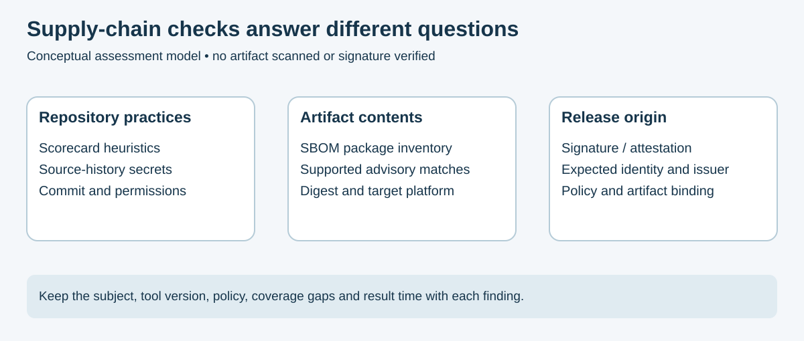
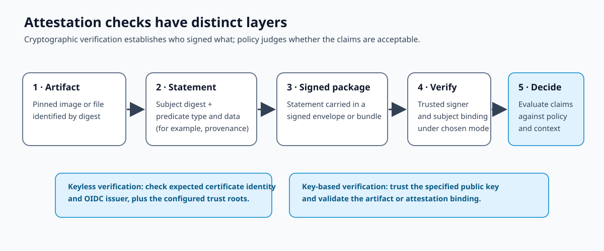
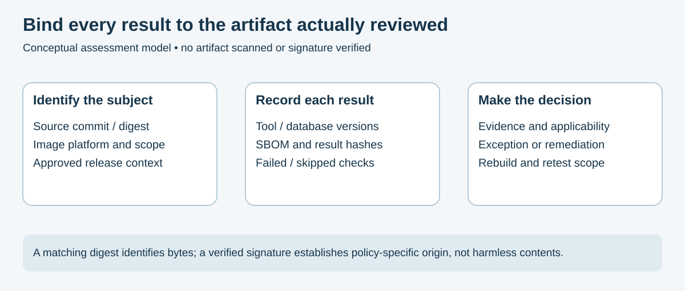

# Software Supply-Chain Assessment and SBOM Workflow

_Last reviewed: 2026-11-24 (upstream and visual review; no artifacts scanned)_

**Related algorithmic trust models:** [Cryptographic Hashes, Certificate Chains, Merkle Trees & Signed Artifacts](../Algorithms/cryptography-parallels.md) explains how graph connectivity, signature verification, digest integrity and provenance solve distinct problems.

**Prerequisites:** [Container security](containers.md) · [Docker diagnostics](docker-cli-operations-reference.md) · [Script index](../Scripts/README.md).

## Curated upstream projects

| Source | Assessment role |
| --- | --- |
| [OpenSSF Scorecard](https://github.com/ossf/scorecard) | Repository security controls and supply-chain practices |
| [Syft](https://github.com/anchore/syft) | Software Bill of Materials (SBOM) for owned filesystem/image |
| [OSV-Scanner](https://github.com/google/osv-scanner) | Match supported dependency inventories to OSV advisories |
| [Trivy](https://github.com/aquasecurity/trivy) | Image/source vulnerability, misconfiguration and secrets checks |
| [Gitleaks](https://github.com/gitleaks/gitleaks) | Find potential accidental secrets in a permitted repository |
| [Sigstore Cosign](https://github.com/sigstore/cosign) | Verify signed build artifacts and relevant identity/provenance metadata |

These checks complement one another. A Scorecard result is not a security certificate; an SBOM is not proof of software integrity; a matching CVE may not be exploitable in the deployed environment.

## Inspect-first engagement workflow

*Figure 1 — Original conceptual map. [Scorecard](https://github.com/ossf/scorecard) evaluates repository practices; [Syft](https://github.com/anchore/syft) inventories supported software; [Cosign](https://docs.sigstore.dev/cosign/verifying/verify/) verifies signatures under configured trust expectations. These are separate assessment questions.*

1. Define source, repo commit, image digest, target platform, registry, scope, owner and asset criticality. Confirm permitted scanning.
2. Pin and record tool releases, vulnerability database timestamps, data-handling policies and any required API credentials.
3. Assess repository security hygiene with Scorecard using documented read-only privileges.
4. Generate an SBOM from a **pinned, approved** artifact using Syft; prefer standard CycloneDX or SPDX format and hash the result.
5. Evaluate dependency issues using OSV-Scanner and/or Trivy with supported source formats. Prefer resolved lockfiles for source analysis because version ranges in manifests may not identify installed packages; compare with an SBOM of the pinned build artifact where available. Document advisory IDs, affected versions, false positives and available mitigations.
6. Run secrets detection against only authorized repository history. Store candidate secrets confidentially; do not paste into a public issue. Coordinate rotation of confirmed exposed credentials.
7. Verify signatures and, separately, relevant attestations when applicable. For keyless verification, check the expected certificate identity and OIDC issuer under the configured trust roots. For key-based verification, trust the specified public key. Confirm the signed material is bound to the expected artifact digest, then evaluate attestation content under policy; successful signature verification alone does not validate every provenance claim.
8. Deduplicate, risk-rank, assign remediation and retest through [client findings](../PlayBooks/assessment-findings-lifecycle.md).

## Attestations: verification and policy are separate

*Figure 2 — Conceptual verification flow only. It does not represent a specific verifier configuration or attest that any artifact was checked.*

An [in-toto Statement](https://github.com/in-toto/attestation/blob/main/spec/v1/statement.md) identifies subjects (commonly by digest) and carries a typed predicate with claims such as build provenance. [SLSA provenance](https://slsa.dev/spec/v1.2/build-provenance) is one predicate type; its presence does not itself mean a build meets a chosen SLSA level. A verifier first checks signature trust and subject binding, then applies policy to predicate contents and assessment context. These stages answer different questions.

## Safe read-only local version queries

~~~bash
syft version
osv-scanner --version
trivy --version
gitleaks version
cosign version
~~~

These fail normally if tools are not installed. No packages or CI workflows were added by this guide. Review current upstream installation steps; do not execute downloaded shell scripts blindly.

## Controls and deliverables

*Figure 3 — Original evidence-management workflow for this guide. It is not a deployed CI pipeline or a software-safety certificate. A new build or changed dependency inventory can require a new assessment.*

Produce a source/digest inventory, SBOM hash and format, vulnerability status, verified secret exposure status (never the secret value), signing policy outcomes, remediation owner and retest date. Recheck lockfile and build metadata; SBOMs and advisories can be incomplete. Keep failed and skipped checks visible; do not convert a lack of matches into proof of safety. Hashing an SBOM protects its identity for comparison, not its completeness.

## Sources

[Syft](https://github.com/anchore/syft) · [OSV-Scanner](https://github.com/google/osv-scanner) · [OpenSSF Scorecard](https://github.com/ossf/scorecard) · [Trivy](https://github.com/aquasecurity/trivy) · [Gitleaks](https://github.com/gitleaks/gitleaks) · [Cosign verification](https://docs.sigstore.dev/cosign/verifying/verify/) · [Cosign attestation verification](https://docs.sigstore.dev/cosign/verifying/attestation/) · [in-toto Statement](https://github.com/in-toto/attestation/blob/main/spec/v1/statement.md) · [SLSA build provenance](https://slsa.dev/spec/v1.2/build-provenance) · [SPDX 3.0.1 specification](https://spdx.github.io/spdx-spec/v3.0.1/). Check the license and notices for the exact project revision and any copied files before reuse.

**Visual provenance:** Figures 1–3 are original static teaching diagrams with no measured scan or verification results. Existing version queries are illustrative; no tool was installed or invoked during this update.

---

[Container index](README.md) · [Main guide](../README.md) · [Legal terms](../LEGAL.md)
