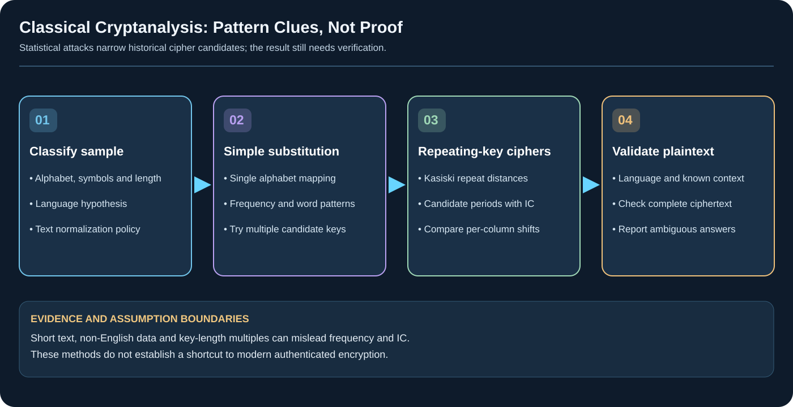
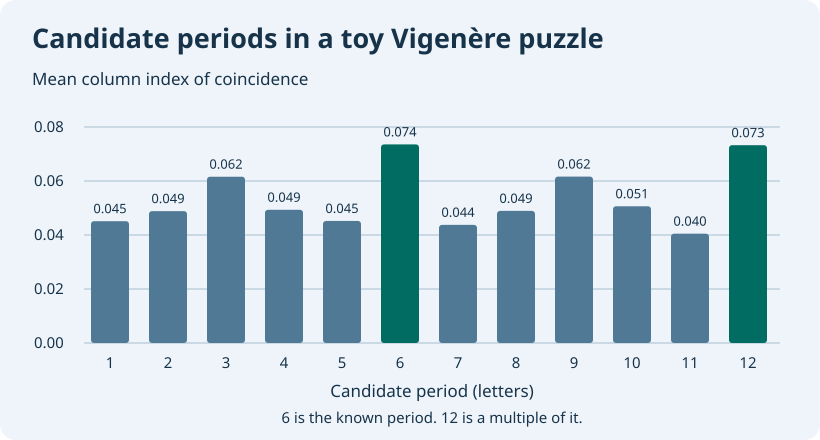

# 🔍 Cryptanalysis

_Last reviewed: 2026-11-19 (source and reproducibility review)_

> [!IMPORTANT]
> **Historical and educational content.** These attacks concern historical ciphers
> and do not provide a general method for breaking modern encryption. For protecting information, use the modern algorithms in
> [algorithms.md](../algorithms.md) and [applied-crypto.md](../applied-crypto.md).

[← Building Your Own Alphabet](build-your-own.md) · [🏠 Classical Index](README.md) · [Security Relevance →](security.md)

Frequency analysis, n-grams, Kasiski examination, and the Index of Coincidence with a worked key-length attack.



*Conceptual historical cryptanalysis workflow.* Candidate frequencies and key lengths are evidence to test, not proof of a unique key. English-letter statistics depend on text length, genre, language and normalization. For the worked implementation, see [cipher_toolkit.py](cipher_toolkit.py) and the [deciphering workbook](deciphering-workbook.md).

**On this page:**

- [Breaking Simple Substitution](#breaking-simple-substitution)
- [Breaking Polyalphabetic Ciphers](#breaking-polyalphabetic-ciphers)

---

## Breaking Simple Substitution

### English Letter Frequency

Monoalphabetic substitution preserves relative symbol-count structure under a one-to-one mapping, but observed frequencies may diverge sharply for short ciphertext, unusual vocabulary or a different language. A commonly used approximate English frequency ranking is `ETAOIN SHRDLU`:

```
E  12.70%  ███████████████████████████████████████████████████
T   9.06%  ████████████████████████████████████
A   8.17%  █████████████████████████████████
O   7.51%  ██████████████████████████████
I   6.97%  ████████████████████████████
N   6.75%  ███████████████████████████
S   6.33%  █████████████████████████
H   6.09%  ████████████████████████
R   5.99%  ████████████████████████
D   4.25%  █████████████████
L   4.03%  ████████████████
C   2.78%  ███████████
U   2.76%  ███████████
M   2.41%  ██████████
W   2.36%  █████████
F   2.23%  █████████
G   2.02%  ████████
Y   1.97%  ████████
P   1.93%  ████████
B   1.29%  █████
V   0.98%  ████
K   0.77%  ███
J   0.15%  █
X   0.15%  █
Q   0.10%  
Z   0.07%  
```

### Attack Techniques

* **Frequency analysis:** Count each ciphertext symbol and match the most common ones to E, T, A, O and so on, then refine.
* **Single-letter words:** In English these are almost always `A` or `I`.
* **Doubled letters:** Common doubles are `LL`, `EE`, `SS`, `OO`, `TT`.
* **N-grams:** Common digraphs (`TH`, `HE`, `IN`, `ER`, `AN`) and trigraphs (`THE`, `AND`, `ING`).
* **Word-pattern matching:** `THAT` has the pattern `1-2-3-1`, `PEOPLE` has `1-2-3-1-4-2`. A ciphertext word with the same pattern is a candidate.
* **Brute force:** A Caesar cipher has only 25 non-trivial keys, so try them all. A general substitution alphabet has 26! (about 4 × 10²⁶) keys, which is too many to brute-force, but frequency analysis and heuristic search can often recover sufficiently long natural-language messages. Runtime and success depend on the sample, language model, and search; short messages may remain ambiguous.

---

## Breaking Polyalphabetic Ciphers

A common approach to a conventional **repeating-key** Vigenère cipher is to estimate candidate key periods *L*. For each candidate, grouping positions modulo *L* yields columns that may each be analyzed as a Caesar shift. Validate the inferred shifts and complete plaintext; the method does not guarantee a unique key.

### The Kasiski Examination

Common words (like `THE`) sometimes line up with the same part of the repeating key and produce identical ciphertext sequences. Measure the distances between repeated sequences; look for recurring factors across several distances. Repeats can also occur by chance.

### The Index of Coincidence (IC)

William F. Friedman's Index of Coincidence (published 1922) estimates the probability that two *distinct positions* sampled uniformly from the text contain the same letter. [Friedman's technical paper](https://www.nsa.gov/portals/75/documents/news-features/declassified-documents/friedman-documents/publications/folder_233/41761039080018.pdf).

```
IC = Σ nᵢ(nᵢ − 1) / (N(N − 1))
```

where *nᵢ* is the count of each letter and *N* is the total number of letters.

| Text type | Expected IC |
| :--- | :--- |
| Uniformly random letters | 1/26 ≈ **0.0385** |
| English plaintext | ≈ **0.0667** |

**Worked demo.** A fictional ferry passage is encrypted with the six-letter key
`HARBOR`. The scan averages the column IC for each proposed period. The graph
shows why a high bar alone cannot settle the period. Both 6 and 12 stand
out in this sample because stepping by either keeps each column on one key
position.



Run this example from `Cryptography/Classical` to reproduce the plotted values.
The toolkit advances the key and scans columns over letters only.

```python
from cipher_toolkit import ic_scan, vigenere

sentences = [
    "The morning ferry crossed the harbor while the last lights along the shore faded.",
    "A mechanic on the lower deck checked the engine and wrote the readings in a notebook.",
    "Two passengers unfolded a map and traced the road from the landing to the market.",
    "By the time the boat reached the far bank, the rain had stopped and the sky was clearing.",
    "On the return trip a deckhand counted the empty seats and watched a gull follow the wake.",
    "The captain slowed near the narrow channel where the current ran faster than expected.",
]
ciphertext = vigenere(" ".join(sentences), "HARBOR")
for period, score in ic_scan(ciphertext):
    print(f"{period:2} {score:.3f}")
```

For a repeating Vigenère key, a candidate period *L* splits the text into candidate Caesar columns. A chi-squared score can rank shifts against reference language frequencies. Inspect multiple candidates and verify the complete message: short columns, accidental repeats, and multiples of the true period can mislead the analysis.

---

[← Building Your Own Alphabet](build-your-own.md) · [🏠 Classical Index](README.md) · [Security Relevance →](security.md)

## See also

- [deciphering-workbook.md](deciphering-workbook.md) - a full workflow, attack assumptions, worked examples, and answer key
- [ciphers.md](ciphers.md) - the ciphers being attacked
- [cipher_toolkit.py](cipher_toolkit.py) - IC scan implementation

---
[⬅️ Back to Master Index](../../README.md) | [🎯 Role Navigation](../../START_HERE.md) | [Legal Notice](../../LEGAL.md)

