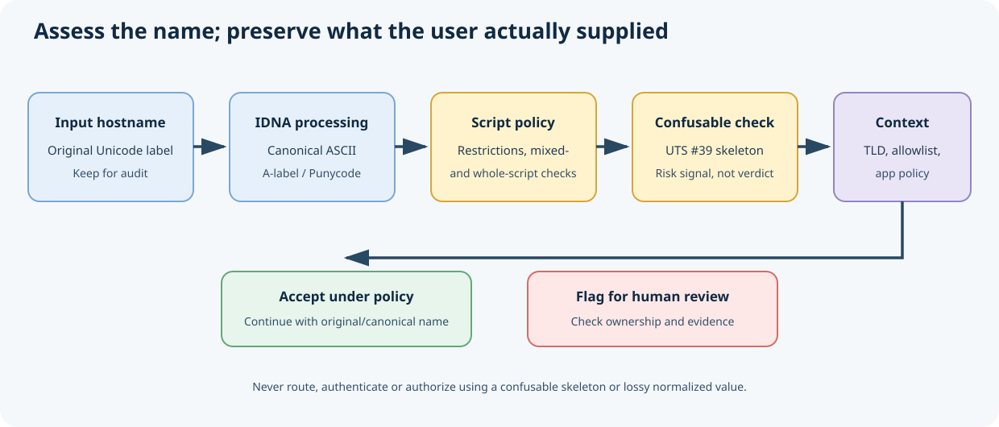

# 🛡️ Security Relevance

_Last reviewed: 2026-10-02_

> [!CAUTION]
> **Authorized use only.** The techniques below are for authorized security
> testing, education, and defensive research. Using them against systems you do
> not own or lack explicit written permission to test is illegal. See
> [LEGAL.md](../../LEGAL.md).

> [!IMPORTANT]
> **Historical and educational content.** Nothing in this section is secure for real
> data. For protecting information, use the modern algorithms in
> [algorithms.md](../algorithms.md) and [applied-crypto.md](../applied-crypto.md).

[← Cryptanalysis](cryptanalysis.md) · [🏠 Classical Index](README.md)

Leet in password cracking, IDN homograph attacks, and filter evasion versus Unicode normalization.

---


## Leet in Passwords

Leet substitutions add almost no strength to a password. Cracking tools apply them automatically as **rules** to every word in a wordlist. Hashcat ships rule files for exactly this purpose, including `leetspeak.rule`, `unix-ninja-leetspeak.rule` and `Incisive-leetspeak.rule`:

```bash
# Try every wordlist entry with common leet substitutions
hashcat -a 0 -m <hash-mode> hashes.txt wordlist.txt -r rules/unix-ninja-leetspeak.rule
```

`P@55w0rd` falls almost as quickly as `password`. Length and randomness (a passphrase or a password manager) matter; character swaps do not.

## Homograph (IDN) Attacks

Internationalized Domain Names (IDNs) allow Unicode labels, which can be visually confusable with other names. A look-alike can use mixed scripts or be written entirely in one script; for example, a Cyrillic-only label such as `ѕсоре` can resemble Latin `scope`. Preserve the original Unicode hostname and its canonical ASCII/Punycode form (A-label), then assess both using an IDN policy appropriate to the application.

* Browser display behavior depends on client and context; do not rely on every suspicious label being shown in **Punycode** (`xn--...`). IDN processing commonly converts A-labels back to Unicode for display.
* Check script restrictions, mixed-script and **whole-script confusables**, registry/TLD context and known-good allowlists. A mixed-script-only check will miss some look-alikes.
* Unicode [UTS #39](https://www.unicode.org/reports/tr39/) defines confusable-detection mechanisms, including skeletons. A skeleton match is a review signal, not proof of spoofing; legitimate internationalized names can also be flagged.
* Do not replace the identifier with a confusable skeleton for routing, authentication or authorization. Keep the original and canonical forms for comparison and audit.



*Keep the submitted Unicode hostname and canonical ASCII/Punycode form; use script and confusable checks as context signals, not as replacements for the identifier.*

## Filter Evasion and Normalization

Content filters often apply **Unicode NFKC normalization** before matching. It folds many styled alphabets back to plain ASCII, but not all of them:

| Input | After NFKC | Caught by filter? |
| :--- | :--- | :---: |
| Fullwidth `ＨＡＣＫ` | `HACK` | ✅ |
| Circled `ⒽⒶⒸⓀ` | `HACK` | ✅ |
| Fraktur / Bold / Script / Double-struck | `HACK` | ✅ |
| Small caps `ʜᴀᴄᴋ` | `ʜᴀᴄᴋ` (unchanged) | ❌ |
| Cyrillic homoglyphs `НАСК` | `НАСК` (unchanged) | ❌ |
| Leet `H4CK` | `H4CK` (unchanged) | ❌ |

There is no universal normalization chain that safely detects every evasion. For identifier checks, retain the submitted value and compute documented comparison forms separately. Use Unicode confusable checks as a risk signal; treat leet substitutions as context-specific heuristics. Tune against legitimate language and identifiers, test false positives and bypass cases, and never use a normalized or confusable skeleton as the identity or authorization value.

```python
import unicodedata
unicodedata.normalize("NFKC", "ＨＡＣＫ")   # -> 'HACK'
unicodedata.normalize("NFKC", "ʜᴀᴄᴋ")       # -> 'ʜᴀᴄᴋ' (unchanged)
```

---

[← Cryptanalysis](cryptanalysis.md) · [🏠 Classical Index](README.md)

## See also

- [../applied-crypto.md](../applied-crypto.md) - correct password storage
- [../../Documentation/hcxtoolshashcat.md](../../Documentation/hcxtoolshashcat.md) - hashcat rule-based attacks in practice
- [../../Tradecraft/osint-threat-intel.md](../../Tradecraft/osint-threat-intel.md) - lookalike-domain discovery with dnstwist
- [../../AI/offensive_ai.md](../../AI/offensive_ai.md) - homoglyph attacks against ML filters
- [../../GLOSSARY.md](../../GLOSSARY.md) - acronyms

---
[⬅️ Back to Master Index](../../README.md) | [🎯 Role Navigation](../../START_HERE.md) | [Legal Notice](../../LEGAL.md)
