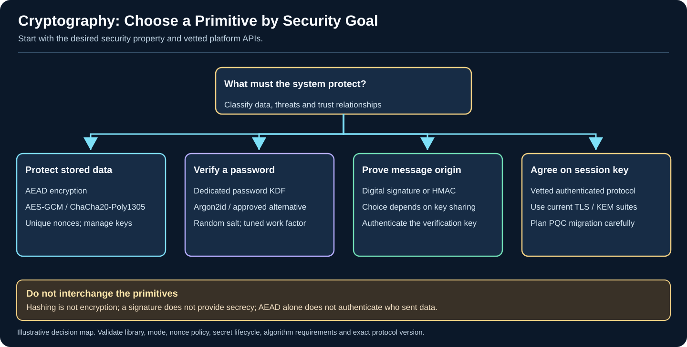
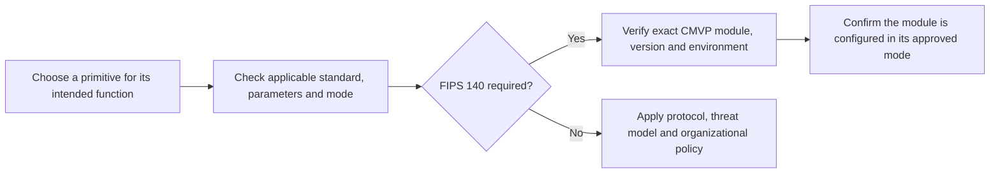
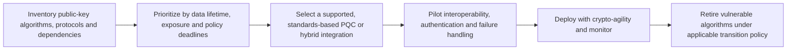

# 🔐 Cryptography

**Practical Cryptography Reference: Algorithms, Applied Use, and What to Avoid**

*Part of the [ULTIMATE CYBERSECURITY MASTER GUIDE](../README.md)*

---

**Broader algorithm context:** [Algorithms & Computational Foundations](../Algorithms/README.md) explains how compression, hashing, encryption and TLS differ, with [worked examples](../Algorithms/compression-hashing-and-crypto.md), [cryptographic parallels & trust graphs](../Algorithms/cryptography-parallels.md), and [original algorithm diagrams](../assets/README.md#algorithms--cryptography-visual-guides). Continue here for cryptographic parameters, approvals and implementation review.

**Cryptography learning:** [Cryptopals](https://cryptopals.com/) and [curated challenge pathways](../PlayBooks/security-training-lab-pathways.md) cover exercises; distinguish classical puzzles from production-grade encryption.

## 🎯 Purpose
**Historical crypto cross-reference:** [Cypherpunk Symposium collection review](../Documentation/cypherpunk-pentesting-toolkit-review.md) covers classical cipher learning and corrects outdated MD5/SHA-1 collision claims. Do not use legacy Python 2 examples for production cryptography.

Dedicated home for cryptography; which algorithms to use (and avoid), how to apply
them correctly (TLS, password storage, key management), and where the field is
heading (post-quantum).

## ⚙️ Function
Indexes the Cryptography section: fundamentals and a current-vs-deprecated summary
(this file), an algorithm reference by primitive
([algorithms.md](./algorithms.md)), and applied cryptography - TLS, password
storage, key management, and common mistakes ([applied-crypto.md](./applied-crypto.md)).

## 🏆 Goal
Give practitioners a single reference for making correct, current cryptographic
choices and recognizing the recurring mistakes - grounded in NIST guidance.

## 📋 When To Use
- Choosing an algorithm, key size, or mode for a design or review
- Reviewing password storage, TLS config, or key management
- Understanding the post-quantum transition and crypto-agility
- Recognizing deprecated/broken primitives in existing code

---

## 📋 Table Of Contents

- [Overview](#-overview)
- [The One Rule](#-the-one-rule)
- [Current vs Deprecated (Quick Reference)](#-current-vs-deprecated-quick-reference)
- [Post-Quantum Cryptography](#-post-quantum-cryptography)
- [Folder Contents](#-folder-contents)
- [Hardware keys and encrypted storage](#-hardware-keys-and-encrypted-storage)
- [Important Notice](#-important-notice)
- [Resources](#-resources)

---

## 🎯 Overview

Cryptography is referenced throughout this repository (TLS, hashing, password
storage, VPNs, disk encryption) but had no dedicated home. This section
consolidates it into fundamentals, an algorithm reference, and applied guidance,
grounded in current recommendations with NIST/FIPS applicability stated where relevant.

The three primitive families:

- **Symmetric** - one shared key for encryption (fast; AES, ChaCha20).
- **Asymmetric** - public/private key pairs for key exchange and signatures
  (RSA, ECC).
- **Hashing** - one-way integrity fingerprints (SHA-2, SHA-3); with **KDFs** for
  password storage (Argon2, bcrypt).

---

## 🛑 The One Rule

> [!WARNING]
> **Don't roll your own crypto.** Use well-reviewed, maintained libraries
> (libsodium, the platform's TLS stack, `cryptography` for Python, Tink) and
> vetted protocols. Many practical cryptographic failures arise from unsafe use -
> such as a wrong mode, nonce reuse, hardcoded keys or fast password hashes -
> rather than a break of a sound algorithm. Prefer **high-level, misuse-resistant** APIs.

---

## Visual Decision Guide: Choose The Right Primitive

*Conceptual selection guide, not a cryptographic implementation or endorsement of a specific library build.* Review the [OWASP Cryptographic Storage guidance](https://cheatsheetseries.owasp.org/cheatsheets/Cryptographic_Storage_Cheat_Sheet.html), [OWASP Password Storage guidance](https://cheatsheetseries.owasp.org/cheatsheets/Password_Storage_Cheat_Sheet.html), [NIST SP 800-38D on AES-GCM](https://csrc.nist.gov/pubs/sp/800/38/d/final) and [NIST SP 800-63B-4](https://csrc.nist.gov/pubs/sp/800/63/B/4/final). NIST's digital identity guidance specifies verifier properties and approved-scheme requirements; the OWASP guide provides environment-specific Argon2id recommendations. Do not claim NIST mandates Argon2id for every deployment.

## 📊 Current Vs Deprecated (Quick Reference)

| Use | ✅ Use | 🚫 Avoid / Deprecated |
|-----|--------|------------------------|
| Symmetric encryption | AES-256-GCM, ChaCha20-Poly1305 (AEAD) | DES, 3DES, RC4, AES-ECB |
| Unkeyed digest (accidental corruption detection) | SHA-256/384/512, SHA-3 | MD5, SHA-1 for new security designs |
| Password storage | Argon2id, scrypt, bcrypt, PBKDF2 | MD5/SHA "fast" hashes, unsalted hashes |
| Asymmetric operations / key agreement | RSA ≥ 3072 where RSA is appropriate; ECDH on P-256 or X25519 for key agreement | RSA ≤ 1024, static DH, custom curves |
| Signatures | Ed25519, ECDSA (P-256), RSA-PSS | RSA ≤ 1024, DSA |
| Transport | TLS 1.3 preferred; TLS 1.2 only with policy-approved suites and configuration | TLS 1.0/1.1, SSLv3 |

These are general-purpose recommendations, not a compliance determination. Applicable NIST/FIPS requirements depend on the cryptographic function, algorithm parameters and mode. Where FIPS 140 validation is required, verify the exact [CMVP-listed module](https://csrc.nist.gov/projects/cryptographic-module-validation-program/validated-modules), operational environment and approved mode; an algorithm name alone does not establish a validated deployment.

*Selection aid only; it does not certify an algorithm, product or deployment.*

TLS 1.2 acceptability is policy- and configuration-dependent. NIST SP 800-52 Rev. 2 currently requires TLS 1.2 with FIPS-based cipher suites and TLS 1.3 support for federal client/server implementations; NIST announced a future revision plan in November 2026, so check the applicable current policy and publication before relying on this summary. See [NIST SP 800-52 Rev. 2](https://csrc.nist.gov/pubs/sp/800/52/r2/final).

Deprecations follow [NIST SP 800-131A Rev. 2](https://csrc.nist.gov/pubs/sp/800/131/a/r2/final) and subsequent transition notices. New protection with three-key TDEA/3DES is disallowed under the relevant NIST transition after 2023, while narrowly defined legacy decryption is a distinct case. NIST's published plan transitions away from SHA-1 for applying cryptographic protection by December 31, 2030; processing information protected before that date is a separate legacy case under applicable guidance. A plain SHA-256 digest detects accidental changes but does **not** authenticate the sender or protect against an attacker who can replace both file and digest. See [algorithms.md](./algorithms.md) and [NIST's SHA-1 transition notice](https://csrc.nist.gov/News/2022/nist-transitioning-away-from-sha-1-for-all-apps).

---

## 🔮 Post-quantum Cryptography

A sufficiently large quantum computer would break RSA and ECC. The threat is
already relevant via **"harvest now, decrypt later"** - adversaries capturing
encrypted data today to decrypt once quantum is viable.

**NIST finalized the first PQC standards in August 2024:**

- **FIPS 203 - ML-KEM** (based on CRYSTALS-Kyber) - key encapsulation.
- **FIPS 204 - ML-DSA** (based on CRYSTALS-Dilithium) - digital signatures.
- **FIPS 205 - SLH-DSA** (based on SPHINCS+) - stateless hash-based signatures.

**What to do now:** inventory where you use public-key crypto, build
**crypto-agility** (the ability to swap algorithms), and plan migration - starting
with long-lived secrets and hybrid (classical + PQC) key exchange.

NIST's final [IR 8547 transition roadmap](https://csrc.nist.gov/pubs/ir/8547/final)
sets a 2035 horizon for removing quantum-vulnerable algorithms from NIST standards,
with high-risk systems transitioning earlier. Treat that as a planning baseline,
not permission to wait: organization policy, contracts and data confidentiality
lifetimes may require earlier action. NIST has also selected FALCON (planned as
FIPS 206) and HQC for standardization, but these are still in development; use
finalized standards and supported implementations for deployments. See the
[current NIST PQC project status](https://csrc.nist.gov/Projects/Post-Quantum-Cryptography).

### Migration planning path

*Planning aid only. It does not prescribe a migration date or protocol; validate
the chosen implementation and transition requirements for each system.*

---

## 🔑 Hardware Keys & Encrypted Storage

Use the [Hardware Security Keys and Passkeys](./security-keys-passkeys.md) guide for FIDO2, WebAuthn, synced vs device-bound passkeys, and authenticator certification levels (L1, L1+, L2, L3, L3+). Its [SoloKeys guide](./solokeys-guide.md) covers the Solo 2 Secure/Hacker distinction and safe enrollment.

For storage confidentiality, start with [Encrypted Drives and Removable Storage](./encrypted-storage.md) and use [PhantomDrive](./phantomdrive-guide.md) only as an experimental hardware/firmware research example. Hardware login tokens are **not** encrypted USB drives; supported OpenPGP/PIV features are separate from FIDO authentication.

For OpenPGP key inspection, file encryption, detached signatures and verification commands, see the [GnuPG CLI quick reference](../Documentation/devhints-cli-field-reference.md#6-gnupg-keys-encryption-and-signature-verification).

---

## 📂 Folder Contents

| File | Description | Status |
|------|-------------|--------|
| **[algorithms.md](./algorithms.md)** | Algorithm reference by primitive - symmetric, asymmetric, hashing, KDFs, and PQC, with key sizes and deprecations | ✅ Complete |
| **[applied-crypto.md](./applied-crypto.md)** | Applied cryptography - TLS, password storage, key management, randomness, and common mistakes | ✅ Complete |
| **[encrypted-storage.md](./encrypted-storage.md)** | Removable drive encryption, technology comparisons, recovery and safe client evidence handling | ✅ Reference |
| **[phantomdrive-guide.md](./phantomdrive-guide.md)** | Experimental PhantomDrive CH569W hidden encrypted USB, testing and risk limits | ✅ Research guide |
| **[security-keys-passkeys.md](./security-keys-passkeys.md)** | FIDO2, WebAuthn, passkey types, authenticator security certification levels and audits | ✅ Reference |
| **[solokeys-guide.md](./solokeys-guide.md)** | Solo 2 Secure/Hacker, key enrollment, verification, firmware and OpenPGP/PIV boundaries | ✅ Device guide |
| **[Mary, Queen of Scots](./Classical/mary-queen-of-scots.md)** | Historical cipher case study, intercepted correspondence, and a worked teaching example | ✅ Complete |
| **[Deciphering workbook](./Classical/deciphering-workbook.md)** | Cipher comparisons, worked decryption, unknown-key methods, practice exercises, and a MIT Press reading connection | ✅ Complete |
| **[Classical/](./Classical/)** | Classical ciphers, leetspeak, Unicode alphabets and homoglyphs, cryptanalysis (frequency analysis, Kasiski, IC), and a Python toolkit | ✅ Complete |

---

## ⚠️ Important Notice

> [!IMPORTANT]
> **Educational reference, not a substitute for a cryptographer.** For
> high-assurance or novel designs, engage a specialist and prefer FIPS-validated
> modules where required. Standards and recommended key sizes change - verify
> against the current NIST publications before relying on specifics.

---

## 📚 Resources

- [NIST Post-Quantum Cryptography](https://csrc.nist.gov/projects/post-quantum-cryptography)
- [NIST SP 800-57 Part 1 (Key Management)](https://csrc.nist.gov/pubs/sp/800/57/pt1/r5/final)
- [NIST SP 800-131A Rev 2 (Transitions)](https://csrc.nist.gov/pubs/sp/800/131/a/r2/final)
- [OWASP Cryptographic Storage Cheat Sheet](https://cheatsheetseries.owasp.org/cheatsheets/Cryptographic_Storage_Cheat_Sheet.html)
- [Cryptographic Right Answers (Latacora)](https://www.latacora.com/blog/2018/04/03/cryptographic-right-answers/)
- [libsodium documentation](https://doc.libsodium.org/)

---

**Repository**: [ULTIMATE CYBERSECURITY MASTER GUIDE](https://github.com/Pnwcomputers/ULTIMATE-CYBERSECURITY-MASTER-GUIDE)

**Maintained by**: [Pacific Northwest Computers](https://github.com/Pnwcomputers)

---

## Related Files
- [algorithms.md](algorithms.md) - algorithm reference by primitive
- [applied-crypto.md](applied-crypto.md) - TLS, password storage, key management
- [security-keys-passkeys.md](security-keys-passkeys.md) - FIDO2 and passkey fundamentals, levels and deployment
- [solokeys-guide.md](solokeys-guide.md) - SoloKeys hardware walkthrough
- [encrypted-storage.md](encrypted-storage.md) - encrypted drive comparisons and safe handling
- [phantomdrive-guide.md](phantomdrive-guide.md) - experimental USB research
- [Classical/](Classical/) - classical ciphers, leetspeak, alternative alphabets, cryptanalysis
- [../OPSEC/press-freedom/README.md](../OPSEC/press-freedom/README.md) - journalist and source protection, retention, and device seizure planning
- [../Documentation/VPN.md](../Documentation/VPN.md) - applied transport encryption
- [../GLOSSARY.md](../GLOSSARY.md) - acronyms (AEAD, KDF, PKI…)

---
[⬅️ Back to Master Index](../README.md) |

